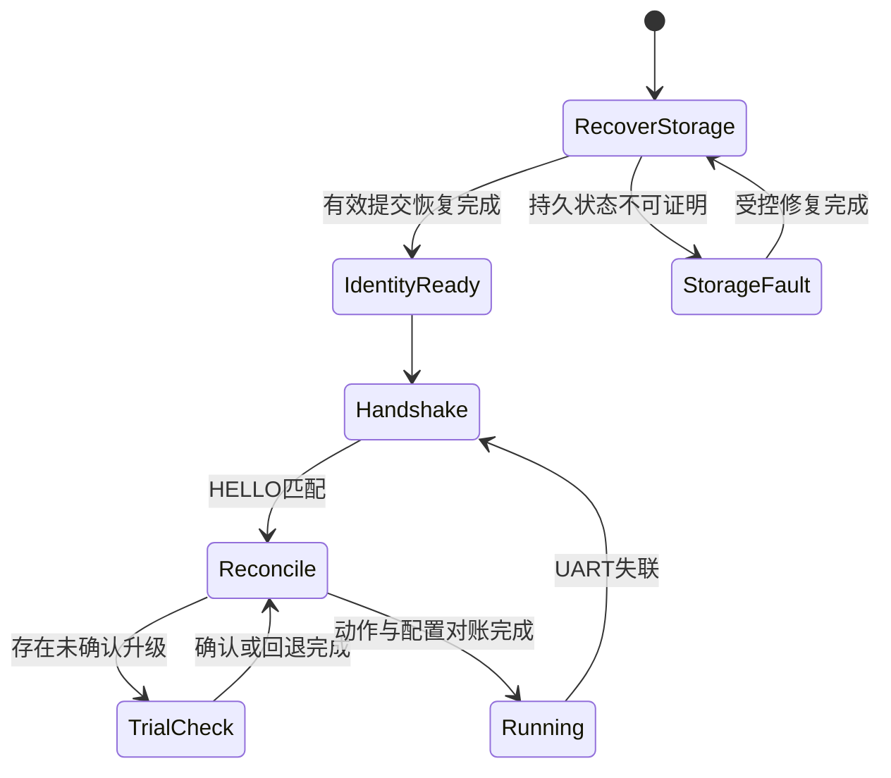

# GW32 ESP32-S3 开发指南

| 项目 | 基线 |
| --- | --- |
| 文档版本 / 日期 | 1.1 / 2026-11-19 |
| 输入需求 | [ESP32-S3 需求规格](esp32s3-requirements.md)：170 条需求、44 个验收用例 |
| 对接对象 | nRF54L15 应用 0.2.0；UART 协议 1.1、线上 frame version=1；服务器既有 1.0/1.1 消息 |
| 当前状态 | 设计已形成，ESP工程和平台配网扩展已有源码；验证状态见固件VALIDATION |
| 配套文档 | [本地与远程配网](esp32s3-network-provisioning.md)、[持久化与恢复设计](esp32s3-persistence.md)、[验证计划](esp32s3-validation-plan.md)、[文档维护约定](README.md) |

本文把需求转为模块、接口、状态、恢复算法和开发步骤。2026-11-19已新增[固件工程](../firmware/esp32s3/README.md)；以下逻辑模块和拟议接口保留设计职责，实际组件合并、API及容量以源码和[实现决策](../firmware/esp32s3/IMPLEMENTATION.md)为准，测试证据见[验证记录](../firmware/esp32s3/VALIDATION.md)。设计中的名称不自动成为同名C接口或测试入口。线上字段仍以 [UART 协议](../server/docs/gateway-uart-protocol.md)、[服务器协议](../server/docs/gateway-protocol.md) 和两份 JSON Schema 为准。

## 1. 开发约束与技术决策

| 类别 | 决策 | 落地要求 |
| --- | --- | --- |
| 工程框架 | 使用 ESP-IDF 组件工程、FreeRTOS 和 C；协议/算法核心保持可主机编译 | IDF、工具链及所有第三方组件在 M0 锁定；不在文档中假定已安装 |
| BLE Host | 优先评估 ESP-IDF 支持的 BLE Host，最终选择必须覆盖扫描、广播与所需 GATT | 选择结果、版本和共存压力数据记入 Markdown 决策记录；不同时维护两套未经验证路径 |
| 芯片通信 | 一条 UART1，单控制请求，异步 RX/TX/持久完成事件 | 重用协议向量，不使用通用 AT 命令替换已有二进制协议 |
| 存储 | 单一写入者、追加事务、提交后确认、恢复后重建索引 | 具体记录/根/GC 契约见持久化文档；NVS 只适合的对象才放入 |
| 外部 JSON | 有界解析、严格字段、无损整数、持久保存服务器摘要 | 不对含 desiredRevision 的最终命令重新计算原 TaskRequest 摘要 |
| 业务并发 | 一个网关任务执行所有者；UART、接管、网络和存储继续独立推进 | 不能把一次 30 s DFU 响应等待写成阻塞整个主循环 |
| SDK / 板版本 | 未冻结项显式保留 | 不猜 CH390H 引脚/驱动版本，不把 Oct29 板定义自动用于新 PCB |
| 文档 | 后续新增和更新的项目说明统一 Markdown `.md` | JSON/YAML/CSV 等机器契约或真实配置保持其原生格式，不把它们误改为文档 |

ESP-IDF 的组件模型和 `idf.py` 构建入口用于组织目标工程；FreeRTOS 的核亲和、栈参数和同步 API 必须按锁定的 IDF 版本核对，不能套用其他 FreeRTOS 移植的默认约定。[组件构建](https://docs.espressif.com/projects/esp-idf/en/stable/esp32s3/api-guides/build-system.html) · [IDF FreeRTOS](https://docs.espressif.com/projects/esp-idf/en/stable/esp32s3/api-reference/system/freertos_idf.html)

## 2. 计划工程结构与依赖方向

以下是设计时的逻辑目录；当前实现把配置/存储/网络合并到gw_core，把无线动作和升级合并到gw_actions，其他实际组件见固件README；目录中的说明和验证记录均为Markdown。

```text
firmware/esp32s3/
  CMakeLists.txt              工程入口
  sdkconfig.defaults         已冻结功能默认值
  partitions.csv             经容量核算的实际分区
  dependencies.lock          组件依赖锁定
  main/app_main.c            仅装配组件与启动流程
  components/
    gw_board/                板版本、UART/Ethernet、受控复位适配
    gw_types/                内部类型、无损整数、字节序
    gw_codec/                COBS、CRC32C、UART字段与JSON映射
    gw_uart/                 驱动事件、RX解码、完整帧TX
    gw_nrf/                  会话、请求缓存、能力和控制调度
    gw_store/                事务、对象、恢复、GC、配额
    gw_capture/              来源归一化、待定观测、事件定稿
    gw_clock/                单调映射、UTC质量和deadline
    gw_cloud/                MQTT/HTTPS传输与应用ACK
    gw_network/              last-good/candidate及接口绑定
    gw_provision/            本地热点、离线网页、Security2会话与限时授权
    gw_credentials/          凭据安全存储、引用及远程安装回执
    gw_commands/             任务journal、路由、结果
    gw_radio/                本机BLE、nRF目标与资源协调
    gw_gatt/                 连接、发现、动作和断链映射
    gw_peripheral/           手机本地inbox、认证/业务路由入口
    gw_ota/                  GATEWAY/NRF54升级编排
    gw_diagnostics/          指标、日志、看门狗与恢复原因
  tests/host/                纯算法与替身测试
  tests/target/              SDK/驱动测试
  tests/hil/                 实板夹具适配
  README.md                  实际构建和烧录说明
  VALIDATION.md              实际运行记录
```

依赖方向：驱动/编解码产生内部事件，业务提交状态变更和存储请求，完成事件返回原所有者。`gw_store` 不调用 BLE、网络或 UART；`gw_codec` 不调用任何驱动；`gw_cloud` 不直接触发 reset/GATT/OTA。避免命令模块与底层回调相互同步调用。

可复用 nRF [gw_core.c](../firmware/nrf54l15/src/gw_core.c) 中的帧/字节序算法及黄金向量；不能把其中的 nRF RAM FIFO 当作 ESP 持久队列，也不能把 Zephyr API 带入 ESP 编译单元。首次复用先做字节级对照测试并明确维护位置，避免两个不一致的协议副本。

## 3. 任务、所有者和缓冲

### 3.1 执行上下文

| 所有者 / 建议任务 | 唯一可修改的状态 | 工作方式 |
| --- | --- | --- |
| uart_io | RX 解码器、当前 TX 缓冲/偏移 | 驱动事件触发；不等待 Flash/网络 |
| nrf_session | link_id、msg_id、挂起请求、重试定时器 | 单请求状态机；与 RX 数据接管并行 |
| store_writer | 持久根、事务序列、对象版本、空间分配 | 独立事务队列；回调仅投递完成消息 |
| capture_owner | 待定观测索引、配对候选、定稿预约 | 事件驱动 + 最早到期定时器 |
| command_owner | 活跃任务、阶段、资源预约、结果序列 | 只接受有 journal 的副作用意图 |
| network_owner | 接口状态、候选验证和路由选择 | 网络事件触发；probe 带接口上下文 |
| provision_owner | SoftAP窗口、网页会话、已认证本地请求 | 不直接改STA；经network_owner提交候选，凭据交安全存储 |
| cloud_owner | 传输会话、批次发送、ACK匹配 | 消费持久快照，ACK回到store提交 |
| radio_owner | 本机BLE状态、nRF目标/实际状态快照 | 回调只投递事件，不在回调做整任务 |
| ota_owner | 当前组件、升级阶段、剩余预算 | 只在 command_owner 授予维护租约后运行 |

表中是所有权，不要求每行都创建独立任务。M0 可合并轻量状态机，但必须证明合并后没有阻塞接管/控制。优先级先按“驱动/ACK → 控制与存储完成 → 定稿/业务 → 后台上传与诊断”验证；数值优先级、栈大小和核亲和在目标测量后冻结，不预设所有任务固定某一核。

### 3.2 缓冲与压力起点

| 对象 | 初始设计 | 满/失败处理 |
| --- | --- | --- |
| UART RX ring | 建议从 8192 B 起测；协议帧上限不改变 | 保持硬件流控，统计overflow，按分隔符重同步 |
| 完整 TX 帧 | 独立不可变缓冲，单帧容量至少3109 B；业务与控制有配额 | 驱动完成/取消确认后才能复用 |
| 控制请求 | 1 个在途槽，保留完整请求字节和期望响应 | 新请求排队/拒绝，不覆盖旧缓存 |
| nRF 在途批次 | 1 个逻辑接管事务；重复帧仅验证身份并合并等待 | 没空间 BUSY，不每次重传复制新持久记录 |
| 双射频待定区 | ≤256条且≤128 KiB，双上限先到者生效 | 有spool空间则单独定稿；否则nRF BUSY，本机按策略计数/暂停 |
| 存储请求/完成 | 有界队列，预留控制、结果与ACK持久化空间 | 普通观测不能耗尽恢复事务配额 |
| 上传序列化 | 按记录和字节双门槛切批，建议流式Base64/JSON | 不为最大HTTP消息预分配多份1MiB缓冲 |

8192 B 是实现起点而非“已经够用”的结论。容量预算同时计算内部RAM、PSRAM、TLS/BLE峰值、栈、Flash索引和序列化；PSRAM不提供掉电持久性。预留配额和GC规则由持久化设计统一管理。

## 4. 内部接口契约

下表是计划 API 契约，不是已存在的 C 声明。实现可以调整命名，但必须保留接受、持久完成、执行完成三个不同结果。

| 接口 | 输入 / 所有权 | 返回与完成事件 |
| --- | --- | --- |
| uart_send_frame | 不可变帧引用、tx_token；提交成功后驱动层持有到完成 | QUEUED仅排队；TX_DONE/TX_ABORTED后调用者才可复用 |
| nrf_request_submit | opcode、不可变args、deadline、retry类别、owner_token | BUSY不接纳；接纳后恰有一次匹配完成，超时分类为未证实 |
| store_submit | 事务ID、对象更新/版本前提、不可变载荷引用 | QUEUED不是持久成功；COMMITTED包含提交身份；失败不回CUSTODY |
| custody_accept | boot/batch/序列/type/SHA及完整记录 | COMMITTED或已提交重复才允许CUSTODY；待提交重复共用同一事务 |
| observation_finalize | 一个/两个待定对象的键与版本、定稿数据 | 原子生成eventId并消费输入；冲突返回重读，禁止重复定稿 |
| command_accept | 原命令、服务器requestDigest、当前身份 | 持久ACCEPTED后才对外报告；重复返回现有记录 |
| result_enqueue | 不可变线上结果与任务结果序列 | 持久后交cloud；结果内容已提交后不重新生成observedAt |
| radio_acquire | 任务、角色、controller、是否授权维护、deadline | 资源预约成功不代表无线角色已切换；完成后单独读回 |
| ota_start | 已验证制品引用、组件、任务、租约 | 只进入状态机；最终结果须有运行镜像/确认/健康证据 |
| network_candidate_submit | 来源、完整network、credentialRef、预期networkGeneration/localRevision或云任务 | 唯一租约和CAS；本地transactionId与云taskId分开，提交结果按来源生成 |
| credential_install | 受保护会话/TLS收到的秘密、设备/SSID/安全模式绑定 | 安全持久提交后才返回引用/INSTALLED；原始秘密不进普通日志或任务outbox |

所有跨任务引用使用明确的 retain/release 或移动所有权，禁止保存回调栈指针。提交失败由调用方释放；提交成功由接收方在恰好一次完成事件后归还。取消请求只表示取消等待或尚未执行的队列项，不能断言已发出的物理操作被撤销。

局部错误如 QUEUED、STORE_FULL、LOCAL_DEADLINE 仅内部使用；发往 UART/服务器时转换为已有协议允许的状态和错误，不能把内部枚举直接复制到线上。

## 5. 启动和时间管理



1. 初始化最低必需外设，保持 nRF reset 释放；不在普通 ESP 启动中无条件复位 nRF。
2. 恢复最新有效持久根、尾事务、身份、各配置组、事件、批次水位、动作/结果和升级journal；损坏隔离不能伪装空库。
3. 持久分配本次espBootId。旧事件继续使用原ID；当前计数与事件创建同事务推进，溢出不复用。
4. 网络与UART可并行建立，但存储未就绪不得CUSTODY。新link_id握手比较nrfBootId；同启动保留旧操作/批次，新启动使旧连接和映射失效。
5. 先恢复试运行决策，再查询旧GATT动作/连接，最后恢复普通配置。对无法证明的副作用保存UNKNOWN，不“重新执行以验证”。
6. 正常上报/任务执行需要可用时间。没有可信UTC时仍可接管UNSYNCED事件；status/result先保留内部观察，建立时间后按真实观察/对账时刻构造必填observedAt。

维护三种时间：`mono_ms`（本次ESP启动内deadline）、nRF采集单调时钟映射、UTC锚。时间锚带两端启动ID、采样时刻、RTT与误差；TIME_PROBE样本必须未重试且扣除nRF处理时间后的净RTT在0～50 ms。用于某观测的锚须满足其capture_ms距锚≤60 s；不能用新锚给久积压观测强行校时。UTC跳变重建锚，已定稿事件不变。

任务在可信UTC下把expiresAt映射到本启动的单调deadline；GATT还取timeoutMs的较早截止。校时变化后重新审查，但不得让已过期任务重新有效或扩大既有操作预算；ESP重启后不能继续使用旧mono deadline。可信时钟引导与证书策略属于M0待冻结项，不通过禁用TLS校验解决。

## 6. UART 会话状态机与调度

| 状态 | 允许处理 | 离开条件 |
| --- | --- | --- |
| DOWN / HELLO_WAIT | HELLO重试、接收解码、旧会话丢弃 | 匹配HELLO响应后进入IDLE |
| IDLE | 提交一个新控制请求、ACK、状态/时钟轮询 | 有控制请求进入SENDING |
| SENDING | RX数据/ACK队列继续运行，不提交新控制 | 完整帧TX_DONE后WAIT_RESPONSE；TX失败先取消/排空 |
| WAIT_RESPONSE | 只匹配当前响应；数据批次持续接管 | OK/错误交回owner；超时同ID同内容重发 |
| RECONCILE | 新link_id HELLO后按业务证据查询 | 查询证明状态后恢复或交UNKNOWN |

普通响应等500 ms、最多重发两次；DFU等30 s，按任务及试运行剩余预算截短等待。未解决请求期间不插入GET_STATUS或TIME_PROBE，以免覆盖nRF最近响应缓存。明确BUSY后旧请求已终结，退避再分配新msg_id；未受理的GATT动作仍用原op_seq。

出队、首次发送和每次重试前重检任务截止；到期后不再重发可能首次触发副作用的请求。保留未证实记录，结束普通重试后按操作身份查询已受理证据，必要时UNKNOWN收尾。重建会话或查询不是延长原业务授权；恢复清理的独立预算不能用于继续写入、READBACK或开始新升级。

ACK与控制msg_id独立。ACK按持久完成产生，UART调度器优先发ACK和握手；发送中的完整帧不可被字节级抢占。RX缓冲中的旧link帧和迟到响应不能推进当前状态。相同link_id的HELLO重试不清普通缓存，新link_id才清缓存，但不清nRF业务RAM。

失联后的恢复必须区分业务：配置查询revision/完整配置/状态，GATT查询op_seq，DFU查询session+状态+大小+SHA+启动ID。Peripheral没有独立tx_seq结果查询命令，只可同tx_seq同内容请求回放最近受理结果，业务执行仍靠应用应答。未知副作用不能通过换新msg_id、op_seq或session直接重做。

轮询只在控制槽空闲时插入：GET_STATUS初始每2 s；有Central登记时额外0x09，必要时0x0A；Peripheral用0x0D；TIME_PROBE每30 s。一次长请求使轮询延后，不把延后的轮询补成洪峰，也不把未轮询视为对端已断开。

## 7. 从 UART 接管到双射频定稿

### 7.1 接管入口

```text
valid_frame(type=20/21/22)
  校验整个批次结构、启动身份、序列、type和摘要
  若早于最近持久批次 -> 忽略
  若等于最近持久批次且完全相同 -> CUSTODY
  若等于待提交批次且完全相同 -> 合并等待，不另起事务
  若冲突/跳号/结构非法 -> 持久故障原因，FAULT
  若不能预留足够事务/后续恢复空间 -> BUSY(250..5000)
  否则 -> 提交观测/本地inbox及批次水位事务
  只有 COMMITTED -> CUSTODY
```

等待存储时若ACK定时预算将到，可返回BUSY；事务后来完成仍按同一批次身份确认。存储完成回调必须匹配boot/type/batch/事务ID，不能用过期link_id发送；会话已切换时等待当前会话重放并回放持久结果。出现新nrfBootId不删除旧启动已经持久接管的事件。

0x20进入观测定稿；0x21保留捕获时连接身份进入GATT事件；0x22进入本地应用inbox，不能塞入不存在的RawEvent类型。三者共用nRF序列，不能按type各自从1计数。

### 7.2 合并算法

单个capture_owner按照持久入队序维护有界索引。定稿时先预约输入对象版本，存储提交成功前不从索引永久删除，也不把它们再分配给第二个配对事务。

```text
到达最早150ms到期点:
  取最早到期且未预约的观测a
  若只有一个扫描源或上下文/时钟不可比较 -> 单条定稿
  否则在未预约异源观测中筛选相同完整匹配键
  再筛选 abs(mapped_time_a - mapped_time_b) + error <= 50ms
  按 时间差升序、持久入队序升序 选择b
  有b: 以nRF为主，observedBy=[NRF54,ESP32]，原子消费a+b
  无b: 单条定稿
  eventId和事件内容在同一次事务创建
```

单源直接定稿；双源待定区满时，有spool空间则单条定稿，否则nRF BUSY，本机新增观测按明确损失策略计数。ESP重启后失去旧时间映射的待定观测逐条定稿；不根据先后到达网络包重新配对。实现和掉电证明见持久化文档。

## 8. 云端适配与任务执行

### 8.1 解析与发送

输入JSON采用有界token解析或能保留整数原始字面的等效实现；revision、sequence和计数不得先转换double再截回u64。检查UTF-8、字段集合、数组上限、Base64和数值范围后才分配业务对象。不得只依赖云端已经校验而跳过设备边界。

MQTT与HTTPS共享同一持久对象和结果队列。每个发送尝试带传输实例ID、身份、batch/result关联和deadline，响应只能推进对应对象。MQTT PUBACK只更新传输统计，不能触发事件回收。设备身份不随接口、IP或重连改变。

| 流 | 版本与匹配 | 持久后动作 |
| --- | --- | --- |
| 事件 | IngressBatch/ACK 1.0或1.1；namespace/gateway/batchId和逐条eventId | RAW_PERSISTED且item ACCEPTED/DUPLICATE后提交本地接管状态 |
| 结果 | TaskResultBatch/ACK 1.0；namespace/gateway/taskId/resultId，无结果batchId | RESULT_PERSISTED且item ACCEPTED/DUPLICATE后标已交付，保留防重墓碑 |
| 状态 | GatewayStatus 1.0，严格已有字段 | 不作为事件/任务接管证据；firmwareVersion是ESP版本 |
| 命令 | Command 1.0，taskId+requestDigest | 原命令和ACCEPTED持久后才报告受理 |

上报默认64条或250 ms，按upload调整，但线上每批≤200条、原始字节≤256 KiB、HTTP JSON≤1 MiB。使用实际序列化字节预算，不能仅按记录数切批；同批不混schemaVersion，重发不改变已定稿对象。永久拒绝隔离、可重试拒绝退避、ACK缺项继续保留。

### 8.2 任务执行器

```text
receive -> validate_identity_schema_capability_ttl
        -> lookup(taskId, requestDigest)
           duplicate: replay durable progress/result
           conflict: reject and record
           new: commit ACCEPTED with original command
        -> reserve required resources
        -> commit EXECUTING intent + child operation mapping
        -> perform one bounded step
        -> record evidence / next stage
        -> commit immutable terminal result
        -> deliver until RESULT_PERSISTED
```

requestDigest是服务端原TaskRequest的摘要，保持服务器给出的值作为绑定；不能对追加desiredRevision后的Command重新序列化计算。结果resultId/resultSequence/observedAt/details一旦持久即不可变。没有可用UTC时先保存本地事实，待真正观察/对账时构造合法结果，不能发送缺失observedAt的消息。

网关仅一个业务在途任务；UNKNOWN保留资源与证据供对账，允许诊断而不放行新副作用任务。现有云端没有下发CANCEL：过期只停止尚未执行的后续业务，已发写入/试启动须按真实状态恢复。REBOOT必须在真实ESP重启后以新bootId完成，不能用改字符串模拟成功。

## 9. 配置事务和 revision

每组保存四个概念：`committed_target`（已提交完整目标）、`pending_patch`（服务器原补丁）、`pending_target`（合并完整候选）、`actual_snapshot`（驱动/芯片读回）。目标与实际状态分开；PAUSED/FAULT不能靠覆盖目标抹去。

1. 根据任务决定network、单radio扫描组、单radio广播组或旧版组；拒绝跨组混合。
2. 在上次完整快照合并patch；数组和ipv4对象整体替换。`radios.<target>.filters.minRssi=null`可以清除，旧顶层filters不接受null。
3. 检查合并后的模式/能力/互斥，持久patch、完整候选及desiredRevision；不自造revision。
4. 调用nRF或本机驱动，等待实际完成，读回配置和状态。
5. 成功时原子推进本组快照与配置成功结果；details.configuration仍回显原patch，量化结果放effective。

掉电恢复时：nRF实际revision/内容等于待提交候选且可核验，则完成原事务；仍为旧快照则按是否已执行和任务时效恢复；出现无法解释的版本/内容进入对账。不能把旧revision重新发送当回滚，也不能为临时停扫使用`revision+1`占用未来服务器版本。

服务器普通configuration GET只返回最近patch；另有管理configuration/effective合并verified patches，但complete=false，不是完整设备实况，设备身份不能调用管理接口。设备存储全失时没有现成的设备全量恢复API，须受控重新配置/重放。恢复nRF复位后的已提交目标可重发原生效revision，因为nRF已进入新的启动周期；同一启动内冲突则不能靠覆盖解决。

## 10. 网络候选配置状态机

两种入口共用network_owner、参数校验、租约、networkGeneration CAS与回退存储。下述probe TaskResult流程专用于**平台CONFIGURE任务**；本地网页使用独立transactionId/localRevision和挑战验证，详细接口及安全会话见[配网设计](esp32s3-network-provisioning.md)。

`STABLE → CANDIDATE_DURABLE → PROBING → WAIT_PROBE_ACK → COMMIT → STABLE`；未提交时失败/重启走`ROLLBACK_LAST_GOOD`。候选窗口最多120 s，并受任务有效期限制。

建议候选探测先使用绑定接口的HTTPS等价结果入口，即使正常上报使用MQTT，也避免复用旧接口会话。具体绑定API在锁定IDF后验证；源地址配置、路由、DNS、TLS与应用应答均须可证明走被测接口，不能只填interface字符串。

| 阶段 | 实现要求 |
| --- | --- |
| 持久候选 | 保存last-good、candidate、desiredRevision、需要验证的接口集合和deadline；不删除旧spool |
| 选接口 | 验证候选首选接口，以及列入uplinkOrder且配置变化的接口；每个接口独立探测 |
| 探测 | 获得真实链路/IP、必要DNS、TLS及服务器身份可用证据 |
| 发probe | 持久稳定resultId的EXECUTING/NONE结果；details.networkProbe包含interface、candidateRevision、linkReady/ipReady/dnsReady/tlsReady，四个ready为true |
| 应用接管 | 在绑定接口连接收到对应RESULT_PERSISTED ACCEPTED/DUPLICATE；持久记录该probe已交付 |
| 提交 | 所需probe均已由服务器此前事务接管，再原子提交本机candidate并生成新的SUCCEEDED/VERIFIED结果 |
| 失败 | 提交前恢复last-good、保存失败原因，联网恢复后报告；提交后重启继续新配置 |

**不能把首次probe与SUCCEEDED放进同一个结果批次来绕过门槛。** 当前服务器要求probe已在先前事务持久化；同批首次提交会被拒绝。服务器校验结果字段不等于已经证明物理接口绑定，该证明由实板抓包/路由证据完成。[服务端校验](../server/internal/platform/control_gw32.go)

常规主备切换只选已提交且验证过的接口，使用防抖和有界重连；Wi-Fi扫描是诊断动作，不改变BLE过滤配置。credentialRef由本机安全存储解析；安装失败或引用缺失在切网前拒绝。

### 10.1 本地网页与首次离线部署

gw_provision提供限时SoftAP及手机/笔记本浏览器页面，静态资源全部本地，秘密和控制经protocomm Security2认证加密。默认窗口10min/空闲5min/单次硬上限30min；具体开窗硬件和浏览器适配先冻结再实现。AP+STA信道变化和网段冲突须支持重连后查询同一事务，不能因网页断线重新提交。

本地在线配置验证候选各必要接口的TLS、设备身份和新鲜平台挑战后才提交；本地没有云任务，不能伪造TaskResult或推进desiredRevision。用户明确选择LOCAL_ONLY可持久保存activeLocalSnapshot和未验证状态，保留lastVerified与旧凭据。网络实际可达、配置已保存、平台已同步分别显示；失败不自动降级成离线成功。

### 10.2 远程凭据与本地改动对账

平台新增秘密接口经TLS接收并加密存储密码，设备私有领取、加密持久安装并回执后，现有CONFIGURE才引用credentialRef。该扩展没有现成实现，不能在当前network Schema私加password。

所有网络提交推进networkGeneration，本地另推进localRevision并设置localOverride；config/network保留平台确认快照，network/current独立记录实际本地来源，不把本地改动伪装成平台revision。恢复在线先上报本地状态，管理员明确ADOPT_LOCAL或APPLY_PLATFORM后生成带generation/快照前置条件的正常任务，完成probe/ACK再清除对应override。扩展未实现时阻止陈旧远程网络任务覆盖本地改动，不能伪称已对账。

## 11. 无线资源与广播控制

### 11.1 资源租约

租约是ESP内部持久任务归属，不是新线上字段。申请按统一顺序完成，缺任一资源就释放预约/退回BUSY，不持锁等待网络或Flash。

| 操作 | 资源 | 当前可接受组合 |
| --- | --- | --- |
| 扫描/广播配置 | 对应radio配置组 + UART控制步 | nRF扫描与广播互斥，不能暗中停止另一目标 |
| Central动作 | 连接所有权 + 单GATT动作 + UART控制步 | nRF自身按已保存扫描目标暂停/恢复；广播或Peripheral冲突需明确协调 |
| NRF54 OTA | 网关升级租约 + nRF维护 + 制品暂存 + 每次UART控制步 | 不与ESP OTA、网关REBOOT、网络候选试用并行 |
| GATEWAY OTA / REBOOT | 网关维护 + 存储恢复兼容性 + 当前nRF义务对账 | 不打断nRF传输、READY处理或试启动确认 |
| 网络候选 | 网络配置事务 + 指定接口探测 | 不影响已有spool接管，不与升级切换并行 |

“UART控制步”仅在请求在途时占用控制槽，不能把整个OTA流程占成不可处理数据ACK的全局锁。nRF试运行确认义务是恢复阶段的高优先事项；不能因服务器任务状态变化就启动ESP重启打断它。

### 11.2 广播实现

服务器的mode表示链路属性，iBeacon/Service Data是AD内容。严格Base64解码并验证完整AD结构，各段≤31字节；不可扫描模式要求空ScanRsp。按既有舍入公式`(ms*8+2)/5`转换0.625 ms ticks并无损编码revision。

- nRF有bit10：仅enabled变化可0x0B，状态0x0C；否则使用完整0x07并0x08/0x09读回。
- 同模式/间隔仅变载荷交给nRF在线更新，失败恢复由nRF处理后读回；不假定两次AD/ScanRsp写入空口原子。
- 模式/间隔变化可能重启广告，任务结果必须报告实际状态和错误；本机BLE走等价适配器。
- 可连接模式要求该目标的ADV+PERIPHERAL能力；手机已连时PAUSED可以正常，enabled=false不等于断开手机。
- 恢复配置来源只能是原持久目标或后续服务器配置任务；不创造临时revision。nRF BEGIN的维护暂停和Central自暂停不修改配置revision。

ESP自己的BLE扫描/广播必须有独立驱动验证和能力声明；不能因nRF支持而授予ESP32_BLE_PERIPHERAL。Wi-Fi共存参数与扫描空档归入压力验证，不在此承诺同步双扫描无损。

## 12. GATT 和 Peripheral 适配器

### 12.1 GATT 动作链

每个动作保存`taskId/digest/controllerBootId/op_seq/opcode/完整请求/阶段/剩余预算`。op_seq按控制器启动周期单调、不复用；终态先持久再发下一动作，因为nRF仅保留最新动作。

```text
已有connectionRef -> 核验活连接、radio、地址和发现缓存
无connectionRef的临时READ/WRITE -> 连接 -> 服务/特征发现 -> 读/写/验证 -> 断开
自动CONNECT -> 核验本地新鲜nRF ADV -> 连接 -> FIND_SERVICE -> 按需DISCOVER -> 连接信息核验
所有步骤 -> 共享任务deadline -> UART受理 -> GET_OP_RESULT -> 持久终态
```

单动作timeout_ms从任务剩余预算计算，且满足协议100～30000 ms；剩余不足100 ms时不开始新动作，不强行向上取整延长任务。写入只WITH_RESPONSE且1～min(512,MTU−3)，句柄必须来自本连接发现；READBACK仍在同一预算内。APPLICATION_REPLY当前服务端拒绝。

连接失败、服务不符或任务预算耗尽后，由恢复路径清理临时/未完成的连接，使用单独有界的清理预算。先尽可能查询并持久保存原动作证据或UNKNOWN，再断开并等待资源回收，避免先断连破坏写入结果。此预算仅用于停止/断开和状态核验，不延长业务成功期限；如果链路不可用，保持待恢复标记并按板级恢复策略处理，不遗忘占用。

断链检测用空闲控制槽轮询0x09，必要时0x0A；保持连接快照以便已入队Notify引用原connectionRef。发现失效后，原子记录GATT_LINK_DOWN及连接/订阅失效；重复轮询不重复生成同一关闭事件。0x03不包含连接状态。

ESP重启但nRF仍活时，先GET_OP_RESULT对账旧动作再关闭遗留连接；不可先断连毁掉可读证据。已发写入在复位/超时后无法证实时为UNKNOWN，不以新op_seq重写。自动连接证据按既有30 s窗口独立保留，即使对应平台事件已ACK也不能提前删。

### 12.2 Peripheral 路径

0x22数据先持久到独立inbox，键包含nRF启动、角色、peripheral_conn_id及采集身份；不能把channel=1当GATT句柄。认证/授权/重放防护之后才进入业务适配器。当前没有云端RX事件类型或公开回复任务，这一适配器在协议补齐前保持受限状态。

回复持久业务事务与tx_seq再调用0x0E；同seq同内容可回放最近受理，不存在GET_TX_RESULT。断连/确认丢失时不自动分配新seq重做业务。手机ATT Write Response仅说明nRF RAM接收，Notify OK仅说明栈受理；业务送达需应用ACK。

公开通道须有配额，避免未认证输入长期占满与扫描共用的nRF FIFO。接管后可以把非法业务按明确策略标为已处理/隔离，但不能在事务持久前假CUSTODY；存储不足用BUSY或受控断开，不凭空添加暂停/清队列opcode。

## 13. 两种升级执行器

### 13.1 共同入口与制品缓存

component省略或GATEWAY走ESP自身升级；NRF54走nRF UART；不定义component=ESP32。制品只从该设备有效任务允许的下载入口取得；先验证原始UTF-8 manifest字节的签名，再校验解析出的组件/型号/硬件/版本约束和下载文件SHA。HTTP摘要头不代替本地计算。

制品实体和元数据分开：实体先完整写入并校验，之后事务发布“已验证可使用”的引用。临时下载文件不得冒充已验证缓存；断电后从可证明的文件状态恢复，不把接收字节计数当完整制品。nRF镜像必须完整暂存在ESP，ESP自身OTA可使用选定IDF的非运行槽下载接口，但启动切换前必须完成全部验证。

### 13.2 NRF54 状态机

| 内部阶段 | 动作 | 必须落盘/核验的内容 |
| --- | --- | --- |
| VERIFIED_ARTIFACT | 检查HELLO bit12、可用容量、当前运行已确认和授权期限 | 文件引用、task/digest、版本、size/SHA、nrfBootId |
| MAINTENANCE | 获取升级租约，按授权关闭冲突连接，BEGIN进入保持目标的暂停 | 业务恢复目标、session、BEGIN意图；不能自造配置revision |
| TRANSFERRING | 连续CHUNK，最大1024 B，首块至少32 B；数据ACK仍运行 | 当前会话、最后块内容身份、接纳偏移与阶段 |
| READY | FINISH刷写/读回、设置TEST；接管剩余FIFO | READY证据；外部复位也可能试启动 |
| REBOOT_REQUESTED | 持久重启意图，再0x35；受理后约1 s重启 | 旧boot、期望镜像、任务时限、已接管水位 |
| TRIAL_CHECK | 新HELLO、状态、版本、健康检查，0x37运行镜像核对 | 新boot与实际镜像验证证据 |
| CONFIRMING | 0x36后读0x33 running_confirmed=1 | 确认结果、实际版本/启动/SHA |
| RESULT_PENDING | 持久SUCCEEDED/VERIFIED，重发至应用ACK | 任务结果与交付状态；不再重新升级 |

BEGIN不是删除现有RAM FIFO；开始维护后可一边下载一边接管剩余记录，REBOOT前必须确认安全排空。传输卡住或资源无法排空时，若尚允许ABORT则用原session终止并读回，不静默复位丢数据。

恢复规则必须先看nRF启动ID和DfuStatus：

对同boot的RECEIVING、READY、FAULT、ABORTED和REBOOT_PENDING，先匹配持久journal的session、size和SHA，再执行下表动作；不匹配进入对账，不重启未知候选、不ABORT其他会话。新boot的IDLE按实际运行镜像判断，不要求已丢失的RAM session继续存在。

| 观察 | 恢复 |
| --- | --- |
| 同boot、RECEIVING、session/size/SHA全匹配且offset合法 | 从当前接纳偏移继续；最近块重发字节必须相同 |
| 同boot、READY | 不再发CHUNK；依据任务有效性、FIFO及政策继续启动或明确ABORT |
| 同boot、FAULT | 原session ABORT成功后才能重新开始；失败保持维护并诊断 |
| 同boot、ABORTED | 新任务/允许重试需新session；旧session不可重开 |
| REBOOT_PENDING | 等启动变化；拒绝ABORT，不能无限重发延长倒计时 |
| 新boot、IDLE | 先读running_confirmed、版本并核验实际主镜像；可能试启动、已确认或回滚，不能仅凭IDLE判断失败 |
| 明确旧下载中断且仍为已确认旧镜像 | 任务仍有效并允许重试时，重新BEGIN从0；旧RAM offset无效 |
| 期望镜像实际已确认、结果未交付 | 恢复原成功证据/结果，不重传镜像 |

试运行确认使用nRF的confirm_remaining_ms预算（默认窗口120 s）；UART长等待30 s不代表可无限重试。健康项目在实施前冻结且可在预算内完成；没有有效任务授权、时间判断或健康/镜像证据就不确认。运行主循环超时可复位，挂死按板级受控reset触发MCUboot回退，恢复后核查真实镜像。

成功详情沿用component=NRF54、firmwareVersion、nrfBootId、bootConfirmed、imageSha256。nRF源版本没有独立服务器登记，非空fromFirmwareVersions受当前服务端限制，不能拿ESP版本替代。错误MCUboot签名可能直到启动才被拒绝，不保证FINISH阶段能识别。

### 13.3 ESP 自身 OTA

先核对nRF没有未完成确认义务和不可安全中断的动作，再写ESP非运行应用槽。必须保存升级journal、当前任务及旧格式读取能力。试运行不做破坏性的共享数据格式迁移；新固件失败后旧应用仍须读懂已接管spool和任务日志。

启用并验证锁定IDF的回滚机制；试启动检查存储恢复、身份、UART、关键配置和所需网络功能后才标有效。确认时限是ESP独立设计参数，不复用nRF的120 s。服务器目前对GATEWAY成功主要检查版本/VERIFIED，设备仍需自己的实际启动和运行镜像证据。

只支持应用槽升级，不通过当前任务更新ESP bootloader、分区表、凭据或nRF bootloader。安全启动/加密/eFuse、防降级与救援策略进入制造设计，不能因文档更新自动执行不可逆配置。[ESP应用OTA与回滚](https://docs.espressif.com/projects/esp-idf/en/stable/esp32s3/api-reference/system/ota.html)

## 14. 故障、诊断和发布默认值

| 类别 | 处理 | 必须保存的诊断 |
| --- | --- | --- |
| 传输暂时失败 | 保留原对象和重试身份，有界退避 | 链路、阶段、重试次数、最近错误 |
| 已证实参数/能力不支持 | 任务终态拒绝，不发物理动作 | 原任务、能力交集、拒绝原因 |
| 结果未知 | 阻止新副作用任务并对账 | op/session、最后证据、发出前后阶段 |
| 存储暂满/慢 | 预留控制空间、BUSY、GC或暂停采集 | 水位、写延迟、GC、丢失/隔离计数 |
| 数据冲突/存储损坏 | 隔离、停止不安全接管，不自动清库 | 冲突键、摘要、可恢复根/损坏范围 |
| 初始化/硬件异常 | 降低可用能力，受限诊断 | 板版本、驱动错误、复位原因 |

诊断按现有DIAGNOSTICS详情承载扩展信息，不给GatewayStatus添加未经Schema允许的字段。日志不打印token、密码、私钥、完整认证会话或带凭据URL。记录nRF reset、数据隔离/丢弃、配置回滚、升级确认与回退的原因。

建议首个开发配置默认关闭ESP本机BLE、公开Peripheral业务和自动升级执行，只启用已经完成相应里程碑的能力；这不是削减需求，生产能力清单必须由测试结果决定。扫描/广播目标来自持久配置，不在app_main中写死开机广播。工程中不得把模拟器或主机测试结果标为实板通过。

## 15. 开发任务分解与完成定义

每个开发任务交付源码、针对风险的测试、更新后的Markdown状态记录。阶段验收对应 [验证计划](esp32s3-validation-plan.md)，不是以文件存在判完成。

| 工作项 | 实现内容 | 前置 / 完成定义 |
| --- | --- | --- |
| DEV-01 | 冻结SDK/工具链/依赖/板版本，建组件工程 | M0；干净环境可构建，记录版本/许可证和目标 |
| DEV-02 | BSP UART/Ethernet/复位与资源预算 | DEV-01；引脚来自目标网表、复位不误动作、容量/峰值内存有记录 |
| DEV-03 | 有界编解码与无损JSON整数 | 独立host测试；与现有UART向量一致，恶意输入不越界 |
| DEV-04 | 存储后端、提交/恢复/GC | DEV-01；提交各点故障注入、空间预留及旧根恢复通过 |
| DEV-05 | UART驱动与single-flight会话 | DEV-02/03；半帧/CTS/丢响应/重握手实测 |
| DEV-06 | CUSTODY批次事务与水位 | DEV-04/05；ESP单独掉电不重复接管，整板缺口可解释 |
| DEV-07 | 时间映射、单源定稿和双源配对 | DEV-04/06；确定性边界、旧锚及重启用例通过 |
| DEV-08 | 设备身份、TLS和MQTT/HTTPS传输 | DEV-02/04；真实身份验证、绑定ACK、重连重放通过 |
| DEV-09 | 事件上传与结果outbox | DEV-07/08；逐项ACK、版本分批、隔离/背压通过 |
| DEV-10 | 命令journal/恢复/结果状态机 | DEV-04/08；摘要冲突、UNKNOWN和真实REBOOT证据通过 |
| DEV-11 | 配置合并、revision、实际读回 | DEV-05/10；原patch回显、跨组拒绝、断电对账通过 |
| DEV-12 | 网络候选及接口探测 | DEV-08/10/11；首选/变更接口分别ACK，前后断电回滚通过 |
| DEV-13 | nRF/ESP扫描、过滤和本机回调 | DEV-07/11；两源空口对照与共存压力通过 |
| DEV-14 | 广播三模式、内容/间隔/启停 | DEV-11/13；实际状态、失败恢复及手机连接语义通过 |
| DEV-15 | Central连接/服务/特征/GATT动作 | DEV-05/10/11；时限、发现、UNKNOWN写入和断链事件通过 |
| DEV-16 | Peripheral本地inbox/认证适配 | DEV-04/10及业务契约冻结；无云端契约时不声明云端闭环 |
| DEV-17 | 制品验签/缓存/OTA公共租约 | DEV-04/08/10；错组件/签名/大小拒绝，缓存断电恢复通过 |
| DEV-18 | NRF54 DFU和试运行恢复 | DEV-06/15/17；UART重连/芯片重启/真实MCUboot验签回退通过 |
| DEV-19 | ESP应用OTA和兼容迁移 | DEV-17/18；目标签名、试启动/回滚、旧格式读取通过 |
| DEV-20 | 压力、生产安全与制造/维护说明 | 前述适用功能完成；44场景和所有需求组有证据或明确阻塞，不带未验收能力出货 |
| DEV-21 | SoftAP、离线网页、Security2浏览器客户端和本地网络事务 | DEV-02/04/12；AT-37～41/44，现场授权/无网保存/重连/回退验证 |
| DEV-22 | 本地凭据区与远程秘密安装服务、页面、安装回执 | DEV-04/08/21及服务端扩展；AT-38/42，设备归属、秘密保护、安装后引用 |
| DEV-23 | 双入口版本对账、条件任务及平台差异页面 | DEV-10/11/12/21/22；AT-43，采用/覆盖和陈旧任务竞态，完整Schema与实现同步 |

不能用DEV-18的nRF主机模拟通过替代真实bootloader验证；DEV-19也不能只调用OTA API后就标完成。BLE手机认证/云端契约未冻结时，只能完成安全本地传输子集。

## 16. 构建、联调与CI入口

### 16.1 当前可用参考

- [nRF主机测试](../firmware/nrf54l15/scripts/Test-Host.ps1)及[验证记录](../firmware/nrf54l15/VALIDATION.md)：对照协议向量和nRF行为；不是ESP测试。
- [串口探针](../firmware/nrf54l15/tools/uart_probe.py)：辅助联调，不具备ESP持久spool，不发送CUSTODY；不能替代接管模块。
- [服务器联调](../server/docs/protocol-v11-integration.md)：身份、规则、任务、模拟网络流程；不能证明真实网口和射频。

### 16.2 ESP工程构建入口

当前已存在`firmware/esp32s3/CMakeLists.txt`，SDK锁定v5.5.6。下列命令是构建入口，实际执行结论和环境限制见固件VALIDATION；不能把示例本身当作测试记录。

```powershell
# 在仓库根目录，确认工程真实存在后再运行。
if (-not (Test-Path -LiteralPath 'firmware/esp32s3/CMakeLists.txt')) {
    throw 'ESP32-S3 工程尚未建立；先完成 DEV-01。'
}
Set-Location -LiteralPath 'firmware/esp32s3'
idf.py --version
# 仅首次建立目标时设置；已有配置变更应经版本审查。
idf.py set-target esp32s3
idf.py -B build-gw32 build
idf.py -B build-gw32 size
```

保存实际SDK版本、依赖锁、sdkconfig、分区表、map、镜像大小/SHA和构建输出；不能在需求未冻结时把示例地址、串口或签名密钥写进发布脚本。烧录、整片擦除和eFuse配置分别走明确目标的硬件操作流程。

### 16.3 CI与验收层次

| 层级 | 自动检查 | 输出 |
| --- | --- | --- |
| 文档 | 相对链接、需求/验收引用、文件格式、协议示例 | Markdown检查结论，不伪造设备测试 |
| Host | 编解码、提交/恢复、去重、任务和OTA替身状态机 | 测试报告、随机种子、故障点与回放输入 |
| IDF构建 | 锁定环境目标编译、告警、分区/镜像/内存预算 | 配置、map、未签名或测试签名产物及摘要 |
| 服务端联调 | 真设备适配器或明确模拟器，Schema/ACK/结果时序 | 服务端日志与设备日志关联证据 |
| HIL | 受控板卡、电源、网络、UART、BLE对端夹具 | 44验收场景证据，失败可重放 |
| 发布 | 专用签名环境、兼容性/回退矩阵、能力清单 | Markdown发布记录与可追溯制品 |

已新增[ESP目标构建工作流](../.github/workflows/esp32s3-firmware.yml)和固件目录下的真实主机测试入口。执行结果与环境记录统一保存在[固件验证记录](../firmware/esp32s3/VALIDATION.md)；下表中的服务端实机联调、HIL和生产发布仍需相应设备与证据。

## 17. 未冻结决策与变更控制

| 决策 | 完成前不能声称的能力 | 记录要求 |
| --- | --- | --- |
| IDF/BLE Host/CH390H及板版本 | 目标可构建和实际网口可用 | 版本、来源、许可证、兼容证据、选定引脚 |
| Flash布局/后端/寿命/GC | 离线容量与掉电可靠性 | 分区、记录格式版本、最大镜像、写放大和故障注入 |
| UTC引导与凭据制造 | 安全冷启动和TTL任务执行 | 信任根、时间来源、密钥轮换及恢复流程 |
| BLE Peripheral手机认证/云端数据契约 | BLE手机业务或云端双向闭环 | Schema/权限/业务ACK/抗重放/迁移版本，与Wi-Fi网页配网分开 |
| 本地网页/平台配网扩展 | 安全浏览器配网和双入口网络闭环 | 开窗、制造凭据、浏览器加密与网页信任、秘密投递、对账Schema及实板证据 |
| 绑定预置及维护 | 通用加密配对管理 | 当前仅预置bond；后续命令/工具及授权 |
| 双组件健康与安全版本 | 可生产OTA、硬件防降级 | 健康预算、回滚/救援、密钥与不可逆制造步骤 |
| 峰值负载和停机指标 | 包率、离线时长、共存或恢复性能 | 实测场景、板/SDK/镜像版本、指标与证据 |

任何外部字段、枚举、能力位、opcode或容量语义的变化，先更新两层协议及Schema/实现，再更新需求、开发和验证文档，不能只在ESP代码中私自扩展。需要改变现有需求时写Markdown决策记录并说明影响及迁移，不覆盖旧验证结论。

## 18. 本次文档状态与参考

本指南与配套存储/配网/验证文档定义开发设计；已新增ESP源码和平台扩展，已有部分主机测试证据，尚未完成整机实板验收。实际实现/构建状态见[固件验证记录](../firmware/esp32s3/VALIDATION.md)，产品放行仍以[验证计划](esp32s3-validation-plan.md)和之后真实产生的验证记录为准。各模块对应的170条需求和44项验收覆盖映射由验证计划统一维护。

实际工程锁定ESP-IDF v5.5.6、NimBLE和CH390组件0.4.1；较新的stable网页不改变该编译基线。API/Kconfig使用以下固定版本文档核对：

- [ESP-IDF 构建系统](https://docs.espressif.com/projects/esp-idf/en/v5.5.6/esp32s3/api-guides/build-system.html)。
- [IDF FreeRTOS](https://docs.espressif.com/projects/esp-idf/en/v5.5.6/esp32s3/api-reference/system/freertos_idf.html)。
- [NVS与持久对象边界](https://docs.espressif.com/projects/esp-idf/en/v5.5.6/esp32s3/api-reference/storage/nvs_flash.html)。
- [应用OTA与回滚](https://docs.espressif.com/projects/esp-idf/en/v5.5.6/esp32s3/api-reference/system/ota.html)。

Nordic端接口采用仓库已有nRF 0.2.0源码及UART协议，本次不更改NCS版本、板定义或nRF固件。
