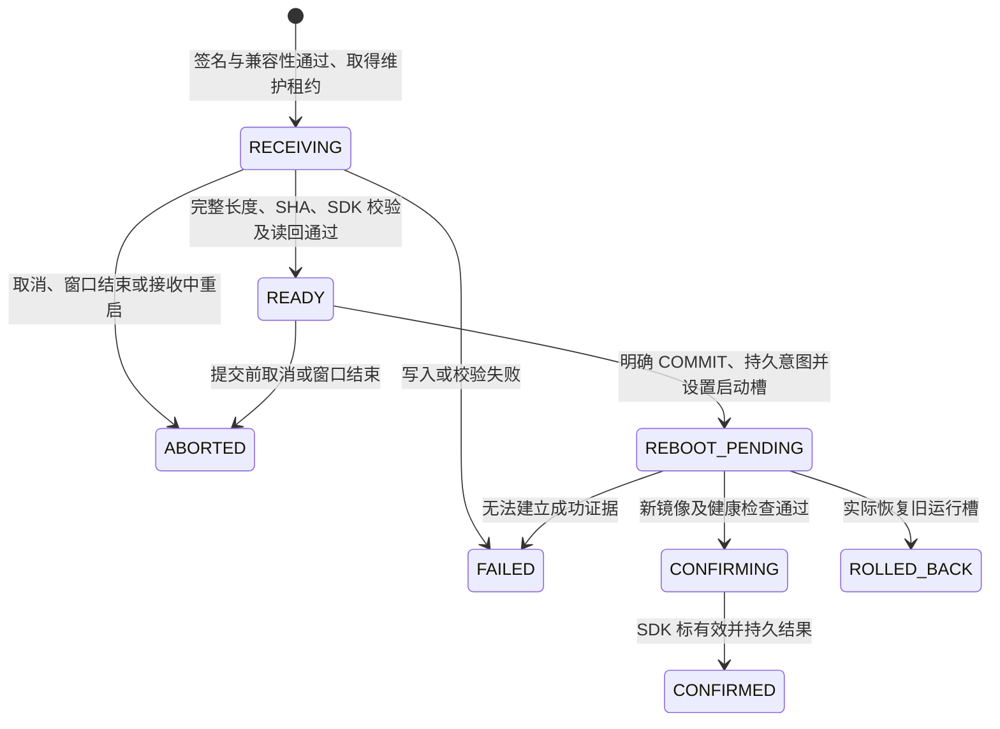

# ESP32-S3 本地与平台远程 OTA 设计及协议

版本：1.0；日期：2026-11-19；实现基线：ESP 固件 0.2.0，ESP-IDF v5.5.6。需求对应 ESP-EOTA-001～020，验收对应 ESP-AT-31/32/45～50；执行证据见[固件验证记录](../firmware/esp32s3/VALIDATION.md)。本文描述代码和交付契约，不表示真实 Flash、手机或断电回滚已验收。

## 1. 两个入口和一个应用升级机制

| 项目 | 本地网页 OTA | 平台远程 OTA |
| --- | --- | --- |
| 发起方 | 连接网关 SoftAP 的手机/笔记本 | 具有任务及固件部署权限的平台用户 |
| 授权 | 限时现场窗口、设备独立 setup 凭据、Security2 | 设备身份、有效 FIRMWARE_UPGRADE 任务、范围权限和 TTL |
| 制品来源 | 浏览器选择 verification.json 与 firmware.bin | 已验签平台制品的 verification/content 接口 |
| 身份 | source=LOCAL，客户端 uploadId | taskId、digest、artifactId、expiresAt |
| 网络依赖 | 上传和试启动不依赖互联网、DNS、UTC、服务器 | 下载及恢复需要有效任务、可信时间、TLS 和可用上联 |
| 完成依据 | 本地 journal 的 CONFIRMED；可重新认证查询 | 真实启动确认、持久 SUCCEEDED/VERIFIED 结果、RESULT_PERSISTED |
| 配置版本 | 不推进 networkGeneration/localRevision/desiredRevision | 升级任务不冒充 CONFIGURE 修订 |

两者均只升级 `component=GATEWAY` 的 ESP32-S3 应用槽。nRF54L15 继续走既有服务器→ESP→UART DFU；本地上传接口不接受 nRF、整机烧录镜像、分区表、bootloader 或任意 Flash 地址。

## 2. 应用分区与信任

| 分区 | 地址 | 长度 | 用途 |
| --- | --- | --- | --- |
| otadata | 0xD000 | 0x2000 | ESP-IDF OTA 启动状态 |
| ota_0 | 0x10000 | 0x280000（2,621,440 字节） | 应用槽 A |
| ota_1 | 0x290000 | 0x280000（2,621,440 字节） | 应用槽 B |

根据实际运行分区选择另一槽，不以固定 A/B 名称推断目标。通过 `esp_ota_begin/write/end` 完成写入及 SDK 镜像校验；完整 Flash 读回 SHA 和应用描述版本一致后才能切换启动目标。制造身份、Wi-Fi 凭据、gwstore、gwspool 及 nRF 暂存分区保持独立。

发行信任公钥由加密制造区 `artifact_keys` 提供，格式为 keyId→32 字节 Ed25519 公钥的 Base64 映射。本地和远程均以其核验原始 manifest UTF-8 字节；用户不能在上传中替换公钥。服务端验签不替代设备验签，HTTP 摘要头和浏览器进度也不是设备成功证据。

应用回滚、Flash/NVS 加密和制品验签具有不同职责。制品签名不自动启用芯片 Secure Boot/eFuse 防降级；硬件安全版本、密钥轮换和救援操作需按制造方案单独完成。本次构建、打包和测试不会烧写 eFuse。

## 3. 共用发行包

本地使用两个文件：`verification.json` 和 `firmware.bin`。平台使用相同 `firmware.bin`、`manifest.json` 及 `signature.txt` 上传制品。不得签名后重排、缩进或改变 manifest 的换行。

```json
{
  "keyId": "release-2026",
  "name": "gw32_esp32s3",
  "kind": "FIRMWARE",
  "component": "GATEWAY",
  "imageFormat": "ESP_IDF_APP_BIN",
  "version": "0.2.0",
  "sizeBytes": 1280000,
  "sha256": "<firmware.bin 全部字节的 64 位小写 SHA-256>",
  "compatibleModels": ["GW32I33V2"],
  "hardwareVersions": ["<实际制造硬件版本>"],
  "fromFirmwareVersions": ["0.1.0"]
}
```

示例长度和摘要是占位说明，不能直接用于升级。版本来自应用 `esp_app_desc`；型号为整机型号而不是 ESP32-S3 芯片名，硬件版本须匹配制造身份。源版本列表为空/省略表示未限制源版本，不能据此宣称有硬件防降级；发行方按实际兼容性填写。

`verification.json` 为 `{ "manifest": "原始完整 JSON 文本字符串", "signature": "64 字节 Ed25519 签名的标准 Base64" }`。签名的是 manifest 字符串解码后的原始 UTF-8 文本，不是外层 JSON 文件，也不是重新序列化后的对象。

在具有 Python 与 cryptography 的发行环境中，从仓库根目录运行：

```powershell
python firmware/esp32s3/scripts/package_ota.py `
  --image firmware/esp32s3/build/gw32_esp32s3.bin `
  --private-key '<仓库外的 Ed25519 PEM 私钥路径>' `
  --key-id release-2026 `
  --model GW32I33V2 `
  --hardware '<实际硬件版本>' `
  --from-version 0.1.0 `
  --output-dir '<尚不存在的发行包目录>'
```

`--model`、`--hardware`、`--from-version` 可重复；`--name` 默认 `gw32_esp32s3`。加密 PEM 可用 `--password-env <环境变量名>` 读取口令，不把口令放在命令行参数。工具检查应用头/描述、ESP32-S3 芯片目标及槽容量，提取真实版本、计算长度/摘要并生成四个文件；完整 SDK 镜像结构验证仍由设备执行。工具不生成密钥、不覆盖已有目录。签名私钥不得复制到包内、网页、服务器配置或 Git 仓库。正式发布前核对构建提交、SDK 锁、签名 keyId 和制造公钥对应关系。

## 4. 本地操作流程

本地功能必须有实际编译并验证的开窗入口。默认 `GW_SETUP_BUTTON_GPIO=-1`、`GW_FACTORY_AUTHORIZED_SETUP=n`，`app_main` 没有开窗调用，HTTP/本地 OTA/网页资源可能被链接器裁除；该默认构建不能证明本地升级已进入最终镜像。正式产品须核实设置按钮 GPIO 或实现其他现场授权入口，并验证重启后的重新开窗路径。

开发/CI 用 [sdkconfig.local-setup-test](../firmware/esp32s3/sdkconfig.local-setup-test) 只开启首次未配网授权：尚无网络且没有 `core/setup-used` 时，持久记录已用标记后尝试一次 600 s 窗口；仍须具备有效制造和认证材料。它不是量产按钮配置，已经使用或已配网设备不能靠重启无限开窗。可用 `Build.ps1 -LocalSetupTest` 构建，完整命令与独立配置要求见[固件 README](../firmware/esp32s3/README.md)。务必使用新构建目录/独立 SDKCONFIG，避免缓存掩盖配置片段；实际链接证据与硬件验证分别记录。

1. 通过已配置的现场按钮或制造授权打开限时热点，连接设备独立密码的 GW32 Wi-Fi，访问其 DHCP 默认网关地址。正常情况下为 `http://192.168.4.1/`；网段冲突时以实际网关地址为准。
2. 使用独立 setup 账号认证。网页资源全部来自设备，Security2 对业务请求/响应加密；手机“此 Wi-Fi 无互联网”不影响操作。
3. 选择签名元数据与应用 bin，开始上传。设备先核验发行签名、兼容性和大小，获取排他维护租约，然后写非运行槽。
4. 页面按设备确认的 offset 更新进度。最后一块完成全部校验后显示 READY；此时旧应用仍在运行，尚未切槽。
5. 用户明确确认安装后提交，设备记录启动意图、设置启动槽并安排重启。提交响应可能因重启丢失，不能据此立即认定升级失败或重复创建新上传。
6. 新应用在 90 s 试启动窗口内完成健康确认。需要再次查看结果时，按现场方式重新打开管理窗口、连接并认证，查询原 uploadId。本地升级不会为等待用户而永久开放热点。

允许在接收或 READY 阶段取消；提交后的启动/回滚属于恢复义务，不能通过“取消上传”抹掉。BEGIN 固定该次授权窗口截止，不因重新开窗延长；上传空闲 5 min 也会终止。首次部署到本地 OTA 功能之前的旧固件，需先通过现有远程 OTA 或受控有线方式安装本版；旧页面不会因新文档自动获得上传功能。

## 5. 本地接口与数据格式

OTA 与配网共用认证后的 `POST /prov-network`；路径名称不改变其 Security2 加密约束。接口仍仅接受 SoftAP 本地连接，检查 Host、Origin、会话、授权窗口、载荷长度及 JSON 深度/重复键。不得增加明文 `/upload` 作为捷径。

请求使用既有信封；字段采用精确大小写：

```json
{
  "apiVersion": "1.0",
  "requestId": "local-request-001",
  "operation": "OTA_BEGIN",
  "expectedNetworkGeneration": "3",
  "baseLocalRevision": "1",
  "body": {
    "uploadId": "local_ota_01",
    "manifest": "<已签名原始 UTF-8 JSON 文本>",
    "signature": "<标准 Base64 签名>"
  }
}
```

网络版本字段仅保持公共信封结构，OTA 不创建或提交网络候选。`requestId` 用于关联响应，`uploadId` 标识固件上传；不能混用配网 transactionId 或云端 taskId。

| operation | body | 效果及重试规则 |
| --- | --- | --- |
| OTA_BEGIN | uploadId、manifest、signature | uploadId 为 1～64 个 ASCII 字母、数字、下划线或连字符；manifest 原文最长 8192 字节。同启动同 ID/相同签名原文可查询并续传；同 ID 不同内容拒绝 |
| OTA_WRITE | uploadId、offset、data | offset 为从零开始的字节整数；data 为标准 Base64，解码后 1～4096 字节。按当前偏移连续写入；只允许完全相同的最后一块重试 |
| OTA_STATUS | 可选 uploadId | 返回当前/最近本地事务状态；指定 ID 必须对应当前保留记录 |
| OTA_COMMIT | uploadId | 仅完整验证后的 READY 可安装；持久记录后切换启动槽，并延后重启以留出响应机会 |
| OTA_ABORT | uploadId | 终止未提交接收/候选，释放维护资源；已提交不得变回接收状态 |

示例 WRITE：`{"uploadId":"local_ota_01","offset":4096,"data":"<下一块原始字节的 Base64>"}`。JSON 解密后最多 16 KiB、最大深度 8，响应最多 32 KiB。4096 字节块编码后约 5464 个 Base64 字符，包含信封后仍在限制内。manifest 的外层 JSON 转义也计入 16 KiB 上限，异常膨胀的元数据包会被拒绝。

正常响应结构：

```json
{
  "apiVersion": "1.0",
  "requestId": "local-request-001",
  "code": "OK",
  "body": {
    "source": "LOCAL",
    "uploadId": "local_ota_01",
    "phase": "RECEIVING",
    "offset": 4096,
    "sizeBytes": 1280000,
    "version": "0.2.0",
    "sha256": "<64 位小写文件摘要>",
    "chunkSize": 4096
  }
}
```

示例并不表示该固件的真实大小或摘要。没有本地记录时 phase 为 NONE；正在标记有效时可显示 CONFIRMING。客户端只在 code 为成功且响应属于当前 uploadId 时更新进度；错误不推进 offset，保留可诊断状态。会话失效须重新认证，不能重放旧密文。上传中断时先 STATUS：相同 ESP 启动且仍 RECEIVING 才按返回偏移继续，READY 则等待明确安装，终态则显示结果；设备重启后未提交的上传从零开始。

| code | 客户端处理 |
| --- | --- |
| OK | 读取 body 中的事实状态，不能只看 HTTP 200 |
| ACCEPTED | COMMIT 已受理并准备重启；不是升级成功，后续须确认实际运行结果 |
| INVALID_ARGUMENT | 信封、字段、大小、分块或型号/硬件/源版本兼容条件不符；修正输入或选择匹配发行物 |
| INTEGRITY_ERROR | 签名、镜像或摘要不符合要求，停止安装并检查发行包 |
| VERSION_MISMATCH | 实际 ESP 应用描述版本与签名版本不符，检查镜像与发行包配对 |
| CONFLICT | 上传身份/内容/偏移/状态不符；查询原事务，不盲目覆盖 |
| BUSY | 其他维护或网络事务占用；当前请求未获执行资格 |
| STORAGE_FAULT | 存储或持久发布异常，停止新增安装并保留诊断 |
| SESSION_EXPIRED | 原窗口/上传授权已结束；重新授权不能续期旧上传 |
| NOT_READY | 模块尚未完成初始化，不开始新副作用 |

外层 Security2/HTTP 守卫拒绝发生在 JSON 操作之前，可能返回受限 HTTP 错误或要求重建认证会话；不能假定所有认证故障都有上述 JSON body。

## 6. 状态、持久性与恢复



本地 `ota/local` journal 保存来源、uploadId、签名制品身份、候选槽/版本/大小/摘要及阶段，与远程 `ota/active` 分开。每个块的即时 offset 和最后块重试证据保留于 RAM，不为每个 4 KiB 块重写整个配置快照。STATUS 返回的接收 offset 是当前启动中的进度，不是断电后仍有效的检查点。

| 中断点 | 恢复要求 |
| --- | --- |
| BEGIN/接收中、READY 尚未提交 | 不自动启动候选；中止旧上传，重新授权并以新 ID 从零开始 |
| 浏览器掉线、ESP 未重启、窗口仍有效 | 重新认证和 STATUS，使用原文件、原 ID、原偏移续传 |
| 窗口手动关闭、绝对到期或空闲到期 | 取消未提交上传并释放维护；不清空其他业务持久数据 |
| COMMIT 持久化和切槽之间断电 | 根据 journal 和实际运行槽判定，不仅凭 phase 报成功 |
| 新槽 PENDING_VERIFY | core/capture/nrf/actions/provision 初始化成功、至少 10 s 启动观察后，在 90 s 内核验运行槽、完整文件 SHA/版本及 nRF 健康/已确认状态，成功才 mark-valid |
| 新槽健康失败/挂死 | 使用实际 SDK 回滚/重启机制；旧槽恢复后记录真实终态 |
| 标有效前后掉电、结果尚未查询 | 以实际槽/状态/镜像证据恢复；保留可查询结果，不再次执行物理升级 |

COMMIT 正常安排约 2 s 后重启，以留出响应机会，但不保证浏览器一定收到回复。本地试启动不要求云端在线或可信 UTC，原现场签名安装授权已持久化。它也不绕过 nRF 未确认镜像或关键模块故障。远程试启动继续要求原任务授权与在线恢复证据；不能把远程失败任务改标 LOCAL 以延长授权。

维护租约覆盖 ESP/nRF OTA、网关重启、网络候选和冲突无线操作。BUSY 不代表排队成功，释放后必须重新查询状态再决定是否重试。UART 接管与持久数据责任继续存在；不能用清空 spool 或重放 GATT 写入来“恢复正常”。

## 7. 平台远程协议

服务器沿用 [gateway-protocol.md](../server/docs/gateway-protocol.md) 的制品与任务契约。发布者通过 `POST /api/v1/artifacts` 上传 multipart 字段 `file/kind/sha256/manifest/signature`，其中 kind 为 FIRMWARE；需要 artifact:write 及 Idempotency-Key。上传返回的 artifactId 用于任务，不能填本地文件名。

```json
{
  "gatewayId": "gw_example",
  "type": "FIRMWARE_UPGRADE",
  "parameters": {
    "component": "GATEWAY",
    "artifactId": "<平台返回的制品 ID>",
    "expectedFirmwareVersion": "0.2.0"
  },
  "expiresAt": "<按当前 UTC 和完整升级预算设置的截止时间>"
}
```

这是 `POST /api/v1/tasks` 的结构示例，不是可直接提交的日期。创建需 task:create、firmware:deploy 及目标网关范围权限；设备能力必须包含 FIRMWARE_UPGRADE。旧契约省略 component 时仍解释为 GATEWAY，新发行建议显式填写。

设备凭据只能访问与本设备尚有效在途任务关联的 `/api/v1/artifacts/{artifactId}/verification` 和 `/content`。平台核验组件、型号、硬件及源版本；设备重新核验签名、兼容性、应用格式、长度/摘要和真实运行镜像。远程现有旧制品字段的兼容行为以服务器 Schema/设备代码为准，新发行包统一携带本节完整字段。

下载不重定向到未经授权 origin；TLS 校验不能因时钟或证书问题关闭。阶段恢复不延长原 expiresAt；远程试启动超时/不满足授权不得强行确认。成功结果使用持久 resultId/resultSequence，重复上报内容保持不变，只有匹配 RESULT_PERSISTED 的 ACCEPTED/DUPLICATE 才完成交付。服务器当前 GATEWAY 结果准入未强制要求运行镜像 SHA，不能因此取消设备端运行镜像检查。

本地 OTA 不创建远程任务，也不上传虚假的升级结果；正常联网状态上报反映新的 firmwareVersion。平台若需要本地升级审计页面，须另立版本化契约，本版不在普通状态中添加未定义字段。

## 8. 测试与发布

主机测试覆盖真实生产状态逻辑配合接口替身；浏览器测试使用最终内置 JS 包和独立协议对端；目标构建检查 API、分区、资源和开窗入口实际链接，使用明示的本地验证配置。默认关闭入口的镜像不能提供此证明，map 中被丢弃的零地址段不算有效本地代码。签名打包测试检查版本提取、文件摘要、签名验证、错误镜像和拒绝覆盖。

完整验收还需 ESP-AT-45～50：真实手机/笔记本、AP 丢线/超时、原始签名篡改、错组件/型号/尺寸、块乱序和重复、两类 OTA 竞争、逐提交边界断电、90 s 试启动失败及真实回滚。每条结果绑定 ESP/服务器/nRF 提交、SDK、板卡、制品 SHA 与关键日志；目标编译成功不代替上述实板证据。
