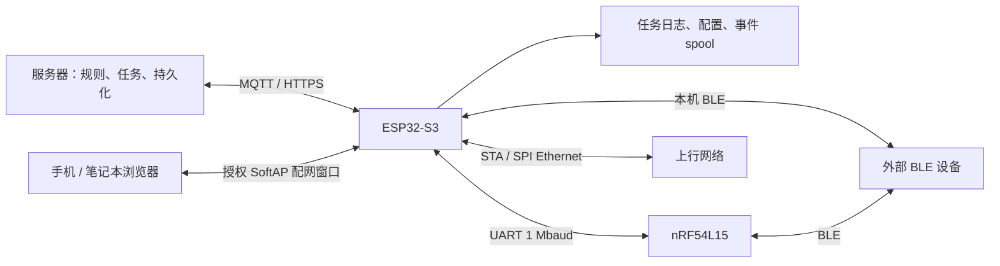

# GW32 ESP32-S3 嵌入式软件详细需求规格

| 项目 | 基线 |
| --- | --- |
| 文档版本 | 1.5 |
| 日期 | 2026-11-19 |
| 适用项目 | GW32I33V2，ESP32-S3 主处理器 + nRF54L15 蓝牙协处理器 |
| 对接基线 | [GW32-E2E-1.1 三方贯通标准](gateway-end-to-end-standard.md)；ESP固件0.3.0、nRF配套V2固件、UART 协议文档 1.2（线上帧version=1；扩展按能力门控）、现有服务器消息契约 1.0/1.1 |

**状态：软件需求与产品验收基线。** 仓库已有 ESP32-S3、服务器和 nRF 固件源码及分层测试；本地与远程 ESP OTA 的实现入口见[升级设计](esp32s3-ota.md)。源码、主机测试、目标构建及真实硬件验收分别记录，本文不表示全部需求已通过实板验收。

本文包含 182 条带编号的软件需求、50 个验收用例，以及模块职责、持久化数据、恢复流程、开发阶段和待冻结事项。1.1 增加本地与远程配网；1.2 增加 ESP 本地网页 OTA、平台远程 OTA 的共同安全要求与独立恢复流程；1.3 按三方贯通标准统一字段映射、责任和实现差距，保留全部原有功能、需求编号及验收编号。1.4 冻结差距实施方向并纳入 [Beacon 过滤专项规范](beacon-filter-spec.md)，新增过滤要求使用独立 BFLT 编号，不重排或替换原有 182 条 ESP 需求和 50 项验收。1.5对应0.3.0源码实施并保留全部编号；见[实施记录](gateway-alignment-implementation.md)，未连接硬件不记为验收通过。

实现路线见 [开发指南](esp32s3-development.md)，事务与恢复细节见 [持久化设计](esp32s3-persistence.md)，逐项测试步骤见 [验证计划](esp32s3-validation-plan.md)。这些开发文档不改变本文的需求编号和线上协议。

本地网页流程、网络候选事务和平台扩展边界见 [网络配置设计](esp32s3-network-provisioning.md)及[平台联调](../server/docs/network-provisioning-integration.md)。ESP 本地 OTA 使用独立的本地事务接口，不扩展或伪造云端任务、网络修订号。

## 1. 范围、优先级和依据

ESP32-S3 必须完成两层协议之间的转换和可靠执行：服务器下发目标与任务，ESP 负责认证、持久化、资源协调和结果核验，再操作自身外设或 nRF；上行采集数据由 ESP 持久接管、跨射频合并并上传。

| 文档 | 本文使用方式 |
| --- | --- |
| [差距统一实施方案](gateway-alignment-development-plan.md) | C02～C09/C11 的唯一实施决策、状态机、接口迁移与完成门槛；0.3.0按此合同实施，平台/Schema/固件须共同部署 |
| [Beacon 过滤专项规范](beacon-filter-spec.md) | BFLT 系列：名称、UUID、RSSI、Major/Minor 的掩码语义、组合规则、跨报告配对和三端一致性向量 |
| [三方贯通标准](gateway-end-to-end-standard.md) | GW32-E2E-1.1：平台、ESP、nRF 的共同语义、冲突裁决、差距登记和联调门槛 |
| [UART 协议](../server/docs/gateway-uart-protocol.md) | 帧、字节序、opcode、状态码、能力位、nRF 行为的权威定义 |
| [服务器协议](../server/docs/gateway-protocol.md) | MQTT/HTTP、任务、配置、上报、应用 ACK 和升级契约 |
| [消息 Schema](../server/internal/platform/assets/message-contracts.schema.json) / [OpenAPI](../server/internal/platform/assets/openapi.json) | JSON 字段、枚举及长度的可执行约束 |
| [系统需求](gateway-requirements.md) / [对接指南](gateway-integration.md) | 整机职责、时序及现有实现边界 |
| [nRF 工程](../firmware/nrf54l15/README.md) | 目标固件能力、构建及已知限制 |

P0：基础可靠性和集成前置条件；P1：本次交付范围内的业务功能，按配置启用；P2：后续扩展。P1 不等于可省略实现。尚未实现或未验收的能力不得登记为可用。

表中“必须”为验收要求；“建议”是实现起点，允许用等效方案满足验收；“待冻结”项必须在对应功能开发或发布前形成版本记录。内部模块名、状态名、日志字段只用于 ESP 实现，不新增服务器 JSON 字段或 UART opcode。

### 1.1 三方责任与两层协议

平台到 ESP 的 MQTT/HTTPS 契约承载身份、目标配置、任务、原始事件和持久结果；ESP 到 nRF 的 UART 契约承载控制器配置、动作、采集批次和升级块。ESP 是两层之间唯一的执行与持久化转换点。平台不能把 UART 的 OK 当成任务成功，ESP 不能把平台的接收 ACK 当成 nRF 已完成物理动作。

| 业务 | 平台责任 | ESP 责任 | nRF / 本机 BLE 执行边界 |
| --- | --- | --- | --- |
| 扫描与过滤 | 下发目标射频的 scan/filters；需要两路共同采集时分别下发等价目标 | 合并本组补丁、保存完整目标；转换单位/过滤字段并核验生效 | 各自执行目标规则，保留上报的原始 AD；不自行改另一射频配置 |
| 双路去重与 UUID | 解析原始数据中的 16/32/128 位 UUID，统一为规范 UUID 后匹配连接规则 | 按同地址类型/地址、报告类型、完整载荷和采集时间一对一合并；保留各来源证据 | nRF 先过滤再上报；未知地址或无法映射时间的观测不强行合并 |
| 广播 | CONFIGURE 设置 enabled、mode、内容和 intervalMs | 合并完整快照、持久 revision、下发并核对配置与实际状态 | Beacon 类型由 AD 内容表示；各射频独立启停，手机已连接时保留目标并报告实际状态 |
| 连接与 GATT | 负责授权、UUID 规则和自动连接；自动连接目标为 NRF54 | 验证新鲜观测，维护 connectionRef、op_seq 和结果 journal；手动任务按 radio 路由 | 执行连接、服务发现、读写、订阅；受理与终态分开 |
| 本地/远程网络配置 | 远程任务、凭据投递和本地状态裁决 | 统一候选校验、逐接口探测、回退和版本 CAS；本地使用独立事务 | 不下发给 nRF；SoftAP 配置入口与 Wi-Fi STA 上行分开 |
| 双组件升级 | 发布制品、授权远程任务、校验最终结果 | GATEWAY 走自身 OTA，NRF54 走 UART DFU；共用维护互斥 | ESP 试启动 90 s；nRF 默认 120 s，分别核验实际运行镜像并确认 |

两路扫描采用相同规则只适用于平台明确安排的同一采集任务；独立配置仍受支持，修改一侧不自动复制或覆盖另一侧。这是 GW32-E2E-1.1 的 C10 裁决，不能借“统一”改变原有独立射频功能。

### 1.2 跨层字段与证据约束

| 项目 | 统一要求 |
| --- | --- |
| 名称与版本 | 配置键为 `radios.nrf54/esp32`；GATT 的 `radio` 为 `NRF54/ESP32`；升级 `component` 为 `NRF54/GATEWAY`，省略沿用 GATEWAY。文档版本1.5、UART文档1.2 / 旧设备兼容基线1.1、帧 version=1 与 JSON schemaVersion 是不同版本域，不互相复制 |
| revision 与整数 | 云端 desiredRevision、网络 generation/localRevision、UART 配置 revision 各自独立；按对应 Schema 的整数/十进制字符串格式处理并保证无损，不能全局转换为浮点数或字符串来绕过校验 |
| 时间与单位 | 配置扫描/广播为毫秒，UART 对应间隔为 0.625 ms tick，沿用既有舍入公式并可在 effective 报告实际值；单调采集时刻用于配对，可信 UTC 用于任务期限，不能互换 |
| RSSI 与过滤 | 仅 `radios.<target>.filters.minRssi:null` 表示清除门限，UART 完整目标编码为禁用门限值 -128；旧顶层 filters 仍拒绝 null。UUID/厂商列表和 Beacon 掩码规则按整数组替换及既有数量/长度上限；本机与 nRF 的逻辑过滤含义一致 |
| 广播内容与功率 | mode 表示可连接/可扫描属性，iBeacon、Service Data 和自定义 AD 由 Base64 原始内容表达。iBeacon 测距参考 RSSI、AD 的 Tx Power 内容和接收元数据 `txPowerDbm` 均不等于设置发射机功率；现有字段不能暗中改作 RF 功率控制 |
| UUID 与连接身份 | 识别 16/32/128 位 UUID 并归一化匹配，原始 AD 不改写，wireBits 保留在平台 UUID 解析结果，不能加入现有 capture 的未定义字段；不能用 UUID 宽度猜测设备地址或跳过服务发现。connectionRef 绑定 radio、控制器 bootId 与 conn_id，Central 与 Peripheral 不混用 |
| 接管与结果 | UART CUSTODY 证明 ESP 已持久接管批次；RAW_PERSISTED 证明平台已持久接管原始事件；RESULT_PERSISTED 证明平台已持久接管任务结果。HTTP 2xx、MQTT PUBACK、驱动受理及 UART OK 不替代这些证据 |

### 1.3 实现差距与交付要求

下表引用统一标准的差距编号。限制当前可宣布能力不等于取消需求；涉及完整功能的条目须补实现并通过对应验收后关闭，文档一致不能作为关闭证据。

| 编号 | 0.3.0源码状态 | 保留验收要求 |
| --- | --- | --- |
| C01 | 文档/源码版本与实现状态统一记录 | 源码、主机测试、目标构建、实板分开取证 |
| C02 | MQTT/HTTPS共用journal/spool和应用ACK | 切换、迟到ACK和broker故障验收 |
| C03 | 完整广播配置读回后核实际状态；PAUSED核活连接 | 空口、驱动故障/恢复与结果一致 |
| C04 | 受控开漏reset/新boot及恢复责任已实现，默认禁用 | 核真实GPIO/时序/未接管数据影响与试启动回退 |
| C05 | 业务Security2、PG分片、持久spool及平台双向路径 | 手机身份、route权限、重放/断线/掉电验收 |
| C06 | 组件挑战、实际镜像证明和独立库存登记 | 不用ESP版本替代nRF，不去掉fromFirmwareVersions |
| C07 | ESP固定Peripheral服务、已有bond加密、能力交集 | 单连接、扫描/广播互斥，首次配对未开放 |
| C08 | 完整设备快照校验与受控恢复来源 | 缺组/摘要/版本拒绝；保护localOverride并逐组配置 |
| C09 | 签名时间挑战、UTC区间及TLS日期边界 | 100ppm制造上界须板验证，失效锚不授权远程敏感动作 |
| C10 | 同任务等价规则与独立radio配置保持分离 | 原始字节及严格一对一去重不变 |
| C11 | nRF重启按传输/FINISH/试启动阶段分派 | 不跨boot续传RAM，不把传输中断误报回滚 |
| C12/BFLT | 共享组合掩码/REPORT/PAIR，V2编译/读回/计数 | 3070B预算、边界/缓存/原始记录及实板负载验证 |

### 1.4 差距的统一实施和关闭条件

0.3.0源码已按下列合同实施；放行仍按 [统一实施方案](gateway-alignment-development-plan.md) 执行，不能由 ESP 单方新造云字段、UART opcode 或证明等级。实施方案冻结的是目标行为，源码、目标构建、实板证据分别验收；任何功能不足都继续保留在交付范围。

| 差距 | ESP 交付物与既有需求映射 | 关闭前必须通过 |
| --- | --- | --- |
| C02 | MQTT 适配器接入同一任务入口、journal/spool、逐项 ACK 验证器；ESP-SYS-002、ESP-CLOUD-001～005 | ESP-AT-13～15：PUBACK 无业务回收、双传输重复/迟到 ACK、断线重放身份不变 |
| C03 | 广播配置与实际状态的统一核验器，持久配置/运行证据分离；ESP-CFG-003/004、ESP-ADV-006～009 | ESP-AT-20/21：ACTIVE/STOPPED/PAUSED/FAULT、热更新回退和旧兼容路径均有证据 |
| C04 | 具有持久原因的板级受控恢复状态机；ESP-BSP-002、ESP-STO-007、ESP-SEC-005、ESP-NOTA-010 | ESP-AT-02/08/30/35：无普通超时盲复位，挂死回退、已接管记录和未接管损失界限正确 |
| C05 | 独立 Peripheral 业务适配器及会话权限/业务 ACK，与原始采集通道隔离；ESP-PER-001～005 | ESP-AT-25：越权、重放、错误角色/连接、队列满及迟到回复不影响管理命令权限 |
| C06 | 上报与对账组件版本证据，保留未知源版本拒绝；ESP-NOTA-002/011/012 | ESP-AT-26/29/30：ESP/nRF 版本不混用，镜像摘要及 boot/确认状态一致 |
| C07 | 本机 Peripheral 和已有 bond 的实际驱动、独立能力/支持集；ESP-ADV-002、ESP-GATT-009 | ESP-AT-20/21/23/25/33：不能静默降级安全，自动连接仍仅使用 NRF54 规则目标 |
| C08 | 受控全量配置恢复适配器，仍经原配置事务执行；ESP-CFG-001～005、ESP-PROV 的本地覆盖保护 | ESP-AT-15/18/43：不完整快照不得应用、旧组不覆盖新组、本地覆盖不静默清除 |
| C09 | 签名时间证据与本启动单调锚，区分同步与可信；ESP-BOOT-007、ESP-CMD-003 | ESP-AT-11/16/45：错误签名/重放/回拨阻断远程时敏任务，本地离线 OTA 不受云 UTC 限制 |
| C11 | nRF OTA 按持久阶段和运行镜像分类恢复；ESP-NOTA-006～010 | ESP-AT-27～30/36：传输中断不误报回滚，FINISH 歧义不盲擦写，旧 RAM offset 不跨 boot 使用 |

## 2. 系统职责与交付范围



| 编号 | 优先级 | 需求 |
| --- | --- | --- |
| ESP-SYS-001 | P0 | ESP 是服务器任务的唯一网关执行入口；nRF 不直接联网，服务器不直接打开板内 UART。 |
| ESP-SYS-002 | P0 | 支持以太网与 Wi-Fi STA；上行 MQTT/HTTPS 共用同一身份、任务 journal 和事件 spool，不因切换网络重新生成事件。 |
| ESP-SYS-003 | P0 | nRF 过滤并上传原始观测；ESP 负责跨芯片去重；服务器负责服务 UUID 解析、授权规则和自动连接决策。ESP 不能擅自建立另一套自动连接规则。 |
| ESP-SYS-004 | P1 | 实现 nRF 扫描、广播、Central/GATT 和 UART 升级的完整任务编排；实现 ESP 自身 BLE 扫描与广播。 |
| ESP-SYS-005 | P1 | 支持 ESP 主固件 OTA 与 nRF 组件 OTA，分开识别镜像、分区、版本、确认和回退；一次只运行一个升级任务。 |
| ESP-SYS-006 | P0 | 正确区分“命令受理”“驱动受理”“实际生效”“数据持久接管”“业务执行成功”；每项成功声明必须有相应证据。 |
| ESP-SYS-007 | P0 | 能力为签名设备清单、ESP 构建实现、运行时驱动、nRF HELLO 与已验收组合的交集。型号名不能替代能力协商。 |

本期不包括任意 Wi-Fi 帧注入、任意 Flash 写入、nRF bootloader 远程升级、通用 BLE 首次配对管理、多连接或未经验证的多角色并发。手机Peripheral认证与云端业务按第13节实施，代码不替代手机/板级验收。

本期包含无需专用手机 App 的本地网页网络配置：手机或笔记本连接 ESP32-S3 热点后设置上联网参数；已联网设备同时支持网关平台远程配置。两种入口复用网络候选管理器，认证、版本来源和提交证据分别定义，不能把本地保存冒充云端任务成功。

## 3. 硬件抽象、SDK 与工程要求

| 编号 | 优先级 | 需求 |
| --- | --- | --- |
| ESP-BSP-001 | P0 | 继承已有 2026-10-29 板级基线：UART1 TX=GPIO17、RX=GPIO18、RTS=GPIO15、CTS=GPIO16；GPIO8 为 nRF 复位控制。这些是已有协议基线，不代表已复核后续 PCB。 |
| ESP-BSP-002 | P0 | GPIO8 正常保持释放/高阻，复位只按确认的板级电路拉低并释放；不能用推挽高电平驱动共享 nRESET。脉宽、上电状态和缓冲电路由板版本配置确定。 |
| ESP-BSP-003 | P0 | CH390H SPI 片选、时钟、数据、中断、复位及其他引脚必须从目标板网表冻结到独立 board 配置；本文不猜测未核对引脚。 |
| ESP-BSP-004 | P0 | 选定受支持的 ESP-IDF 稳定版本并锁定 tag/commit、toolchain、BLE Host、Ethernet 驱动及依赖校验值；CI 不跟随 latest 自动升级。当前工程基线为 ESP-IDF v5.5.6、NimBLE、CH390 组件 0.4.1；变更须保留版本与验证记录，不随参考文档 stable 页变化。 |
| ESP-BSP-005 | P0 | 基线模块为 ESP32-S3-WROOM-1-N8R8；启动检测 Flash/PSRAM 与制造配置一致。PSRAM 仅作易失缓存，任何持久接管承诺必须由非易失存储完成。 |
| ESP-BSP-006 | P0 | 分区表必须给出双 ESP 应用槽、OTA 元数据、配置/凭据、journal、spool、隔离区和 nRF 镜像暂存的容量预算；不得挤占回滚镜像或已接管事件。 |
| ESP-BSP-007 | P0 | UART 驱动缓冲和 DMA 内存按所选 IDF/驱动要求分配，明确所有权和生命周期；不能把 nRF EasyDMA 实现直接等同为 ESP 驱动。 |
| ESP-BSP-008 | P1 | 交付源码、sdkconfig.defaults、分区表、依赖锁、构建脚本、烧录说明、制造配置格式、主机测试与硬件测试脚本；生产签名私钥不进入仓库。 |

ESP UART 的硬件流控和事件/缓冲接口以选定版本官方驱动为依据。[ESP-IDF UART](https://docs.espressif.com/projects/esp-idf/en/v5.5.6/esp32s3/api-reference/peripherals/uart.html)

## 4. 软件模块与执行模型

以下为建议的模块边界；允许调整名称，但必须保留职责与单一所有者。

| 模块 | 职责 | 禁止行为 |
| --- | --- | --- |
| board / recovery | 外设初始化、版本引脚映射、受控 nRF reset | 初始化时无条件复位 nRF、抹除数据 |
| uart_transport | RX 流式解码、完整 TX 帧、RTS/CTS、坏帧恢复 | 多任务直接交叉写 UART；日志复用业务串口 |
| nrf_session | HELLO、能力、单控制请求、重试及 ID | 丢响应未解决就插入另一控制请求 |
| persistence | journal/spool 原子提交、恢复、回收、水位 | ACK 先于持久提交；因满盘擦除未交付数据 |
| capture / dedup | 观测归一化、时间映射、一对一配对、事件定稿 | 只按 MAC 去重；修改已定稿事件 |
| network / cloud | 网络候选、TLS、MQTT/HTTPS、应用 ACK | 把链路建立或 PUBACK 当持久成功 |
| provisioning | SoftAP 窗口、本地页面/认证、本地配置事务及云端对账入口 | 绕过 network owner 直接改驱动；在本地制造服务器 revision 或任务结果 |
| command_executor | 任务校验、持久意图、资源协调、结果 | 从网络回调直接执行 GATT 写入或升级 |
| radio_manager | nRF 与本机 BLE 的目标、实际状态及恢复 | 自动抢占另一授权任务且不留记录 |
| ota_manager | 镜像验证、ESP/nRF 升级、试运行与恢复 | 同时升级两个控制器；下载完就报告成功 |
| diagnostics | 统计、故障、看门狗健康、脱敏日志 | 凭空填充未测量指标；异常时只重启不留证据 |

| 编号 | 优先级 | 需求 |
| --- | --- | --- |
| ESP-RT-001 | P0 | ISR、网络/BLE 回调只校验有限输入、复制/引用受控缓冲并入队，不等待云端或长时间 Flash 擦写。 |
| ESP-RT-002 | P0 | UART TX 由单一调度器串行输出完整帧；ACK/握手/控制优先于低优先级工作。DFU 等待响应期间 RX 与数据 ACK 必须继续运行。 |
| ESP-RT-003 | P0 | 每个队列有长度、字节上限、生产者、消费者、满队列行为和统计；不以无限堆分配吸收背压。 |
| ESP-RT-004 | P0 | Flash 事务、网络 I/O 和 UART 请求不形成循环锁等待；为存储回收保留控制/结果提交空间。 |
| ESP-RT-005 | P0 | 看门狗按任务真实进展喂狗；任务挂死进入可诊断恢复。nRF reset 不是处理普通网络断线的默认动作。 |

## 5. 启动、身份与恢复状态机

建议内部启动状态：`BOOT → STORAGE_RECOVERY → IDENTITY_READY → NRF_HANDSHAKE → RECONCILE → RUNNING`；网络可并行恢复。存储损坏进入 `STORAGE_FAULT`，不允许发送 CUSTODY；缺失身份进入受限配网状态，不接纳普通远程任务。

| 编号 | 优先级 | 需求 |
| --- | --- | --- |
| ESP-BOOT-001 | P0 | 每次 ESP 启动生成并持久记录新的 128 位 espBootId；恢复旧 spool 时保留每条事件原有 bootId/sequence/eventId。序号分配与事件提交同事务。 |
| ESP-BOOT-002 | P0 | 启动先恢复 journal、批次水位、待合并记录、结果队列和最后可用配置，再开始接管 nRF 数据。 |
| ESP-BOOT-003 | P0 | HELLO 后比较 nrf_boot_id；同启动仅重建会话，新启动才失效旧计数/连接并记录采集连续性中断。 |
| ESP-BOOT-004 | P0 | ESP 重启但 nRF 未重启时，先查询并对账旧 GATT/DFU 动作，避免盲目恢复新业务；关闭已失去 ESP 活连接登记的旧连接并生成相应链路事件。 |
| ESP-BOOT-005 | P0 | 若 nRF 为未确认试运行，优先完成镜像/健康检查及确认或回退，不让常规扫描恢复耗尽确认窗口。 |
| ESP-BOOT-006 | P0 | 身份、任务、事件状态不可读时不能恢复出厂后继续使用旧身份假装从未接管；应隔离错误、报告并执行受控维护。 |
| ESP-BOOT-007 | P0 | 未同步可信 UTC 时可采集并标 UNSYNCED；不能执行无法判断 expiresAt 的时间敏感任务。TLS 时间引导不得以关闭 CA/主机名校验替代。 |

## 6. UART 主机详细要求

### 6.1 固定接口与初始时间参数

| 参数 | 需求基线 |
| --- | --- |
| 串口 | UART1，1,000,000 baud，8N1，3.3 V，RTS/CTS |
| 帧 | `00 + COBS(header + payload + CRC32C) + 00`；整数字段小端，MAC/UUID 按协议 |
| 长度 | payload≤3072，解码帧≤3094，非零 COBS 段≤3107，含分隔符≤3109 字节 |
| 建链 | 非零随机 link_id；HELLO msg_id=0，业务控制从 1 开始 |
| 普通请求 | 发完整帧后等待 500 ms，最多重发两次；仍失败则重新握手并对账 |
| DFU 请求 | 30 s 等待；根据剩余任务/确认预算提前判定能否继续，不能无限阻塞 |
| HELLO 重试 | 初次 250 ms，失败翻倍，上限 2 s |
| 状态查询 | 无挂起控制请求时每 2 s GET_STATUS；升级长命令等待时不插入查询 |
| 明确 BUSY | 退避初始 250 ms，再以新 msg_id 重试，仍受任务期限和重试预算限制 |
| TIME_PROBE | 建链后及每 30 s 刷新；仅使用未重试、扣除处理后 RTT 0～50 ms 的样本 |

| 编号 | 优先级 | 需求 |
| --- | --- | --- |
| ESP-UART-001 | P0 | 流式接收半帧、多帧和空分隔；坏 COBS、CRC、长度、magic 或版本计数后丢弃，不执行命令，不因损坏传输帧直接发语义 FAULT。 |
| ESP-UART-002 | P0 | 硬件流控仅保护接收缓冲；Flash/spool 满使用 BLE_ACK BUSY。必须验证长 CTS 阻塞、FIFO overflow、driver buffer full 和恢复路径。 |
| ESP-UART-003 | P0 | 同一时刻最多一条挂起控制请求。超时重发相同 msg_id、相同 payload；nRF 仅缓存最近请求，未解决前禁止 GET_STATUS 等新请求覆盖缓存。 |
| ESP-UART-004 | P0 | 明确收到 BUSY 后使用新 msg_id；GATT 未受理动作保留原 op_seq。重新握手不能把已受理动作当作从未执行。 |
| ESP-UART-005 | P0 | 响应须匹配 link_id/msg_id/opcode，丢弃旧会话响应。完整 TX 完成后才启动响应计时；取消/排空旧 TX 后才能发送下一帧。 |
| ESP-UART-006 | P0 | 使用新 link_id 重新 HELLO 清除普通请求缓存，不清空 nRF FIFO、GATT op、Peripheral tx_seq、DFU session；分别查询对账。相同 link_id 的 HELLO 重试不清除普通缓存。 |
| ESP-UART-007 | P0 | UART ACK 使用批次消息号，与控制 msg_id 独立；不能混用两个序列。计数到上限前执行受控换会话/启动策略。 |
| ESP-UART-008 | P1 | 使用 HELLO 能力选择命令：基础扫描/增强过滤、广播管理、Peripheral、GATT service discovery、DFU；未支持时明确拒绝或使用语义等价的兼容路径。 |

### 6.2 命令路由

| ESP 工作 | UART opcode / type | 成功依据 |
| --- | --- | --- |
| 扫描/过滤 | 0x01/02 或 0x05/06 | 生效配置 + GET_STATUS |
| 广播 | 0x07/08，独立启停 0x0B，状态 0x0C | revision、目标内容与实际状态 |
| 状态/时钟/连接 | 0x03/04/09/0A | 有效会话中的实际快照 |
| Central/GATT | 0x10～0x18，0x17 查询结果 | op_seq 的终态与证据；受理 OK 不等于完成 |
| Peripheral | 0x0D/0E/0F，上行帧 0x22 | 连接/订阅状态；Notify 仅本机受理 |
| DFU | 0x30～0x37 | 当前镜像验证、明确确认及成功结果 |
| 数据批次 | type 0x20/0x21/0x22，ACK type 0xA0 | 持久提交完成后 CUSTODY |

## 7. 持久存储与数据接管

### 7.1 必须保存的数据

以下为内部语义字段，不要求采用相同文件名或数据库结构。

| 数据集 | 最少内容 | 回收条件 |
| --- | --- | --- |
| 身份与凭据 | namespaceId、gatewayId、型号/硬件版本、能力、凭据引用、信任根标识 | 授权制造/迁移流程，普通任务不能删除 |
| 配置快照 | 各组目标/生效 revision、完整快照、网络 last-good/candidate、事务阶段；本地 transactionId/localRevision、来源、验证等级及待对账标记 | 新版本已验证提交且恢复不再依赖旧版；本地保存不自动删除最后可用远程恢复点 |
| UART 接管水位 | nrfBootId、batch_seq、first_capture_seq、count、type、payload SHA | 与当前 nRF 启动关联独立保留，不能随云端事件 ACK 删除 |
| 待合并观测 | 来源、原始载荷、控制器启动/采集身份、采集时刻、时间锚与误差、入队次序 | 定稿事件及消费标记原子提交后 |
| 事件 spool | schemaVersion、eventId、sequence、时间质量、capture、payload、重试/隔离状态 | 对应 RAW_PERSISTED 逐项接管或受控隔离维护 |
| 任务 journal | taskId、requestDigest、原命令、状态、意图、对应 UART op/session、证据 | 已交付终态仍需保留防重记录，保留期与服务器协商 |
| 结果 outbox | resultId、resultSequence、原始结果内容、交付状态 | RESULT_PERSISTED 匹配后回收内容，保留任务防重 |
| 升级 journal | component、制品 ID/版本/长度/SHA、验证状态、阶段、启动 ID、offset、session、恢复证据 | 成功/失败证据已持久交付且不再需要恢复 |

| 编号 | 优先级 | 需求 |
| --- | --- | --- |
| ESP-STO-001 | P0 | 提供可断电恢复的提交单元，支持事务 ID、长度/版本/校验和、完整提交标记与损坏隔离；不能假定多个 NVS key 的更新天然组成一个业务原子事务。 |
| ESP-STO-002 | P0 | UART 批次观测与接管水位必须同事务提交；校验完整批次后全量接管或全量拒绝，不能 ACK 半批。 |
| ESP-STO-003 | P0 | 配对/单条定稿时，把稳定 eventId、事件内容与消费待定观测的标记同事务提交；重启后不得一条变两条或两条都消失。 |
| ESP-STO-004 | P0 | 重放最近相同批次且 type/摘要一致时返回 CUSTODY，不再次生成观测；批号内容变化、前跳或结构非法返回 FAULT 并留证据。 |
| ESP-STO-005 | P0 | 新 nRF 启动首批要求 batch_seq=1、capture_seq=1。ESP 接管水位丢失而 nRF 仍从中途发批次时，不能任意接受为“新起点”，须进入数据连续性故障处理。 |
| ESP-STO-006 | P0 | 存储暂不可写/满盘返回 BUSY，retry_after_ms=250～5000。无法安全恢复的接管故障与正常暂时背压必须区分。 |
| ESP-STO-007 | P0 | nRF FIFO FAULT 无远程清除命令；HELLO 不解除。复位前必须核查已接管数据并记录可能丢失的 RAM 观测，不用无限握手假装恢复。 |
| ESP-STO-008 | P0 | GC/压缩过程中，先提交新的有效副本和索引再回收旧空间；保留结果、控制日志和故障记录的预留空间，避免满盘后无法报告满盘。 |
| ESP-STO-009 | P0 | 对永久拒绝数据提供有界隔离区及明确满区策略；不得静默删除尚未交付的原始数据，任何授权丢弃须审计原因和计数。 |
| ESP-STO-010 | P1 | 记录写入量、GC 次数、容量水位和最大提交延迟；用预期包率计算 Flash 寿命与离线时长，不把 RAM/PSRAM 容量算作离线持久容量。 |

建议小配置/凭据使用受保护的 NVS，连续事件采用经过掉电测试的追加日志或等效存储；选型不免除上述事务要求。官方说明 NVS 更适合较多小值，批量大载荷应单独评估。[ESP-IDF NVS](https://docs.espressif.com/projects/esp-idf/en/v5.5.6/esp32s3/api-reference/storage/nvs_flash.html)

### 7.2 CUSTODY 提交流程

```text
收到有效批次
→ 校验启动身份、序号、结构与长度
→ 早于最近持久水位的旧批次忽略；最近批次相同则回放 ACK，内容冲突则 FAULT
→ 为观测和水位预留足够持久空间
→ 同事务写入观测 + 批次身份/摘要 + 提交标记
→ 存储层确认可恢复
→ 发送 CUSTODY
```

BLE 写入应答、串口收齐、RAM 入队、文件写函数返回、MQTT PUBACK 都不能独立替代“可断电恢复”的证明。

## 8. 双射频合并、时间和平台事件

| 编号 | 优先级 | 需求 |
| --- | --- | --- |
| ESP-DATA-001 | P0 | 将 nRF 与本机 BLE 观测映射到同一内部格式，保留原始 AD、报告类别、实际地址类型、PHY/SID、RSSI、连接属性和来源启动身份；未知字段用未知语义，不造值。 |
| ESP-DATA-002 | P0 | 只有不同无线电的观测可配对。匹配键包含地址及类型、ADV/SCAN_RSP、legacy/extended、SID、ADV 可连接属性和完整 AD；Hash 命中后仍比较原字节。 |
| ESP-DATA-003 | P0 | TIME_PROBE 建立 nRF→ESP 单调时间映射；时间差绝对值加误差估计≤50 ms 才可配对。误差考虑 RTT、量化和锚龄内漂移；任一芯片重启或观测 capture_ms 距有效锚时刻超过 60 s 后映射失效，不能用刚取得的新锚强配旧积压记录。 |
| ESP-DATA-004 | P0 | 每条观测从进入暂存队列起最多等待 150 ms；到期选时间差最小的未配对异源候选，同差选先入队者；每条最多配对一次。 |
| ESP-DATA-005 | P0 | 合并后以 nRF 为主记录，observedBy 固定为 [NRF54,ESP32]；同无线电重复、不同 AD/报告类型、未知地址、不可比元数据和迟到观测独立保留。 |
| ESP-DATA-006 | P0 | 待定区初始上限 256 条或 128 KiB；满时若 spool 有空间则单条定稿，否则向 nRF BUSY。本机 BLE 无 UART 重试保障，应计数并按既定策略暂停/丢弃新观测。 |
| ESP-DATA-007 | P0 | ESP 重启后失去旧单调映射的待定观测分别定稿，不沿用陈旧时间锚继续匹配；定稿必须防重。 |
| ESP-DATA-008 | P0 | 有可信 UTC 锚才填 SYNCED/capturedAt；否则 UNSYNCED 并省略 capturedAt。UTC 校时跳变后重建 UTC 锚；重传不改变已定稿事件的时间质量、采集时间、来源或载荷。 |
| ESP-DATA-009 | P0 | 定稿时分配 eventId=`espBootId-sequence`，持久保存完整事件；不同 schemaVersion 分批发送，协议升级不重写旧 spool。 |
| ESP-DATA-010 | P1 | nRF bond identity 被标为未知地址时保留原始数据，不用于按 MAC 合并或自动连接；不能自行补回看似合理的地址。 |

| 来源 | 平台映射 |
| --- | --- |
| ADV / SCAN_RSP | protocolHint=ble-ad-v1，payloadBase64 为完整 AD；1.1 capture 保存采集上下文 |
| GATT Notify / Indicate | ble-gatt-value-v1，只编码特征值，带捕获时 connectionRef 和句柄 |
| 链路关闭 | ble-gatt-link-v1，空 payloadBase64，linkReason 使用协议枚举 |
| 同步 GATT Read | 任务结果通道，不伪造通知事件 |
| Peripheral 0x22 | 独立本地应用 inbox；现有 RawEvent 无此类型，见第 13 节 |

服务器仍负责 AD 服务 UUID 的 16/32/128 位解析与自动规则；ESP 做传输校验和必要的目标转换，不改变这一职责。

## 9. 服务器连接、消息和 ACK

| 业务 | MQTT topic 后缀 | HTTP 等价入口 |
| --- | --- | --- |
| 原始事件 | telemetry / telemetry-ack | POST /api/v1/gateway-ingress/batches |
| 下行任务 | commands | GET /api/v1/gateway-ingress/commands |
| 执行结果 | command-results / result-ack | POST /api/v1/gateway-ingress/results |
| 状态 | status | POST /api/v1/gateway-ingress/status |

MQTT 前缀为 `gw/v1/{namespaceId}/{gatewayId}/`，QoS 1，retain=false。`result-ack` 是单数。控制命令、TaskResultBatch、GatewayStatus 仍使用 schemaVersion=1.0；采集 IngressBatch/IngressAck 按事件契约使用 1.0 或 1.1。

| 编号 | 优先级 | 需求 |
| --- | --- | --- |
| ESP-CLOUD-001 | P0 | HTTPS 验证 CA/主机名，TLS 至少 1.2；设备使用独立 token 或登记证书。MQTT 用户名为 gatewayId，订阅仅本设备命令/ACK topic。 |
| ESP-CLOUD-002 | P0 | MQTT/HTTP 只是传输适配器，同一任务和数据走同一防重路径；链路切换/重连不清空 journal、不重置在途事件身份。 |
| ESP-CLOUD-003 | P0 | 默认上报 64 条或 250 ms 刷新，实际服从 upload 配置；每平台批次≤200 条、原始总字节≤256 KiB、单条≤64 KiB、HTTP JSON≤1 MiB。batchMaxRecords 可到 1000 的内部缓冲必须拆批。 |
| ESP-CLOUD-004 | P0 | RAW_PERSISTED ACK 必须匹配 namespaceId/gatewayId/batchId，逐项 ACCEPTED/DUPLICATE 才回收；缺失 item、错误身份或无响应保留。 |
| ESP-CLOUD-005 | P0 | REJECTED_RETRYABLE 保留并遵守 retryAfterMs、退避和抖动；REJECTED_PERMANENT 移到可诊断隔离路径，不能紧密重试或伪装成功。 |
| ESP-CLOUD-006 | P0 | RESULT_PERSISTED ACK 按 namespaceId/gatewayId/taskId/resultId 匹配，不能要求不存在的结果 batchId；仅对应 item 为 ACCEPTED/DUPLICATE 才标已交付，拒绝/缺项/身份不符不回收。接管结果后仍保留任务终态防重记录。 |
| ESP-CLOUD-007 | P0 | GatewayStatus 只能发送 Schema 已定义字段；firmwareVersion 表示 ESP 主机版本，不能填 nRF 版本。nRF 版本和状态放到已允许的诊断/任务详情中。 |
| ESP-CLOUD-008 | P0 | GatewayStatus.observedAt 与 TaskResult.observedAt 必须是合法 RFC3339。UTC 未建立时暂存内部事实/单调时刻，延后构造此类信封；恢复时间后记录实际观察/对账时刻，不伪造掉电前精确 UTC，也不省略必填字段。 |
| ESP-CLOUD-009 | P0 | 对 1.1 capture 严格校验：未知 RSSI/功率省略；Schema 范围 -127～126；NRF54 ADV 带 connectable，SCAN_RSP 不带；legacy 不带 SID/secondaryPhy，primaryPhy 不用 LE_2M。 |
| ESP-CLOUD-010 | P1 | 断线重连必须有上限退避和抖动、认证失败分类及诊断；永久身份/证书错误进入受限恢复，不能无休止快速登录。 |

## 10. 任务 journal 与配置事务

### 10.1 任务执行

内部建议状态为 `RECEIVED → VALIDATED → ACCEPTED_DURABLE → EXECUTING_DURABLE → VERIFYING → TERMINAL_DURABLE → RESULT_DELIVERED`；无法证明的物理动作进入待对账状态。线上结果使用 Schema 中的 state/verification 枚举，不直接发送这些内部名字。

| 编号 | 优先级 | 需求 |
| --- | --- | --- |
| ESP-CMD-001 | P0 | 校验消息版本、身份、type、参数、能力、createdAt/expiresAt 和 requestDigest 格式后，原子保存 taskId/digest/命令，再报告受理。不得在持久意图之前执行副作用。 |
| ESP-CMD-002 | P0 | 相同 taskId/digest 返回既有进度或结果；相同 taskId 不同 digest 拒绝并告警。requestDigest 对应原始 TaskRequest，不是带服务器追加 desiredRevision 的最终命令重新计算值。 |
| ESP-CMD-003 | P0 | 执行前和可中断阶段边界检查 TTL；总 timeoutMs 是整个任务预算，不能为连接、发现、写入和读回各重新获得一份预算。 |
| ESP-CMD-004 | P0 | resultId/resultSequence/内容持久后才发送；ACK 丢失保持原结果重发。不能因为结果未送达再次执行物理动作。 |
| ESP-CMD-005 | P0 | 已发出但结果不可证实的 REBOOT/GATT_WRITE/OTA 等任务按证据对账，不能通用地“重试整个任务”；GATT 模糊写入报告 UNKNOWN。 |
| ESP-CMD-006 | P0 | 当前没有下发 CANCEL 命令，服务器仅可取消未投递任务；到期也不等于物理副作用被撤回。ESP 应停止尚未执行的后续动作，对不可逆或已发动作保留真实结果/UNKNOWN。 |
| ESP-CMD-007 | P1 | REBOOT 必须先保存意图并完成必要接管，真实 ESP 重启后以新 bootId 报告；不能只修改 bootId 字符串冒充重启。 |
| ESP-CMD-008 | P1 | 将资源冲突、能力不足、参数错误、超时、已过期和结果未知映射到既有服务端错误契约；内部新增错误不得随意作为线上枚举。 |
| ESP-CMD-009 | P0 | 与服务器每网关仅一个在途任务的约束一致；存在待对账 UNKNOWN 时保留证据并允许 DIAGNOSTICS，不在本地绕过占用继续执行新业务任务。 |

### 10.2 配置分组

| 配置组 | ESP 保存/执行方式 |
| --- | --- |
| network | last-good、candidate、试用阶段和各接口 probe 结果；应用 ACK 门槛见第 11 节 |
| radios.nrf54 扫描组 | scan/filters/beaconRules 合并完整快照，转 ScanProfile；独立 revision |
| radios.nrf54 广播组 | advertising 合并完整快照，转 AdvConfig；独立 revision |
| radios.esp32 扫描/广播组 | 相同 JSON 语义，调用本机 BLE；独立状态及能力 |
| 既有 scan/filters/upload | 兼容映射：scan/filters 到 nRF，upload 由 ESP 执行 |

| 编号 | 优先级 | 需求 |
| --- | --- | --- |
| ESP-CFG-001 | P0 | 一次扩展任务只改 network、一个 radios 目标或既有配置组；一个 radio 只改扫描组或广播组。数组/原始字节整体替换，未出现字段继承本组持久快照。 |
| ESP-CFG-002 | P0 | 合并后的完整配置再次校验能力和互斥；不能通过 patch 省略 mode 等字段绕过可连接广播能力。radios.<target>.filters 扩展支持 minRssi:null 清除阈值，旧版顶层 filters 不接受该 null；空数组用于清除相应过滤列表。 |
| ESP-CFG-003 | P0 | 持久保存目标及执行意图，应用后读回配置/实际状态，再提交本组生效快照。失败保留错误和真实实际状态，不能只改 reportedRevision。 |
| ESP-CFG-004 | P0 | 成功结果 details.configuration 回显原 patch，reportedConfigurationRevision 等于 desiredRevision；量化值和实际状态用允许的 details.effective 表达。 |
| ESP-CFG-005 | P0 | 服务器 configuration 的 desired/reported 是最近补丁，不是全量快照；管理侧 effective 查询可合并已核验补丁，但须尊重 complete=false 等完整性标记，设备 token 不能调用管理查询接口。设备快照入口须校验完整性、摘要、组revision与来源；Flash全失只能按获授权完整快照/管理重放重新配置，不凭最近补丁虚构恢复。 |
| ESP-CFG-006 | P1 | 毫秒按既有公式转换到 0.625 ms ticks，统一整数舍入，读回报告实际值；revision 使用无损整数编码，避免 JSON 数值实现丢精度。 |

## 11. 以太网、Wi-Fi 与网络切换

| 编号 | 优先级 | 需求 |
| --- | --- | --- |
| ESP-NET-001 | P0 | 实现 CH390H SPI Ethernet 和 Wi-Fi STA 驱动适配，分别报告链路/IP/DNS/TLS/应用可达性；一个接口失败不重置整个事件系统。 |
| ESP-NET-002 | P0 | network.uplinkOrder 含 1～2 个不重复 ETHERNET/WIFI_STA，且都对应启用接口；默认以太网 DHCP 优先。 |
| ESP-NET-003 | P0 | 支持 DHCP 与静态 IPv4；静态地址、prefixLength 1～30、同网段网关、1～2 个 DNS 校验；ipv4 作为整个对象替换。 |
| ESP-NET-004 | P0 | STA 启用时 SSID 为 1～32 UTF-8 字节，WPA2_PSK/WPA3_SAE 按实际驱动支持；credentialRef 必须在本机安全凭据存储可解析，平台 CONFIGURE 任务不携带明文密码。本地密码输入先经受保护的认证通道写入凭据存储，再由引用参与网络候选事务。 |
| ESP-NET-005 | P0 | 网络变更先持久 last-good/candidate/意图，试用最长 120 s；远程不超过任务有效期，本地不超过会话及事务有效期。所有需要验证的变更接口分别试用；本地显式离线保存按 ESP-PROV-012 标明验证等级。 |
| ESP-NET-006 | P0 | probe 的 DNS、TLS、管理连接及结果 ACK 必须实际绑定被测候选接口；不能用旧接口收到 ACK 来证明新网络成功。 |
| ESP-NET-007 | P0 | 远程任务中每个受测接口的 EXECUTING/NONE probe 结果使用稳定 resultId；全部收到匹配 RESULT_PERSISTED 的 ACCEPTED/DUPLICATE 后才原子提交 candidate。本地无服务器任务时使用本地事务与独立验证证据，不伪造 probe TaskResult。 |
| ESP-NET-008 | P0 | 提交前失联/超时/重启恢复 last-good；提交后重启恢复已持久提交的新配置；两种情况均保留数据、身份和结果。本地 LOCAL_ONLY 保存的恢复遵守其验证等级并保留旧恢复点，不能推导出平台 reportedRevision 已更新。 |
| ESP-NET-009 | P1 | 正常接口故障按 uplinkOrder 切换已验证接口，保留在途上传并重试；设置防抖与恢复策略，具体时间作为实现参数实测冻结。 |
| ESP-NET-010 | P1 | DIAGNOSTICS NETWORK 的 wifiScan=OFF/PASSIVE/ACTIVE，最多返回 32 个 AP；按任务时间与地区限制执行。本地页面也可请求受限扫描，单独受会话和资源限制。SoftAP 只用于第 11.1 节定义的授权配网窗口。 |

Wi-Fi 与 ESP 本机 BLE 共享射频资源，必须启用所选 SDK 的适用共存机制并测量实际扫描空档、网络吞吐和延迟；芯片支持某组合不等于整机负载验收通过。[ESP-IDF 共存](https://docs.espressif.com/projects/esp-idf/en/v5.5.6/esp32s3/api-guides/coexist.html)

### 11.1 本地 Wi-Fi 网页配网与平台远程配置

手机或笔记本的基本流程为：授权打开配网窗口 → 连接网关热点 → 打开本地页面并认证 → 选择或填写网络参数 → 校验/试用 → 查看在线验证、失败回退或明确的离线保存结果。平台流程为：校验权限与设备能力 → 凭据引用就绪 → 下发网络配置任务 → 候选接口验证 → 持久 ACK → 提交及结果。具体状态和接口见 [网络配置设计](esp32s3-network-provisioning.md)。

| 编号 | 优先级 | 需求 |
| --- | --- | --- |
| ESP-PROV-001 | P1 | 同时交付 ESP32-S3 SoftAP 本地网页配网和网关平台远程网络配置；两入口调用同一参数校验、候选试用、提交和回退服务，不能各维护一套可互相覆盖的实际网络状态。 |
| ESP-PROV-002 | P1 | 手机或笔记本可连接具备设备辨识信息的网关热点，通过固定的本地访问入口打开设备内置页面；页面、脚本和样式不依赖互联网。提供直接地址作为自动弹窗失败时的入口；不依赖用户安装专用 App。 |
| ESP-PROV-003 | P0 | 配网窗口仅由已定义的首次部署、现场授权或已认证管理操作开启；默认 10 min、空闲 5 min 关闭，单次窗口最长 30 min，并提供明确关闭。重新启动、认证失败或上联网失败不自动把窗口变为永久开放；没有已验证实体按键时不虚构按键操作入口。 |
| ESP-PROV-004 | P0 | 热点使用设备独立 WPA2 访问密码；控制和凭据经 protocomm Security2（SRP6a/AES-GCM）认证加密会话，另有会话过期、抗重放及请求来源校验。未认证 HTTP 仅提供静态页面和最小握手，不返回完整配置或接收明文控制；浏览器兼容问题不得降级明文。网页客户端须项目实现并验收，禁止生产默认通用密码。 |
| ESP-PROV-005 | P1 | 页面适配手机和笔记本，提供网络概览、Wi-Fi 选择/手工输入、以太网与 IP 设置、测试/应用、结果/回退信息及关闭窗口；区分保存、链路可用、平台可达和平台已对账，错误明确到字段或失败阶段。 |
| ESP-PROV-006 | P1 | 本地授权扫描结果包含 SSID、BSSID、信道、RSSI、认证类型并有数量和频率上限；支持手工输入隐藏 SSID，不把空 SSID 扫描结果当作可直接提交配置。扫描不静默替换当前连接；不支持的频段、认证或地区信道明确提示。 |
| ESP-PROV-007 | P1 | 本地可设置 Wi-Fi STA 的启用、SSID、受支持认证和凭据，以及 Wi-Fi/以太网 DHCP 或静态 IPv4、网关、DNS、接口启用与上行优先级；复用既有 network 约束。提交前展示脱敏差异，校验地址/网段/接口依赖；修改平台地址、设备身份和信任根不混入普通网络表单。 |
| ESP-PROV-008 | P0 | 新密码仅用于安全凭据写入，返回不可反查明文的 credentialRef；界面、日志、配置回读及审计均不回显密码。保留原凭据、替换和清除使用明确不同操作，空输入不能隐含覆盖；旧恢复点仍引用的凭据不得提前清除。 |
| ESP-PROV-009 | P0 | 所有网络候选持久记录来源、事务 ID、预期基线、完整候选、引用和阶段；同一时刻只允许一个网络写事务。使用覆盖所有来源的 networkGeneration 进行比较并交换，拒绝基线过期；重复相同请求返回原事务状态，ID 相同但内容不同拒绝，页面重试不能产生另一轮配置。 |
| ESP-PROV-010 | P0 | 本地配置使用独立 transactionId/localRevision，同时检查预期 localRevision 和 networkGeneration；不得生成或递增服务器 desiredRevision，不构造不存在任务的 taskId/resultId。云端 revision、最近本地版本和实际配置来源独立持久保存，reportedRevision 仅按真实远程任务成功推进。 |
| ESP-PROV-011 | P0 | 本地在线应用必须在候选接口实际完成链路/IP、适用的 DNS、TLS、设备认证及新鲜 challenge 应用响应验证，完成持久提交后才显示在线成功；旧接口、手机互联网或浏览器加载成功均不是候选成功证据。独立平台probe已接入，该探测结果仍不证明平台已采用本地配置。 |
| ESP-PROV-012 | P1 | 首次无互联网或平台暂不可达时可由用户明确选择 LOCAL_ONLY：校验参数与凭据、展示未完成验证、持久保存 activeLocalSnapshot/验证等级，保留 lastVerified 和旧凭据。普通试用失败不得自动离线提交；后台重试有界，失联回退时保留本地候选供查询/重试，后续联网仍需验证及对账。 |
| ESP-PROV-013 | P0 | 本地试用超时、认证/证书失败、提交前重启等按持久阶段恢复；普通试用失败回退到试用前可用配置，尚无可用配置时回到受限配网流程。提交后响应丢失可按原 transactionId 查询；热点或手机因信道/接口变化断开不等于事务失败，不能凭页面断线重放配置。 |
| ESP-PROV-014 | P0 | 本地提交后保留待平台对账状态；重新上线时比较本地来源、完整配置摘要及服务器基线，显式选择采用本地配置或应用平台目标，不能静默覆盖。采用本地配置仍由服务器创建正式 revision，旧任务不得凭较大的云端 revision 越过本地冲突检查；对账接口未实现时准确显示未同步并禁止假报完成。 |
| ESP-PROV-015 | P1 | 平台远程网络配置复用现有 CONFIGURE/network 任务、权限/能力/TTL、desiredRevision 和结果协议；候选首选及需要验证的变更接口分别提供实际绑定的 networkProbe，先取得对应持久 ACK 再提交和上报成功。远程操作可查询执行阶段和失败回退原因，设备离线时不能显示已生效。 |
| ESP-PROV-016 | P0 | 远程 credentialRef 须先安全部署并确认就绪，缺失/不匹配在切网前拒绝。新密码经独立 TLS 管理接口写入服务器加密凭据库，目标设备以严格设备身份经 TLS 私有领取、加密持久安装并确认后，平台才创建仅含引用的 CONFIGURE；此流程为待实现扩展，秘密不得进入普通任务、outbox、日志或明文 Flash。 |
| ESP-PROV-017 | P0 | 本地和远程写入竞争、过期表单、其他网络候选及 OTA/重启维护冲突均显式返回冲突或忙碌；已开始的事务不得被另一入口悄悄覆盖。查询与受限诊断可继续，采集/spool 不因打开页面清空；涉及试启动确认窗口时优先完成既有恢复义务。 |
| ESP-PROV-018 | P1 | 保存来源、操作者的非敏感标识、事务/任务 ID、脱敏差异、验证阶段、版本、回退原因和时间质量；本地可查询重连后的事务结果。平台展示目标、实际及待同步状态，不记录或返回原始密码、访问令牌和完整认证材料。 |
| ESP-PROV-019 | P1 | 验证 SoftAP+STA 与 Ethernet、ESP BLE 并用时的单射频调度、信道变化、手机掉线重连及地址网段冲突；SoftAP 不成为未经授权的 NAT/桥接或常驻管理网络。窗口结束释放服务器、DHCP/DNS、会话与临时敏感资源，业务状态不被无关重置。 |
| ESP-PROV-020 | P0 | 发布前完成 ESP-AT-37～44 的手机/笔记本、首次部署、远程变更、离线/失败/冲突和恢复证据；新本地接口、远程凭据部署与对账按明确版本实现后才声明可用。现有平台配置校验通过不能替代 ESP 热点、网页、驱动及实板执行验收。 |

本节定义产品必须交付的能力。具体认证实现、首次授权入口、热点地址选择、浏览器矩阵及平台扩展须按配套设计冻结并验证；窗口/会话限值变更须同步配套设计和测试。2026-11-19已加入ESP配网页面/设备服务源码和平台接口实现；主机与目标验证记录见[固件VALIDATION](../firmware/esp32s3/VALIDATION.md)，不能据此把实板验收标为完成。

## 12. 扫描、广播与无线资源协调

### 12.1 扫描与过滤

| 编号 | 优先级 | 需求 |
| --- | --- | --- |
| ESP-RAD-001 | P1 | nRF/ESP 扫描分别支持 enabled、active、intervalMs/windowMs，范围 10～10240 ms 且 window≤interval；本机驱动无法支持的精度/模式须明确拒绝或报告协议允许的量化。 |
| ESP-RAD-002 | P1 | 两路过滤语义一致：RSSI、UUID/厂商列表、最多 8 条 Beacon 掩码规则；完整解析字段参与匹配，保留原始 AD，不只上传解析值。 |
| ESP-RAD-003 | P1 | ESP 本机 ADV 与 SCAN_RSP 独立采集和过滤，使用捕获时元数据；不以强 RSSI、相同 MAC 或相同 UUID 代替跨源配对规则。 |
| ESP-RAD-004 | P0 | 当前 nRF 不声明并行扫描/广播/Central 组合，Central+Peripheral 共用一连接；冲突返回 BUSY 或按已有授权任务协调，不默默停止另一任务。 |
| ESP-RAD-005 | P0 | 保存停止/暂停原因和恢复目标。Central/DFU 优先使用 nRF 保留配置目标的暂停机制；显式停扫/启播/恢复的 revision 必须来自后续服务器配置任务，ESP 不得自行加一制造修订号。显式关闭后的旧目标不会自动复活。 |

#### 12.1.1 Beacon 掩码过滤扩展

名称、UUID、信号强度、Major/Minor 的新过滤按 [BFLT 专项规范](beacon-filter-spec.md) 实施；原 ESP-RAD-001～005 及旧 beaconRules 行为不变。专项规范是新增配置的唯一字段/长度/字节序/版本依据，当前旧固件与 Schema 不因文档出现这些字段就获得支持。

- 使用 fieldMask 的 bit0～5 分别启用名称、iBeacon UUID、RSSI、Major、Minor、Service UUID；未知位拒绝，名称、UUID、Major、Minor 按专项定义的 value/mask 位比较，同一规则启用条件全部满足才命中，不能拆成若干旧规则而变成“任一字段命中”。
- UUID 明确区分 iBeacon proximity UUID 和 GATT service UUID；Major/Minor 只在结构合法的 iBeacon 帧内使用，不从其他厂商自定义内容任意取偏移。名称按原始字节及明确完整/短名称策略比较，不擅自大小写折叠、Unicode 归一化或截断。
- RSSI 是接收元数据；默认使用含边界的数值范围，显式 BITS 才对原始 i8 补码按 value/mask 比较。BITS 不等价于强度门限，未知/无效 RSSI 不能以补码巧合放行。
- 默认单报告模式不把 ADV 和 SCAN_RSP 连接成一个伪造 AD。只有显式 PAIR（ADV_SCAN_RSP_PAIR）模式且 legacy/主动扫描、规则目标为 LEGACY_ADV 时，才能在同一 radio、同一控制器启动与扫描配置下关联唯一前序未配对 ADV；窗口固定 500 ms，不能用 nRF 的 ADV 与 ESP 的名称拼成命中证据。
- 新规则使两条报告通过时，两条仍按原始载荷及采集信息分别交付；已有跨射频一对一去重在之后独立执行。PAIR 的 RSSI 取 ADV；多候选、超时无响应或缓存满保守不放行并计数，不能借 DENY 条件未知绕过拒绝。其他缺失字段、不足长度和格式错误按专项规定处理，不静默降低条件。
- 配置切换及控制器重启不得让旧配对缓存参与新规则；相同逻辑目标在两侧使用相同规范与向量，但两 radio 独立配置仍保留。旧能力不足不能降级成较宽规则后返回成功。V2 仅在目标具备对应能力、nRF HELLO bit13 及双方扩展已部署时使用；UART 0x19/0x1A 承载完整配置写入/读回，0x1B 查询过滤状态及专项定义的计数。旧 beaconRules 与 V2 不能同时非空，整组切换原子提交。

BFLT 需求与 BFLT-AT 专项向量补充 ESP-AT-19/33；名称跨报告、UUID 位宽与字节序、Major/Minor 部分掩码、负 RSSI 范围/BITS、规则顺序、失效缓存和混合版本都必须有三方一致性证据。原 50 个验收编号不变。

### 12.2 广播

| 编号 | 优先级 | 需求 |
| --- | --- | --- |
| ESP-ADV-001 | P1 | 服务器可独立控制 nRF/ESP 的广播启停、模式、内容与间隔；沿用 CONFIGURE，不新增无 revision 的启停通道。 |
| ESP-ADV-002 | P1 | 支持 NONCONNECTABLE、SCANNABLE_NONCONNECTABLE、CONNECTABLE_SCANNABLE；最后一种在对应目标有 Peripheral 实现和能力时才接受。 |
| ESP-ADV-003 | P1 | iBeacon、16/32/128 位 Service Data、自定义 AD 均通过完整字节配置。mode 是连接属性，不是 Beacon 类型；不得自行增加未定义 beaconType JSON 字段。 |
| ESP-ADV-004 | P1 | advDataBase64/scanResponseBase64 解码各≤31 字节，AD 结构完整；不可扫描模式要求空扫描响应。严格校验 Base64/长度/UTF-8 名称字节数，不静默截断。 |
| ESP-ADV-005 | P1 | intervalMs 为 100～10240 ms；显示频率可由 1000/intervalMs 估算，但不能承诺精确空口每秒包数。iBeacon 校准 RSSI 与实际 RF 发射功率分开。 |
| ESP-ADV-006 | P1 | 对 nRF 使用 0x07/08；仅改 enabled 且支持 bit10 时可用 0x0B，同样有 bit10 才读 0x0C。旧广播固件用 0x08/0x09 读回配置及实际状态。配置相同也要处理更高 revision 的提交。 |
| ESP-ADV-007 | P1 | 内容在线更新失败按 nRF 状态处理；AdvData/ScanRsp 非空口原子更新，恢复失败为 FAULT。不得在两包切换间隙误报完整一致的新载荷。 |
| ESP-ADV-008 | P1 | enabled=true/PAUSED 且存在有效手机连接是正常状态；enabled=false 不等于断开手机。显式断连需单独授权和本地路由。 |
| ESP-ADV-009 | P1 | nRF 重启后按持久广播目标恢复，UART 重握手则先读回；ESP 本机广播同样记录目标、驱动实际状态和失败原因。 |

ESP 本机可连接广播需要自己的 GATT 服务与认证实现；nRF Peripheral 已存在不等于 ESP 同时具备该服务。0.3.0已实现本机INFO/RX/TX及独立业务认证，只有制造授权与实板交集允许才登记ESP32_BLE_PERIPHERAL。

## 13. GATT 与手机 Peripheral

### 13.1 Central/GATT

| 编号 | 优先级 | 需求 |
| --- | --- | --- |
| ESP-GATT-001 | P1 | 接收服务器 GATT_CONNECT/DISCONNECT/READ/WRITE/SUBSCRIBE/UNSUBSCRIBE，检查 radio、地址/类型、服务/特征、权限、连接引用和总时限。当前服务器自动连接目标固定 nRF。 |
| ESP-GATT-002 | P1 | 自动任务执行前再核验本地 nRF 可连接 ADV、控制器启动 ID 和 maxAgeMs；观测证据独立于 spool ACK 保留，按既有 30 s 保留窗口管理，任务不得超出其时效。 |
| ESP-GATT-003 | P1 | 建链后 0x18 查规则服务，按需发现特征，0x0A 核验实际对端/MTU/安全；成功连接无线链路本身不足以完成带服务要求的任务。 |
| ESP-GATT-004 | P0 | 持久 taskId/digest→nrfBootId/op_seq/请求/阶段映射；UART OK 后查询 0x17 到终态并落盘，再发下一个 GATT 动作。 |
| ESP-GATT-005 | P1 | 按协议算法派生 connectionRef：ASCII gw32-conn-v1 + radio 字节 + 控制器 16 字节 boot ID + 小端 conn_id 的 SHA-256 前 16 字节小写 hex；Central/Peripheral 本地 ID 分属不同角色。 |
| ESP-GATT-006 | P1 | 无 connectionRef 的 READ/WRITE 在同一任务预算内连接、发现、操作、断开；有引用则须匹配当前已登记活连接。断开后旧引用不能控制新连接，已入队通知仍保留原身份。 |
| ESP-GATT-007 | P1 | 写入只用 WITH_RESPONSE，长度为 1～min(512,MTU−3)，句柄来自当前发现；READBACK 按任务要求执行。当前服务器拒绝 APPLICATION_REPLY，不能因 Schema 有该枚举就宣布可用。 |
| ESP-GATT-008 | P0 | 写入已送出但断链/复位/超时无法证实，返回 UNKNOWN，不换 op_seq 重新写；同一 task 重投只恢复证据或重发结果。 |
| ESP-GATT-009 | P1 | BONDED_ENCRYPTED 只使用已有绑定，不能静默降级明文或触发首次配对；绑定预置、轮换/删除另列待冻结流程。 |
| ESP-GATT-010 | P1 | 有已登记连接时，在无待决控制请求的轮询机会及动作完成后查询 0x09 Central 状态，必要时读 0x0A；正常轮询初始周期 2 s。检测断链后持久生成 GATT_LINK_DOWN 并失效连接/订阅。0x03 不含连接状态；Peripheral 另用 0x0D，不能混用。 |

### 13.2 nRF Peripheral 不透明数据

| 编号 | 优先级 | 需求 |
| --- | --- | --- |
| ESP-PER-001 | P1 | 解析 0x22 的 peripheral_conn_id/channel/kind/长度并与 Central 数据隔离；channel=1 不是 Central characteristic handle。 |
| ESP-PER-002 | P0 | 0x22 与其他批次共用接管序列，先写可恢复本地应用 inbox 再 CUSTODY；手机 ATT Write Response 只证明写入 nRF RAM，不能表示 ESP/云端已执行。 |
| ESP-PER-003 | P0 | 公开 RX 字节不直接执行配网、GATT 写入或升级；必须经过应用认证、授权、抗重放和长度/速率限制。认证未实现时只受限存储/拒绝业务，不开放敏感操作。 |
| ESP-PER-004 | P1 | 回复检查当前连接和 CCC，持久业务事务 ID 与 tx_seq 后调用 0x0E；OK 只表示栈受理。需要业务送达时采用应用 ACK，不因 UART 丢响应重复业务。 |
| ESP-PER-005 | P0 | RawEvent仍不承载Peripheral业务；使用独立业务事件/ACK及PERIPHERAL_NOTIFY、PERIPHERAL_DISCONNECT，按版本化Schema、认证/路由/权限执行，不伪装为GATT_NOTIFY。 |

因此“支持手机连接和 UART 数据转发”与“手机配置网关/云端交互已完成”必须独立验收。

## 14. nRF54L15 OTA 执行器

升级链路是服务器→ESP 网络下载→UART→nRF；不是 BLE 直连 DFU。采用项目 DFU 构建的 `zephyr.signed.bin`，不发送裸应用、merged.hex 或其他分区镜像。

### 14.1 阶段与成功证据

```text
任务验证 → 制品下载 → manifest验签/文件SHA/兼容性验证 → 持久升级意图
→ 准备无线维护、处理冲突连接 → BEGIN（保留目标并暂停无线）
→ 接管剩余FIFO、连续CHUNK → FINISH/READY → 确认FIFO已接管 → REBOOT
→ 新HELLO → 当前版本与健康检查 → VERIFY_RUNNING → CONFIRM
→ DFU_STATUS.running_confirmed=1 → 持久成功结果 → RESULT_PERSISTED
```

| 编号 | 优先级 | 需求 |
| --- | --- | --- |
| ESP-NOTA-001 | P1 | component=NRF54，检查 NRF54_UART_DFU_1 与 HELLO bit12、当前镜像已确认、槽容量及匹配 bootloader 前提；不能拿 ESP 固件版本判断 nRF 源版本。 |
| ESP-NOTA-002 | P0 | 验证服务器原始 manifest 字节的 Ed25519 签名，校验 keyId/组件/型号/硬件/版本及文件 SHA；不得解析再重新序列化后验签。MCUboot 的镜像签名是另一层验证。 |
| ESP-NOTA-003 | P1 | 将完整且校验通过的 nRF 镜像保存到受控暂存区，之后才 BEGIN；下载断线不影响旧 nRF。禁止下载未完成时以不可恢复流直接驱动擦写。 |
| ESP-NOTA-004 | P0 | 升级前持久保存业务恢复目标、任务和制品，按授权处理冲突连接。可由前置服务器配置停扫，也可由 BEGIN 进入保留目标的维护暂停；后者在传输期间持续接管原 FIFO，REBOOT 前必须排空。不能为临时停扫自造 revision；无法排空则失败/安全终止或记录显式允许的损失，不静默复位。 |
| ESP-NOTA-005 | P1 | BEGIN 使用非零 session，绑定 taskId/digest/artifact/长度/SHA/nrfBootId；运行时读 max_image_size，不固定按 600 KiB 假定所有构建容量。 |
| ESP-NOTA-006 | P1 | 每块 1～1024 字节、首块至少 32 字节，连续 offset；同请求重试字节完全相同。重握手先 STATUS，仅 RECEIVING 且 boot/session/size/SHA 匹配、偏移合法时续传；READY 进入启动核验流程，FAULT 用原 session 成功 ABORT 后才释放维护，ABORTED 重新开始必须换 session。 |
| ESP-NOTA-007 | P0 | accepted_offset 可含 nRF RAM 缓冲，不能当断电检查点；nRF 启动 ID 改变后重新判定实际镜像/阶段，未完成下载从 0 重新 BEGIN。 |
| ESP-NOTA-008 | P0 | FINISH/READY 已设置待试启动标记，意外复位也可能启动候选；若尚允许清理须成功 ABORT，不能仅停止传输。REBOOT_PENDING 无法 ABORT。 |
| ESP-NOTA-009 | P1 | 新启动后核对期望版本、UART 稳定性、存储/状态和既定健康项目，执行 0x37 对当前运行镜像完整文件长度/SHA 校验，再 0x36 确认，最后读 running_confirmed=1。 |
| ESP-NOTA-010 | P0 | 确认预算使用 confirm_remaining_ms，默认 nRF 窗口 120 s；30 s 长命令不能无限重试直到窗口外。任何健康/镜像失败都不确认，超时/挂死按可控 reset 回退。 |
| ESP-NOTA-011 | P1 | 成功 details 含 component=NRF54、firmwareVersion、32 位小写 hex nrfBootId、bootConfirmed=true、匹配制品的 64 位小写 hex imageSha256；结果先持久后发送。 |
| ESP-NOTA-012 | P0 | nRF 尚无独立已验证源版本登记，服务器对非空 fromFirmwareVersions 限制会拒绝；不能删除发布约束或改填 ESP 版本绕过。 |

健康检查必须在实现阶段冻结为可执行项目，例如：HELLO/能力/版本一致、关键状态请求成功、无重启循环、所需无线初始化成功、必要扫描/广播短测与恢复不报错。UART 没有“一键健康成功”命令；不得把建议清单当成已经由 nRF 自动执行。

### 14.2 控制器重启后的阶段恢复

nRF boot 改变不单独证明候选镜像已进入试运行。ESP 必须结合持久升级 journal、FINISH/READY/REBOOT 意图与实际运行镜像区分下载中断、候选试启动、已确认及真实回滚。确认尚未执行 FINISH 的传输中重启应记录为下载中断，旧 boot 的 session/offset 失效；若决定重新传输，仍须有效任务授权、制品核验及新的 BEGIN，从 offset=0 开始。允许按原策略终止或等待受控重试，不新增同一任务必自动重传的要求。

FINISH 已发但结果不明，或已到 READY/REBOOT/确认阶段时，不能仅以新 boot、IDLE 或旧 offset 判断是否重传；必须核验当前镜像、版本与 running_confirmed，再处理确认、回滚或对账。当前源码缺少上述阶段分支，登记为 C11，不能将接收过程中重启运行旧镜像直接记为 ROLLED_BACK。该缺口关联原 ESP-NOTA-006/008/009 及 ESP-AT-28/36，不增加或删除需求、验收编号。

## 15. ESP32-S3 自身 OTA

| 编号 | 优先级 | 需求 |
| --- | --- | --- |
| ESP-EOTA-001 | P1 | 自身升级 component=GATEWAY 或沿用省略组件的旧契约；不能自造 component=ESP32。与 NRF54 制品严格分流。 |
| ESP-EOTA-002 | P0 | 使用双应用槽和 OTA 元数据，将完整已验证的 ESP 应用写入非运行槽；本期不远程更新 bootloader、分区表、身份或任意数据分区。 |
| ESP-EOTA-003 | P0 | 固件与 manifest 分别按部署信任策略验证，兼容型号/硬件/源版本及大小先检查；nRF MCUboot 镜像不能作为 ESP 应用，反之亦然。 |
| ESP-EOTA-004 | P0 | 持久记录升级意图、候选版本/SHA、旧版本、任务和待发结果。重启前处理 nRF 当前动作与未接管数据，不能让主机重启重复 GATT 写入。 |
| ESP-EOTA-005 | P1 | 启用并验证所选 IDF 的应用回滚机制；试运行完成 Flash 恢复、身份、UART、配置及来源对应的健康检查后才标有效，失败回退。ESP 确认窗口为 90 s，独立于 nRF 的 120 s；本地离线升级不因缺少 UTC/服务器连接直接失败，远程升级仍受任务授权及在线恢复要求约束。 |
| ESP-EOTA-006 | P0 | 新旧应用需兼容共享存储格式；破坏性 journal/spool 迁移不得在试运行时使旧固件无法恢复。必须测试迁移中断与回退读取。 |
| ESP-EOTA-007 | P1 | 自身启动成功后更新 GatewayStatus.firmwareVersion；远程任务回传符合契约的升级结果，本地升级保存可查询结果，联网后正常上报版本。服务器目前未像 NRF54 强制校验运行镜像 SHA，ESP 仍须自行完成镜像/启动证据，不能降低验收要求。 |
| ESP-EOTA-008 | P1 | 发布冻结 Secure Boot、Flash/NVS 加密、密钥备份、救援与安全版本策略；eFuse/防降级等不可逆制造动作单独执行，本需求编写不触发烧写。 |
| ESP-EOTA-009 | P1 | 手机或笔记本可在授权 SoftAP 窗口内，通过内置网页选择签名元数据与 ESP 应用 bin，上传、查询、取消并明确确认安装；资源不依赖互联网或外部 CDN。 |
| ESP-EOTA-010 | P0 | 本地 OTA 复用 Security2 认证/加密通道及 AP 接口、Host/Origin、会话和窗口限制；不新增匿名文件上传、明文固件控制或任意 Flash 地址写入接口。 |
| ESP-EOTA-011 | P0 | 本地 OTA 使用独立 uploadId 和 source=LOCAL；远程使用现有 FIRMWARE_UPGRADE/taskId/digest/TTL。两者共用维护排他锁，不伪造云端任务、TaskResult、desiredRevision 或本地网络修订号。 |
| ESP-EOTA-012 | P0 | 本地签名 manifest 原文最长 8192 字节，必须声明 component=GATEWAY、imageFormat=ESP_IDF_APP_BIN、sizeBytes、版本、型号及 SHA；以制造公钥验证 Ed25519 签名后才擦写非运行槽。精确文件 SHA、完整长度、应用版本与芯片格式均须验证，浏览器检查不能替代设备检查。 |
| ESP-EOTA-013 | P0 | 本地每块解码后 1～4096 字节，连续 offset 且总量不超过签名 sizeBytes/目标槽容量；同一上传只允许相同内容的最后一块重试。同 uploadId 对应不同签名/manifest 拒绝，乱序/越界/损坏块不得推进偏移。 |
| ESP-EOTA-014 | P1 | 浏览器断连后重新认证、查询原 uploadId，再按设备返回偏移继续；只保证同次 ESP 启动中的受控续传。重启中断的接收不能复用 RAM 偏移，必须终止并以新 uploadId 从零上传。 |
| ESP-EOTA-015 | P0 | 上传完成、OTA API 校验、Flash 读回摘要和应用版本一致后进入 READY；READY 不等于已安装。只有显式 OTA_COMMIT 才设置启动槽并安排重启；提交前取消或窗口关闭/过期要终止候选，保留旧运行槽并释放维护资源。 |
| ESP-EOTA-016 | P0 | 本地试启动由持久 LOCAL 授权及镜像身份恢复，独立于服务器、DNS、UTC 和云端任务。90 s 内完成存储/身份、期望运行镜像、关键模块及 nRF 健康检查才确认；失败/挂死走实际回滚机制，不仅写失败标记。 |
| ESP-EOTA-017 | P0 | 本地/远程 ESP OTA、nRF OTA、重启及网络候选互斥；冲突返回忙碌，不能抢占试启动确认义务。升级不得清空身份、网络凭据、已接管 spool 或动作证据，也不能重放模糊 GATT 写入。 |
| ESP-EOTA-018 | P1 | 页面展示接收偏移、总长度、版本及 RECEIVING/READY/REBOOT_PENDING/CONFIRMED/ABORTED/FAILED/ROLLED_BACK 状态；清楚区分上传完成、准备重启、确认成功及回滚，最后一块/提交响应丢失后通过查询恢复判断。 |
| ESP-EOTA-019 | P1 | 提供可复现签名打包工具，生成相同发行物用于本地和平台发布：firmware.bin、manifest.json、signature.txt、verification.json；私钥只从外部发行环境读取，工具不自动生成生产密钥、不覆盖现有包、不输出私钥。 |
| ESP-EOTA-020 | P0 | 远程升级保留制品归属、设备能力/型号/硬件/源版本、task TTL、TLS 与设备独立验签；过期任务不得继续首次写入或授权确认。成功结果持久保存并等待 RESULT_PERSISTED，重复任务/ACK 丢失不能触发第二次升级；本地结果不得冒充远程授权。 |

官方 ESP OTA 文档说明双 OTA 槽、OTA 数据及应用试运行/回滚机制；具体 Kconfig/API 按项目锁定版本实现，不直接照搬浮动 stable 页的符号。[ESP-IDF OTA](https://docs.espressif.com/projects/esp-idf/en/v5.5.6/esp32s3/api-reference/system/ota.html)

## 16. 异常恢复与安全要求

| 故障 | ESP 必须采取的动作 |
| --- | --- |
| Wi-Fi/以太网断开 | 继续安全接管至持久容量上限，重连/切换后重发原事件；满盘后 BUSY |
| UART 控制响应丢失 | 原 ID/字节重试，仍失败换会话后按动作类型对账 |
| ESP 重启、nRF 未重启 | 恢复持久水位；先对账旧动作，再处理旧连接和业务恢复 |
| nRF 重启 | 失效旧连接/时间映射，记录连续性中断；重建配置和升级阶段 |
| Flash 满或写慢 | 保留已接管记录，暂停/背压新采集，控制与诊断仍可运行 |
| 批次摘要冲突 | 保存证据、FAULT；禁止用 HELLO 或清水位掩盖 |
| 配置应用失败 | 读回实际状态；保留原有效快照/明确恢复结果，不假报 revision |
| GATT 写入结果不明 | UNKNOWN，保留 journal，禁止重做物理写入 |
| OTA READY 后异常重启 | 优先查询当前启动/镜像，不能只按旧 download offset 继续 |
| 认证/证书失败 | 有界退避和受限恢复，不关闭 TLS 验证、不暴露凭据 |

| 编号 | 优先级 | 需求 |
| --- | --- | --- |
| ESP-SEC-001 | P0 | 凭据、签名私钥、完整认证会话和 Wi-Fi 密码不得进入日志、普通 diagnostics 或公共 BLE 特征；凭据引用与证书轮换需可审计。 |
| ESP-SEC-002 | P0 | UART CRC 是检错而非认证；网络及手机命令在到达 UART 路由之前完成授权，物理串口和调试接口纳入设备部署边界。 |
| ESP-SEC-003 | P0 | Base64/JSON/COBS/AD/GATT 长度在分配和复制前检查；深度、数量、速率和累计内存有上限，拒绝未知外部字段。 |
| ESP-SEC-004 | P0 | 恢复出厂必须区分业务配置重置与设备身份销毁，明确 journal/spool/凭据去留；不能把生产身份重新开放成无认证设备。 |
| ESP-SEC-005 | P1 | 每次 nRF reset、配置回滚、数据隔离/丢弃、升级确认/回退记录原因、任务关联和证据；没有任务时也保留本地恢复原因。 |

## 17. 性能、容量与诊断

| 编号 | 优先级 | 需求 |
| --- | --- | --- |
| ESP-OPS-001 | P0 | 输出实际 ESP/nRF 版本与启动身份、UART 能力、扫描/广播目标及实际状态、连接、队列水位、时钟质量、网络状态、升级阶段和最近故障。 |
| ESP-OPS-002 | P0 | 统计 UART 坏帧/重试/溢出、Flash 延迟/BUSY、各源观测/过滤/配对/独立定稿、spool/隔离数、网络应用 ACK 延迟、重启原因。queue FAULT 由 ESP 保存原因，不能假设 nRF GET_STATUS 有独立字段。 |
| ESP-OPS-003 | P0 | 建立资源预算：内部 RAM、PSRAM、任务栈、UART 缓冲、TLS/BLE 峰值、Flash 可用空间、nRF 暂存与写放大；目标构建后用 map 和压力测试验证。 |
| ESP-OPS-004 | P0 | 离线容量按 `可用持久字节 / 实际平均记录占用` 和峰值输入速率计算；必须包含索引、校验、提交、GC 及预留开销，不按原始 AD 字节简单估算。 |
| ESP-OPS-005 | P1 | 建议进行至少 72 小时混合压力测试，覆盖双扫描、Wi-Fi 重连、UART 背压与存储回收；该时长是新增验收建议，不是已通过结果。 |
| ESP-OPS-006 | P1 | 产品包率、最大离线时长、允许采集空档、网络切换时间、Flash 寿命及重启恢复时间须用实际存储/镜像/板卡测量后冻结，当前不写虚构性能承诺。 |

## 18. 验收测试清单

每个用例记录 ESP/nRF/服务器提交号、SDK、板版本、配置、输入、断电/丢包点、日志和结果。单元测试、模拟测试、目标编译和实板测试分别标记，不相互替代。

| 编号 | 用例 | 通过条件 |
| --- | --- | --- |
| ESP-AT-01 | UART 黄金向量、半帧、粘帧、最大帧和损坏帧 | 解码与 nRF 一致，无越界和错误执行 |
| ESP-AT-02 | CTS 长阻塞、RX overflow、TX 中止 | 无缓冲复用/帧交叉，恢复后可握手与控制 |
| ESP-AT-03 | 丢控制响应、重复/冲突命令、明确 BUSY | 同请求无重复副作用，BUSY 后新 ID，不覆盖待决缓存 |
| ESP-AT-04 | Flash 提交前仅 ESP 断电，nRF 保持运行 | 未发 CUSTODY，nRF 保留批次，重放可重新接管 |
| ESP-AT-05 | 提交后、CUSTODY 前仅 ESP 断电，nRF 保持运行 | 重放只确认，不生成重复观测/事件 |
| ESP-AT-06 | CUSTODY 后、云端 ACK 前断电 | 已接管数据恢复并按原身份上传 |
| ESP-AT-07 | RAW_PERSISTED 后 GC 中断 | 已接管数据不重复物理处理，其他未交付记录不丢失 |
| ESP-AT-08 | 水位丢失、批次跳号/摘要冲突 | 进入可诊断故障，不任意接受新起点 |
| ESP-AT-09 | 50 ms 边界、多候选同差、150 ms 到期 | 严格按时间误差、最小差和入队次序一对一匹配 |
| ESP-AT-10 | 同源重复、不同 AD/类型、未知地址、迟到 | 保留独立事件，不错误合并 |
| ESP-AT-11 | 任一芯片重启、时间锚过期、UTC 跳变 | 失效正确锚，旧事件不改时间/来源 |
| ESP-AT-12 | 待定区/spool/隔离区满，Flash 慢写 | 有界内存和背压，ACK 不提前，诊断可用 |
| ESP-AT-13 | MQTT PUBACK 与应用 ACK 分别丢失/伪配对 | 仅合法应用逐项 ACK 才回收 |
| ESP-AT-14 | 1.0/1.1 混合旧 spool 重放 | 原 schema/ID/内容保持，分批正确 |
| ESP-AT-15 | task 重发/摘要冲突/过期/结果 ACK 丢失 | 不重执行，稳定结果重传，模糊副作用 UNKNOWN |
| ESP-AT-16 | 无可信 UTC 冷启动 | 不伪造 observedAt，不执行 TTL 无法判断的任务，采集可 UNSYNCED |
| ESP-AT-17 | network 候选仅旧接口可达、缺少一项 probe ACK | 不提交候选；超时恢复 last-good |
| ESP-AT-18 | 候选提交前后分别断电、主备接口切换 | 恢复正确版本，身份和 spool 保留 |
| ESP-AT-19 | 扫描过滤两路对照空口 | 规则/字节/ADV与SCAN_RSP一致，差异有诊断 |
| ESP-AT-20 | 服务器广播开关、三模式、载荷、间隔 | UART/本机读回与空口一致，失败不假报成功 |
| ESP-AT-21 | 热更新部分失败、手机连接时关闭广播 | 恢复/FAULT 清楚；关闭广告不误断手机，PAUSED 正确 |
| ESP-AT-22 | 未授权、过期、未知地址自动连接 | 不发起连接；合法任务完成服务/特征和实际对端核验 |
| ESP-AT-23 | GATT 写出后断链/复位，查询结果丢失 | 不重新物理写入，保存 UNKNOWN/终态证据 |
| ESP-AT-24 | ESP 重启但 nRF 连接仍存，队列中有旧通知 | 先对账后清连接，旧通知身份正确，旧引用拒绝新控制 |
| ESP-AT-25 | 手机恶意 RX、满队列、Notify 响应丢失 | 未认证不执行敏感动作，接管/受理/业务 ACK 不混淆 |
| ESP-AT-26 | nRF 制品错组件/型号/manifest签名/SHA/尺寸，另测错误MCUboot签名 | 前类在传输前或协议边界拒绝；错误MCUboot签名可到READY但须启动时被拒绝，不能误报成功，旧应用可用 |
| ESP-AT-27 | nRF 下载中 UART 重握手与芯片复位 | 前者核对后续传；后者不复用 RAM offset |
| ESP-AT-28 | FINISH/READY 后未发 REBOOT 即断电 | 正确识别试启动，不误认为只是旧下载未完成 |
| ESP-AT-29 | 同版本不同镜像、校验失败、窗口到期 | VERIFY_RUNNING 拦截，未确认镜像不报成功 |
| ESP-AT-30 | nRF 新镜像挂死、CONFIRM 前后复位 | 硬件恢复/回退有效；确认后的结果重传不再升级 |
| ESP-AT-31 | ESP OTA 写入、切槽、试运行、自检失败 | 旧固件可恢复，真实新版本成功才确认 |
| ESP-AT-32 | ESP 存储格式迁移后回滚 | 旧固件仍能安全读取已接管事件和任务 |
| ESP-AT-33 | 双扫描+Wi-Fi+FlashGC+云端重试长稳 | 无死锁、持续泄漏和假 ACK；资源及损失满足冻结指标 |
| ESP-AT-34 | SDK 构建、分区/镜像容量、生产安全配置 | 可复现构建和完整证据，密钥不入仓库，恢复路径可执行 |
| ESP-AT-35 | CUSTODY 前后整板断电，nRF RAM 丢失 | 仅承诺已持久接管记录恢复；未接管数据缺口可解释，不伪称可重放 |
| ESP-AT-36 | DFU RECEIVING/READY/FAULT/ABORTED 时重握手 | 按状态续传/启动/原session终止/新session重开，不因摘要相同误续传 |
| ESP-AT-37 | 手机/笔记本连接 SoftAP，首次/再次开窗和本地页面 | 无互联网可打开内置页面；授权开关、直接地址与窗口超时有效 |
| ESP-AT-38 | 本地认证、密码更新、重放/跨源/越权输入 | 未授权不读改敏感配置；凭据不泄露，重复请求无第二次写事务 |
| ESP-AT-39 | 本地 Wi-Fi 扫描/隐藏 SSID、DHCP/静态 IP、以太网优先级 | 参数校验一致，真实候选接口验证后才本地提交；旧接口不能伪证成功 |
| ESP-AT-40 | 首次无网、平台不可达时显式 LOCAL_ONLY 保存 | 不自动降级，验证等级/待同步明确，无伪造云端任务或 revision |
| ESP-AT-41 | 本地候选试用失败、提交前后掉电、页面响应丢失 | 按持久阶段回退或恢复，原事务可查询，原凭据及数据保持 |
| ESP-AT-42 | 平台远程改网、凭据缺失/未就绪、探测 ACK 丢失 | 凭据准入与实际接口验证通过才提交；不可达/失败显示真实结果 |
| ESP-AT-43 | 双入口竞争、旧页面、迟到任务、版本对账及 OTA 冲突 | 单写事务、冲突明确；本地版本不伪造云端 revision，不覆盖未决任务 |
| ESP-AT-44 | 手机/笔记本兼容、AP+STA 信道变化、地址冲突和 BLE 压力 | 重连后可查事务，窗口关闭清理完整，采集/网络损失符合冻结指标 |
| ESP-AT-45 | 本地离线签名 OTA、READY 与明确提交 | 无互联网/UTC 可上传；完整验证后才 READY，确认安装后真实新镜像通过自检才成功 |
| ESP-AT-46 | 本地 OTA 认证、坏签名/镜像、非法块及重试 | 无越权写槽；组件/型号/版本/长度/SHA 检查有效，重复块不重复写入 |
| ESP-AT-47 | 本地 OTA 浏览器断连、窗口到期、取消与并发 | 同启动按偏移恢复，取消/超时释放资源，网络及双组件升级冲突明确 |
| ESP-AT-48 | 本地 OTA 断电、离线试启动和回滚 | 接收中断从零重开；提交前后恢复正确，健康失败实际回退且保留配置与数据 |
| ESP-AT-49 | 平台 ESP OTA、授权到期、结果 ACK 丢失 | 有效任务驱动 GATEWAY 升级；超时不续权，成功证据与稳定结果一致，不重复升级 |
| ESP-AT-50 | 签名包生成、同包双入口、移动浏览器升级 | 包与运行应用版本/摘要一致；本地和服务器使用同一签名原文，私钥不进入交付物 |

## 19. 开发阶段与冻结、验收事项

| 阶段 | 必须交付 | 完成门槛 |
| --- | --- | --- |
| M0 工程与存储 | 固定 IDF/依赖、BSP、分区、持久事务/恢复 | 构建成功；关键提交断电测试通过 |
| M1 UART 与 nRF | 会话/命令/ACK/配置对账、单源采集 | ESP-AT-01～08 及对应硬件测试 |
| M2 网络与服务器 | 身份/TLS、spool、任务journal、网络候选、本地网页配网及远程配置 | 应用 ACK、掉电恢复和真实接口探测闭环；ESP-AT-37～43 全流程 |
| M3 双无线业务 | ESP BLE、双路合并、广播、Central/GATT | 去重/广播/GATT 空口及服务器任务闭环 |
| M4 双组件升级 | nRF UART OTA、ESP 自身 OTA、恢复与结果 | 正常/异常/掉电/错误签名/回退矩阵通过 |
| M5 发布 | 压力、安全、制造配置和故障诊断交付 | 所有 P0/P1 验收完成，包含 ESP-AT-44 的浏览器/共存验证，能力清单据实签发 |

以下事项必须保留版本与验证记录；已经有源码或选型的项目仍须满足实际部署验收，不能猜测未核实的板级与生产条件：

1. 实际 PCB/原理图版本、CH390H/复位/调试引脚和有效复位时序。
2. 已锁定 ESP-IDF v5.5.6、NimBLE、CH390 0.4.1 的版本/授权来源与变更控制；目标 Flash 分区、容量及真实离线时长验证。
3. 可信 UTC 的冷启动引导、证书更新/吊销和初始设备凭据注入流程。
4. journal/去重保留期、隔离区满策略、损坏水位和恢复出厂后的管理恢复流程。
5. 手机 Peripheral 的认证、载荷、业务 ACK 与云端版本化接口；首次 BLE 绑定的受控预置流程。
6. ESP 90 s、nRF 默认 120 s 确认窗口中的具体健康项目、挂死回退及双组件互斥验证；安全版本/防降级和密钥生命周期。
7. 精确峰值包率、离线时长、恢复时间、Flash 寿命和 Wi-Fi/BLE 共存验收指标。
8. 本地配网首次授权/重新开窗的实板入口、设备独立凭据制造、已有浏览器认证实现及 SoftAP 地址/超时验证；已有远程凭据与本地对账扩展的共同部署、兼容和恢复验证。

上述待验证事项不妨碍继续开发可独立验证的传输、存储及解析模块，但不能用它们掩盖端到端功能缺失；当前差距统一见 C01～C12；实施决策已收敛到统一方案，剩余板级参数、部署信任材料与实测证据不能写成已完成。

## 20. 文档核验与官方参考

本文件按 GW32-E2E-1.1、两份传输协议、ESP 0.2.1 / nRF 0.2.0 源码和服务器 Schema/校验实现核对。ESP 已有源码和分层验证记录；服务器/模拟器及 nRF 主机测试仍不能替代 ESP 证据，本文所有 ESP 实板验收项均待执行。

ESP-IDF API/Kconfig 参照工程已锁定的 v5.5.6，浮动 stable 页不改变构建基线：

- [UART 驱动与硬件流控](https://docs.espressif.com/projects/esp-idf/en/v5.5.6/esp32s3/api-reference/peripherals/uart.html)。
- [NVS 存储](https://docs.espressif.com/projects/esp-idf/en/v5.5.6/esp32s3/api-reference/storage/nvs_flash.html)。
- [Wi-Fi/BLE 射频共存](https://docs.espressif.com/projects/esp-idf/en/v5.5.6/esp32s3/api-guides/coexist.html)。
- [ESP 应用 OTA 与回滚](https://docs.espressif.com/projects/esp-idf/en/v5.5.6/esp32s3/api-reference/system/ota.html)。

实现时使用锁定版本对应的官方文档/API，版本变化需要重新验证，不自动升级依赖。
