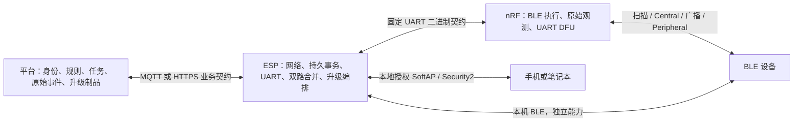

# GW32 三方贯通统一标准

| 项目 | 基线 |
| --- | --- |
| 标准编号 / 文档版本 | **GW32-E2E-1.1 / 1.1** |
| 日期 / 范围 | 2026-11-19；网关管理平台 ↔ ESP32-S3 ↔ nRF54L15 |
| 功能约束 | 保留扫描过滤、双路合并、Central/GATT、Beacon/自定义广播、Peripheral、本地/远程配网、ESP 本地/远程 OTA、经 UART 的 nRF OTA及既有平台功能 |
| 源码核对基线 | `b8ba3ef74af05fe33459f429f4f1f9438b71340a`；其固件实现来自 `9533a14cce8690a976481727ed68a7dac61f01e6` |
| 固件版本 | ESP `0.2.1`，ESP-IDF `v5.5.6`；nRF `0.2.0`，NCS `v3.2.1` |
| 本次变更 | 需求、开发及协议说明；不修改运行源码、Schema、API、线上枚举或帧格式 |
| 结论 | C01～C12的统一开发方案已确定；本次完成文档层对齐，规划接口、源码及实板验收仍须联合落实 |

## 1. 文档效力与不变范围

本文件统一跨层职责、字段映射、完成条件和故障处理。它不是第三套传输协议，也不是新的固件版本：

1. ESP ↔ nRF 的字段、偏移、状态码和命令编号以 [UART 协议](../server/docs/gateway-uart-protocol.md) 为准。文档修订为 1.2，保留既有1.1实现接口，Beacon V2为规划扩展；线上帧 `version=01` 不变。
2. ESP ↔ 平台的 JSON、MQTT topic、HTTP API 以 [服务器协议](../server/docs/gateway-protocol.md)、[消息 Schema](../server/internal/platform/assets/message-contracts.schema.json) 和 [OpenAPI](../server/internal/platform/assets/openapi.json) 为准；既有消息 1.0/1.1 的兼容规则不变。
3. 三方需求保留原功能与编号。发现源码不满足需求时，登记缺口并限制不实能力声明；不得通过删需求、缩减必需功能或声称已验收来消除冲突。
4. 文档之间的职责或语义歧义按本标准解释。若今后发现二进制/Schema 本身冲突，先登记并联合评审版本迁移；本文件不能单独授权发送 Schema 不允许的字段。

1.1增加两份实施依据：[差距统一开发方案](gateway-alignment-development-plan.md)逐项确定C02～C11的接口、状态、持久化、迁移及验收；[Beacon组合掩码规范](beacon-filter-spec.md)确定C12名称、iBeacon/服务UUID、RSSI、Major/Minor及PAIR语义。两文档的规划字段须联合实现后启用，当前机器合同不因Markdown更新而自动支持。

| 文档层次 | 需求 | 开发设计 |
| --- | --- | --- |
| 系统 | [系统需求](gateway-requirements.md)，原 93 条需求、18 项 ACC 保留 | [系统对接指南](gateway-integration.md) |
| nRF54L15 | [nRF 专项需求](nrf54l15-requirements.md)，映射既有系统编号 | [nRF 开发文档](nrf54l15-development.md) |
| ESP32-S3 | [ESP 专项需求](esp32s3-requirements.md)，182 条需求、50 项验收保留 | [ESP 开发文档](esp32s3-development.md) |
| 网关管理平台 | [平台贯通需求](../server/docs/gateway-platform-requirements.md)，不替代平台其他功能需求 | [平台贯通开发文档](../server/docs/gateway-platform-development.md) |

## 2. 冲突、缺口与唯一处理标准

“文档已统一”表示口径冲突已纠正；“源码待补齐”表示功能仍属交付要求，本次没有用文档修改代替开发。

| 编号 | 原冲突或缺口 / 源码证据 | 统一标准 | 状态及后续责任 |
| --- | --- | --- | --- |
| C01 | 总文档仍称 ESP 执行器未提供、SDK 待冻结；实际已有 [ESP 工程](../firmware/esp32s3/README.md)、本地网页、配网、采集和双组件 OTA | 使用 ESP 0.2.1 / IDF v5.5.6 实现基线；源码、主机测试、目标构建、实板分别记录 | 文档已统一；三方维护者持续更新证据 |
| C02 | 平台/ESP 需求有 MQTT 与 HTTPS；[gw_cloud](../firmware/esp32s3/components/gw_cloud/gw_cloud.c) 当前仅 HTTPS 轮询与上报 | 两传输使用同一业务消息及持久 ACK；保留 MQTT 需求，当前可联调路径为 HTTPS | 源码待补齐：ESP MQTT；平台 MQTT/HTTP 交叉重试验收 |
| C03 | nRF 有 `GET_ADV_STATUS(0x0C)`，ESP [gw_nrf_advertise](../firmware/esp32s3/components/gw_nrf/gw_nrf.c) 目前仅设置/读回广播配置 | 广播成功须同时核对目标配置、revision 与实际状态；`enabled=true` 不等于 `ACTIVE`，连接导致的 `PAUSED` 可为合法状态 | 源码待补齐：ESP 实际状态核对和结果证据；三方广播验收 |
| C04 | OTA-011 要求挂死时 ESP 复位 nRF；当前 GPIO8 仅作为输入释放，未实现主动恢复 | 保留受控恢复要求，按持久恢复意图和已核对板级策略执行开漏拉低/高阻释放；OTA 结合升级 journal/试启动期限，普通 UART 超时不盲复位；非任务恢复仍记录本地原因 | 源码待补齐：ESP 恢复编排；板卡与 MCUboot 回退实测 |
| C05 | nRF `0x22` 与 ESP Peripheral 持久 INBOX 已有；平台尚无对应完整业务封装、认证及回发/断开任务契约 | 保留手机收发功能；独立认证、业务路由与业务 ACK；不得伪装广播 RawEvent 或 GATT_NOTIFY，不得把公开 RX 当管理授权 | 设计已确定：按GW-PERIPHERAL-1同步机器合同/源码；现有Schema本次不变 |
| C06 | 平台 `firmwareVersion` 表示 ESP 主固件；独立可信 nRF 源版本尚未登记 | NRF54 非空 `fromFirmwareVersions` 在无法证明时继续以 `FIRMWARE_COMPONENT_VERSION_UNKNOWN` 拒绝；不得拿 ESP 版本代替或取消前置约束 | 源码待补齐：平台组件版本证据与 ESP 上报对账 |
| C07 | 平台协议的模式/安全级别集合大于 ESP 本机 [gw_ble](../firmware/esp32s3/components/gw_actions/gw_ble.c) 实现：拒绝可连接广播、BONDED_ENCRYPTED；自动连接限定 nRF | 按目标 radio 和实际支持集校验；保留产品要求；nRF 支持不代表 ESP 具备，不支持返回明确失败，不改投另一芯片 | 源码待补齐：ESP 既有必需功能；三方能力登记与拒绝路径验收 |
| C08 | 平台 configuration/effective 的 `complete=false` 不是设备完整目标；存在把最新补丁当恢复快照的风险 | ESP 从本机持久完整目标恢复；丢失时只可受控重放/重新配置，禁止用不完整平台结果覆盖已有组；保留完整恢复能力要求 | 语义已统一；平台完整快照/恢复契约与设备适配仍待补齐 |
| C09 | 远程任务期限、TLS、远程 OTA 依赖可信 UTC；当前 ESP 制造指定 SNTP 未密码学认证 | 保留可信时间验收，不宣称已抗时间伪造、不关闭 TLS 日期/主机校验；本地离线 OTA 使用现场授权及单调期限，不要求云任务或 UTC | 实现及验收待补齐：ESP 时间信任与平台部署；已受理动作仍使用固定截止时限 |
| C10 | 系统 SCAN-008 写“两路同一过滤目标”，平台同时允许 `radios.nrf54/esp32` 独立配置 | 同一双路采集任务分别下发等价过滤目标；两 radio 的独立配置能力保留，不自动互相覆盖；合并仅看可证明的观测匹配 | 文档已统一；保留原需求编号与独立配置测试 |
| C11 | ESP [nrf_transfer](../firmware/esp32s3/components/gw_actions/gw_ota.c) 遇 boot 变化直接转 nrf_trial，下载中重启可能被当作试启动后回滚 | 按 journal 区分下载中断与 FINISH/READY 后试启动。下载中断后旧会话失效，重新传输须有效授权并从0 BEGIN；正常试启动先核当前镜像再确认/回退，不重新擦写 | 源码待补齐：ESP 分阶段恢复/结果分类与两侧故障测试；不新增同任务必须自动重传的要求 |
| C12 | 旧beaconRules是单AD掩码与首条命中，不能表达名称等多字段AND、精确名称及RSSI位掩码 | BFLT-2.0：fieldMask选择字段、内容mask、同条AND，显式REPORT/PAIR；保留旧引擎及原子切换 | 设计已确定；平台Schema/预览、ESP/nRF共享引擎、bit13/0x19～0x1B及BFLT验收待实现 |

上表保留实际源码差距。C05业务合同、C06组件盘点、C08快照、C09时间引导已在[统一开发方案](gateway-alignment-development-plan.md)确定实施定义，不再由各端自行另取名称或等待另一次方案选择；“待补齐”指机器合同、源码、部署材料与验证证据。C01/C10文档冲突已消除，其他项不能仅凭方案确定标记实现完成。

当前已核对一致、无需修改线上协议的事项：UART 1 Mbaud/8N1/RTS-CTS、COBS/CRC32C、GET_STATUS 71 字节、GET_ADV_STATUS 35 字节、DFU_STATUS 62 字节、DFU 块最大 1024 字节、广播 AD/ScanRsp 各 31 字节、广播间隔 100～10240 ms、GATT 规范 UUID 16 字节以及任务和应用 ACK 的分层。大小指各命令定义的结果体，不包括额外帧头/CRC。

## 3. 三方职责、能力与状态

- 平台决定目标配置、授权和自动连接规则；ESP 执行并提供证据；nRF 不解析云 JSON、不联网、不自行根据 UUID 授权连接。
- 实际可用能力是签名设备清单、ESP 实现、目标芯片当前 HELLO/构建及已验证组合的交集。能力检查必须检查参数和完整合并目标，不能只检查命令名称。
- 当前已有平台签名清单/任务校验和 ESP 按操作检查 nRF HELLO/本机驱动支持；尚未形成设备重新验签并上报统一交集对象的完整对账路径。不能写成能力校验全部未实现，也不能把分层拒绝等同于统一能力对账已验收。
- nRF 射频构建的能力位 5～8 当前为 0，不承诺扫描/广播/Central 并发；Central/Peripheral 共享一个连接资源。Central 连接期暂停扫描，释放后按有效目标恢复；其他冲突由 ESP 显式编排。目标仍保留，不因暂时停止而被改成关闭。
- ESP 本机 BLE 不继承 nRF 能力；自动连接规则当前指定 NRF54，不自动换用 ESP。自定义 nRF 板默认 `GW_RADIO_VERIFIED=n`，不能仅凭芯片型号向平台登记射频或 DFU 能力。
- 平台任务、UART 命令、控制器异步操作三者不同。UART `OK` 可能只是受理；任务的 `VERIFIED` 必须具有该任务要求的最终读回/完成证据，状态不明保留 `UNKNOWN`，不得虚构成功。

## 4. 字段、单位和版本映射

| 项目 | 平台 / ESP 对外格式 | ESP ↔ nRF 映射与规则 |
| --- | --- | --- |
| radio | 配置路径 `radios.nrf54` / `radios.esp32`；命令和 capture 的 `NRF54` / `ESP32` | 大小写属于不同字段约定；由 ESP 明确映射，不能全局改名 |
| UUID | 16/32/128 位服务 UUID 输入按现有规则规范为 128 位，平台 UUID 解析结果保留 `wireBits`；原始 capture 不新增该字段 | AD 按其规定字节序解析；GATT UUID 使用 UART 规定的 16 字节规范序，禁止直接复制字符串或 AD 小端字节 |
| 广播内容 | `advDataBase64` / `scanResponseBase64`；完整 AD 结构 | Base64 解码后发送原字节；每段 ≤31 字节，合法 AD 长度，不可扫描模式不得携带 ScanRsp |
| 广播类型 | `NONCONNECTABLE` / `SCANNABLE_NONCONNECTABLE` / `CONNECTABLE_SCANNABLE` | mode 控制连接/扫描属性；Beacon/Service Data/自定义属于载荷格式，不新增 `beaconType` 字段 |
| 时间单位 | `intervalMs` 等以毫秒表示；广播 100～10240 ms | UART 扫描/广播按 0.625 ms 单位；当前 ESP 用 `(ms*8+2)/5` 整数舍入，结果回报实际有效值；不能将 Hz 直接写进 interval |
| 发射相关数据 | iBeacon measured power 为 1 m 校准 RSSI；平台观测字段为 `txPowerDbm` | UART 对应 `tx_power_dbm`，是观测元数据；均不是服务器 RF 发射功率设置，现有协议没有可设置发射功率字段 |
| 修订号 | 平台分配 `desiredRevision`，成功结果回显原补丁和同值 `reportedConfigurationRevision` | ESP 合并持久完整目标，分别维护扫描/广播等组；UART 使用对应组 revision；旧组恢复不能带更高但无关的 revision |
| 原始/有效配置 | `details.configuration` 回显原请求；`details.effective` 表示实际值/状态 | 量化后值放 effective，不改原 configuration；`complete=false` 不得当全量快照 |
| 连接引用 | `connectionRef` 绑定 radio、控制器启动与 conn_id | 按服务器协议既定散列算法派生；断链/重启失效，不将 conn_id 单独当永久引用 |
| 固件组件 | `GATEWAY` = ESP；`NRF54` = nRF；旧任务缺 component 保持 GATEWAY | ESP OTA 不走 nRF DFU opcode；nRF OTA 使用 0x30～0x37；版本和确认状态分别管理 |

`taskId/requestDigest/resultId`、UART `link_id/msg_id`、芯片 `boot_id/capture_seq/batch_seq`、事件 `eventId` 和 GATT `op_seq` 不能互换。`requestDigest` 是原始 TaskRequest 的规范摘要；平台随后加入的 `desiredRevision` 不得用于重新计算原摘要。JSON 数值与二进制整数的可接受范围以既有 Schema/实现校验为准，不因 UART 是 u64 就对外接受会丢精度的 JSON 数值。

## 5. 控制链的统一完成条件

| 意图 | 平台入口 | ESP 责任 | nRF 命令 / 完成证据 |
| --- | --- | --- | --- |
| 扫描过滤 | CONFIGURE / radio 扫描组 | 合并完整目标、校验支持集、持久意图、编排、读回 | 0x05/0x06；基础兼容 0x01/0x02；按现有能力与过滤语义 |
| 广播内容/类型/间隔 | CONFIGURE / advertising | 合并、解码、校验 AD、提交 revision、查实际状态 | 0x07/0x08 + 0x0C（bit10）；旧兼容路径按0x08/0x09取证；缺口 C03 |
| 广播启停 | 同一 CONFIGURE 广播组 | 保持完整目标与其他组不变 | 支持时 0x0B；仍读回配置及 0x0C；关闭不隐式断开手机 |
| Central/GATT | GATT_* / 平台规则创建任务 | 校验证据、保存副作用意图、查询异步完成 | 0x10～0x18、0x0A；不能以初始 OK 代替最终结果 |
| Peripheral 收发 | 规划GW-PERIPHERAL-1，待实现 | 持久 INBOX、认证/业务路由/应答 | 上行0x22；0x0D/0x0E/0x0F；缺口 C05 |
| 网络配置 | CONFIGURE / network，或本地 Security2 操作 | 共享候选/探测/回退管理，本地与平台版本独立 | 不发送给 nRF |
| ESP 升级 | FIRMWARE_UPGRADE GATEWAY，或本地 OTA | 认证、验签、候选槽写入、启动检查、确认、持久结果 | 不发送给 nRF |
| nRF 升级 | FIRMWARE_UPGRADE NRF54 | 下载验签、维护租约、残余数据接管、传输、启动验证/确认 | 0x30～0x37；缺口 C04/C06 |

先持久受理任务，再回命令受理确认；先持久副作用意图，再实际执行。控制响应丢失沿用同一 UART ID/字节重试；普通等待 500 ms、DFU 30 s，按 UART 协议限制重试。BUSY、过期、能力不足、配置冲突、状态未知必须分别处理，不能无限重试或替换目标芯片。

结果稳定持久化后重发，直至身份、逐项 ID 均匹配且 `durability=RESULT_PERSISTED`、对应项 `status=ACCEPTED/DUPLICATE` 的既定回执；不能另造“等价 ACK”。只能由有效成功结果推进相应 reported revision；迟到旧结果或 DUPLICATE 不得把已确认 revision 回退。UART ACK、HTTP 2xx、MQTT PUBACK 均不能独立证明整项任务成功。

## 6. 采集、双路合并及接管边界

1. 平台配置 → nRF/ESP 各自过滤 → ESP 持久采集事务 → 一对一合并定稿 → 平台原始事件持久化 → 规则解析/客户投递。nRF 不先解析成业务值替代原始 AD。
2. 旧过滤及V2 REPORT保持逐报告语义；已启用类别之间AND、类别列表内部OR，规则首条命中，有ALLOW而无命中则拒绝。新增V2 PAIR仅在显式主动legacy配置下按500ms唯一前序候选关联上下文，随后ADV/SCAN_RSP仍逐条原样保留；不得静默更改旧规则。
3. 仅合并不同 radio、可比较时间、相同地址及类型、报告种类、AD 字节和适用的 connectable/SID 上下文。匿名地址、缺失映射、上下文不足、同 radio 重复、迟到记录分别保留。
4. 每条最多等待 150 ms；匹配必须满足 `|Δt| + error_nrf + error_esp ≤ 50 ms`，在合法候选中选时间差最小者，同差先入先出。当前映射超过 60 s 失效，并计入漂移/量化误差；不能仅凭 MAC 或载荷相同删除事件。
5. 双路匹配以 NRF54 观测为主记录、`observedBy` 保留两路；nRF 自动连接证据不因合并丢失。定稿后的 `eventId/capture/payload/observedBy` 不再改，重传不能重新生成身份。
6. UART 批次、ESP 内部批次和平台 IngressBatch 不要求一一对应。平台单批最多 200 事件，ESP 必须拆批；不把内部缓存上限当网络批次上限。

| 确认点 | 允许释放的对象 | 尚未承诺的事情 |
| --- | --- | --- |
| ESP 持久接管后 UART `CUSTODY` | nRF 对应 RAM 批次 | 平台已收到、完成解析或客户已消费 |
| 平台 `durability=RAW_PERSISTED`，身份/批次/逐事件匹配且项为 ACCEPTED/DUPLICATE | ESP 对应原始事件 spool | 客户已消费；客户 outbox 由平台独立负责 |
| 平台 `durability=RESULT_PERSISTED`，身份/逐结果匹配且项为 ACCEPTED/DUPLICATE | ESP 相应待确认任务结果；按任务规则提交 | 网络/升级等全部物理结果可只凭 ACK 推断 |
| MQTT `PUBACK` / 普通传输成功 | 不据此回收业务持久对象 | 任何一层业务持久完成 |

Peripheral 0x22 的 CUSTODY 只表明 ESP 已持久保管其不透明业务数据，不证明平台存在接收契约。队列满时保留/背压并显式计数，不能先接管后静默丢失。

## 7. 自动连接与对外广播

平台从原始 AD 解析服务 UUID（16/32/128 位），匹配已登记且授权的对端及规则，要求新鲜、可连接的 NRF54 ADV；SCAN_RSP 的服务 UUID只能按既有规则关联。iBeacon 的厂商 UUID 不作为服务 UUID，未知真实空中地址不能用于地址自动连接。

平台创建 GATT_CONNECT，ESP 再检查证据时效、nRF 启动 ID、地址和规则目标；nRF 连接后发现/查找服务并核验实际连接信息，生成有效 connectionRef。多个服务/特征匹配按协议报歧义，不任取首个；断链后的模糊写入返回 UNKNOWN，不能盲重写。现有 bond 使用不等于新配对管理；不支持的安全级别必须拒绝。

广播开/关、三种链路模式、Beacon/自定义内容和间隔全部保留。模式与间隔不变的内容修改可在线更新，但 AD/ScanRsp 两次写入不保证空口原子性；失败恢复旧内容，恢复失败进入 FAULT。连接中的 PAUSED 和目标关闭后的已有连接是允许状态；必须同时核对目标和实际原因，不能要求任何 enabled 都立即 ACTIVE，也不能把错误停止伪装成功。

## 8. 本地配网与平台远程配置

详细契约见 [配网设计](esp32s3-network-provisioning.md)。本地手机/笔记本通过有时限的授权 SoftAP、离线网页和 protocomm Security2 会话配置网络；普通断网不自动永久开窗。当前默认构建没有现场开窗入口，量产必须核实按钮/授权流程；`sdkconfig.local-setup-test` 只是一次出厂授权窗口验证配置，不代替实板方案。

两入口共用参数校验、加密凭据、候选网络、逐接口绑定探测、回退及资源租约。远程 CONFIGURE 引用已持久安装的 `credentialRef`，任务不携带明文 Wi-Fi 密码。远程候选在有效探测和应用结果 ACK 后提交；本地使用 transactionId/localRevision，不能伪造云 taskId 或推进 desiredRevision。

无互联网时用户可明确 LOCAL_ONLY 保存，保留 lastVerified 和旧凭据；在线验证必须绑定当前事务、接口和设备身份。LOCAL_ONLY、TCP/MQTT 连接、普通心跳或 ping 均不是平台已验证。`localOverride` 联网后由管理员明确采用/覆盖，不能静默覆盖现场配置。配置恢复遵守 C08，时间信任遵守 C09；不引入未经定义的远程开窗命令。

## 9. 双组件 OTA

| 项目 | ESP 本地 / 远程 | nRF 经 ESP UART |
| --- | --- | --- |
| 入口 | 本地授权 Security2 会话；平台 GATEWAY 任务 | 平台 NRF54 任务；不是手机直接 BLE DFU |
| 制品信任 | 共同的签名 manifest、设备兼容性、大小、镜像格式和 SHA 校验；本地使用独立现场授权和单调期限，无需云任务或 UTC | ESP 校验 manifest/文件；nRF FINISH 读回 SHA，MCUboot 启动独立验签 |
| 写入/启动 | 写非运行槽；启动后健康检查并确认或回退 | BEGIN→CHUNK→FINISH(TEST)→REBOOT→新 HELLO/健康检查→VERIFY_RUNNING→CONFIRM→DFU_STATUS |
| 完成证据 | 当前运行版本/镜像与确认状态；远程结果再等待平台持久 ACK | NRF54 component、nrfBootId、匹配制品 imageSha256、bootConfirmed=true；不覆盖 ESP 版本 |
| 恢复边界 | 固定任务/本地授权期限；持久 journal 与租约；结果丢失可重传，不能重复升级 | 同 boot 重握手核 session/offset；下载未完成时重启，先对账，获有效重传授权后从0 BEGIN；READY/重启后先辨识试启动或回滚，核验当前镜像。缺口 C04/C11 |

ESP 本地和远程 OTA、nRF OTA、网络切换等共享资源按现有租约互斥，不并行擦写/切网破坏活动升级。过期检查不能只在下载开始时做；迟到块不进入 Flash。重启命令 OK、FINISH READY、版本字符串相同、文件 SHA 正确均不足以单独判升级成功。

nRF 源版本限制按 C06 保留；私钥不进仓库。默认 SDK 示例签名密钥不能用于发布。硬件防降级、密钥轮换、bootloader 自升级、nRF 跨掉电断点续传属于既有后续扩展，不因本次文档贯通而声称已实现。

## 10. 贯通验收与下一阶段顺序

| 贯通场景 | 必须检查的证据 | 对应既有验收 |
| --- | --- | --- |
| 启动/断链/控制重试 | 芯片 boot 与 UART link 分离、相同请求重试、实际能力、恢复目标 | ACC-01～03；ESP 相关 UART/恢复用例 |
| 双路扫描→平台→客户 | 有序过滤、50/150 ms、重启事件不重建、三层持久 ACK、批次拆分 | ACC-04～06；ESP 采集/持久化用例 |
| 服务 UUID→授权连接→GATT | 16/32/128、证据新鲜、真实连接/服务、安全级别、UNKNOWN 防重 | ACC-07/08 |
| 广播开关/类型/内容/间隔 | 配置与实际状态、角色暂停、热更新失败恢复、空口证据 | ACC-09/10；C03/C07 |
| Peripheral 双向业务 | 持久 INBOX、业务认证、回发/断开、业务 ACK及满队列 | ACC-11；C05 |
| 手机/笔记本本地与平台配网 | 授权开窗、在线/离线保存、候选回退、凭据、冲突对账 | ACC-12；ESP-AT-37～44 |
| ESP 本地/远程 OTA | 签名/长度/格式/超时拒绝、非运行槽、重启确认、掉电恢复 | ESP-AT-45～50 |
| nRF OTA | 镜像绑定、双重校验、阶段恢复、启动确认、真实复位回退 | ACC-13～16；C04/C06/C11 |
| 构建、容量和真实并发 | 两侧 SDK、板修订、产物 SHA、负载、Flash/RF/网络故障 | ACC-17/18；专项验证计划 |

下一阶段按统一开发方案落实C02～C09、C11及C12的机器合同/源码，再运行软件合同/故障恢复测试、两端目标构建，最后执行实板端到端验收。支持集不足、规划接口未部署或板卡未验证时明确报告阻塞，功能继续保留在需求中。

本次只完成文档审计与统一。ESP 已有目标构建证据，见 [ESP 验证记录](../firmware/esp32s3/VALIDATION.md)；nRF 的目标构建和硬件验证边界见 [nRF 验证记录](../firmware/nrf54l15/VALIDATION.md)。这些历史软件证据不等于本次执行了烧录、真实无线链路或整机升级验收。

上一版b8ba3ef的文档检查记录为15份Markdown、243个相对文件链接、13个章节锚点通过。本版保留系统93条/18项ACC、ESP182条/50项验收、平台59条/11项验收的既有编号；新增18条BFLT需求、16项BFLT验收。当前检查记录随本版交付更新，运行源码、Schema及构建配置保持不变，不把文档检查记为固件构建或实板通过。
