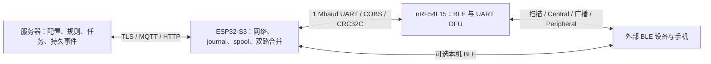
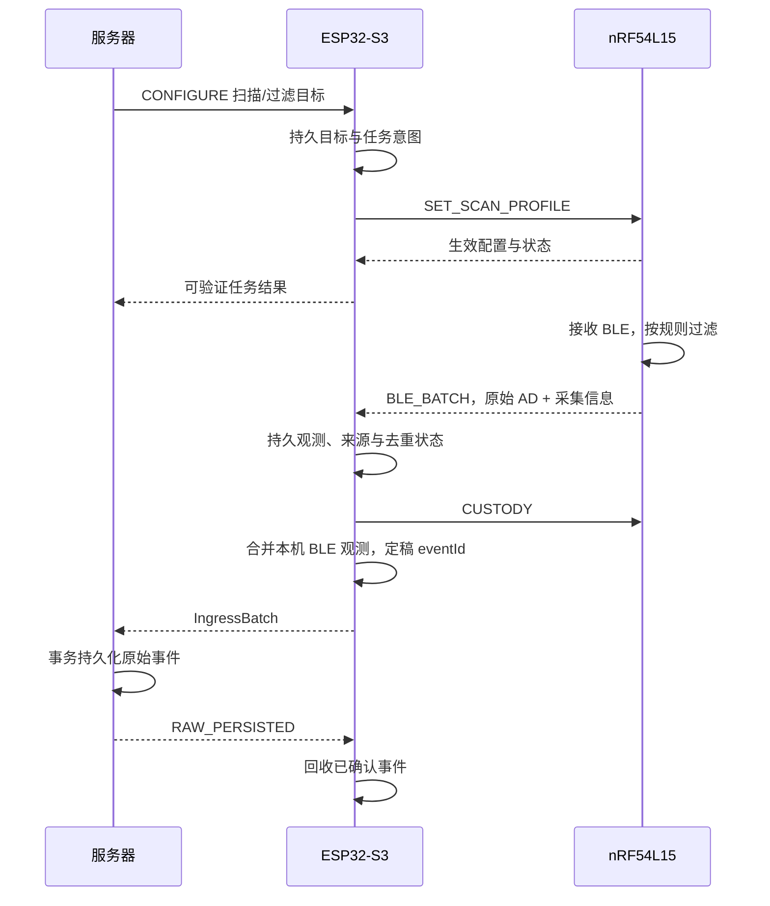
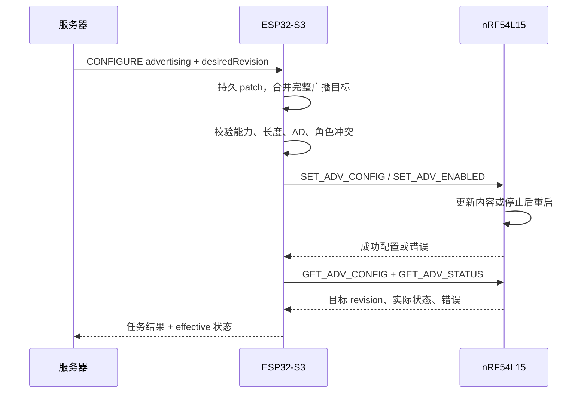
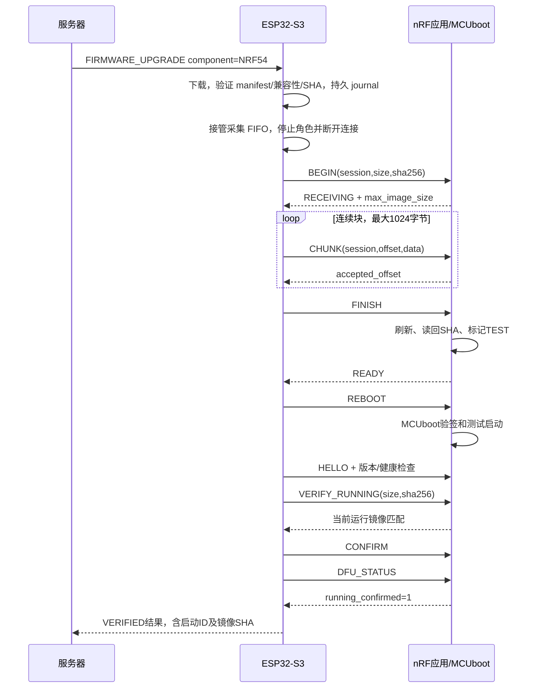

# GW32 系统流程与协议对接指南

基线：2026-11-18；nRF 固件 0.2.0。本文连接 [需求清单](gateway-requirements.md)、[UART 协议](../server/docs/gateway-uart-protocol.md) 与 [服务器协议](../server/docs/gateway-protocol.md)，不引入第三套字段定义。

ESP 执行器的详细开发与验收要求见 [ESP32-S3 软件需求](esp32s3-requirements.md)。

具体模块接口与状态机见 [ESP32-S3 开发指南](esp32s3-development.md)，配套事务和测试文档统一收录在 [文档索引](README.md)。

## 1. 两层接口及数据责任

当前 nRF 和服务端有实现；ESP 框内是真实固件待实现内容。模拟器仅用于软件流程验证，Python 探针仅用于串口联调。

| 管理意图 | 服务器接口/对象 | ESP 动作 | nRF 接口 |
| --- | --- | --- | --- |
| 扫描与过滤 | CONFIGURE / radios.nrf54 扫描组 | 合并目标、校验能力、编排角色、读回 | 0x05/0x06；基础兼容 0x01/0x02 |
| 广播配置 | CONFIGURE / radios.nrf54.advertising | Base64 解码、时间量化、完整 revision 配置 | 0x07/0x08 |
| 仅启停广播 | 同一 CONFIGURE 广播组 | 有 bit10 时使用简化命令，仍持久目标 | 0x0B；0x0C 查实际状态 |
| 连接与 GATT | GATT_* 任务 / 自动连接规则 | 验证证据、持久意图、序列化副作用、查询结果 | 0x10～0x18；0x0A 连接信息 |
| Peripheral 手机收发 | 云端业务契约待定义 | 认证、业务解析、路由和业务级 ACK | 上行 0x22；状态 0x0D、通知 0x0E、断开 0x0F |
| 网络 | CONFIGURE / network | 候选试用、绑定接口探测、应用 ACK 后提交 | 不发送给 nRF |
| 本地网页配网 | 手机/笔记本→ESP SoftAP安全会话 | 与远程共享候选管理；本地版本和云revision分离，明确离线保存/回退 | 不发送给 nRF；本地及云对账扩展待实现 |
| ESP 本机 BLE | CONFIGURE / radios.esp32 | 本机 BLE 驱动与同一合并队列 | 不发送给 nRF |
| nRF 升级 | FIRMWARE_UPGRADE / component=NRF54 | 下载校验、journal、维护、恢复与结果证据 | 0x30～0x37 |

表中的 `0x10～0x18` 为 CMD_REQ 内的 opcode；它与帧 type `0x10 CMD_REQ` 不是同一个命名空间。

## 2. 标识与持久化约定

| 标识 | 生命周期与用途 |
| --- | --- |
| gatewayId / namespaceId | 平台中的持久设备与安装身份 |
| nrf_boot_id | nRF 每次启动变化；隔离计数、连接和本次 RAM 状态 |
| link_id | ESP 发起 UART 握手时生成；旧会话帧不再执行 |
| msg_id | 同一 UART 控制会话的请求去重；批次帧中为 batch_seq |
| capture_seq / batch_seq | nRF 本次启动的观测/批次身份；ESP 用于接管幂等 |
| eventId | ESP 定稿事件身份；网络重发不变 |
| taskId / resultId | 云端任务与应用执行结果的持久去重键 |
| revision | 对应扫描、广播等配置组的生效目标；各组独立恢复 |
| conn_id / connectionRef | 芯片连接号与跨层连接引用；断链/重启后旧引用失效 |
| op_seq / tx_seq | Central 副作用操作及 Peripheral 通知受理序列，不能只靠 UART ID 跨重握手防重 |
| DFU session | ESP 持久绑定升级制品与当前 nRF 启动；nRF 重启后旧下载状态不保证保留 |

ESP 必须把配置目标、执行意图、事件 spool 和未确认结果写入可恢复存储。nRF 当前的业务配置、下载会话与采集 FIFO 位于 RAM；bond settings 的持久化不意味着其他状态也持久化。

## 3. 启动与恢复

1. ESP 恢复身份、最后可用网络、journal、spool、待合并数据和去重水位。
2. 打开带 RTS/CTS 的 UART，发 HELLO，记录 nRF 启动 ID 和能力。
3. 若只是 link_id 改变，保留当前 nRF 启动的配置/批次关联；若 nRF 启动 ID 变化，使旧连接失效、重新对账配置，并判断是否处于升级试运行。
4. 读取状态、扫描配置、广播配置及实际无线状态，和持久目标比较。不得靠一次“已发送”标为已生效。
5. 接入服务器并重试待确认事件与任务结果；恢复动作受任务有效期、授权和当前能力约束。
6. 未配置的 nRF 默认不扫描、不广播；自定义板未启用射频时只使用可用管理能力。

若处于未确认试运行，应优先完成升级健康检查和确认/回退决策，避免普通业务恢复耗尽确认窗口。

## 4. 扫描、合并与上报

同一 MAC 不等于同一事件。匹配必须区分 AD 字节、ADV/SCAN_RSP 和时间上下文；同无线电重复仍是独立观测。按服务器协议，每条观测最多等待 150 ms，到期选符合 50 ms 时间窗约束、尚未配对且时间差最小的另一射频候选，同差取先入队者。缺少有效时间映射或可比较上下文、以及迟到的记录分别保留。服务器解析与客户投递不阻塞原始持久 ACK。

## 5. 服务器自动连接

1. 服务器按 AD type 解析 16/32/128 位服务 UUID，保留原始位宽并统一表示。
2. 检查登记对端、授权规则、网关能力、冷却时间与新鲜 nRF 可连接 ADV。UUID 可来自可关联的 SCAN_RSP；iBeacon 厂商 UUID 不作为服务 UUID。
3. 服务器创建 GATT_CONNECT；ESP 再核对本地证据、nRF 启动和任务有效期。
4. 当前 nRF 不声明扫描/广播/连接并发能力。ESP 显式停止冲突角色，保存恢复目标，再请求连接。
5. nRF 建链后 ESP 用 `0x18 GATT_FIND_SERVICE` 查找规则指定服务，按规则需要发现特征，最后读取实际连接信息并派生 connectionRef。只有服务/特征与实际对端核验通过才完成自动连接任务，后续读写/订阅使用该连接。
6. 写入超时或断链且无法证明对端执行状态时报告 UNKNOWN，不盲重发；断链后旧引用失效，按有效目标恢复无线业务。

## 6. 服务器广播控制

三种 `mode` 是链路属性；Beacon/自定义是载荷格式。服务器下发完整 AD 的 Base64，不直接发送终端命令字符串。广播间隔使用毫秒，不把“每秒次数”当额外无单位字段。

同模式同间隔的内容更新使用在线更新；AD 与 ScanRsp 不是空口原子写。失败须恢复两者，恢复失败转 FAULT。手机已连接时实际状态可以为 PAUSED；关闭目标广播不会强制断开手机。手机 RX 数据不自动执行服务器命令，更不能以公开 GATT 写入替代任务授权。

## 7. 经 ESP UART 升级 nRF

前提是首次 SWD 安装专用公钥对应的 MCUboot 和匹配双槽布局。普通无 DFU 构建不得声明能力位 12；服务器也不能仅凭型号授予 `NRF54_UART_DFU_1`。

| 故障点 | 规定动作 |
| --- | --- |
| 控制响应丢失 | 沿用同一 msg_id 和内容重试；DFU 使用 30 s 等待 |
| UART 重握手但 nRF 未重启 | 读 STATUS，核对 session/摘要/偏移；不要重新擦除仍有效下载 |
| nRF 下载中复位 | 旧 RAM 会话不可作持久证据，重新 BEGIN 从 0 传输 |
| 块乱序、内容冲突或校验失败 | 停止推进，读取错误，按协议终止或重新开始 |
| FINISH 成功但未重启 | 仍是 READY，不能报告升级成功 |
| MCUboot 拒绝镜像或恢复旧镜像 | 新 HELLO 后核对实际镜像；不以相同版本字符串确认 |
| 试运行不健康/未确认 | 不发 CONFIRM；运行主循环超时复位，挂死由 ESP 硬件复位 |
| 确认窗口已过 | CONFIRM 返回 STALE，不能用迟到消息阻止回退 |
| 已确认但云端结果 ACK 丢失 | 重发稳定 resultId 的已持久结果，不再次下载或升级 |

当前服务器要求成功证据绑定任务制品 SHA；设备独立 nRF 版本登记和 `fromFirmwareVersions` 的限制见服务器协议。硬件强制防降级与断电跨启动续传未实现。

## 8. 本地网页配网与远程配置的衔接

现场授权打开限时SoftAP，手机/笔记本连接后用本机网页认证，填写Wi-Fi/以太网、DHCP/静态IP和主备顺序。本地凭据先安全保存，再建立独立transactionId的候选；实际接口通过TLS/设备身份挑战才显示平台可达。无互联网时用户可明确LOCAL_ONLY保存，保留lastVerified及旧凭据，不伪造云任务或成功修订。

平台远程仍走CONFIGURE→逐接口networkProbe→RESULT_PERSISTED→提交；修改密码先经拟新增秘密安装接口获得设备持久回执，再引用credentialRef。本地改动设置localOverride，联网后由管理员明确采用或覆盖，执行正式任务才同步平台revision。两入口共用网络租约，旧任务/OTA冲突先对账；详细协议和未实现接口见[配网设计](esp32s3-network-provisioning.md)。

## 9. 实施与验收入口

| 工作 | 入口 |
| --- | --- |
| nRF SDK 构建、板定义及 DFU 变体 | [固件 README](../firmware/nrf54l15/README.md) |
| 主机测试及验证限制 | [VALIDATION](../firmware/nrf54l15/VALIDATION.md) |
| 串口帧黄金向量与命令字段 | [UART 协议](../server/docs/gateway-uart-protocol.md) |
| 配置 API、JSON、升级任务和结果 | [服务器协议](../server/docs/gateway-protocol.md) |
| 服务器模拟器和自动连接 API 示例 | [协议联调](../server/docs/protocol-v11-integration.md) |
| 端到端验收用例及未实现清单 | [需求清单第 13～14 节](gateway-requirements.md#13-集成验收清单) |

本次没有生成已验证的可烧录镜像；没有执行真实网络、BLE 空口、目标 Flash 或硬件复位。联调时以实际记录更新验证结论，不把上述时序图视为整机已经执行的证据。
