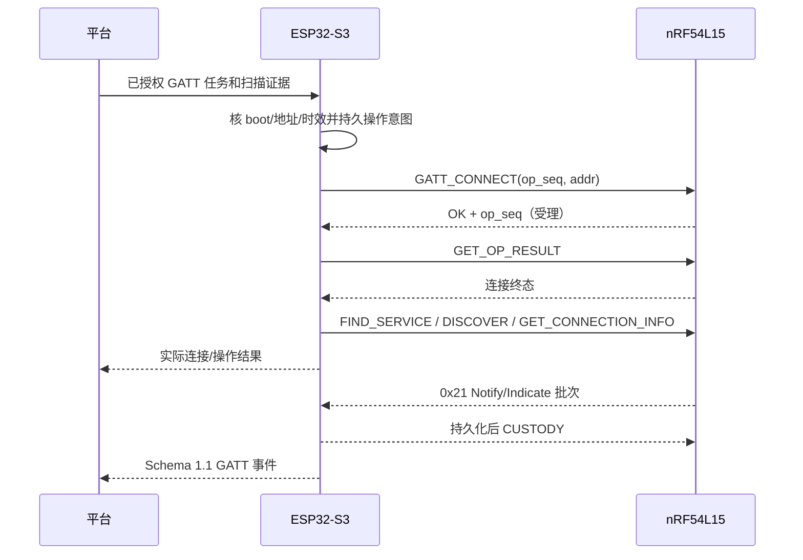

# nRF54L15 开发与三方接口贯通规范

文档版本：1.1；更新日期：2026-11-19；共同标准：**GW32-E2E-1.1**；核对源码：`9533a14`，nRF `0.2.0` / ESP `0.2.1`。本轮完善规划合同与开发步骤，Beacon V2待实现；不是源码修复或整机联调完成声明。

## 1. 开发依据

- [端到端统一标准](gateway-end-to-end-standard.md)：三方职责、兼容决策、冲突 C01～C12 及交付门槛。
- [差距实施方案](gateway-alignment-development-plan.md)：C01～C12的唯一实现决策、三方责任及关闭证据。
- [Beacon过滤规范](beacon-filter-spec.md)：名称/UUID/RSSI/Major/Minor掩码、服务UUID独立字段、REPORT/显式配对及BFLT向量。
- [nRF 需求](nrf54l15-requirements.md)：沿用总需求的 SYS/UART/SCAN/DATA/GATT/ADV/PER/OTA 编号。
- [UART 协议 1.2](../server/docs/gateway-uart-protocol.md)：所有偏移、字段长度、状态码和向量的唯一字节合同。线上帧版本仍为 `1`。
- [服务器协议](../server/docs/gateway-protocol.md)：Schema `1.0/1.1`、配置、任务及数据上报；[ESP 开发文档](esp32s3-development.md)：适配与持久化责任。
- [nRF README](../firmware/nrf54l15/README.md) 和 [验证记录](../firmware/nrf54l15/VALIDATION.md)：固定 NCS v3.2.1、构建入口、原板级约束与历史测试证据。

本轮只依据仓库合同及源码对照确认行为，不新增 SDK 能力或硬件结论。后续涉及 Nordic SDK/API 变更或目标开发时，先使用官方 Nordic MCP 获取适用版本的官方依据；不得拿较新 SDK API 静默替换固定基线。

## 2. 模块与执行边界

| 模块 | 职责 | 关键约束 |
| --- | --- | --- |
| `gw_core.c/h` | 帧编解码、ScanProfile、AD 过滤、FIFO 与批次 | 与 RTOS 无关；固定容量；队列调用者负责串行化 |
| `gw_app.c` | UARTE 接收、HELLO、请求缓存、命令分派、数据 ACK、轮询 | 主循环串行执行命令；队列与 BLE 回调间加锁；控制/ACK 不能被数据背压堵死 |
| `gw_radio.c/h` | 扫描/广播配置事务、角色状态、原始观测 | 检查冲突与故障；成功才提交 revision；保留恢复错误 |
| `gw_gatt.c/h` | Central 生命周期、操作序号、服务/特征发现、收发订阅 | 一连接、一在途动作、16 个发现句柄、4 条订阅 |
| `gw_peripheral.c/h` | 固定服务、手机连接、RX 队列和 TX notify | 连接资源与 Central 共用；不解释业务数据；TX 受理不代表远端已处理 |
| `gw_dfu.c/h` | 候选槽流式写入、状态、镜像读回、试启动确认 | 可选编译；双槽检查通过才声明 bit12；不更新 bootloader |
| `tools/uart_probe.py` / `adv_payload.py` | UART 联调参考、Beacon/原始 AD 生成 | 不替代 ESP 持久任务和平台授权 |

配置目标在 nRF RAM；bond 由 settings/NVS 管理。nRF 重启后的目标恢复以 ESP 已提交配置为准。FIFO 也是 RAM，不能把控制器复位描述成无损恢复。

## 3. UART 参数、身份与控制

### 3.1 串口与帧

串口固定 **1,000,000 baud / 8N1 / RTS+CTS / 3.3 V / UARTE20**。P1.04 TX 对 ESP18 RX；P1.05 RX 对 ESP17 TX；P1.06 RTS 对 ESP16 CTS；P1.07 CTS 对 ESP15 RTS。日志走独立接口。

```text
00 | COBS(magic="GW" | version=01 | type:u8 | payload_len:u16 |
          link_id:u64 | msg_id:u32 | payload[N] | crc32c:u32) | 00
```

数值小端、无结构体填充；MAC 与规范 UUID 按文本显示顺序，空口 AD 内部 UUID 按相应 AD 格式解析。CRC32C 使用反射多项式 `0x82F63B78`、初值及末异或 `0xFFFFFFFF`，黄金向量 `123456789→0xE3069283`。payload 最大 3072 B，解码帧最大 3094 B，含分隔符线上帧最大 3109 B。

### 3.2 身份生命周期

| 标识 | 宽度/来源 | 不可混淆的语义 |
| --- | --- | --- |
| `nrf_boot_id` | nRF 每次启动 16 B | 扫描/连接/DFU RAM 状态所属启动；平台通常显示为 32 位十六进制 |
| `link_id` | ESP 建链 u64 | UART 会话；重握手不清除当前 boot 的业务状态 |
| `msg_id` | u32 | 控制请求 ID 或数据 batch_seq；两者使用独立含义 |
| `capture_seq` | u64 | 成功入队观测序号；0x20/0x21/0x22 共用，从 1 起 |
| `batch_seq` | u32 | 冻结数据批次序号，三种类型共用，从 1 起 |
| `revision` | u64 | 配置组版本；scan 与 advertising 分别存储，0 为出厂值 |
| `op_seq` | u64 | Central 异步动作意图；ESP 发前持久化，跨串口重连查询 |
| `conn_id` | u32 | 当前 boot 内连接号；关联时还必须区分 Central/Peripheral 角色 |
| DFU session | u64 | 上传会话；与 boot、文件大小和 SHA 一起判断续传 |

`taskId` 是平台任务，`eventId` 是 ESP 定稿事件，两者不下沉替代 nRF 序号。UART 重握手清普通控制响应缓存，保留 FIFO、冻结批次、配置、连接、GATT 操作缓存、Peripheral notify 去重及 DFU RAM 状态；nRF 真正复位则相应 RAM 状态失效。

### 3.3 能力和错误

HELLO 请求为 `0x01` 空 payload；应答 `0x81` 为 boot[16]、caps:u32、版本长度:u8、版本字符串 1～63 B。只有当前实际能力与平台授权、ESP 适配交集内的命令才可下发。禁用 RF 的自定义板射频能力为 0；DFU 能力独立判断。

| 状态 | 值 | 主机处理 |
| --- | --- | --- |
| OK | 0 | 按命令继续读回或查询异步终态，不自动等同平台成功 |
| BAD_PARAM / UNSUPPORTED | 1 / 2 | 修正参数或能力；不得重复盲试 |
| BUSY | 3 | 先处理资源/维护冲突，退避后以新请求 ID 重试 |
| CONFLICT | 4 | 核对 revision、序号或重复请求字节，保留旧目标 |
| APPLY_FAILED | 5 | 读回实际状态和错误，不能仅靠 SET 超时推断失败已回滚 |
| STALE / NOT_FOUND | 6 / 7 | 旧意图/引用失效，按上层规则恢复，不能换目标重放物理写入 |

普通控制等待 500 ms，最多额外重试 2 次；DFU 擦写/整镜像校验使用 30 s。丢响应重发原 ID 和完整相同 payload；错误响应固定为 opcode+status 共 2 B。TIME_PROBE 使用未重试样本，避免重放响应污染时钟映射。

## 4. 控制映射与固定尺寸

下表响应长度均为成功 `CMD_RSP` 的 result 长度，不含前面的 opcode/status。详细参数以 UART 协议为准。

| 平台/主机动作 | UART opcode | nRF 成功 result | ESP 完成条件 |
| --- | --- | --- | --- |
| 扫描、过滤、Beacon 规则 | `05 SET_SCAN_PROFILE` / `06 GET_SCAN_PROFILE` | 19～2755 B ScanProfile | 完整配置相等，并核对扫描实际状态及允许的 PAUSED 原因 |
| 旧基础扫描接口 | `01 SET_SCAN_CONFIG` / `02 GET_SCAN_CONFIG` | 16～2320 B ScanConfig | 有规则时不得用旧 SET 绕过完整 profile 更新 |
| 状态 / 时钟探测 | `03 GET_STATUS` / `04 TIME_PROBE` | 71 B / 16 B | 长度、boot 和时间有效性一致 |
| 广播完整配置 | `07 SET_ADV_CONFIG` / `08 GET_ADV_CONFIG` | 14～76 B AdvConfig | 配置相等，再 `0C` 核对实际状态，C03 尚待源码补齐 |
| 广播快速启停 / 状态 | `0B SET_ADV_ENABLED` / `0C GET_ADV_STATUS` | 14～76 B / 35 B | 启停也带新 revision；目标 enabled 与实际状态分开 |
| 资源与连接状态 | `09 GET_RADIO_STATE` / `0A GET_CONNECTION_INFO` | 15 B / 14 B | 当前 boot 的目标 conn_id、地址、MTU、安全级别一致 |
| Peripheral 状态/回复/断开 | `0D` / `0E` / `0F` | 16 B / tx_seq 8 B / 空 | 不将 notify 受理或断开受理当远端业务完成 |
| Central 动作 | `10～16`、`18` | 接受时 op_seq 8 B | `17 GET_OP_RESULT` 取得终态；连接后还要读实际连接信息 |
| nRF 升级 | `30～37` | 30～34 为 62 B；35～37 为空 | 新 boot + 版本 + 健康 + 当前槽 SHA + running_confirmed |

当前旧引擎以 `SET_SCAN_PROFILE` 为完整入口，即便rule_count=0也不用其他含糊字段。规划V2使用0x19/0x1A完整包装，并以0x1B读实际状态；活跃V2时旧0x01/0x05/0x06返回CONFLICT，0x02只有基础子集。退回旧引擎必须显式0x19 engine=0，不能靠旧SET清除新规则。

## 5. 扫描配置与 UUID 规则

### 5.1 标准化

平台/ESP 输入 4 位、8 位或 36 字符 UUID。简写展开 Bluetooth Base UUID：`180D→0000180d-0000-1000-8000-00805f9b34fb`；`12345678→12345678-0000-1000-8000-00805f9b34fb`。UART 固定传标准文本从左到右的 16 个字节；不把整串按 u128 小端反转。空口 16/32/128 位 UUID 则先按 AD 规则解析再比较规范化值。

平台保留原始 `wireBits`；厂商 iBeacon UUID 不自动作为 GATT service UUID。UUID 列表去重后按 16 B 字典序，Company ID 去重后按数值升序。平台整数 ms 量化为 `ticks=(ms*8+2)/5` 的整数除法，单位 0.625 ms，扫描 interval/window 均为 16～16384 ticks。

### 5.2 既有LEGACY引擎过滤顺序

1. 检查完整报告和可处理长度，保留 ADV/SCAN_RSP 区别；未知地址不伪造为空口 public MAC。
2. 基础 RSSI、服务 UUID、公司 ID 各启用条件取 AND，单一列表内取 OR。
3. 按配置顺序找首条完整匹配的 Beacon 规则；DENY 拒绝、ALLOW 接纳。无命中且含 ALLOW 时拒绝，否则接纳。
4. 通过后按原样入 FIFO，成功入队才分配 capture_seq。同一无线电重复包不在 nRF 合并。

同一双路采集任务分别向 nRF/ESP 下发等价逻辑过滤目标并独立读回；两路配置能力仍相互独立。不能因为更新 nRF 过滤而隐式覆盖 ESP 目标，反之亦然；未形成可比较观测的报告分别保留。此项沿用 SCAN-008，按统一标准 C10 解释。

规则最多 8 条；`offset` 从 AD 的 Data 起算，不含 Length/Type；value/mask 等长 1～24 B，mask 至少一位非零，offset+n≤254。匹配不能把两个同 type 的 AD 拼起来。扩展报告 kind 位可留作合同兼容，当前未声明 bit0 时不能实际发送 EXT 报告。

### 5.3 Beacon V2实现设计（规划）

V2保持旧引擎行为与已有配置有效性，新增独立 `engine=V2`。所有新内容都按 [Beacon规范](beacon-filter-spec.md) 和 [UART 1.2 V2章节](../server/docs/gateway-uart-protocol.md#beacon-v2-组合掩码扩展规划待实现) 实施；不得把下面的计划结构写成当前已存在的函数。

| 开发位置 | 计划改动 | 必须保持的边界 |
| --- | --- | --- |
| `gw_core.c/h`，可拆计划 `gw_filter_v2.c/h` | V2配置解析/编码、typed谓词、AD合法性、字段掩码及完整上下文判定 | 纯C、无SDK依赖，由ESP共享相同源码；旧gw_filter_match的原行为不回写改变 |
| `gw_radio.c` | 接收完整报告并构造REPORT上下文或显式PAIR候选，原始时间/地址/字节均保存 | 配对缓存有界、同radio/boot/revision/真实地址、不拼接AD；字段缺失与无合法配对不同 |
| `gw_app.c` | bit13门控0x19/0x1A/0x1B；完整配置原子切换、回读、96 B状态编码 | 原帧3072 B上限不变；opcode/status长度单独计入；GET_STATUS仍71 B |
| ESP `gw_wire/gw_nrf` | 编码同一配置、检查bit13、0x19后0x1A逐字节读回、核0x1B | 目标配置和原请求分别保留；超总预算不能裁剪字段；本机BLE调用同一判定引擎 |
| 平台与共同测试数据 | JSON字段语义、原始报告输入和预期结果/编码向量统一 | 平台新增Schema后才能实际创建V2任务；当前机器Schema不因文档编辑而支持V2 |

配置目标采用两套明确引擎，一套活动。V2包装保留完整旧ScanProfile基础字段和唯一revision；V2时旧rule_count=0。激活/退回、名称来源变化、rule数组替换必须作为一个扫描组提交，解析、容量、角色条件均通过才切换。候选缓存绑定revision，切换或暂停时丢弃尚未判定记录并计数，避免把旧规则看到的名称配给新规则的UUID。配置失败时恢复旧完整引擎，不局部留下一半新规则。

#### 字段执行

- `fieldMask`决定启用哪些条件；同规则AND，规则间仍首条完整命中。名称、UUID、Major、Minor使用逐字节/数值掩码；RSSI支持RANGE与BITS，不能把“信号越强越通过”写成位掩码比较。
- 名称从0x09完整名/0x08短名提取，按显式source与EXACT/PREFIX处理；mask按UTF-8字节而非字符数。按规范处理ANY优先级和冲突重复名称，禁止随机选一个名称蒙混匹配。
- iBeacon固定4C000215头及25 B Data不能被用户mask跳过；启用的UUID/Major/Minor必须来自同一0xFF元组。UUID原字节顺序，Major/Minor先按空口大端解析为u16再与mask比较；UART数值仍小端。
- 服务UUID字段与iBeacon UUID分开。16/32/128位服务UUID先按AD类型/宽度解析，再规范化128位进行掩码比较；不要拿iBeacon厂商UUID去查询GATT服务。
- RSSI采用主报告元数据；-128未知在启用RSSI时整上下文拒绝。RANGE两端包含，BITS按有符号值的补码字节比较，例如-64/0xF0不是≥-64。基础minRssi与V2 RSSI仍同时有效，配置UI可提示矛盾但不能隐式删除条件。
- Typed V2的完整上下文AD必须合法；无所需字段是predicate false，畸形、未知RSSI或不支持上下文则按独立原因拒绝。无规则命中仍沿用有ALLOW则拒绝、否则放行，因此DENY不构成完整白名单。

#### 配对、容量与时序

REPORT不使用历史名字补字段。ADV_SCAN_RSP_PAIR必须主动legacy扫描、kind仅主ADV、500 ms固定窗口。查找同radio/boot/revision/地址类型/真实地址且前序的唯一未使用ADV；零候选不能伪造，多候选不能取最近一个。配对完整才评估该上下文的基础过滤和V2规则；RSSI用ADV，名称可来自显式范围内的SCAN_RSP，iBeacon各字段仍同一AD。

每个报告只属于一个上下文；配对成功通过后逐条原样进入原FIFO，保留各自kind与capture_ms。500 ms配对超时、歧义、缓存满或缺扫描响应均整组不放行；不能借“只有DENY而无命中默认通过”绕过配对准入。其缓存与ESP跨射频150 ms/50 ms去重不同：V2配对不消除记录，ESP之后仍执行原一对一跨radio合并。

缓存槽位、原始字节预算、溢出处理和验证向量按Beacon规范冻结；实现必须先核预算再接纳新候选，不动态无限增长。最大V2编码body为3070 B，单全字段规则含长度142 B；基础列表与8条最长规则可超总预算，必须在三方入口一致拒绝整个目标，不截断。旧2755 B profile包装后2763 B可完整使用，不能为V2降低旧容量。

#### 诊断与回归门槛

0x1B返回revision、引擎、范围、即时待判数量/字节和10项原始报告计数，固定96 B。所有计数同boot累计，配置切换不清零；每输入只seen一次、终态只落一个放行/拒绝原因，PAIR放行或规则拒绝通常对应两条报告。records_passed不是CUSTODY，后续FIFO满仍按旧dropped_full计数。

先建立同一份纯C黄金向量，由nRF与ESP执行，并用平台配置编译器核对相同UART字节；覆盖EXACT/PREFIX、短名/全名、UTF-8多字节、部分UUID/16与32位服务UUID、Major/Minor端序、未知与边界RSSI、BITS与RANGE差异、所有字段AND、首条DENY、缺字段、畸形AD、全零mask、未支持能力、长度预算、PAIR超时/歧义/溢出/清理、重复与重启恢复。最后真实空口核对原始ADV/SCAN_RSP仍分别上报。只有完整矩阵及目标资源预算通过后才声明bit13。

### 5.4 扫描报告映射

BLE 记录头为 24 B：capture_ms[0..7]、kind[8]、props[9]、addr_type[10]、addr[11..16]、rssi[17]、tx_power[18]、primary_phy[19]、secondary_phy[20]、sid[21]、ad_len[22..23]，随后原始 AD。RSSI/TxPower 都是 i8 dBm，-128 未知；SID 0xFF 未提供。未知地址 addr_type=0xFF 且地址全零，不能做地址自动连接或 MAC 匹配。

ESP 将通用 AD 映射为 `ble-ad-v1` 原始 Base64，上报使用 Schema 1.1 的 capture/observedBy 扩展；注册参考传感器可按已有规则使用 `reference-sensor-v1`，不得普遍剥掉原始 AD。完整映射和字段合法性见服务器协议，不向现有 RawEvent 随意追加 JSON 字段。

## 6. FIFO、时钟和三层确认

批次统一头为 `count:u16 | first_capture_seq:u64`，后接同类型记录。batch_seq 放帧 msg_id。首批/首记录均为 1，批内连续，冻结后序号与 payload 不变。上限 32 条和 2048 B，按类型边界分批；队首等待 50 ms 或容量条件满足时发送，一次一个在途数据批次。

| 层 | 确认 | 释放对象 |
| --- | --- | --- |
| nRF→ESP | `BLE_ACK(0xA0): CUSTODY=0` | ESP 已把记录与去重水位在 Flash 一起提交，nRF 才释放 RAM FIFO |
| ESP→平台 | `RAW_PERSISTED` 中 ACCEPTED/DUPLICATE | 释放对应 ESP 已定稿事件；HTTP 成功/MQTT PUBACK 不足以释放 |
| 平台→客户 | 客户投递 ACK | 平台独立 outbox，不反向阻塞已接管的 nRF 批次 |

`BUSY=1` 退避 250～5000 ms；`FAULT=2` 保留队首、停止自动发批次并继续诊断。FAULT 不被 HELLO 清除，无清队列命令；复位前先核对已接管数据及损失边界。

ESP 以 `(nrf_boot_id,batch_seq,first_capture_seq,count,type,SHA256(payload))` 持久辨识重放，不能只用 msg_id。0x22 是持久 INBOX，不进入跨无线电广播合并。当前源码已有这一分离，后续补平台业务时必须保留。

TIME_PROBE 返回 nRF 收/发单调时间；ESP 用未重试且扣除处理时间后 RTT≤50 ms 的样本建映射，每 30 s 刷新，锚龄超过 60 s 或 boot 改变则失效。没有可信 UTC 就上报 UNSYNCED 并省略 capturedAt，不能把 uptime 当时间戳；有效单调映射仍可供板内合并。

## 7. Central / GATT 操作闭环



每个动作专用参数前带 `op_seq:u64 + timeout_ms:u16`，超时 100～30000 ms。ESP 发送前保存 boot、完整请求和意图，恢复时先核 boot，再查结果；已受理 ACK 不能生成成功任务结果。Read 同步值走任务结果；Notify/Indicate 走 0x21，记录含 capture_ms、conn_id、实际地址、value_handle、kind、len、value；不按 payload 与广播去重。

0x21 kind=0 Notify、1 Indicate；长度 0～min(512,MTU−3)。收到 ATT Write Response 才可把 Write Request 判为成功；响应丢失且不能确认的物理写入保留 UNKNOWN。更换 op_seq 盲目重写会破坏幂等责任。

Central 发起时暂停扫描，连接成功继续暂停，失败或释放后按目标恢复。广播运行时 Central 连接 BUSY；Peripheral 已连接/对象未回收也阻止 Central。bit5～8 未声明期间，ESP 不得把并行角色提交当成功，并须保持各组持久目标可恢复。

## 8. 广播与手机数据

### 8.1 平台到 UART

| 平台字段 | UART 表达 | 约束 |
| --- | --- | --- |
| `enabled` | u8 0/1 | 目标值，不能代替实际状态 |
| `mode=NONCONNECTABLE` | 0 | 不可连接、不可扫描，scan response 必须为空 |
| `mode=SCANNABLE_NONCONNECTABLE` | 1 | 可扫描、不可连接 |
| `mode=CONNECTABLE_SCANNABLE` | 2 | 可连接、可扫描，要求 bit11 |
| `intervalMs` | interval_ticks:u16 | 100～10240 ms，160～16384 ticks |
| `advDataBase64` / `scanResponseBase64` | 各长度 u8 + 原始 AD | 分别≤31 B，完整 AD 校验；内容类型不增加线上字段 |
| `desiredRevision` | 独立 adv revision:u64 | 幂等、冲突和回滚与扫描配置规则一致 |

Beacon 是内容格式，mode 是无线连接/扫描属性；两者不能混为单个“广播类型”。iBeacon measured power 是 1 m 校准 RSSI；协议未提供服务器 RF 发射功率参数，`tx_power_dbm` 又属于接收报告元数据，不能复用为控制参数。

AdvStatus 固定 35 B：revision@0、enabled@8、state@9、mode@10、interval_ticks@11、adv_len@13、rsp_len@14、last_driver_error:i32@15、last_apply_ms:u64@19、live_updates:u32@27、start_count:u32@31。读取 AdvConfig 只能证明目标；完成配置任务还要核实际状态。手机已连接造成 PAUSED 是合法的目标保留状态，须结合 PeripheralState 说明原因；不能把 FAULT 当成这种例外。

只改内容可在线更新，模式/间隔变化重启；失败尝试恢复旧配置，恢复失败 FAULT。两次 HCI 数据写入不能保证空口同时切换。手机连接使广播暂停，关闭广播不自动断开手机；显式 `0x0F` 并轮询 `0x0D` 到无连接，才证明连接资源回收。

### 8.2 Peripheral 固定契约

服务 `7be00001-4b5a-4c31-9d91-6c2f9a0b5400`，同后缀特征：INFO=`7be00002` Read，RX=`7be00003` Write Request，TX=`7be00004` Notify。INFO 固定 13 B：version=1、caps:u32、uptime_ms:u64。RX 只接受 1～min(512,MTU−3) B，队列满返回 ATT 错误。

RX 进入 0x22，24 B 头与 GATT 形似但 channel=1 是固定 RX 通道，不是 Central value handle；kind=0。ESP 现有 `gw_capture_nrf` 写持久 INBOX 后 CUSTODY，INBOX 满返回 BUSY。后续平台业务封装、认证和回发任务属于 C05，不能把不透明 RX 伪装为 RawEvent 广播/GATT_NOTIFY，也不能据此执行配网/OTA。

回复 `0x0E` 参数为 tx_seq:u64、conn_id:u32、len:u16、value，返回 tx_seq 表示本机受理；同 seq 同内容幂等，业务送达由应用自定义应答证明。关联须含 nrf_boot_id 和 Peripheral 角色。

## 9. nRF OTA 状态机与主机编排

入口保留 `FIRMWARE_UPGRADE(component=NRF54)`，不指定 component 仍按现有 GATEWAY 兼容行为。ESP 本地及平台远程主固件 OTA 是另一组件，不能写 nRF 槽或复用 nRF 版本。

```text
平台授权制品 → ESP 验 manifest/型号/硬件/格式/大小/SHA 并持久 journal
→ 维护准入与无线静止/连接对象回收 → DFU_BEGIN → 连续 DFU_CHUNK
→ DFU_FINISH（读回完整文件 SHA，设置 TEST）→ 接管残余 FIFO
→ DFU_REBOOT → 新 HELLO/实际版本/健康 → VERIFY_RUNNING → CONFIRM
→ DFU_STATUS.running_confirmed=1 → 平台组件结果
```

### 9.1 固定状态尺寸

| 偏移 | 字段 | 类型 |
| --- | --- | --- |
| 0 | session | u64 |
| 8 | state | u8：0 IDLE、1 RECEIVING、2 READY、3 FAULT、4 ABORTED、5 REBOOT_PENDING |
| 9 | running_confirmed | u8 0/1 |
| 10 | accepted_offset | u32 |
| 14 | image_size | u32 |
| 18 | max_image_size | u32 |
| 22 | last_error | i32 |
| 26 | sha256 | 32 B |
| 58 | confirm_remaining_ms | u32 |

总长 **62 B**，nRF `GW_DFU_STATUS_SIZE` 和 ESP `dfu_status` 当前一致。不得添加字段而仍按 62 B 解析。状态 digest 属于上传会话，不等于当前运行镜像已证明；确认必须另做 VERIFY_RUNNING。

### 9.2 传输与恢复

- BEGIN 参数 44 B；CHUNK 头 14 B、数据 1～1024 B，首块至少 32 B；FINISH/ABORT/REBOOT 参数为 session 8 B；VERIFY_RUNNING 参数为 size:u32+SHA32 共 36 B。
- 传输文件是完整 `zephyr.signed.bin`，含头部和签名 TLV，flags=0 的未压缩未加密镜像；manifest 验签和 MCUboot 镜像验签是两层信任校验。
- 候选槽上限以运行时 `max_image_size` 为准，不能固定为缓存分区大小。当前布局保留空间后的 600 KiB 不是通用常量。
- CHUNK offset 连续，只有最近相同块可重试；先按原 UART ID 重试丢响应，重握手后查询 session/大小/SHA/offset。accepted_offset 含 RAM 缓冲。下载中 nRF 真正复位后旧 RAM 会话失效，先依据 journal 和当前镜像对账；有效授权下重新传输须 BEGIN 从 0 开始，不承诺同一任务必自动重传。READY 以后重启可能已进入试启动，应先核验当前镜像并按确认/回滚流程处理，不能一律重新 BEGIN。
- 活跃 DFU 禁止业务变更，仅保留状态/查询等允许命令。READY 仍是维护期，需 REBOOT 或 ABORT 退出；ABORT 恢复目标要确认连接对象已回收。
- REBOOT 应答不是升级成功。新启动即使版本字符串相同，也要按 manifest 精确长度/SHA 验证当前主槽，再 CONFIRM；读回 running_confirmed=1 后报告成功。
- 试启动默认 120 s，主循环正常时到期触发复位；挂死/无法启动需 ESP 硬件恢复，C04 尚未实现完整路径。错 boot、错 SHA、过期、回滚不得生成成功结果。

## 10. 本轮审计结论与后续源码任务

| 标准项 | 已核对位置 | 后续工作，仍不改变功能 |
| --- | --- | --- |
| C01 实现状态过时 | nRF README 对比 ESP `components/gw_actions/gw_ota.c` | 本轮修正文案为“已有执行器源码，目标/实板分别验收” |
| C03 广播实际状态 | ESP `components/gw_nrf/gw_nrf.c:gw_nrf_advertise`、`gw_actions.c:gw_actions_configure` | SET/GET 后补 AdvStatus 校验，故障与合法 PAUSED 分开；结果带实际依据 |
| C04 硬件恢复 | ESP `gw_nrf.c:gw_nrf_init` 仅 GPIO8 输入释放 | 在硬件基线匹配后完成复位恢复编排、启动超时和 MCUboot 回退故障注入 |
| C05 手机业务闭环 | nRF `gw_peripheral.c` 与 ESP `gw_capture.c:gw_capture_nrf` | 保留持久 INBOX，按差距实施方案的已定合同实现认证、平台业务消息、回复任务及应用 ACK；不滥用旧事件字段 |
| C06 独立 nRF 版本 | HELLO/升级结果已有版本，平台仍缺可信独立登记 | 实现证明/登记及 fromFirmwareVersions 比较；完成前保守拒绝不能证明的前置版本 |
| C11 升级阶段与重启 | ESP `gw_ota.c:nrf_transfer` 发现 previousBoot 变化即调用 nrf_trial；版本仍为旧已确认镜像时可能记为 ROLLED_BACK，未区分下载中断 | 根据 journal 区分下载中断、READY/试启动与真正回滚，保留当前镜像校验；重传须有效授权并 BEGIN 从 0，不承诺同一任务必自动重传 |
| C12 Beacon V2 | 旧gw_filter_match仅单AD片段/首条规则，不能表达多字段AND、名称完整长度及显式报告配对 | 按5.3节、Beacon规范及UART1.2实现共享引擎/能力门控/读回/96 B计数；保留旧引擎行为并通过BFLT矩阵 |

静态核对已确认 UART 帧、UUID 16 B 规范表示、三种广告 mode、62 B DFU 状态、71 B状态及三类批次基本布局在当前 nRF/ESP 实现间一致。此结论只针对已阅读的源码合同，不表示无线时序、持久掉电或 MCUboot 真实验签已通过。

## 11. 开发与验证顺序

1. 先保持本标准和两份链路协议一致，按差距实施方案将C03/C04/C05/C06/C11分配到ESP/平台实现；C12由三方共享合同与测试向量，保留需求与原编号。
2. 在 nRF 目录按 README 执行 `scripts/Test-Host.ps1` 和 Python 工具测试；新增状态/边界修改应使用针对性故障用例，不只检查结构大小。
3. 在固定 NCS v3.2.1 工具链分别构建 DK、自定义板 RF 禁用、自定义板已调试 RF、DFU sysbuild，保存 RAM/Flash 占用与版本信息。当前仓库记录尚无 nRF 目标构建通过证据。
4. 先实板 UART/流控，再过滤/扫描、角色转换、广播/Peripheral、Central/GATT，最后升级和电源故障注入。覆盖共享 FIFO 类型切换及 ESP spool 满的背压。
5. 按 [专项需求验收矩阵](nrf54l15-requirements.md#11-验收矩阵) 记录预期、实际、软件提交、板版本、日志和失败原因。配置成功需配置与实际状态双验证；升级成功需当前运行镜像与确认双验证。
6. 发布包归档固件、SDK/配置、源码提交、分区、SHA、签名公钥标识及测试报告；未通过相应条件的能力不登记为生产支持。
