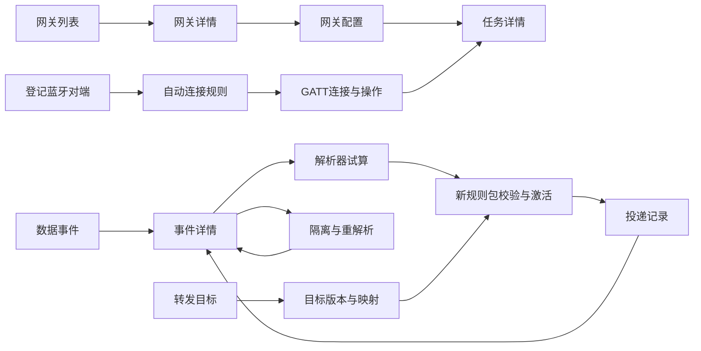

# 蓝牙网关管理前端总体规划

规划版本：1.0。编制日期：2026-11-07。功能基线：服务器 0.2.0、API 1.8.0、GW32I33V2 嵌入式协议 1.1；核对源码提交 `fa2174a`。

建议建设 **7 个功能大类、23 个业务页面、1 个登录页，共 24 个页面**。侧栏只放 **18 个入口**，其余 **5 个业务页面**从列表、对象链接或操作入口进入。页签、抽屉、对话框和不同型号的配置分区不重复计为页面。

产品面向客户服务器上的自有网关管理与数据接入。前端重点是网关配置、可靠任务、蓝牙连接、数据解析转发以及客户开发接入。页面中的状态和操作必须来自服务器当前能力与权限，客户业务应用通过接口另行构建。

本规划给出拟建页面与交互，不代表这些页面已经编码上线。当前管理页面仍是基础登录与 JSON 查询界面；下文 `/ui/...` 是拟建浏览器路由，`/api/...` 才是已核对的后端接口。结构化目录见 [frontend-pages.json](frontend-pages.json)。

## 1 分类与页面总数

| 大类 | 业务页面数 | 侧栏入口数 | 页面组成 |
| --- | ---: | ---: | --- |
| 运行概览 | 1 | 1 | P01 运行概览 |
| 网关设备 | 3 | 1 | P02 网关列表；P03 网关详情；P04 网关配置 |
| 蓝牙连接 | 3 | 3 | P05 蓝牙对端；P06 GATT连接与操作；P07 自动连接规则 |
| 数据处理 | 5 | 4 | P08 数据事件；P09 事件详情；P10 解析器与试算；P11 解析规则包；P12 隔离与重解析 |
| 客户转发 | 3 | 2 | P13 转发目标；P14 目标版本与字段映射；P15 投递记录 |
| 任务与升级 | 3 | 2 | P16 命令任务；P17 任务详情；P18 固件与签名制品 |
| 系统管理 | 5 | 5 | P19 项目与分组；P20 账号与应用凭据；P21 系统运维；P22 审计日志；P23 接口与对接指南 |
| 业务合计 | **23** | **18** | 其中 P03、P04、P09、P14、P17 为上下文页面 |
| 独立访问页面 | **1** | **0** | P00 登录 |
| 总计 | **24** | **18** | 权限不足、未找到、会话失效是公共状态，不另算业务页面 |

分类依据是操作者要完成的工作：网关安装配置、蓝牙连接控制、数据处理、客户交付、任务追踪、实例维护。一个命令不单独建一页；同一任务中心承接配置、重启、诊断、GATT 和固件升级的结果。一个对象的创建和编辑复用抽屉或向导；长内容与可独立分享的排查过程采用详情路由。

页签也不新增页数。例如 P04 的网络、两路扫描、两路广播、上传参数属于同一配置页；P12 的隔离列表和重解析向导属于同一处故障处理入口；P20 的人员、应用和凭据属于同一身份管理页。

## 2 全局布局与公共组件

推荐桌面管理工作区以 1440 × 900 设计、1280 宽作为主要使用尺寸。采用左侧导航、顶部身份栏、面包屑和主内容区；详情页保留父类导航高亮。

```text
┌──────────────┬───────────────────────────────────────────────┐
│ 产品名称      │ 当前实例 / 面包屑                当前用户 / 退出 │
│              ├───────────────────────────────────────────────┤
│ 7 类导航      │ 页面标题 + 说明                 主要操作         │
│ 18 个入口     ├───────────────────────────────────────────────┤
│              │ 筛选 / 版本 / 当前对象上下文                     │
│              ├──────────┬─────────────────────┬──────────────┤
│              │范围/目录  │ 表格、表单或正文      │ 按需详情/差异 │
│              │按需显示   │ 主工作区             │ 不常驻占位    │
│              ├──────────┴─────────────────────┴──────────────┤
│              │ 分页 / 提交操作 / 最近刷新时间                   │
└──────────────┴───────────────────────────────────────────────┘
```

建议导航宽 216 px、顶栏高 56 px、内容间距 24 px、页内辅助目录约 220–240 px、编辑抽屉宽 440–640 px。主区宽度不足时先收起页内目录，再将右侧差异区移到表单下方；1024 宽可收起全局导航，移动端采用单列及可打开的导航。数据表保留身份和状态列，其余列允许用户展开；确有必要的宽表在自身区域横向滚动。上述尺寸是设计起点，验收以文本可读、键盘可达和不遮挡操作为准。

基础字号 14 px，正文和表格行高保持可读。状态同时使用文字与颜色；原文字节、UUID 和摘要使用等宽字体，长值截断时可展开/复制。日期显示本地时区并可查看原始 UTC，界面明确区分采集时间、服务器接管时间、确认时间。

### 公共组件

| 组件 | 职责 |
| --- | --- |
| 应用外壳与导航 | 当前用户、面包屑、权限内入口、404/403、登录跳转 |
| 资源范围树与网关选择器 | 按实际 scope 和 gateway 权限选择对象，避免全量无界加载 |
| 游标表格 | 查询条件、固定身份列、加载更多、已访问游标回退、快照时间；无 total 时不显示总页数 |
| 状态标识与阶段指示器 | 区分在线/生命周期、任务状态/验证阶段、数据接管/客户确认 |
| 能力与权限动作组件 | 依据角色、对象范围、设备 capability 和状态判断操作，并提供禁用原因 |
| 版本与差异组件 | ETag、revision、不可变版本、配置 patch 和本次改动预览 |
| 任务创建及结果组件 | 统一幂等键、有效期、提交后跳转/跟踪、取消与 UNKNOWN 处理 |
| 字节和结构化数据查看器 | Hex/Base64/JSON，以文本渲染，按 data:raw 权限加载 |
| 错误与冲突组件 | 错误码、字段定位、traceId、保留草稿、刷新比较及重试引导 |
| 向导和编辑抽屉 | 创建/修改/确认，焦点返回原触发控件，关闭前提示未提交修改 |

公共空态至少区分：从未配置、筛选无结果、暂无权限、接口暂不可达、记录未找到、原文已回收、数据采样已过期。普通提示不覆盖字段错误，后台轮询失败也不能把已有数值改成零。

## 3 页面之间的主要业务路径



图中的自动规则到连接、规则包到投递是业务关系，不表示已有专门的关联查询接口。首期按现有网关/目标筛选及已知对象 ID 跳转；补齐关联查询后再提供一键追踪。

### 首次使用

1. 部署人员在服务器完成初始化与证书/Broker配置，用户登录。
2. 管理员配置项目和分组，导入经过签名的自有网关清单。
3. 在网关详情确认设备身份、在线状态与声明能力，按组提交配置并核对任务结果。
4. 建立客户目标和字段映射版本，选择解析器，创建、校验并激活规则包。
5. 从数据事件核对接管与解析，从投递记录核对客户应用确认。
6. 需要连接式业务时，登记静态对端、配置自动连接规则，再使用 GATT 操作和通知数据链路。

### 日常异常处理

- 设备不在线：网关详情→最近已知状态→诊断/部署说明。页面不能承诺离线设备即时响应。
- 解析错误：隔离→事件原文→解析器试算→新规则包→重解析预览→提交→核对新处理revision。
- 客户未确认：投递记录→错误码/目标版本→检查接收端→人工重试原投递；解析错误另走重解析。
- 物理动作结果未知：任务详情→UNKNOWN解释→诊断/设备证据对账。界面不重复执行未知写入。

## 4 必须保持一致的交互规则

### 配置和任务

- 配置 GET 的 desired/reported 是最新 patch。完整表单只能使用带来源、版本、采样时间的有效快照；未读到的字段显示“未获取”。首期允许提交明确的局部变更，不能自动填默认值覆盖未知配置。
- PUT 配置携带服务器返回的 ETag、expectedReportedRevision、expiresAt 和幂等键。PATCH 账号、范围、对端、自动规则等也使用对应资源的 If-Match。412/409 后保留草稿并重新比较，不自动覆盖。
- 同一次用户意图因超时重试时复用原幂等键与完全相同的内容。用户修改请求后视为新意图；先解释前次结果不确定的情况。应用令牌签发等未提供幂等包装的接口不自动重试。
- 配置提交、设备接收、执行、实际验证分别显示。步骤条依据 state/executionStage，不补造百分比和阶段时间。Network probe 的全部历史当前不可查询，首期显示任务已有执行证据和最终结果。
- 每个网关存在未决任务时按服务器裁定显示“已有任务进行中”。UNKNOWN 不自动等同FAILED，也不因网页倒计时结束释放连接占用。
- 只对尚未派发的 QUEUED 任务显示“尝试取消”，处理派发竞争导致的 TASK_ALREADY_DISPATCHED。规则停用只阻止后续自动触发。

### 数据和版本

- T1接管、解析完成、客户应用确认是三个事实。业务已接收必须来自DELIVERED及对应确认，不能由HTTP状态或MQTT PUBACK代替。
- 规则包和目标版本不可原地修改。界面用“复制为新包/新版本”，再校验、激活或引用。新增目标版本不改变已有outbox中的冻结版本。
- 源事件身份是 namespaceId、gatewayId、eventId；连接身份是 namespaceId、gatewayId、connectionRef。浏览器链接与缓存键不可只用eventId或connectionRef。
- 重解析先选择范围、生成预览、确认摘要，再提交。预览过期、范围变化或恢复对账锁定必须重新处理，不能复用失效结果。
- 1.0历史数据没有capture属于正常兼容情况。重处理或浏览器刷新不改变原上行版本与采集身份。

### 查询、刷新和错误

- 管理分页与数据分页分别遵循服务端游标协议；统一组件支持“下一批/加载更多”和本会话已访问游标回退，不提供任意页码跳转。换筛选清空旧cursor。
- 默认每页50条，允许50/100/200；没有total时显示“本批50条/已加载100条”，不能写成“共100条”。大范围返回QUERY_TOO_BROAD时引导缩小范围。
- 登录身份/能力按需获取；概览建议15秒，网关列表10秒，活跃任务详情2秒并在长等待时退到5–10秒。列表页不并发轮询每个任务，隐藏窗口暂停或显著降频，终态停止轮询。
- 所有轮询间隔为前端初始策略，可结合负载调整；当前无SSE/WebSocket事件推送，不把轮询包装为真正实时流。
- 401转登录并保存不含秘密的返回位置；403显示权限不足；404显示对象不可用；409/412显示冲突；422定位字段或业务约束；429尊重Retry-After；503保留旧数据及采样时间。错误细节保留traceId便于排查。

### 凭据和浏览器存储

同源Cookie会话与CSRF头沿用现有服务端认证。密码、应用token、秘密value、原始payload和敏感配置不写localStorage、URL、前端日志或错误上报。URL只保存非敏感筛选和对象ID；原始报文只在当前受权视图内存中存在。对外消息示例采用占位符，应用token只在签发成功时展示一次。

## 5 角色和范围

角色权限以 `auth/me` 返回的绑定和后端对象校验为准。前端隐藏按钮是交互设计，服务端授权仍是最终裁定。对于同一用户多个角色绑定，必须将“权限”和“绑定范围”一起判断，不能把不同范围的权限拼成全局授权。

| 能力 | ADMIN | DEVICE_ADMIN | OPERATOR | DEVELOPER | AUDITOR |
| --- | --- | --- | --- | --- | --- |
| 查看网关/蓝牙摘要 | 全部 | 范围内 | 范围内 | 范围内 | 范围内 |
| 修改网关/分组归属 | 可 | 范围内 | — | — | — |
| 配置、重启、诊断 | 可 | 范围内 | 范围内 | — | — |
| GATT执行/自动规则管理 | 可 | 范围内 | — | — | — |
| 解析器目录 | 可 | 可 | — | 可 | 可 |
| 解析器试算 | 可 | — | — | 可 | — |
| 规则包读取 | 可 | — | — | 实例范围 | 实例范围 |
| 规则包创建/校验/激活 | 可 | — | — | — | — |
| 客户目标读取 | 可 | 实例范围 | — | 实例范围 | 实例范围 |
| 目标/映射/秘密写入 | 可 | — | — | — | — |
| 数据/投递读取 | 可 | — | 范围内 | 范围内 | — |
| 原文/重解析 | 可 | — | — | 范围内 | — |
| 投递重试 | 可 | — | 范围内 | 范围内 | — |
| 固件发布 | 可 | 范围内 | — | — | — |
| 审计日志 | 可 | — | — | — | 范围内 |
| 系统状态 | 可 | 实例范围 | 实例范围 | — | 实例范围 |
| 账号/凭据/维护导出 | 可 | — | — | — | — |

DEVELOPER 当前并不能修改解析规则或客户目标；如果希望赋予这类权限，应单独修改后端角色策略并测试。解析器目录/试算当前仅检查对应权限，不要求实例范围；规则包、客户目标、秘密等全局配置接口则要求实例范围。维护作业查询还检查作业所有者或实例维护权限。

默认入口按可访问能力选择：实例运维用户进入P01；没有实例状态权限的设备管理员进入P02；开发者优先进入P08；审计用户按范围进入P22或P02。P23只要求登录，作为无业务范围时的可用入口。

## 6 逐页规格

每页包含用途、路由、区域布局、主要字段、操作、真实接口、权限、实现边界与验收点。布局中的“右”通常是按需抽屉或辅助区，不要求一直占据桌面空间。计划数据来自 [frontend-pages.json](frontend-pages.json)，页面编号保持稳定。

### P00 登录

登录客户本地安装实例，并恢复上次有权限访问的页面。

所属：独立访问。入口：独立登录入口。拟建路由：`/ui/login`。开发阶段：1。

| 区域 | 布局内容 |
| --- | --- |
| 上 | 产品名称、客户本地部署标识 |
| 主 | 居中的账号、密码、登录按钮；保留首次初始化说明入口 |
| 下 | 登录错误与重试提示；部署文档入口 |

主要字段：`账号`；`密码`。

操作：登录；查看初始化说明。

权限：登录入口无需账号权限；会话信息仅本人。

现有接口：

- `POST /api/v1/auth/sessions`
- `GET /api/v1/auth/me`
- `DELETE /api/v1/auth/sessions/current`

实现边界：

- 不提供不存在的自助注册、短信验证或邮件找回密码。
- 不持久保存密码或应用令牌；会话使用同源 Cookie，变更请求携带 CSRF Token。
- 开发者无 system:read，登录后按权限进入数据事件等首个可访问页面。

验收：错误口令、429、会话失效均有明确提示；刷新页面恢复会话；无权限入口不反复请求系统状态。

### P01 运行概览

让运维人员判断当前服务是否就绪、存储是否接近额度、投递是否积压。

所属：运行概览。入口：侧栏菜单。拟建路由：`/ui/overview`。开发阶段：1。

| 区域 | 布局内容 |
| --- | --- |
| 上 | 实例ID、软件版本、最近刷新时间和手动刷新 |
| 主 | 服务就绪、已用存储/额度、原文与未完成投递载荷字节、最老待投递时长四个摘要区 |
| 左 | 管理库、数据管线等组件状态列表 |
| 右 | 当前数据节点与激活规则包；进入任务、投递、运维的权限内快捷入口 |
| 下 | 磁盘可用空间与预留空间说明；当前状态采样时间 |

主要字段：`ready`；`storageBytes / storageLimitBytes`；`queueBytes`；`oldestPendingAgeSeconds`；`diskFreeBytes`；`activeBundleId`。

操作：刷新；查看投递；查看系统运维。

权限：system:read 且实例作用域。

现有接口：

- `GET /api/v1/system/status`

实现边界：

- 不展示无数据源的CPU/内存曲线、全局设备总数、今日流量、成功率或告警数量。
- queueBytes 包含全部现存原文和未完成投递的载荷字节，不等于未确认事件总数；storageBytes 包含数据库及WAL等存储占用。
- 无实例权限时隐藏该入口，不用部分列表条数替代全局统计。

验收：所有数字可追溯到一次系统状态响应；接口失败显示最近采样时间和数据过期状态，而不是清零。

### P02 网关列表

查看和管理自有网关的分组、生命周期及接入状态。

所属：网关设备。入口：侧栏菜单。拟建路由：`/ui/gateways`。开发阶段：1。

| 区域 | 布局内容 |
| --- | --- |
| 上 | 标题、导入签名清单按钮、刷新 |
| 左 | 实例/项目/分组树；选择分组形成服务端groupId查询 |
| 主 | 生命周期筛选及网关表格；行点击进入网关详情 |
| 右 | 导入向导或修改名称/分组/状态抽屉，按操作打开 |
| 下 | 游标翻页、当前已加载条数、snapshotAt |

主要字段：`名称 / gatewayId`；`SN`；`型号`；`硬件/固件版本`；`分组`；`生命周期`；`在线状态`；`最近上报时间`。

操作：导入签名设备清单；查看详情；修改名称/分组；停用/退役。

权限：gateway:read；导入/修改需gateway:write，上传清单制品还需实例artifact:write；检查源/目标分组。

现有接口：

- `GET /api/v1/gateways`
- `GET /api/v1/resource-scopes`
- `POST /api/v1/gateway-imports`
- `PATCH /api/v1/gateways/{gatewayId}`
- `POST /api/v1/artifacts`

实现边界：

- 服务端仅支持groupId和生命周期state筛选；名称/型号检索若先做只能明确标注本页筛选。
- 不把online当成生命周期state，不显示定位地图。
- 没有删除实体或匿名批量发现；设备清单导入不等于生产Broker开户。

验收：筛选变化清空旧cursor；跨组移动被拒时保留原分组；导入设备身份和制品签名结果明确显示。

### P03 网关详情

以单个网关为入口关联配置、诊断、任务和数据。

所属：网关设备。入口：上下文页面。拟建路由：`/ui/gateways/:gatewayId`。开发阶段：1。

| 区域 | 布局内容 |
| --- | --- |
| 上 | 返回网关列表、名称/SN、在线/生命周期、进入配置与创建诊断任务 |
| 主 | 概况、能力、诊断、关联任务四个页签；有数据权限时增加数据入口 |
| 右 | 操作面板：配置、重启、固件升级、进入蓝牙连接，按实际capability及权限启用 |
| 下 | 当前configuration revision、lastTaskId、最近已知状态与更新时间 |

页内分区：概况；声明能力；诊断结果；关联任务。

主要字段：`网关身份和版本`；`capabilities`；`desiredRevision`；`reportedRevision`；`lastTaskId`；`诊断result.details`。

操作：进入配置；创建诊断任务；重启；关联任务；关联数据。

权限：gateway:read；动作需task:create及gateway:configure/gateway:reboot/diagnostics:run等对应权限。

现有接口：

- `GET /api/v1/gateways/{gatewayId}`
- `GET /api/v1/gateways/{gatewayId}/configuration`
- `GET /api/v1/tasks`
- `POST /api/v1/tasks`
- `GET /api/v1/tasks/{taskId}`

实现边界：

- 设备诊断是持久任务，界面显示已知结果及采样时间，不假装持续在线仪表。
- capabilities来源于已授权设备档案；不只按GW32型号打开全部操作。
- 不展示当前无接口的CPU、连接设备总数、温度和无线覆盖图。

验收：从任务或网关列表深链接进入后均能重载；禁止操作给出能力/权限/状态方面的具体原因。

### P04 网关配置

按配置组提交可审查的变更，并追踪设备验证结果。

所属：网关设备。入口：上下文页面。拟建路由：`/ui/gateways/:gatewayId/configuration`。开发阶段：1。

| 区域 | 布局内容 |
| --- | --- |
| 上 | 网关身份、desired/reported revision、诊断快照时间 |
| 左 | 网络、nRF扫描、nRF广播、ESP扫描、ESP广播、上传参数六个分区 |
| 主 | 当前分区的表单；每字段区分已知值、未知值和本次修改 |
| 右 | 本次差异、配置组范围、能力校验提示；窄屏移到表单下方 |
| 下 | 取消草稿、检查变更、提交任务；显示新任务链接和当前阶段 |

页内分区：网络；nRF扫描/过滤；nRF广播；ESP扫描/过滤；ESP广播；上传参数。

主要字段：`上行顺序 / DHCP或静态IPv4`；`Wi-Fi SSID / security / credentialRef`；`扫描间隔/窗口/过滤条件`；`Beacon规则`；`广播AD/扫描响应`；`批量记录数/刷新间隔`。

操作：读取诊断快照；修改本组；预览差异；提交配置任务。

权限：gateway:read、gateway:configure、task:create；诊断需diagnostics:run。

现有接口：

- `GET /api/v1/gateways/{gatewayId}`
- `GET /api/v1/gateways/{gatewayId}/configuration`
- `PUT /api/v1/gateways/{gatewayId}/configuration`
- `POST /api/v1/tasks`
- `GET /api/v1/tasks/{taskId}`

实现边界：

- GET desired/reported只代表最近patch，不能据此预填完整配置；未知值留空并明确标注，首期只发送用户显式改动。
- 一次只提交network，或一个radio的扫描组，或一个radio的广播组，或legacy scan/upload/filters；不得混组。
- Wi-Fi credentialRef是设备本地引用，不是平台secretRef；没有远程写入Wi-Fi密码接口。
- 数组、IPv4对象、AD原文整体替换；只改部分时必须展示完整替换范围。
- 网络提交成功不等于已生效；以设备结果和VERIFIED判断，UNKNOWN需诊断对账。

验收：不改动的字段不进入patch；412/409保留草稿并显示冲突；窗口大于间隔、UTF-8超长SSID、非法AD、混组请求在提交前可定位到字段。

### P05 蓝牙对端

登记允许参与自动连接的蓝牙对端及管理范围。

所属：蓝牙连接。入口：侧栏菜单。拟建路由：`/ui/ble-peers`。开发阶段：3。

| 区域 | 布局内容 |
| --- | --- |
| 上 | 登记对端、刷新、本页搜索 |
| 主 | 对端名称、规范地址、地址类型、范围、状态、版本表格 |
| 右 | 登记/修改抽屉，地址与类型只在登记时可编辑 |
| 下 | 游标翻页；从所选对端进入自动规则或连接页 |

主要字段：`displayName`；`deviceAddress`；`addressType`；`scopeId`；`state`；`revision`。

操作：登记对端；修改名称；启用/停用；查看相关规则。

权限：gatt:read；登记和修改需gatt:manage及对端作用域。

现有接口：

- `GET /api/v1/ble-peers`
- `POST /api/v1/ble-peers`
- `PATCH /api/v1/ble-peers/{peerId}`
- `GET /api/v1/resource-scopes`

实现边界：

- 登记只接受PUBLIC或random-static；UI可接受带冒号输入，提交前规范化为12位大写十六进制。
- PATCH仅名称与状态，不能原地改地址、地址类型或范围；无删除接口。
- 暂无peerId详情接口，深链接编辑必须从有权限的分页列表重新定位，不能依赖浏览器旧缓存。

验收：重复登记、非静态随机地址、版本冲突提示准确；停用不被描述为已断开现有连接。

### P06 GATT连接与操作

查看连接引用并创建受控的读写、订阅和断开任务。

所属：蓝牙连接。入口：侧栏菜单。拟建路由：`/ui/gatt-connections`。开发阶段：3。

| 区域 | 布局内容 |
| --- | --- |
| 上 | 网关选择、刷新、新建连接 |
| 主 | 连接表：对端、radio、connectionRef、安全状态、MTU、ACTIVE/CLOSED/UNKNOWN |
| 右 | 所选活连接操作区：读、写、订阅、取消订阅、断开；服务与特征UUID手动输入 |
| 下 | 本次操作任务链接、结果和错误；订阅通知跳到事件页查看 |

页内分区：连接摘要；执行操作。

主要字段：`gatewayId`；`radio`；`connectionRef`；`deviceAddress`；`securityState`；`attMtu`；`serviceUuid`；`characteristicUuid`。

操作：连接；读；写；订阅；取消订阅；断开；查看任务。

权限：gatt:read；操作需gatt:execute、task:create和对应网关能力。

现有接口：

- `GET /api/v1/gatt-connections`
- `GET /api/v1/gateways/{gatewayId}`
- `POST /api/v1/tasks`
- `GET /api/v1/tasks/{taskId}`

实现边界：

- 没有服务树/订阅清单查询接口，首期采用UUID输入，不能画自动发现树或伪造已订阅列表。
- 未知引用状态不补成ACTIVE；CLOSED/UNKNOWN禁用依赖活连接的操作，保留诊断与任务查询入口。
- GW32写使用WITH_RESPONSE；校验实际MTU−3及512字节约束，结果不明不自动重发物理写。

验收：失效引用、跨radio引用、MTU超长写入、权限不足均不能被UI误认为执行成功；命令发送与设备验证分开显示。

### P07 自动连接规则

明确授权哪些网关可依据服务UUID连接哪个已登记对端。

所属：蓝牙连接。入口：侧栏菜单。拟建路由：`/ui/auto-connect-rules`。开发阶段：3。

| 区域 | 布局内容 |
| --- | --- |
| 上 | 新建规则、刷新、本页名称/启停筛选 |
| 主 | 规则表：名称、对端、网关范围、UUID、优先级、启停、revision |
| 右 | 分步抽屉：对端与网关→匹配条件→安全与时效→启用确认 |
| 下 | 规则解释摘要、版本冲突提示和关联任务入口 |

主要字段：`name / peerId / gatewayIds`；`serviceUuid / wireBits / characteristicUuid`；`minRssi / priority`；`security`；`maxAgeMs / cooldownMs`；`enabled / revision`。

操作：创建规则；修改规则；启用/停用；进入相关网关任务。

权限：gatt:read；修改需gatt:manage及对端范围、目标网关gatt:execute；运行还检查task:create。

现有接口：

- `GET /api/v1/auto-connect-rules`
- `POST /api/v1/auto-connect-rules`
- `PATCH /api/v1/auto-connect-rules/{ruleId}`
- `GET /api/v1/ble-peers`
- `GET /api/v1/gateways`

实现边界：

- 默认新建关闭，由用户显式启用；UUID规范化为小写128位表达，wireBits保持独立。
- 停用只阻止后续触发，不取消已有任务。
- 无触发记录查询接口，不显示命中次数、最近命中时间或假关联任务列表；autoTrigger不进入用户表单。

验收：不支持能力的网关不可勾选；revision冲突后不覆盖；时效1–30秒、冷却至少30秒及作用域均检查。

### P08 数据事件

检索服务器已经接管的事件，判断解析和投递阶段。

所属：数据处理。入口：侧栏菜单。拟建路由：`/ui/events`。开发阶段：2。

| 区域 | 布局内容 |
| --- | --- |
| 上 | 网关、接管时间区间、查询、刷新 |
| 主 | 事件列表：eventId、网关、acceptedAt、当前状态、处理revision、原文是否可用 |
| 右 | 不常驻；点击行进入独立事件详情 |
| 下 | 游标翻页、已加载条数、查询快照时间 |

主要字段：`eventId`；`gatewayId`；`acceptedAt`；`state`；`latestProcessingRevision`；`rawAvailable`。

操作：查询；查看事件；进入隔离处理。

权限：data:read及网关作用域。

现有接口：

- `GET /api/v1/events`
- `GET /api/v1/gateways`

实现边界：

- 时间筛选基于acceptedAt接管时间，不混用无线采集时间。
- 目前没有状态、MAC、UUID、payload搜索等服务端筛选；不要用第一页搜索冒充全量检索。
- 不能将T1已接管显示为客户已确认。

验收：事件标识链接同时携带gatewayId；分页和深链接可恢复查询条件；数据过期状态与空结果分开。

### P09 事件详情

核查一条事件的原文、采集上下文与处理修订。

所属：数据处理。入口：上下文页面。拟建路由：`/ui/gateways/:gatewayId/events/:eventId`。开发阶段：2。

| 区域 | 布局内容 |
| --- | --- |
| 上 | gatewayId/eventId、当前状态、接管时间、原文可用性 |
| 主 | 原始报文、capture、处理修订三个页签；原文区支持Hex/Base64两种本地展示 |
| 右 | protocolHint、radio、kind、timeQuality、连接引用等身份字段摘要 |
| 下 | 处理revision表：规则包、状态、outputIds、错误码；进入解析试算或重解析向导 |

页内分区：原始报文；采集上下文；处理修订。

主要字段：`raw / capture`；`processingRevision`；`bundleId`；`outputIds`；`errorCode`；`rawAvailable`。

操作：查看原文；复制事件身份；用原文试算；重解析入口。

权限：data:read；includeRaw=true需要data:raw；试算/重解析再检查各自权限。

现有接口：

- `GET /api/v1/gateways/{gatewayId}/events/{eventId}`

实现边界：

- 当前返回outputIds但不返回已持久化解析记录或投递载荷，首期不显示虚构的解析后数据。
- 解析器试算结果必须标为当前试算，不能当作历史解析结果。
- 1.0没有capture时显示未提供，不显示异常；原文已回收时保留身份和处理锚点。

验收：没有data:raw时不请求或渲染原文；恶意报文字节按文本转义；失效原文不再提供可执行重解析选项。

### P10 解析器与试算

查看已安装可信解析器并用样例报文检查字段解析。

所属：数据处理。入口：侧栏菜单。拟建路由：`/ui/parsers`。开发阶段：2。

| 区域 | 布局内容 |
| --- | --- |
| 上 | 解析器目录、版本选择、运行试算 |
| 左 | 已安装解析器/版本及协议、模型、输入限制 |
| 主 | 样例输入和测试上下文；Hex输入先本地转换为契约所需Base64 |
| 右 | 结构化outputs、错误定位、实现摘要和耗时 |
| 下 | 预期值对比；进入规则包配置入口 |

页内分区：输入样例；预期输出。

主要字段：`parserId / version`；`schemaVersion`；`modelIds / protocolVersions`；`maxInputBytes`；`payloadBase64`；`outputs / errors`。

操作：选择版本；运行试算；复制输出。

权限：parser:read；试算需parser:test；当前目录和试算处理器不要求实例范围。

现有接口：

- `GET /api/v1/parsers`
- `POST /api/v1/parsers/{parserId}/versions/{parserVersion}/tests`

实现边界：

- 不是任意脚本编辑/上传执行平台；新厂商解析器需发布可信代码。
- ble_ad 1.0与1.1版本分开选择，不静默升级旧规则。
- 试算不写客户业务，也不构成实际投递成功。

验收：支持16/32/128位UUID样例与非法AD错误；超限输入在客户端提示且服务端再次裁定。

### P11 解析规则包

按不可变版本管理透传、解析、隔离规则及目标引用。

所属：数据处理。入口：侧栏菜单。拟建路由：`/ui/rule-bundles`。开发阶段：2。

| 区域 | 布局内容 |
| --- | --- |
| 上 | 新建规则包、刷新、当前节点激活信息 |
| 左 | 包ID、状态、摘要、规则数量列表 |
| 主 | 选中包的优先级规则表与默认动作 |
| 右 | 新包/复制包编辑抽屉：匹配范围、动作、解析器版本、目标版本 |
| 下 | 校验结果、激活确认、当前activationRevision；显示激活操作结果 |

页内分区：规则；校验结果；激活信息。

主要字段：`bundleId / contentDigest / state`；`priority / match`；`action`；`parserId / parserVersion / schemaVersion`；`targetVersions`；`defaultAction`。

操作：创建新包；复制为新包；校验；激活。

权限：rule:read/write/validate/activate分别控制；当前写入与激活仅ADMIN；数据管线全局接口需实例作用域。

现有接口：

- `GET /api/v1/rule-bundles`
- `GET /api/v1/rule-bundles/{bundleId}`
- `POST /api/v1/rule-bundles`
- `POST /api/v1/rule-bundles/{bundleId}/validations`
- `POST /api/v1/rule-bundles/{bundleId}/activations`
- `GET /api/v1/system/status`
- `GET /api/v1/operations/{operationId}`

实现边界：

- 发布后的包不原地编辑；修改创建新包，先验证再CAS激活。
- 当前返回模型没有包名称，首期以bundleId/摘要标识，不能假装名称已持久保存。
- 每条规则至多8个目标，target version与mappingVersion需匹配；当前只部署本地节点；仅有实例system:read的用户请求节点激活状态，DEVELOPER只读页不请求该接口。

验收：DEVELOPER仅查看，不能出现可提交的激活按钮；激活冲突保留新包，不覆盖当前节点修订。

### P12 隔离与重解析

定位解析错误，预览影响范围后创建有界重解析作业。

所属：数据处理。入口：侧栏菜单。拟建路由：`/ui/quarantine`。开发阶段：2。

| 区域 | 布局内容 |
| --- | --- |
| 上 | 隔离记录/重解析作业两个页签；错误码筛选或按jobId查询 |
| 主 | 隔离列表与事件入口；重解析页签展示当前已知作业状态 |
| 右 | 向导：网关及接管时间范围→目标规则包→预览→确认提交 |
| 下 | 预览有效期、选中数量、缺原文数量、选择摘要；提交后按jobId跟踪 |

页内分区：隔离记录；重解析作业。

主要字段：`errorCode / eventId / gatewayId`；`selector`；`bundleId`；`selectionDigest`；`expiresAt`；`jobId / state`。

操作：查看原事件；生成预览；提交重解析；按作业ID查询。

权限：隔离记录需data:read；预览/提交需data:reprocess及网关范围；按jobId查询另要求data:reprocess且作业为本人创建。

现有接口：

- `GET /api/v1/quarantine`
- `POST /api/v1/reprocess-previews`
- `POST /api/v1/reprocess-jobs`
- `GET /api/v1/reprocess-jobs/{jobId}`

实现边界：

- 一期通过范围选择实现，不承诺任意跨页勾选单事件提交；以EventSelector实际字段为准。
- 区间最多31天、最多10000事件、预览15分钟；过期或选择变化需重做预览。
- 没有作业历史列表接口，首期显示本次作业和按ID查询，不把localStorage当服务器历史。

验收：提交前明确新增processing revision并可能再次投递；缺原文及恢复对账锁定能解释，不提供绕过按钮。

### P13 转发目标

管理客户系统接收端及其不可变配置版本。

所属：客户转发。入口：侧栏菜单。拟建路由：`/ui/targets`。开发阶段：2。

| 区域 | 布局内容 |
| --- | --- |
| 上 | 新建目标、刷新、本页名称搜索 |
| 主 | 目标ID、名称、已存在版本和协议列表 |
| 右 | 新建目标抽屉，引导填写首个版本 |
| 下 | 游标翻页；进入版本与映射或目标投递记录 |

主要字段：`targetId`；`name`；`versions`；`protocol`；`endpoint（脱敏展示）`。

操作：创建目标；查看版本与映射；查看投递。

权限：target:read/write；当前写入仅ADMIN，读取也要求实例作用域。

现有接口：

- `GET /api/v1/targets`
- `POST /api/v1/targets`

实现边界：

- 无目标暂停、删除、即时连通性测试接口，不画可点击的伪操作。
- 最新创建版本不一定是正在被规则引用的版本；不能标成当前生效。
- 不从浏览器直接请求客户URL以代替服务器投递测试。

验收：目标创建成功后可刷新重新查询；显示immutable版本而不覆盖既有配置。

### P14 目标版本与字段映射

配置HTTP/MQTT、应用确认与确定性字段映射，形成新目标版本。

所属：客户转发。入口：上下文页面。拟建路由：`/ui/targets/:targetId`。开发阶段：2。

| 区域 | 布局内容 |
| --- | --- |
| 上 | 目标名称、只读版本选择、复制为新版本 |
| 左 | 连接与确认、容量、字段映射三个分区 |
| 主 | 连接参数表单或source→target映射表，支持scale/offset/unit及常量 |
| 右 | 新版本差异和示例映射预览；明确标注本地示例计算 |
| 下 | 创建新版本、查看摘要、转到规则包引用该版本 |

页内分区：连接与确认；容量限制；字段映射。

主要字段：`endpoint / protocol / ackMode`；`payloadTopic / ackTopic`；`secretRef / tlsTrustRef`；`maxBatchEvents / maxInflightEvents / maxQueueBytes`；`mappingVersion / fields / constants / wrapKey`。

操作：复制为新版本；创建秘密引用；预览映射样例；创建版本。

权限：target:read/write；创建秘密需secret:write，均按实例权限。

现有接口：

- `GET /api/v1/targets/{targetId}`
- `POST /api/v1/targets/{targetId}/versions`
- `POST /api/v1/secrets`

实现边界：

- secretRef只可新建或手动引用，暂无秘密列表/读取/删除；明文不回填、不写浏览器存储。
- tlsTrustRef可引用服务器已保存的CA秘密；首期以新建或手动引用输入，不提供不存在的证书仓库列表或证书轮换按钮。
- 字段映射仅data内顶层字段，不能改deliveryId/eventId/revision等身份字段。
- 当前没有服务端映射试算接口；本地预览不作为实际投递或后台验证结果。

验收：HTTP与MQTT字段联动准确，MQTT必须应用ACK；新版本不修改历史outbox的目标和mapping引用。

### P15 投递记录

核对数据是否被客户平台持久接管，并处理可重试失败。

所属：客户转发。入口：侧栏菜单。拟建路由：`/ui/deliveries`。开发阶段：2。

| 区域 | 布局内容 |
| --- | --- |
| 上 | 目标、投递状态筛选，查询和刷新 |
| 主 | deliveryId、目标/版本、来源事件、状态、attempts、下次尝试、错误码表格 |
| 右 | 投递详情抽屉，展示固定身份、处理revision、mappingVersion和confirmedAt |
| 下 | 游标分页；有权限且符合状态时显示人工重试与原因输入 |

主要字段：`deliveryId`；`targetId / targetVersion`；`sourceEventId`；`processingRevision`；`mappingVersion`；`state / attempts`；`nextAttemptAt / lastErrorCode / confirmedAt`。

操作：查看详情；跳转来源事件；人工重试。

权限：delivery:read/retry及来源网关范围。

现有接口：

- `GET /api/v1/deliveries`
- `GET /api/v1/deliveries/{deliveryId}`
- `POST /api/v1/deliveries/{deliveryId}/retries`

实现边界：

- 只有客户应用确认才显示DELIVERED；HTTP响应或MQTT PUBACK不等于业务接管。
- 无逐次attempt日志、完整wirePayload查询或全局成功率接口；首期仅显示摘要。
- 仅支持targetId和state服务端筛选；不提供虚假的eventId/日期全量筛选。

验收：人工重试复用原身份，不变成重解析；已完成/不可重试记录不出现误导操作。

### P16 命令任务

统一查询网关下行命令，区分排队、已执行和已验证。

所属：任务与升级。入口：侧栏菜单。拟建路由：`/ui/tasks`。开发阶段：1。

| 区域 | 布局内容 |
| --- | --- |
| 上 | 网关、任务状态筛选；新建任务 |
| 主 | 任务类型、网关、state、executionStage、创建/到期时间表格 |
| 右 | 新建任务向导，优先链接到配置/GATT专用表单；诊断与重启可在此发起 |
| 下 | 游标翻页；点击任务进入详情 |

主要字段：`taskId / gatewayId`；`type`；`state`；`executionStage`；`createdAt / expiresAt`；`errorCode`。

操作：创建诊断/重启任务；进入专用操作表单；查看任务。

权限：task:read/create以及具体动作权限、网关作用域和capability。

现有接口：

- `GET /api/v1/tasks`
- `POST /api/v1/tasks`
- `GET /api/v1/gateways`

实现边界：

- 网关已有未决任务时服务端可能拒绝新操作；不宣称支持任意并行控制。
- 不提供无对应批量接口的全选批量升级、重启或写入。
- 当前没有服务端按类型、日期筛选；本页筛选需标明范围。

验收：每个发起入口使用同一任务表单/请求层；网络超时重试保留原幂等键，避免重复创建动作。

### P17 任务详情

显示当前任务阶段、最近执行证据及下一步处理。

所属：任务与升级。入口：上下文页面。拟建路由：`/ui/tasks/:taskId`。开发阶段：1。

| 区域 | 布局内容 |
| --- | --- |
| 上 | 任务ID、类型、网关、终态/未决状态及刷新时间 |
| 主 | 当前阶段指示：排队、派发、设备接收、执行、结果验证；不绘制无来源百分比 |
| 右 | 有效期、requestDigest、revision、关联网关与配置入口 |
| 下 | 最新结果、verification、errorCode、details；符合条件时尝试取消 |

页内分区：当前执行证据；结果原文。

主要字段：`state / executionStage`；`createdAt / expiresAt`；`requestDigest / revision`；`result / verification / errorCode`。

操作：刷新；返回网关；尝试取消未派发任务；创建诊断任务。

权限：task:read/cancel及网关范围；诊断按独立权限检查。

现有接口：

- `GET /api/v1/tasks/{taskId}`
- `POST /api/v1/tasks/{taskId}/cancellation`

实现边界：

- 接口没有原始请求参数、完整结果历史、各阶段时间；刷新后不能用浏览器草稿补成服务端证据。
- UNKNOWN显示执行结果待核实，不提供强制成功/一键重试写入/释放占用。
- 仅QUEUED可尝试取消，最终以服务器判定为准；409已派发需清晰解释。

验收：轮询遇到终态停止，后台页降频；UNKNOWN不被倒计时自动改为失败或成功。

### P18 固件与签名制品

上传签名制品、按ID查验，并为兼容网关创建固件升级任务。

所属：任务与升级。入口：侧栏菜单。拟建路由：`/ui/artifacts`。开发阶段：3。

| 区域 | 布局内容 |
| --- | --- |
| 上 | 上传制品、输入artifactId查验 |
| 左 | 文件/清单与签名信息输入；限制和支持类型说明 |
| 主 | 选中制品的摘要、大小、类型、签名状态、兼容型号、版本 |
| 右 | 固件目标网关选择与能力/型号/版本检查 |
| 下 | 创建FIRMWARE_UPGRADE任务；上传结果或查询结果可复制ID |

页内分区：上传与查验；创建固件任务。

主要字段：`artifactId`；`kind`；`sha256 / sizeBytes`；`signatureState`；`compatibleModels / version`。

操作：上传签名制品；按ID查询；下载有权限的制品；创建固件升级任务。

权限：实例artifact:read/write；升级还需firmware:deploy、task:create、目标网关范围及能力。

现有接口：

- `POST /api/v1/artifacts`
- `GET /api/v1/artifacts/{artifactId}`
- `GET /api/v1/artifacts/{artifactId}/content`
- `GET /api/v1/artifacts/{artifactId}/verification`
- `POST /api/v1/tasks`

实现边界：

- 没有制品列表/删除接口；首期是上传查验工作台，不展示伪造的完整固件仓库。
- PLATFORM_PACKAGE上传不等于在线升级服务器；服务端程序升级仍按停机运维流程。
- 型号适配与签名验证不等于实板刷写成功，升级结果看任务实际验证。

验收：无效签名和不兼容型号不能发起任务；重复刷新可凭artifactId查询，不依赖临时上传记录。

### P19 项目与分组

配置实例下项目和分组，并建立资源权限范围。

所属：系统管理。入口：侧栏菜单。拟建路由：`/ui/scopes`。开发阶段：1。

| 区域 | 布局内容 |
| --- | --- |
| 上 | 新建项目/分组、刷新 |
| 左 | 实例→项目→分组树，逐层加载子节点 |
| 主 | 选中范围名称、类型、父范围、状态与revision |
| 右 | 新建/修改抽屉及归档说明 |
| 下 | 关联网关入口与权限范围解释 |

主要字段：`scopeId`；`kind`；`parentScopeId`；`name`；`state / revision`。

操作：新建项目/分组；修改名称；按契约归档；查看分组网关。

权限：scope:read/write及层级范围；当前写入仅ADMIN。

现有接口：

- `GET /api/v1/resource-scopes`
- `POST /api/v1/resource-scopes`
- `PATCH /api/v1/resource-scopes/{scopeId}`

实现边界：

- 本地实例的资源分组，不是SaaS租户、套餐或计费账户。
- 没有实体删除与任意拖拽移动接口；按实际Patch字段提供操作。
- 不能把分页中缺少的节点当作已删除；按parentScopeId展开读取。

验收：归档影响与服务器拒绝原因明确；跨层级权限查询不会泄漏其他分组。

### P20 账号与应用凭据

管理人员账号、客户应用账号、固定角色及应用访问令牌。

所属：系统管理。入口：侧栏菜单。拟建路由：`/ui/principals`。开发阶段：1。

| 区域 | 布局内容 |
| --- | --- |
| 上 | 人员/应用页签、新建账号、刷新 |
| 主 | 账号列表：类型、名称、状态、角色绑定与revision |
| 右 | 账号编辑抽屉；应用账号的凭据子页签显示元数据与撤销 |
| 下 | 新凭据一次性展示区和复制确认，离开即清除明文 |

页内分区：人员账号；应用账号；选中应用的凭据。

主要字段：`principalId / name / type / state`；`roleBindings`；`credentialId / label / expiresAt / state`；`新签发token（仅一次）`。

操作：创建账号；修改状态/角色；按契约修改用户密码；签发应用令牌；撤销令牌。

权限：实例identity:write；当前账号与凭据的读取和修改均要求ADMIN的实例授权。

现有接口：

- `GET /api/v1/principals`
- `POST /api/v1/principals`
- `PATCH /api/v1/principals/{principalId}`
- `GET /api/v1/principals/{principalId}/credentials`
- `POST /api/v1/principals/{principalId}/credentials`
- `DELETE /api/v1/principals/{principalId}/credentials/{credentialId}`

实现边界：

- 只有活动APPLICATION账号可签发应用令牌；固定5类角色，无自定义角色编辑器。
- 令牌明文只在签发响应展示，不进URL、日志、localStorage或导出。
- 签发接口没有通用幂等包装，网络不确定时不自动重复签发；查元数据并由用户决定。

验收：刷新不能恢复旧token；撤销后列表状态更新；角色和scope绑定修改携带If-Match。

### P21 系统运维

查看实例版本和容量，导出诊断，并指导可靠备份与升级。

所属：系统管理。入口：侧栏菜单。拟建路由：`/ui/system`。开发阶段：1。

| 区域 | 布局内容 |
| --- | --- |
| 上 | 版本、实例ID、就绪状态和刷新 |
| 主 | 存储与组件、诊断导出、备份恢复指引、升级说明四个页签 |
| 右 | 诊断原因输入、当前operationId及按ID查询 |
| 下 | 诊断结果下载；停机维护命令示例及完成后的验证步骤 |

页内分区：实例状态；诊断导出；备份与恢复；升级说明。

主要字段：`softwareVersion / instanceId`；`storageBytes / storageLimitBytes`；`diskFreeBytes`；`operationId / state / progress`；`result / errorCode`。

操作：刷新状态；导出脱敏诊断；查询作业；下载诊断结果；查看停机操作说明。

权限：system:read需实例范围；导出需system:maintain；作业受所有者/实例维护权限限制。

现有接口：

- `GET /api/v1/system/status`
- `POST /api/v1/maintenance/jobs`
- `GET /api/v1/operations/{operationId}`
- `GET /api/v1/operations/{operationId}/content`

实现边界：

- BACKUP API返回MAINTENANCE_OFFLINE_REQUIRED，备份/恢复/程序升级采用停机CLI指引，不做假的在线一键按钮。
- 诊断导出includeRawPayload=false；不泄露报文和凭据。
- 无全部维护作业列表、在线证书管理或服务器参数保存API；首期按作业ID查询。

验收：诊断完成可受权下载；停机恢复指引及遇到RESTORE_RECONCILIATION_REQUIRED时的引导准确；服务无法访问时说明离线排查入口。

### P22 审计日志

查询系统已经记录的管理动作及对象变更。

所属：系统管理。入口：侧栏菜单。拟建路由：`/ui/audit`。开发阶段：1。

| 区域 | 布局内容 |
| --- | --- |
| 上 | 起止时间、查询、刷新 |
| 主 | 时间、执行者、动作、对象类型/ID、结果、traceId表格 |
| 右 | 审计详情抽屉，转义显示changes及关联对象入口 |
| 下 | 游标分页；当前权限范围和采样时间 |

主要字段：`at`；`actorId`；`action`；`resourceType / resourceId`；`outcome`；`traceId`；`changes`。

操作：查询；查看详情；复制追踪ID。

权限：audit:read及可见对象范围；ADMIN和AUDITOR。

现有接口：

- `GET /api/v1/audit-events`

实现边界：

- 仅from/to是服务端筛选；操作者、动作等本页筛选必须标范围。
- 不等同于所有HTTP访问或所有失败登录日志；只展示后端实际记录。
- 无删除审计接口，也没有全量导出接口。

验收：日志内容作为文本显示，不能执行报文中的HTML；无权限对象不在搜索结果中出现。

### P23 接口与对接指南

让客户开发者找到当前版本的接入、应用确认和认证资料。

所属：系统管理。入口：侧栏菜单。拟建路由：`/ui/integration`。开发阶段：1。

| 区域 | 布局内容 |
| --- | --- |
| 上 | 服务器/API/嵌入式协议版本和契约下载 |
| 左 | 认证、网关接入、客户HTTP/MQTT接收、GATT、错误码、模拟验证目录 |
| 主 | 带示例的本地文档与流程图，默认离线可读 |
| 右 | 本节相关页面和API，复制脱敏示例 |
| 下 | 示例版本及模拟验证边界 |

主要字段：`OpenAPI版本`；`协议版本`；`Topic模板`；`CustomerBatch / CustomerAck示例`；`错误码说明`。

操作：下载OpenAPI；复制示例；跳到应用账号或目标页面。

权限：已登录；相关动作跳转后分别检查权限。

现有接口：

- `GET /openapi.json`

实现边界：

- 文档和组件资源随安装包离线提供，不依赖外网CDN。
- 示例不填真实令牌；不内置可向任意客户地址发请求的浏览器调试代理。
- 设备上报API是协议资料，不是管理页面向设备身份接口发假数据的按钮。

验收：断网环境仍可阅读与下载契约；文档使用当前1.8.0 API并区分上行1.0/1.1和控制1.0。


## 7 后端补充接口与前端可交付边界

24页可先按上面的有限能力落地。下列是建议补充的接口，**不是现有接口**；是否补齐不改变页面总数，只增强对应页面。优先级P0指相关完整交互进入开发前优先补齐，P1指增强使用体验，P2指后续监控能力。

| 编号/优先级 | 对应页面 | 建议能力/接口草案 | 一期未补时的可用方式 | 接口验收要求 |
| --- | --- | --- | --- | --- |
| G01 / P0 | P03、P04 | `GET /api/v1/gateways/{gatewayId}/configuration/effective` | 最新patch展示、显式局部修改、诊断结果引用 | 区分desired/reported/effective；按组known/unknown、来源任务/设备、capturedAt、revision；返回未知而非填默认；凭据脱敏 |
| G02 / P0 | P17、P04 | 任务详情补脱敏request；`GET /api/v1/tasks/{taskId}/results` | 当前阶段、最新结果和requestDigest | 按sequence稳定排序与分页，保留重复/迟到处理语义；networkProbe可追溯；不泄露凭据 |
| G03 / P0 | P09、P15 | `GET /api/v1/outputs/{outputId}`、`GET /api/v1/deliveries/{deliveryId}/payload` | 原文、revision、outputIds、投递状态；试算明确标为当前计算 | 返回冻结版本与实际持久数据、保留策略和脱敏规则；独立权限设计，拒绝越权原文/客户载荷 |
| G04 / P0 | P18、P12、P21 | `GET /api/v1/artifacts`、`GET /api/v1/reprocess-jobs`、`GET /api/v1/operations` | 上传/当前作业与按ID查询 | 游标分页、类型/状态/时间筛选、稳定排序；维护作业按所有者授权，不泄漏全局列表 |
| G05 / P1 | P05、P06、P07 | 单对端/单规则GET；连接订阅查询；按gateway/rule/peer查询自动触发记录 | 对端/规则行内抽屉、UUID手动输入、连接摘要 | 区分当前订阅和已关闭订阅；触发记录带观测ID、rule revision、taskId与结果；不以数据库有表视为已有API |
| G06 / P1 | 各列表、P11 | 新增必要的服务端搜索/筛选；RuleBundle补name；来源事件关联投递查询 | 现有筛选、本页筛选明确范围、bundleId标识 | URL条件与游标绑定；计数必须同权限同查询条件；跨对象ID正确关联；避免全量拉取后本地过滤 |
| G07 / P2 | P01、P21 | 统计快照、聚合区间与历史监控数据 | 当前状态卡片，不展示历史曲线 | 指标口径、采样时刻/间隔、保留期、数据缺口、权限明确；离线时间不能连成零值曲线 |

G01和G03对日常使用价值最高：前者避免错误回填配置，后者让用户真正看到解析后和转发后的数据。G02/G04补齐后可以完整追踪下行证据和历史作业。其他能力保留现有页面结构逐步增强。

应用账号token元数据已经有列表/撤销，应直接使用；客户转发secret和设备本地Wi-Fi credentialRef是另外两套对象，不能合并成一张看似通用的密钥列表。平台服务证书、Broker账户/ACL、主机允许列表和停机备份恢复仍采用部署工具操作，P21提供对应说明及可观测结果。

## 8 前端实现组织与交付顺序

前端构建产物随服务器安装包交付，同源访问现有API，静态资源和帮助文档离线可用。功能模块按七大类组织，API客户端统一处理Cookie/CSRF、ETag、幂等、错误码和取消请求；界面状态与服务端实体状态分离。浏览器路由需由服务器静态资源入口提供回退，深链接刷新不得404。

组件先从真实样例与已发布契约开发，样例包含原文回收、未知状态和权限不足。业务逻辑测试集中在权限组合、配置patch、幂等重试、版本冲突、解析与投递状态、不可逆命令结果等关键行为，不为每个静态标签重复写测试。

| 阶段 | 页面 | 交付目标 | 开发工作量估算 |
| --- | --- | --- | --- |
| 第一阶段 12页 | P00–P04、P16–P17、P19–P23 | 可登录、按权限管理网关/分组/账号、配置并追踪任务、审计与运维；含公共组件 | 前端约10–14人日 |
| 第二阶段 8页 | P08–P15 | 原文核查→试算→新规则包→目标映射→客户确认→隔离重解析完整操作路径 | 前端约9–12人日 |
| 第三阶段 4页 | P05–P07、P18 | 蓝牙对端、自动规则、GATT控制与签名固件任务 | 前端约6–9人日 |
| 综合联调 | 全部24页及公共状态 | 跨角色、协议版本、异常状态、刷新深链接、离线资源与部署回归 | 前端/测试约5–7人日 |

估算合计约30–42人日，不是承诺工期。按1名前端、后端接口支持和测试配合估算约6–9周；G01–G04新增后端能力另计，需要在第二阶段完整追踪功能开工前明确契约。可以并行先完成公共壳、真实列表和任务结果，不必等全部增强接口后再开始。

## 9 前端验收清单

1. 页面数量为24、业务导航18、深层页5；从侧栏、列表、对象链接进入和刷新均正确。
2. 用ADMIN、范围内DEVICE_ADMIN、OPERATOR、DEVELOPER、AUDITOR分别登录，菜单、动作和字段与实际授权一致；撤权后操作不能继续成功。
3. 使用1.0参考网关及1.1 GW32 profile分别验证能力按钮、配置组、capture空缺与新字段显示。
4. 配置表单不覆盖未知字段；扫描窗口/AD/网络字段校验、差异确认、ETag冲突和任务验证可演示。
5. 客户ACK丢失、任务UNKNOWN、连接CLOSED、队列背压、原文回收、预览过期、游标过期、HTTP 401/403/409/412/422/429/503均有正确交互。
6. 对端登记→自动规则→连接任务→订阅通知→断链的界面操作与服务器状态相符；不能使用过期引用继续写入。
7. 解析器试算不冒充历史输出，完整追踪仅在G03提供真实数据后启用；页面对缺失能力给出可执行替代路径。
8. 原文、诊断内容和JSON使用转义文本；敏感值不进持久浏览器存储；一次性token离开视图后清除。
9. 断网环境可加载前端及说明；生产TLS、Cookie、CSRF、静态资源缓存与版本更新经过安装包验证。
10. 键盘能完成登录、筛选、抽屉提交和返回；320/736/1024/1280以上宽度无覆盖主要操作的布局问题。真实数据量压测后再确定表格虚拟化及刷新策略。

## 10 核对依据

本轮核对以仓库实际代码为准，接口契约与实现有差异时以经过确认的运行行为限定一期交付：

- [API契约](../internal/platform/assets/openapi.json)：65个操作与112个schema。
- [服务器实现范围](implementation-status.md)、[GW32联调说明](protocol-v11-integration.md)。
- [认证与角色](../internal/platform/auth.go)、[账号与令牌](../internal/platform/accounts.go)。
- [网关配置与任务](../internal/platform/control.go)、[GW32控制](../internal/platform/control_gw32.go)。
- [蓝牙规则与连接API](../internal/platform/autoconnect_api.go)。
- [解析器、规则包与客户目标](../internal/platform/pipeline_config.go)、[事件、投递与重解析](../internal/platform/pipeline_query.go)。
- [资源范围、审计与状态](../internal/platform/scopes.go)、[维护操作](../internal/platform/maintenance.go)。
- [管理游标](../internal/platform/pagination.go)、[数据游标](../internal/platform/pipeline_cursor.go)。

这些源码链接用于开发核对，产品界面只展示业务名称、操作提示和有需要的对接字段。
