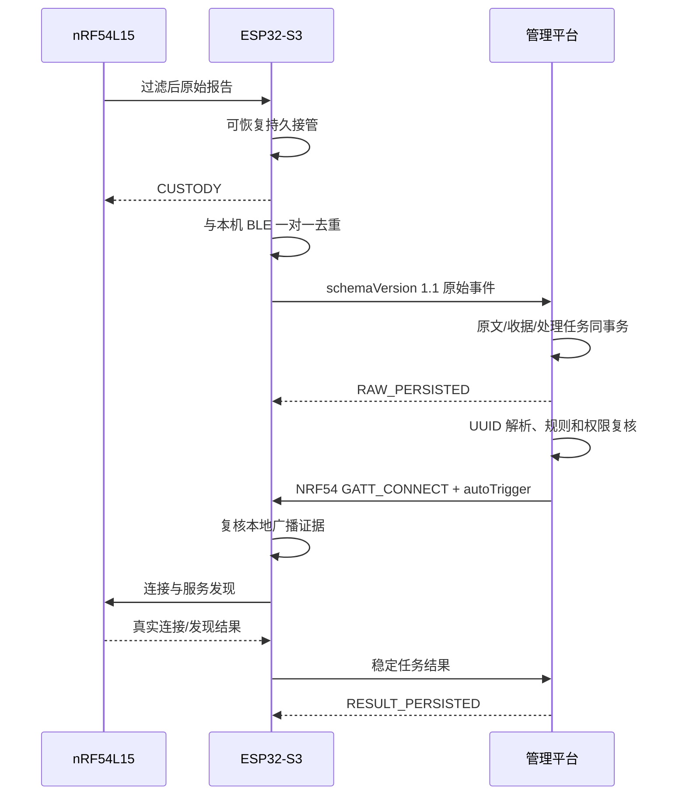

# 网关管理平台贯通开发文档

版本：1.0 · 日期：2026-11-19 · 统一标准：`GW32-E2E-1.0`

本文是[平台对接需求](gateway-platform-requirements.md)的实现与联调说明。跨端规则以[端到端标准](../../docs/gateway-end-to-end-standard.md)为统一裁决；具体已发布字段保留在[平台协议](gateway-protocol.md)、[UART 协议](gateway-uart-protocol.md)、[配网接口](network-provisioning-integration.md)和 Schema/OpenAPI。本文本轮只对齐文档，不宣称以下后续项已修改源码或已通过实板验收。

## 1. 源码落点与边界

| 模块 | 关键文件 | 开发职责 |
| --- | --- | --- |
| 平台配置 | [gw32_config.go](../internal/platform/gw32_config.go) | GW32 型号/能力、扫描/Beacon/广播/网络校验、完整对象合并、字段规范化 |
| 持久任务与结果 | [control.go](../internal/platform/control.go)、[control_gw32.go](../internal/platform/control_gw32.go) | 幂等、任务所有权、revision、结果证据、GATT 生命周期 |
| 原始 BLE 解析 | [parsers_ble.go](../internal/platform/parsers_ble.go)、[pipeline_capture.go](../internal/platform/pipeline_capture.go) | 原始捕获、AD/UUID 解析、持久采集队列 |
| 自动连接 | [autoconnect.go](../internal/platform/autoconnect.go)、[autoconnect_api.go](../internal/platform/autoconnect_api.go) | 对端/规则、证据配对、权限复核、NRF54 连接任务及断链墓碑 |
| 网络配网 | [network_provisioning.go](../internal/platform/network_provisioning.go) | 密钥安装、探测收据、网络世代、状态与本地覆盖裁决 |
| 制品/升级 | [artifacts.go](../internal/platform/artifacts.go) | 签名 manifest、下载授权、组件兼容、任务制品绑定 |
| 机器契约 | [message-contracts.schema.json](../internal/platform/assets/message-contracts.schema.json) | 信封、配置、捕获、任务结果与配网结构 |
| ESP 云端 | [gw_cloud.c](../../firmware/esp32s3/components/gw_cloud/gw_cloud.c) | 当前 HTTPS 拉取、任务 journal、稳定结果重传与 ACK、心跳 |
| ESP BLE 执行 | [gw_actions.c](../../firmware/esp32s3/components/gw_actions/gw_actions.c)、[gw_ble.c](../../firmware/esp32s3/components/gw_actions/gw_ble.c)、[gw_nrf.c](../../firmware/esp32s3/components/gw_nrf/gw_nrf.c) | 本机与 nRF 目标适配、命令读回、能力及超时 |
| ESP 采集 | [gw_capture.c](../../firmware/esp32s3/components/gw_capture/gw_capture.c) | 接管、持久去重、稳定事件、上行应用 ACK |

平台继续负责原有管理、数据流水线、客户投递、审计和运维。新增对接工作必须复用上述事务边界，不另建绕过任务/结果校验的“直通串口 API”。

能力校验已部分分层实现，不能笼统称“尚未对接”：平台在签名清单导入、任务操作及配置合并后检查授权能力；ESP 的扫描、广播、GATT 和 DFU 路径分别检查 nRF HELLO 位，原生 BLE 驱动显式拒绝不支持的模式，并用资源互斥防止角色冲突。当前未见 ESP 重新验证平台设备清单、生成并上报统一能力交集对象的完整流程；实际是平台授权检查与 ESP 分操作支持检查共同生效，后续仍需能力变化对账和参数级支持证据。

具体证据：平台 `artifacts.go` 导入签名清单、`control.go` 检查任务能力、`gw32_config.go` 检查合并后模式的目标能力；ESP `gw_nrf.c` 检查扫描 bit 1、广播 bit 4、Peripheral bit 11；`gw_gatt_nrf.c` 检查 Central/发现 bit 2/9 和订阅 bit 3；`gw_ota.c` 检查 DFU bit 12。以上现存校验不得因标准统一而删除。

## 2. 接口与版本映射

| 意图 | 平台入口/载体 | ESP 对应行为 | nRF 对应行为 |
| --- | --- | --- | --- |
| 配置查询/变更 | GET/PUT `/api/v1/gateways/{gatewayId}/configuration` | 合并持久快照，执行指定组，保存结果 | nRF 目标转扫描/广播设置及读回 |
| GATT/诊断/重启/OTA | POST `/api/v1/tasks` | taskId/requestDigest journal 与总时限 | 有关任务映射 UART，其他任务本机执行 |
| 拉取命令 | GET `/api/v1/gateway-ingress/commands` 或 MQTT `.../commands` | 身份、TTL、摘要、重复检查 | 不认识云端 namespace/task 信封 |
| 上报执行结果 | POST `/api/v1/gateway-ingress/results` 或 `.../command-results` | 等待 RESULT_PERSISTED | UART 响应仅作为 ESP 执行证据之一 |
| 原始事件 | POST `/api/v1/gateway-ingress/batches` 或 `.../telemetry` | 双路去重、稳定 eventId，等 RAW_PERSISTED | 原始扫描/GATT 记录，等待 ESP CUSTODY |
| 状态 | POST `/api/v1/gateway-ingress/status` 或 `.../status` | ESP 主机版本/任务和存储等状态 | nRF 状态经诊断/UART 进入 ESP |
| 网络本地状态/凭据 | 专门的 network-state/probes/credentials 接口 | 独立本地事务与共同网络状态机 | 无 Wi-Fi/Ethernet 配置职责 |

MQTT 基础 topic 是 `gw/v1/{namespaceId}/{gatewayId}`，结果 ACK 为单数 `result-ack`，具体其它 ACK 路径依平台协议。HTTPS 与 MQTT 同一应用合同；目前 ESP 源码以 HTTPS 为可执行路径，MQTT 仍为待完成传输要求。

必须分别保留以下版本空间：UART 帧版本字节、平台任务/状态信封版本、1.1 原始捕获扩展、组件固件版本、平台 API 版本、配置 revision，以及本地网络 generation/revision。统一标准 ID 不写入这些字段替代原值。

## 3. 字段、单位和枚举的统一适配

| 概念 | 平台表示 | ESP/UART 适配与判定 |
| --- | --- | --- |
| 无线目标 | 配置 `radios.nrf54/esp32`；命令/采集 `NRF54/ESP32` | 有意区分配置键和枚举，不能全局改大小写 |
| RSSI 阈值 | -127..20；扩展对象 null 清除 | UART/内部 -128 为关闭阈值哨兵；不能向平台输出 -128 阈值 |
| RSSI/TxPower 不可用 | capture 字段省略 | UART -128/127 等不可用值由适配层识别，不能伪造有效 dBm |
| 扫描时间 | intervalMs/windowMs 整数 10..10240，window≤interval | 0.625 ms tick，`ticks=floor((ms*8+2)/5)`；读回/有效状态显示量化 |
| 广播时间 | intervalMs 整数 100..10240 | 同一 tick 算法；协议未引入 Hz 字段，界面频次换算后仍提交 intervalMs |
| 广播字节 | advDataBase64/scanResponseBase64 | 标准规范 Base64、完整 AD，各 0..31 字节；不使用另一套 content/data/payload 别名 |
| UUID | 输入 4/8 位 hex 或完整带连字符 UUID；规范输出 128 位小写 | 短 UUID 展开 Bluetooth base；UART UUID 按协议规定的字节序；原始 AD 内 little-endian UUID 由解析器专门转换 |
| 地址 | PUBLIC/RANDOM 和 12 位大写十六进制规范地址 | 接口兼容冒号输入的地方规范化；上行不混用地址类型，不把随机地址都视为稳定身份 |
| 平台 revision | JSON 安全整数 ≤2^53-1 | 平台分配；UART 容器可为 uint64，来自平台的值仍受安全整数上限 |
| 本地 networkGeneration/localRevision | 规范十进制 uint64 字符串 | 不经浮点数转存；检查真实 uint64 上限，不仅依赖正则 |
| GATT connectionRef | 32 位小写 hex | 绑定 radio+boot ID+控制器连接 ID；禁止以连接 handle 字符串替代 |
| 固件组件 | GATEWAY/NRF54 | GATEWAY 代表 ESP；manifest、下载、执行、结果按同一组件一致校验 |

短 UUID 标准化示例：`180d` → `0000180d-0000-1000-8000-00805f9b34fb`；`12345678` → `12345678-0000-1000-8000-00805f9b34fb`。这不改变原始 payloadBase64，解析结果与原文分别保存。

## 4. 配置和广播的事务链

1. 管理端读取配置和 ETag，用 expectedReportedRevision/If-Match/Idempotency-Key 提交单组补丁。
2. 平台校验权限、型号、签名能力及合并后完整配置，分配 desiredRevision 并持久化 CONFIGURE。
3. ESP 验证任务及总时限，持久化意图，将补丁合并至该组持久快照，再校验本机能力与运行时资源。
4. nRF 目标通过 SET_SCAN_PROFILE 或 SET_ADV_CONFIG 等命令写入并读回；ESP 本机目标通过驱动确认。不能仅以串口发送完成作成功。
5. ESP 保存已提交目标及执行结果，details.configuration 回显原补丁；details.effective 可给量化参数与实际运行状态。平台核对结果后推进 reportedRevision。
6. ESP 收到稳定 resultId 对应 RESULT_PERSISTED 后完成结果出队；迟到旧结果 ACK 不得降低 reportedRevision。

广播五字段为 enabled/mode/intervalMs/advDataBase64/scanResponseBase64。首次应提交完整内容；后续 enabled-only 使用同一配置合同，保留类型、内容、间隔。切换到 NONCONNECTABLE 时须同时清空已有扫描响应。可连接模式必须依据合并后 mode 检查 BLE_PERIPHERAL，不能通过省略字段绕过。

扫描组、广播组、两路 radio、网络组独立持久目标，各自应用时不能重置其他组。平台 API 的最近补丁不具有全快照含义，重启恢复所需完整快照由 ESP 管理。

平台前端汇总视图由 `frontend_api.go` 返回 `complete=false` 和 `valueSemantics=ACKNOWLEDGED_PATCH_NOT_RUNTIME_READBACK`，即使已有 configuration/knownPaths/sources，也不能证明它包含设备所有组或实时状态。ESP 存储丢失后的全量恢复要求继续保留：必须受控重放/重配置并逐组确认，缺字段不能直接清空，也不能默认为已知完整配置。后续恢复证据与接口扩展按统一标准 C08 实施。

## 5. 采集、双路去重和自动连接

ESP 的跨射频配对使用报告类别、地址/地址类型、完整 AD 等身份和可信时间映射；时间差加误差估计≤50 ms、每观测最多等待 150 ms，且只配对异源、每条至多一次。合并固定 nRF 为主记录，observedBy 为 NRF54/ESP32；无可靠时间映射按两条观察上传。该层与平台同对端 ADV/SCAN_RSP 的 500 ms 配对分开。

平台自动连接当前仅目标 NRF54。ESP32 单路 capture 不升级为 nRF 可连接证据。平台解析 UUID 后须检查规则目标、静态对端、广播新鲜度、RSSI、connectable、能力、所有者现时权限及对端独占，在事务内再检查规则状态/revision。autoTrigger 是平台证据字段，普通管理请求不自行拼造。

服务发现后确认目标服务存在；连接成功不自动等于目标业务服务可用。GATT_WRITE 已发但结果不明时保留 UNKNOWN 与连接证据，不再次发送物理写入。GATT_LINK_DOWN 建墓碑；迟到连接成功结果不得恢复已关闭连接。

nRF Peripheral 写入的 UART 0x22 接入 ESP 本地持久 inbox，不当作 Central GATT Notify 伪造云端事件；业务 handler 的授权与处理 ACK 保持单独边界。

当前本地 inbox 不代表手机↔平台业务闭环已经完成。统一标准 C05 保留平台封装、身份/会话认证、请求关联、平台受理和 UART 下行回发的需求；后续先定义正式契约、再同步 Schema/平台/ESP/nRF，本文不发明临时 JSON 字段或回发任务名称。

自动连接、远程任务 TTL 与远程 OTA 的“可信时间”仍须验证时间源。当前制造指定 SNTP 仅说明服务器来源配置，不能代替密码学认证或抗回拨证明；按 C09 完成时间来源、误差、重启后可信门槛和失可信阻断测试。本地离线 OTA 使用本地授权和单调期限，试启动及恢复不要求互联网、云端任务或可信 UTC。

## 6. 网络配置与状态对账

精确字段与部署依[配网接口实现](network-provisioning-integration.md)，不能再建立独立密码字段或另一个 generation。当前数据库迁移为追加 v4，禁止改写历史 v1–v3 迁移。

| 接口 | 事务与安全边界 |
| --- | --- |
| POST `/api/v1/gateway-network-probes` | 绑定 transactionId/interface/snapshotId/nonce，事务持久后返回 receiptId；用于本地挑战，不能替代远程试用 RESULT_PERSISTED |
| PUT `/api/v1/gateway-network-state` | 保存完整 desiredLocalNetwork/actualNetwork、世代、活动接口、本地覆盖与验证状态；同世代目标及 localRevision 不变，允许实际备用接口变化 |
| GET `/api/v1/gateway-network-credentials/pending` | 仅设备自身授权安装通道返回秘密；每次最多 8 项，普通 network 配置仍只引用凭据 |
| POST `/api/v1/gateway-network-credentials/receipts` | INSTALLED 必须发生在设备加密存储后，终态幂等；平台删除秘密实体，保留不可逆引用和元数据 |
| POST `/api/v1/gateways/{gatewayId}/network-credentials` | 管理者具 gateway:credentials 和目标范围；HMAC 秘密请求指纹，避免把口令写入普通幂等记录 |
| POST `/api/v1/gateways/{gatewayId}/network-reconciliation` | If-Match、Idempotency-Key、世代/快照与 ADOPT_LOCAL/APPLY_PLATFORM；resolutionToken 由服务器生成 |

设备保存本地修改时使用独立 transactionId/localRevision，不伪造云端 CONFIGURE。明确选择离线保存可进入 LOCAL_ONLY；不能因收到 IP/访问任意网站即改称 PLATFORM_SYNCED。

远程网络任务针对每个变更且列入优先级的接口及候选首选路由，用绑定该接口的应用连接提交 EXECUTING 试用证据并收到匹配 RESULT_PERSISTED。最长试用窗口还受任务到期时间限制；失败和提交前重启恢复最后可用配置。提交后恢复新配置和既有结果身份。

清除 localOverride 必须先将成功任务结果持久于平台并获得应用 ACK，再报告正确 appliedTaskId 和新 generation。cancelQueued 只取消未投递任务，不能释放已执行/UNKNOWN 所有权。`GW_NETWORK_CREDENTIAL_KEY` 是服务器 AES-256-GCM 存储密钥，当前方案是可信服务器持有明文处理能力；不得文案宣称设备独占解密。

## 7. 双组件 OTA 与本地 OTA 对齐

| 路径 | 授权源 | 镜像与结果证据 |
| --- | --- | --- |
| 平台→ESP GATEWAY | 在途未过期 FIRMWARE_UPGRADE 任务、网关凭据 | ESP 应用镜像、原文 manifest 签名、大小/摘要/兼容校验；新启动自检确认后远程终态 |
| 平台→ESP→nRF NRF54 | 同上，并要求 NRF54_UART_DFU_1 和 HELLO DFU 能力 | MCUBOOT_SIGNED_BIN；UART DFU、重启后新 HELLO/boot ID、版本/摘要/bootConfirmed |
| 手机/笔记本→ESP 本地 | 物理配网窗口、本地认证会话、LOCAL/uploadId 和单调期限 | 同一签名包与全局升级互斥；本地 journal、重启确认及回滚；离线试启动无需互联网/UTC，不构造远程 TaskResult |

签名验证使用 manifest 原始 UTF-8 字符串。component/imageFormat/sizeBytes/sha256/model/hardware/version/source version 必须在任务、制品和执行器之间一致；manifest 签名可信不代表授权永远有效。下载、擦除、写入和启动提交前均需检查相应授权及期限。网络配置、双组件升级和本地升级共享必要的任务/升级互斥，不能以两种入口同时更新 Flash。

两入口共享的是签名、兼容性、大小、摘要和启动健康校验；本地入口的授权来源和期限独立于远程任务，不能因“共享校验”而追加云任务或 UTC 依赖。远程路径继续校验可信时间、任务有效期及 TLS。

平台成功结果对 NRF54 校验 component、firmwareVersion、nrfBootId、bootConfirmed 和镜像摘要；不能覆写登记的 ESP firmwareVersion。当前平台对 NRF54 的非空 fromFirmwareVersions 返回 FIRMWARE_COMPONENT_VERSION_UNKNOWN，因为没有独立可信组件库存。这是保留的兼容校验需求尚未完成，后续应补组件库存合同、验签/受权上报及更新路径，不移除限制。

nRF boot ID 变化不必然代表候选已经试启动。按持久 journal 区分传输尚未完成的重启与 FINISH/READY 后的试启动，再核对实际运行镜像和确认状态。下载中断后 nRF RAM 会话和旧 offset 无效；确需重新传输时必须获得有效授权，从 0 重新 BEGIN，不能把同任务自动重传作为强制行为，也不能把旧镜像仍运行直接标成候选 ROLLED_BACK。该恢复缺口按[统一标准 C11](../../docs/gateway-end-to-end-standard.md#2-冲突缺口与唯一处理标准)补齐。

ESP 本地 OTA 的状态不强塞进云端远程任务；离线本地成功后恢复联网，平台看到真实当前主机版本和诊断证据。设置启动分区结果模糊时保留 REBOOT_PENDING、日志和升级所有权，经受控重启对账；不能报告升级已成功或开放第二个升级。

## 8. 冲突判定与后续源码清单

以下结论来自本次源码审查。优先级“贯通前”表示在宣称对应功能联合通过前完成；不阻止本次文档统一。

| 编号 | 证据位置与当前行为 | 统一判定 | 后续工作 |
| --- | --- | --- | --- |
| PLAT-GAP-01 / C02 | 平台协议 MQTT/HTTPS 并行；ESP gw_cloud.c 的 request/poll/status/results 使用 HTTP | 传输实现缺口，不是删功能依据 | 补 ESP MQTT 适配并用同样 ACK/任务测试；贯通前验证两种通道 |
| PLAT-GAP-02 / C06 | artifacts.go 259–279 行以主机版本检查 GATEWAY，NRF54 非空 fromFirmwareVersions 拒绝 | 组件版本库存缺口，禁止以 ESP 版本替代 | 定义可信组件库存与兼容校验，保留拒绝直到证据完整 |
| PLAT-GAP-03 / C07 | gw_ble.c 368–371 行拒绝 CONNECTABLE_SCANNABLE，623–628 行拒绝 autoTrigger/非 UNENCRYPTED；平台 control_gw32.go 接受 BONDED_ENCRYPTED 参数 | 产品/Schema 可表达范围大于本机驱动支持集 | 保留需求；能力清单不得虚报 ESP Peripheral；补相应实现和参数级支持校验，当前明确 UNSUPPORTED |
| PLAT-MAP-01 | gw32_config.go 配置键 nrf54/esp32；control_gw32.go 和 gw_capture.c 使用 NRF54/ESP32 | 枚举适配一致，不是冲突 | 增加跨端合同向量覆盖，禁止全局改名 |
| PLAT-MAP-02 | gw32_config.go minRssi 扩展 null；gw_actions.c/gw_nrf.c 转内部 -128 | 平台空值与内部哨兵适配一致 | 固定边界测试 -127/20/null/旧版拒绝 null |
| PLAT-MAP-03 | gw32_config.go 广播 31 字节/100..10240；gw_nrf.c 543–577 行同字段及 tick 转换 | 广播合同一致，驱动能力仍需检查 | 以原始 AD 字节及读回验证 Beacon/自定义，不添加假定字段 |
| PLAT-MAP-04 | gw_capture.c 385–391 行固定 nRF 主记录，729–732 行 observedBy；autoconnect.go 133/144 行要求 NRF54 | 双路合并不会丢 nRF 自动连接资格 | 验证 ESP 先收到、nRF 后收到和迟到未合并三种次序 |
| PLAT-MAP-05 | gw_cloud.c 143/467/824 行控制与状态 1.0；gw_capture.c 原始数据 1.1 | 消息族版本不同是兼容设计 | 合同测试逐消息族校验，不统一改为 1.1 |
| PLAT-GAP-04 | 各端存在单测/模拟器与构建记录，尚无完整实板三端证据 | 测试范围缺口 | 执行需求文档 AT-01..11，并记录版本、硬件、日志、故障注入与结论 |
| C03 | gw_nrf.c 的广播路径执行 SET/GET 配置，诊断仅取基础 GET_STATUS，尚缺 GET_ADV_STATUS 的完整实际状态核对 | 配置读回不能替代真实广播状态 | 补实际状态、驱动错误、应用时间和 revision 证据，并校验任务成功条件 |
| C04 | nRF OTA 有 UART DFU/等待新 HELLO 路径，板级硬件复位恢复尚缺完整执行与验收 | 复位恢复要求保留 | ESP 补板级复位安全时序、重连和回滚对账，实板注入卡死/失联 |
| C05 | ESP 有 Peripheral 本地 inbox，平台尚无完整业务封装、认证及回发合同 | 已有本地接管不代表平台闭环 | 先冻结补充合同后同步机器契约和实现，保留业务需求 |
| C08 | frontend_api.go:181 明确 complete=false、ACKNOWLEDGED_PATCH_NOT_RUNTIME_READBACK | 汇总配置不是完整恢复快照 | ESP 保留完整目标；平台后续补受控重放/完整恢复证据 |
| C09 | 当前 ESP 制造指定 SNTP 不具密码学认证 | 远程时效、TLS 和自动连接的可信 UTC 验收差距 | 补可认证时间来源或受权可信锚、误差及失可信阻断证据，不将来源配置视为可信；本地离线 OTA 不追加 UTC 前提 |
| [C11](../../docs/gateway-end-to-end-standard.md#2-冲突缺口与唯一处理标准) | gw_ota.c:483–554 的 nrf_transfer 在 boot 变化后进入 nrf_trial，可能将传输中断记为 ROLLED_BACK | 下载中断和 READY 后试启动必须按 journal 分阶段对账 | ESP 补阶段判断及真实镜像核对；重新传输须有效授权并从 0 BEGIN，不强加同任务自动重传；平台保留真实失败/恢复证据 |

行号对应审查基线，仅用于快速定位；重构后以函数和行为为准。Schema/OpenAPI/平台 Go/ESP C/UART 若发生真实字段差异，必须先在统一标准裁决，然后同一变更中补齐机器合同、实现、模拟器和测试，不在某一端临时增加含义不同的别名。

## 9. 开发顺序与验证

1. 固定本文、需求清单和 GW32-E2E-1.0 的字段/权责；保留历史版本和兼容映射。
2. 建立跨端合同向量：radio/UUID/RSSI/AD/时间量化/结果 ACK/修订号/组件字段；覆盖平台拒绝与 ESP 拒绝一致性。
3. 依差距清单完成必要源代码与机器契约变更，特别是 MQTT、组件库存、ESP 本机支持集；每项单独确认变更不删除既有功能。
4. 运行平台现有 Go 测试、Schema/OpenAPI 验证和模拟器流程；运行对应 ESP/nRF 主机测试与目标构建。不要把模拟器当作射频和 Flash 验证。
5. 使用固定硬件/固件/服务端版本完成实板扫描、双路去重、授权自动连接、广播、本地/远程配网、两组件远程 OTA 与 ESP 本地 OTA。
6. 注入重启、串口 ACK 丢失、网络中断、迟到结果、存储满、撤权和窗口关闭，验证恢复与所有权；保存可复核证据后再宣布对应功能贯通。

本次仅更新 Markdown 文档，未运行或声称新的固件构建、Go 测试、射频/升级实板验收。历史实现与测试范围继续见[实现与验收范围](implementation-status.md)、[ESP 实现状态](../../firmware/esp32s3/IMPLEMENTATION.md)及[nRF 验证记录](../../firmware/nrf54l15/VALIDATION.md)。
