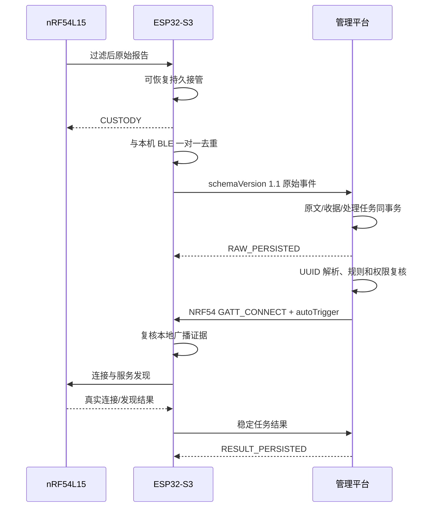

# 网关管理平台贯通开发文档

版本：1.2 · 日期：2026-11-19 · 统一标准：`GW32-E2E-1.1`

本文是[平台对接需求](gateway-platform-requirements.md)的实现与联调说明。跨端规则以[端到端标准](../../docs/gateway-end-to-end-standard.md)为统一裁决；精确字段保留在[平台协议](gateway-protocol.md)、[UART 协议](gateway-uart-protocol.md)、[配网接口](network-provisioning-integration.md)和 Schema/OpenAPI。本版对应平台、ESP32-S3/nRF54L15 0.3.0 的源码实现；软件验证与实板验收分别记录，完整交付范围见[三方实现记录](../../docs/gateway-alignment-implementation.md)。

所有差距的实施决定以[统一开发方案](../../docs/gateway-alignment-development-plan.md)为准；名称/UUID/RSSI/Major/Minor 掩码过滤以[Beacon 过滤规范](../../docs/beacon-filter-spec.md)为准。新增接口已挂载到服务端，Schema/OpenAPI、数据库迁移、配置界面与设备合同同步；上线需部署本版程序、执行 v5 迁移并配置真实签名授权，旧服务和旧固件不会因文档更新自动获得能力。

## 1. 源码落点与边界

| 模块 | 关键文件 | 开发职责 |
| --- | --- | --- |
| 平台配置 | [gw32_config.go](../internal/platform/gw32_config.go) | GW32 型号/能力、扫描/Beacon/广播/网络校验、完整对象合并、字段规范化 |
| Beacon V2 | [beacon_v2.go](../internal/platform/beacon_v2.go)、[beacon_preview.go](../internal/platform/beacon_preview.go) | 严格语义、完整 UART profile 编译/3070 字节预算、离线原始 AD 匹配预览 |
| 持久任务与结果 | [control.go](../internal/platform/control.go)、[control_gw32.go](../internal/platform/control_gw32.go) | 幂等、任务所有权、revision、结果证据、GATT 生命周期 |
| 原始 BLE 解析 | [parsers_ble.go](../internal/platform/parsers_ble.go)、[pipeline_capture.go](../internal/platform/pipeline_capture.go) | 原始捕获、AD/UUID 解析、持久采集队列 |
| 自动连接 | [autoconnect.go](../internal/platform/autoconnect.go)、[autoconnect_api.go](../internal/platform/autoconnect_api.go) | 对端/规则、证据配对、权限复核、NRF54 连接任务及断链墓碑 |
| 网络配网 | [network_provisioning.go](../internal/platform/network_provisioning.go) | 密钥安装、探测收据、网络世代、状态与本地覆盖裁决 |
| 制品/升级 | [artifacts.go](../internal/platform/artifacts.go) | 签名 manifest、下载授权、组件兼容、任务制品绑定 |
| 组件与能力 | [gateway_integration.go](../internal/platform/gateway_integration.go)、[component_artifact.go](../internal/platform/component_artifact.go) | 路由注册、组件挑战/CAS 库存、运行能力交集、签名制品查找 |
| 配置恢复 | [gateway_snapshot.go](../internal/platform/gateway_snapshot.go) | 六组完整基线、稳定世代/摘要、不可变历史、受控恢复来源检查 |
| Peripheral | [peripheral.go](../internal/platform/peripheral.go)、[broker.go](../internal/platform/broker.go) | 客户端/route 登记、HTTP/MQTT 同事务收件、业务幂等、关联回发与证据 |
| 签名时间 | [gateway_time.go](../internal/platform/gateway_time.go) | 无设备 token 的启动时间挑战、独立 Ed25519 签名、来源配置与限流 |
| 机器契约与迁移 | [message-contracts.schema.json](../internal/platform/assets/message-contracts.schema.json)、[openapi.json](../internal/platform/assets/openapi.json)、[management.v5.sql](../internal/platform/assets/management.v5.sql) | 正式请求/响应结构与新增持久表；保留历史合同 |
| 配置界面 | [BeaconFilterEditor.vue](../../frontend/src/features/gateway/BeaconFilterEditor.vue)、[ConfigurationEditor.vue](../../frontend/src/features/gateway/ConfigurationEditor.vue) | 字段掩码编辑、旧/V2 原子切换、完整 profile 长度和样本预览 |
| ESP 云端 | [gw_cloud.c](../../firmware/esp32s3/components/gw_cloud/gw_cloud.c)、[gw_transport.c](../../firmware/esp32s3/components/gw_transport/gw_transport.c)、[gw_sync.c](../../firmware/esp32s3/components/gw_cloud/gw_sync.c) | HTTPS/MQTT、公共任务 journal/应用 ACK、库存与快照同步 |
| ESP BLE 执行 | [gw_actions.c](../../firmware/esp32s3/components/gw_actions/gw_actions.c)、[gw_ble.c](../../firmware/esp32s3/components/gw_actions/gw_ble.c)、[gw_nrf.c](../../firmware/esp32s3/components/gw_nrf/gw_nrf.c) | 本机与 nRF 目标适配、命令读回、能力及超时 |
| ESP 采集 | [gw_capture.c](../../firmware/esp32s3/components/gw_capture/gw_capture.c) | 接管、持久去重、稳定事件、上行应用 ACK |

平台继续负责原有管理、数据流水线、客户投递、审计和运维。新增对接工作必须复用上述事务边界，不另建绕过任务/结果校验的“直通串口 API”。

能力校验采用签名授权上限与运行交集两层：平台导入并验证设备清单；ESP 的 `gw_authority` 验证外层签名原文、内层文件摘要及 gatewayId/SN/model/hardwareVersion 绑定，再结合实际编译能力、受保护的板级验证列表和当前 nRF HELLO 上报运行能力。平台保存签名 `capabilities`，另返回 `availableCapabilities`；已有运行报告时任务和配置按后者检查，不可用原因保留供诊断。没有当前 nRF 身份时上报 `nrfBootId:null` 与空 HELLO 能力，旧启动的库存和连接证据不得复用。

具体映射：nRF 扫描 bit1、Central bit2、Notify bit3、广播 bit4、发现 bit9、广播管理 bit10、Peripheral bit11、DFU bit12、V2 bit13。平台 V2 能力按目标为 `NRF54_BLE_FILTER_V2` / `ESP32_BLE_FILTER_V2`，并新增 `PERIPHERAL_BRIDGE_1`、`PERIPHERAL_NOTIFY`、`PERIPHERAL_DISCONNECT`、`COMPONENT_INVENTORY_1`、`CONFIG_SNAPSHOT_1`、`SIGNED_TIME_1`。这些名称已进入机器合同；一个目标的 HELLO 位不能代替另一目标能力，板级授权也不能扩大签名清单上限。

## 2. 接口与版本映射

| 意图 | 平台入口/载体 | ESP 对应行为 | nRF 对应行为 |
| --- | --- | --- | --- |
| 配置查询/变更 | GET/PUT `/api/v1/gateways/{gatewayId}/configuration` | 合并持久快照，执行指定组，保存结果 | nRF 目标转扫描/广播设置及读回 |
| GATT/诊断/重启/OTA | POST `/api/v1/tasks` | taskId/requestDigest journal 与总时限 | 有关任务映射 UART，其他任务本机执行 |
| 拉取命令 | GET `/api/v1/gateway-ingress/commands` 或 MQTT `.../commands` | 身份、TTL、摘要、重复检查 | 不认识云端 namespace/task 信封 |
| 上报执行结果 | POST `/api/v1/gateway-ingress/results` 或 `.../command-results` | 等待 RESULT_PERSISTED | UART 响应仅作为 ESP 执行证据之一 |
| 原始事件 | POST `/api/v1/gateway-ingress/batches` 或 `.../telemetry` | 双路去重、稳定 eventId，等 RAW_PERSISTED | 原始扫描/GATT 记录，等待 ESP CUSTODY |
| 状态 | POST `/api/v1/gateway-ingress/status` 或 `.../status` | ESP 主机版本/任务和存储等状态 | nRF 状态经诊断/UART 进入 ESP |
| 网络本地状态/凭据 | 专门的 network-state/probes/credentials 接口 | 独立本地事务与共同网络状态机 | 无 Wi-Fi/Ethernet 配置职责 |

MQTT 基础 topic 是 `gw/v1/{namespaceId}/{gatewayId}`，结果 ACK 为单数 `result-ack`，具体其它 ACK 路径依平台协议。ESP 已实现 HTTPS/MQTT 公共传输，制造键 `cloud_link=HTTPS|MQTT|AUTO`，默认 HTTPS；MQTT 必须使用 TLS、QoS1、retain=false。两通道复用稳定任务/事件/结果身份和应用 ACK；PUBACK 不释放持久队列。候选网络试用仍通过绑定受测接口的 HTTPS 完成应用证明。

必须分别保留以下版本空间：UART 帧版本字节、平台任务/状态信封版本、1.1 原始捕获扩展、组件固件版本、平台 API 版本、配置 revision，以及本地网络 generation/revision。统一标准 ID 不写入这些字段替代原值。

### 2.1 新接口及正式 Schema

以下路径以 `/api/v1` 为前缀。设备接口使用网关身份和作用域检查；管理接口另检查操作者权限。唯一公开且不发送设备 token 的入口是签名时间挑战。

| 方法与路径 | 主要 Schema | 行为及边界 |
| --- | --- | --- |
| POST `/gateway-component-challenges` | GatewayComponentChallenge / GatewayComponentChallengeResponse | 指定 GATEWAY 或 NRF54；返回 challengeId、inventoryGeneration、32 字节 nonce、expiresAt/ expiresAtUnixMs，60 s 有效。同组件新挑战使旧未完成挑战失效。 |
| PUT `/gateway-components` | GatewayComponentReport / GatewayComponentReceipt | 校验挑战和当前世代，事务更新独立组件库存并推进世代；收据包含 component、challengeId、inventoryGeneration、evidenceReceivedAt 和 inventory。 |
| GET `/gateway-component-artifact?component=...&sha256=...` | GatewayComponentArtifact | 仅查询匹配组件/SHA、签名已验证且与本设备兼容的制品，返回 artifactId/component/firmwareVersion/imageSha256/sizeBytes；无匹配 404，多匹配按 artifactId 固定顺序选择。 |
| GET `/gateways/{gatewayId}/components` | 组件库存查询响应 | 管理端读取本网关独立库存，不修改设备证据。 |
| PUT `/gateway-runtime-capabilities` | GatewayRuntimeCapabilities / GatewayRuntimeCapabilitiesResponse | 校验登记 manifestDigest，保存 espImplemented/nrfHelloCapabilities/boardVerified/启动身份并返回实际能力交集。nrfBootId 字段必需但可为 null。 |
| GET `/gateway-configuration-snapshot` | GatewayConfigurationSnapshot | 设备读取当前视图；可带 `snapshotId` 读取本网关不可变完整历史快照。 |
| GET `/gateways/{gatewayId}/configuration-snapshot` | GatewayConfigurationSnapshot | 管理端同样支持历史 `snapshotId`；不绕过范围权限。 |
| POST `/gateway-peripheral/batches` | PeripheralEventBatch / PeripheralEventAck | 事务持久业务收件后返回 PERIPHERAL_PERSISTED；MQTT `peripheral-events` / `peripheral-ack` 使用相同合同。 |
| PUT `/gateways/{gatewayId}/peripheral-clients/{clientId}` | 客户端 enabled/routes 结构 | gateway:configure、Idempotency-Key 和目标范围检查；登记 route 授权，不传输或安装手机认证密码。 |
| GET `/gateways/{gatewayId}/peripheral-events` | Peripheral 事件查询响应 | 管理端读取最近 100 条业务事件，保持原业务身份和来源。 |
| POST `/gateways/{gatewayId}/scan-profile-preview` | ScanProfilePreview / BeaconPreviewSample | 校验并编译完整 profile，返回 bodyLength/bodyBase64、容量上限和可选样本判断；不创建任务、不改变设备。 |
| POST `/gateway-time-challenges` | GatewayTimeChallenge / GatewayTimeResponse | 公开签名时间挑战，绑定 nonce/bootId，返回 keyId/payloadBase64/signatureBase64；没有签名配置时返回 503。 |

恢复继续使用既有 PUT `/gateways/{gatewayId}/configuration` 或 POST `/tasks` 的 CONFIGURE，在前者请求体或后者 parameters 中传 `sourceSnapshotId`；不新增绕过幂等、ETag 或任务所有权的恢复命令。

## 3. 字段、单位和枚举的统一适配

| 概念 | 平台表示 | ESP/UART 适配与判定 |
| --- | --- | --- |
| 无线目标 | 配置 `radios.nrf54/esp32`；命令/采集 `NRF54/ESP32` | 有意区分配置键和枚举，不能全局改大小写 |
| RSSI 阈值 | -127..20；扩展对象 null 清除 | UART/内部 -128 为关闭阈值哨兵；不能向平台输出 -128 阈值 |
| RSSI/TxPower 不可用 | capture 字段省略 | UART -128/127 等不可用值由适配层识别，不能伪造有效 dBm |
| 扫描时间 | intervalMs/windowMs 整数 10..10240，window≤interval | 0.625 ms tick，`ticks=floor((ms*8+2)/5)`；读回/有效状态显示量化 |
| 广播时间 | intervalMs 整数 100..10240 | 同一 tick 算法；协议未引入 Hz 字段，界面频次换算后仍提交 intervalMs |
| 广播字节 | advDataBase64/scanResponseBase64 | 标准规范 Base64、完整 AD，各 0..31 字节；不使用另一套 content/data/payload 别名 |
| UUID | 输入 4/8 位 hex 或完整带连字符 UUID；规范输出 128 位小写 | 短 UUID 展开 Bluetooth base；UART UUID 按协议规定的字节序；原始 AD 内 little-endian UUID 由解析器专门转换 |
| 地址 | PUBLIC/RANDOM 和 12 位大写十六进制规范地址 | 接口兼容冒号输入的地方规范化；上行不混用地址类型，不把随机地址都视为稳定身份 |
| 平台 revision | JSON 安全整数 ≤2^53-1 | 平台分配；UART 容器可为 uint64，来自平台的值仍受安全整数上限 |
| 本地 networkGeneration/localRevision | 规范十进制 uint64 字符串 | 不经浮点数转存；检查真实 uint64 上限，不仅依赖正则 |
| GATT connectionRef | 32 位小写 hex | 绑定 radio+boot ID+控制器连接 ID；禁止以连接 handle 字符串替代 |
| 固件组件 | GATEWAY/NRF54 | GATEWAY 代表 ESP；manifest、下载、执行、结果按同一组件一致校验 |

短 UUID 标准化示例：`180d` → `0000180d-0000-1000-8000-00805f9b34fb`；`12345678` → `12345678-0000-1000-8000-00805f9b34fb`。这不改变原始 payloadBase64，解析结果与原文分别保存。

## 4. 配置和广播的事务链

1. 管理端读取配置和 ETag，用 expectedReportedRevision/If-Match/Idempotency-Key 提交单组补丁。
2. 平台校验权限、型号、签名能力及合并后完整配置，分配 desiredRevision 并持久化 CONFIGURE。
3. ESP 验证任务及总时限，持久化意图，将补丁合并至该组持久快照，再校验本机能力与运行时资源。
4. nRF 目标通过 SET_SCAN_PROFILE 或 SET_ADV_CONFIG 等命令写入并读回；ESP 本机目标通过驱动确认。不能仅以串口发送完成作成功。
5. ESP 保存已提交目标及执行结果，details.configuration 回显原补丁；details.effective 可给量化参数与实际运行状态。平台核对结果后推进 reportedRevision。
6. ESP 收到稳定 resultId 对应 RESULT_PERSISTED 后完成结果出队；迟到旧结果 ACK 不得降低 reportedRevision。

广播五字段为 enabled/mode/intervalMs/advDataBase64/scanResponseBase64。首次应提交完整内容；后续 enabled-only 使用同一配置合同，保留类型、内容、间隔。切换到 NONCONNECTABLE 时须同时清空已有扫描响应。可连接模式必须依据合并后 mode 检查 BLE_PERIPHERAL，不能通过省略字段绕过。

扫描组、广播组、两路 radio、网络组独立持久目标，各自应用时不能重置其他组。平台 API 的最近补丁不具有全快照含义，重启恢复所需完整快照由 ESP 管理。

平台原前端汇总视图由 `frontend_api.go` 返回 `complete=false` 和 `valueSemantics=ACKNOWLEDGED_PATCH_NOT_RUNTIME_READBACK`，即使已有 configuration/knownPaths/sources，也不能证明它包含所有组或实时状态。新增 C08 完整快照与该补丁视图并行，不能混用。

### 4.1 完整快照、历史及显式恢复

`gateway_snapshot.go` 按成功且 VERIFIED 的任务记录重放目标，严格检查 `network`、`nrf54Scan`、`nrf54Advertising`、`esp32Scan`、`esp32Advertising`、`upload` 六组。每组含 revision/value/source/verifiedAt；当前实现的来源为 VERIFIED_TASK，不凭空构造工厂默认值或本地已采纳基线。扫描组显式含 beaconFilterV2（可为 null），缺字段不解释为清空。

快照采用规范 JSON 的 SHA-256 摘要（计算对象不含 digest），content 不变时 `generation` 不变；新内容才推进十进制字符串世代。已保存完整历史不可覆盖，`?snapshotId=` 始终按网关范围读取原始来源。缺基线、UNKNOWN 任务、在途配置或本地覆盖分别产生 MISSING_BASELINE、UNKNOWN_TASK、PENDING_CONFIGURATION、LOCAL_OVERRIDE 阻塞，不能返回可自动恢复的完整状态。

ESP 下载后校验作用域、摘要、世代、组结构和完整性，只保存候选及当前视图，不应用配置。管理员显式提交 sourceSnapshotId 后，平台要求 CONFIG_SNAPSHOT_1、本网关完整历史来源、没有当前阻塞，且请求恰好等于历史中一个完整组的 value，再分配新的配置 revision。ESP 执行前按来源 ID 读取必要历史、复核同组值和新 revision；网络仍服从 localOverride/凭据规则。上一组成功并确认后才恢复下一组，旧快照 revision 不直接成为当前修订。

## 5. 采集、双路去重和自动连接



ESP 的跨射频配对使用报告类别、地址/地址类型、完整 AD 等身份和可信时间映射；时间差加误差估计≤50 ms、每观测最多等待 150 ms，且只配对异源、每条至多一次。合并固定 nRF 为主记录，observedBy 为 NRF54/ESP32；无可靠时间映射按两条观察上传。该层与平台同对端 ADV/SCAN_RSP 的 500 ms 配对分开。

平台自动连接当前仅目标 NRF54。ESP32 单路 capture 不升级为 nRF 可连接证据。平台解析 UUID 后须检查规则目标、静态对端、广播新鲜度、RSSI、connectable、能力、所有者现时权限及对端独占，在事务内再检查规则状态/revision。autoTrigger 是平台证据字段，普通管理请求不自行拼造。

服务发现后确认目标服务存在；连接成功不自动等于目标业务服务可用。GATT_WRITE 已发但结果不明时保留 UNKNOWN 与连接证据，不再次发送物理写入。GATT_LINK_DOWN 建墓碑；迟到连接成功结果不得恢复已关闭连接。

nRF Peripheral 写入的 UART 0x22 接入 ESP 本地持久 inbox，不当作 Central GATT Notify 伪造云端事件；业务 handler 的授权与处理 ACK 保持单独边界。

C05 已实现独立业务链：手机 Security2 身份与 setup 管理身份分开，ESP 按制造 ACL 校验 clientId/route 并处理 PG 分片；本地持久 STORED 后通过独立业务 spool 上行。平台再次检查客户端启用状态和 route，事务写入原事件、业务去重及连接关联后返回 PERIPHERAL_PERSISTED。HTTP/MQTT 共同执行该事务，保留同 eventId 同内容重试和跨重连稳定 businessId；同身份异内容明确冲突。每批最多 16 条、JSON 上限 128 KiB、单条业务载荷上限 2048 字节，容量不足返回 RETRY/CAPACITY_TEMPORARY，不能静默丢弃。

平台 PERIPHERAL_NOTIFY / PERIPHERAL_DISCONNECT 复用持久任务、幂等和 gatt:execute 权限，要求匹配的新鲜客户端连接关联。NOTIFY 的 businessId 由平台稳定生成，不因重投改变；SUCCEEDED/VERIFIED 必须核对 radio/connectionRef/clientId/businessId 及手机 businessStatus=APPLIED，STORED 不能升级为成功。DISCONNECT 需要实际 CLOSED 证据。业务收件是通用 route 传输与可审计持久化，业务系统自身的处理器和客户交付 ACK 继续独立，不把 ATT/Notify 成功当业务执行完成。

### 5.1 签名时间与启动门槛

签名时间服务校验规范 Base64 的 32 字节 nonce、32 位小写 hex bootId，拒绝未知字段、重复键和尾随内容，并设全局请求速率限制。Ed25519 签名覆盖 ASCII `gw32-time-v1` 紧接 payload 原始 UTF-8 字节；payload 包含 schemaVersion、原 nonce/bootId、十进制字符串 issuedAtUnixMs、uncertaintyMs=1000、validForMs=60000。不得解析重排 payload 后验签，也不向公开启动入口发送网关 token。

服务端必须配置 `GW_TIME_SIGNING_KEY`（Base64 的 32 字节 seed 或 64 字节私钥）、`GW_TIME_KEY_ID`、`GW_TIME_SOURCE_VERIFIED=true`；缺失时 503，不产生假可信时间。最后一项由运维核实时间源后设置，签名本身不能证明服务器时钟准确。设备使用独立制造时间公钥，绑定本次 nonce/boot，并根据单调时钟及已验证漂移维护保守 UTC 区间，用于完整 TLS 日期区间、任务 TTL 和远程 OTA 授权。SNTP 不独立建立可信锚；本地离线配网和 OTA 仍使用本地授权与单调期限，无需互联网或 UTC。

## 6. 网络配置与状态对账

精确字段与部署依[配网接口实现](network-provisioning-integration.md)，不能再建立独立密码字段或另一个 generation。原网络配置表由 v4 引入；本轮数据库版本为 v5，禁止改写历史 v1～v4，新增表见 8.1。

| 接口 | 事务与安全边界 |
| --- | --- |
| POST `/api/v1/gateway-network-probes` | 绑定 transactionId/interface/snapshotId/nonce，事务持久后返回 receiptId；用于本地挑战，不能替代远程试用 RESULT_PERSISTED |
| PUT `/api/v1/gateway-network-state` | 保存完整 desiredLocalNetwork/actualNetwork、世代、活动接口、本地覆盖与验证状态；同世代目标及 localRevision 不变，允许实际备用接口变化 |
| GET `/api/v1/gateway-network-credentials/pending` | 仅设备自身授权安装通道返回秘密；每次最多 8 项，普通 network 配置仍只引用凭据 |
| POST `/api/v1/gateway-network-credentials/receipts` | INSTALLED 必须发生在设备加密存储后，终态幂等；平台删除秘密实体，保留不可逆引用和元数据 |
| POST `/api/v1/gateways/{gatewayId}/network-credentials` | 管理者具 gateway:credentials 和目标范围；HMAC 秘密请求指纹，避免把口令写入普通幂等记录 |
| POST `/api/v1/gateways/{gatewayId}/network-reconciliation` | If-Match、Idempotency-Key、世代/快照与 ADOPT_LOCAL/APPLY_PLATFORM；resolutionToken 由服务器生成 |

设备保存本地修改时使用独立 transactionId/localRevision，不伪造云端 CONFIGURE。明确选择离线保存可进入 LOCAL_ONLY；不能因收到 IP/访问任意网站即改称 PLATFORM_SYNCED。

远程网络任务针对每个变更且列入优先级的接口及候选首选路由，用绑定该接口的应用连接提交 EXECUTING 试用证据并收到匹配 RESULT_PERSISTED。最长试用窗口还受任务到期时间限制；失败和提交前重启恢复最后可用配置。提交后恢复新配置和既有结果身份。

清除 localOverride 必须先将成功任务结果持久于平台并获得应用 ACK，再报告正确 appliedTaskId 和新 generation。cancelQueued 只取消未投递任务，不能释放已执行/UNKNOWN 所有权。`GW_NETWORK_CREDENTIAL_KEY` 是服务器 AES-256-GCM 存储密钥，当前方案是可信服务器持有明文处理能力；不得文案宣称设备独占解密。

## 7. 双组件 OTA 与本地 OTA 对齐

| 路径 | 授权源 | 镜像与结果证据 |
| --- | --- | --- |
| 平台→ESP GATEWAY | 在途未过期 FIRMWARE_UPGRADE 任务、网关凭据 | ESP 应用镜像、原文 manifest 签名、大小/摘要/兼容校验；新启动自检确认后远程终态 |
| 平台→ESP→nRF NRF54 | 同上，并要求 NRF54_UART_DFU_1 和 HELLO DFU 能力 | MCUBOOT_SIGNED_BIN；UART DFU、重启后新 HELLO/boot ID、版本/摘要/bootConfirmed |
| 手机/笔记本→ESP 本地 | 物理配网窗口、本地认证会话、LOCAL/uploadId 和单调期限 | 同一签名包与全局升级互斥；本地 journal、重启确认及回滚；离线试启动无需互联网/UTC，不构造远程 TaskResult |

签名验证使用 manifest 原始 UTF-8 字符串。component/imageFormat/sizeBytes/sha256/model/hardware/version/source version 必须在任务、制品和执行器之间一致；manifest 签名可信不代表授权永远有效。下载、擦除、写入和启动提交前均需检查相应授权及期限。网络配置、双组件升级和本地升级共享必要的任务/升级互斥，不能以两种入口同时更新 Flash。

两入口共享的是签名、兼容性、大小、摘要和启动健康校验；本地入口的授权来源和期限独立于远程任务，不能因“共享校验”而追加云任务或 UTC 依赖。远程路径继续校验可信时间、任务有效期及 TLS。

平台成功结果对 NRF54 校验 component、firmwareVersion、nrfBootId、bootConfirmed 和镜像摘要；不能覆写登记的 ESP firmwareVersion。C06 库存已分别保存 GATEWAY/NRF54，使用 UNKNOWN、VERSION_ONLY、CONFIRMED_ARTIFACT 三种证据等级。设备先获取 60 s 挑战，携带当前 inventoryGeneration 上报，平台事务检查 nonce、有效期和 CAS 世代，更新后返回新世代收据。完全相同重试返回原收据及 evidenceReceivedAt，不刷新证据时间；同挑战异内容或过期/被替换的未完成挑战拒绝。

CONFIRMED_ARTIFACT 必须有可信签名制品、匹配的实际运行 SHA/版本和 bootConfirmed=true。设备重新读取当前镜像，nRF 在核验期间启动变化时不得组合旧 boot 与新版本伪造证明。平台对 NRF54 非空 fromFirmwareVersions 仅接受距接收不超过 60 s 且与当前运行报告 nrfBootId 一致的 CONFIRMED_ARTIFACT；其余返回 FIRMWARE_COMPONENT_VERSION_UNKNOWN，已确认但版本不匹配仍拒绝兼容性。VERSION_ONLY、主机版本及历史升级成功结果均不能替代该条件。

本地离线 OTA 通常没有 artifactId。设备确认并保存真实签名/镜像证据后，可调用只读 `/gateway-component-artifact?component=GATEWAY|NRF54&sha256=<64位小写hex>`，以 COMPONENT_INVENTORY_1 能力关联已导入且验签的兼容制品。未导入则 404，库存保持 VERSION_ONLY；查询只返回制品元数据，不创建库存，也不能替代设备本地验签、运行镜像重算 SHA 和启动确认。

nRF boot ID 变化不必然代表候选已经试启动。C11 已按持久 journal 区分传输尚未完成的重启与 FINISH/READY 后的试启动，再核对实际运行镜像和确认状态；FINISH 结果不确定时保留不确定证据。下载中断后 nRF RAM 会话和旧 offset 无效；确需重新传输时必须获得有效授权，从 0 重新 BEGIN，不能把同任务自动重传作为强制行为，也不能把旧镜像仍运行直接标成候选 ROLLED_BACK。C04 的有限握手及一次板级复位恢复已有代码，复位默认关闭，须确认接线/电平/时序后再开启并实测。

ESP 本地 OTA 的状态不强塞进云端远程任务；离线本地成功后恢复联网，平台看到真实当前主机版本和诊断证据。设置启动分区结果模糊时保留 REBOOT_PENDING、日志和升级所有权，经受控重启对账；不能报告升级已成功或开放第二个升级。

## 8. 原差距的实现落点与剩余验证

保留原差距编号用于追溯；下表区分已完成的源码与仍需实板验证的条件。

| 编号 | 当前实现 | 保留的验证边界 |
| --- | --- | --- |
| PLAT-GAP-01 / C02 | `gw_transport` 提供 HTTPS/MQTT，公共 journal/spool 和应用 ACK 防止切换重复执行 | TLS、实网重连、丢 ACK、满队列和网络试用 |
| PLAT-GAP-02 / C06 | `gateway_integration.go` 实现组件挑战/CAS/证据分级；`artifacts.go` 检查新鲜可信 nRF 库存；只读制品关联支持本地 OTA | 实际运行镜像、启动确认、离线升级后重联网和旧 boot 失效 |
| PLAT-GAP-03 / C07 | 制造两层验签、运行能力交集；ESP 原生 Peripheral 与预置 bond 加密路径 | 手机兼容性、真实链路安全、资源/角色组合，不能虚报未实测能力 |
| PLAT-MAP-01 | 配置键 nrf54/esp32 与命令/捕获 NRF54/ESP32 保持显式映射 | 禁止全局改名，合同测试保留 |
| PLAT-MAP-02 | 扩展 minRssi=null 与内部 -128 哨兵适配保留 | -127/20/null/旧版拒绝 null 边界 |
| PLAT-MAP-03 | 广播 31 字节、100..10240 ms 和 tick 量化一致；完整配置与实际状态均核对 | Beacon/自定义原始 AD、启停、读回和失败回滚 |
| PLAT-MAP-04 | 双路合并固定 nRF 主记录及 observedBy，自动连接仍要求 NRF54 证据 | ESP 先到、nRF 先到、迟到未合并及可信时间失效 |
| PLAT-MAP-05 | 控制/状态 1.0 与原始采集 1.1 保持；新增独立对象各自使用 1.0 | 按消息族验证，不统一替换版本 |
| PLAT-GAP-04 | Go、前端、ESP/nRF 主机测试已有执行记录 | AT-01～11 仍须固定版本的完整实板证据 |
| C03 | `gw_radio_evidence.h` 与 nRF 适配核对实际广播状态；PAUSED 需真实连接 | 真实启停/角色切换、错误状态和重启恢复 |
| C04 | OTA 持久恢复意图、有限重握手和最多一次板级复位 | 默认不开启；核对接线、复位时序并注入卡死/失联 |
| C05 | 正式事件/ACK、客户端 route 授权、HTTP/MQTT 事务收件和 NOTIFY/DISCONNECT；手机 APPLIED 独立验证 | Security2 手机会话、业务重连/去重和实际应用回复 |
| C08 | 六组完整快照、不可变历史、sourceSnapshotId 单组新修订恢复 | 缺基线/本地覆盖/凭据不足与逐组掉电恢复 |
| C09 | 独立 Ed25519 时间服务、设备 nonce/boot 验签、UTC 区间及单调预算 | 运维时钟源核验、100 ppm 制造时钟验证、失可信拒绝和 TLS 日期边界 |
| C11 | OTA journal 区分传输中断、FINISH 不确定和试启动，核验实际镜像后确认 | Flash/复位真实故障注入；有效授权下从 0 BEGIN |
| C12 | Beacon V2 Schema、编译/长度检查、界面预览、ESP 编码及两 radio 共享匹配语义 | BFLT 空口样本、PAIR 缓存边界与角色资源实测 |

Schema/OpenAPI/平台 Go/ESP C/UART 若发生字段差异，仍须先统一裁决，再同步机器合同、实现和测试；不能在单端添加含义不同的别名。

### 8.1 数据库 v5 与部署顺序

[management.v5.sql](../internal/platform/assets/management.v5.sql) 为追加迁移，历史 v1～v4 不变；[pipeline.v5.sql](../internal/platform/assets/pipeline.v5.sql) 同步版本，业务收件表属于 management 数据库，不另建不受事务保护的旁路。

| 持久表 | 责任 |
| --- | --- |
| gateway_component_generations / gateway_component_challenges / gateway_component_inventory | 每组件 CAS 世代、一次性挑战、幂等收据和可信证据时间 |
| gateway_runtime_capabilities | 签名授权下的运行报告、实际能力交集及接收时间 |
| gateway_configuration_snapshots / gateway_configuration_snapshot_history | 当前稳定世代/摘要及不可变来源快照 |
| peripheral_clients / peripheral_connections | 客户端 route 授权和带 boot 的连接关联 |
| peripheral_events / peripheral_business | 原始业务事件、业务身份去重、下行结果与状态 |

部署时先备份并由正常启动迁移升级数据库，再部署匹配的静态界面和固件。导入设备/固件签名制品，配置时间签名服务与设备独立公钥，按已验证硬件设置 board_caps 和必要的业务身份；确认运行报告及各组件证据后再开放相应操作。缺少授权或证据时保留显式拒绝，不通过修改历史迁移、补假库存或扩大发布能力绕过。

## 9. 软件验证与实板验收

本轮执行了平台 `go test ./... -count=1`、前端类型检查、Vite 构建、10 项 Node 测试及 21 项输入检查。新增平台测试位于 [gateway_integration_test.go](../internal/platform/gateway_integration_test.go)，覆盖完整 V2 编码向量/容量、掩码语义及 PAIR 预览、能力门槛、时间签名原文、库存 CAS/重试、业务幂等和 APPLIED 证据、快照缺组/历史/显式恢复，以及制品查询不能伪造库存。

ESP 的生产同步/制造授权主机测试使用实际 C 实现与独立 Python Ed25519 签名夹具，覆盖 Unicode/大整数规范摘要、世代乱序、缺字段、历史单组恢复、实际镜像 hash/boot 变化和身份验签；Python 环境需已有打包工具使用的 `cryptography`。两路过滤器及广播状态证据由对应主机测试覆盖。具体构建产物、SDK 和运行结果见[三方实现记录](../../docs/gateway-alignment-implementation.md)、[ESP 验证记录](../../firmware/esp32s3/VALIDATION.md)与[nRF 验证记录](../../firmware/nrf54l15/VALIDATION.md)。

常规复现入口（在对应子目录运行）：

```text
server:   go test ./... -count=1
frontend: npm test
frontend: npm run build
root:     python firmware/esp32s3/scripts/test_host.py --cc <C编译器> --idf <ESP-IDF v5.5.6>
root:     powershell -File firmware/nrf54l15/scripts/Test-Host.ps1 -Compiler <C编译器>
```

联合验收继续使用固定硬件/固件/服务版本完成扫描、双路去重、授权自动连接、广播、本地/远程配网、双组件 OTA 和 ESP 本地 OTA，再注入重启、串口/网络 ACK 丢失、迟到结果、满存储、撤权和窗口关闭。保留日志及实际镜像证据后才可宣布对应 AT 用例通过；主机模拟器和目标构建不能替代射频、Flash、复位接线或时钟漂移验收。

## 10. Beacon V2 的平台实现

### 10.1 单一合同和编译路径

`radios.<target>.beaconFilterV2` 是新增的版本化过滤 profile；旧 `beaconRules` 不改字段、AND/OR 或默认动作。完整 JSON、掩码位定义、二进制布局及 BFLT 向量使用[统一过滤规范](../../docs/beacon-filter-spec.md)，本节只规定平台实现落点。

```text
管理界面选择字段/填写值和掩码
  → 生成规范 beaconFilterV2 JSON
  → 平台合并目标并校验能力/语义/完整编码大小
  → 持久 CONFIGURE、desiredRevision 和原请求摘要
  → ESP 生成同一规范 profile 字节
  → nRF 0x19 设置 / 0x1A 读回，或 ESP 本机共享匹配器
  → 核对完整目标与生效 revision
  → 稳定 TaskResult → RESULT_PERSISTED
```

UART 线上帧仍为 1；新 profile 要求 nRF HELLO bit13，平台分别校验 NRF54_BLE_FILTER_V2 / ESP32_BLE_FILTER_V2。平台 Schema、编译器、配置界面及设备编码/匹配代码已经实现；不能由 nRF 的 bit13 推断 ESP 本机支持，也不能向旧设备静默降级发送。

### 10.2 修改点与校验顺序

| 实现点 | 当前行为 |
| --- | --- |
| Schema/OpenAPI | radio 扫描组已增加可空 `beaconFilterV2`，严格限制对象属性、枚举和范围；新能力已登记；保留原消息族版本和旧对象定义。 |
| `gw32_config.go` / `beacon_v2.go` | 先解析字段与类型，再检查 fieldMask 与谓词集合相等，再校验内容/掩码、scope/reportKinds/active，最后对合并完整 profile 编码并检查≤3070字节。JSON 合法但字节总长超限也拒绝。 |
| 配置合并/修订 | V2 对象整体替换，rules 数组整体替换；不按规则索引局部更新。切换时允许同补丁显式清空旧对象并提交新对象，禁止合并结果两者均启用。失败不提交 revision，不先停掉旧规则形成空窗。 |
| `control.go` / 结果校验 | 原 TaskRequest 摘要和配置结果回显规则不变；接受成功前核对目标 radio、扫描组 revision、完整读回证据及规则版本。无法证明实际目标时不得标 VERIFIED。 |
| 管理界面 | BeaconFilterEditor 用 fieldMask 控制所选字段，名称文本转换为 UTF-8/Base64，UUID 使用 hex 掩码、名称使用等长 Base64 掩码；RSSI 区分 RANGE/BITS 并展示补码示例。ConfigurationEditor 提供原子切换、完整编码长度与原始 AD 离线预览，不静默清除基础 filters。 |
| 两 radio 编译 | 平台 Go 与 ESP C 对相同 JSON 产出相同规范字节；nRF 与 ESP 本机使用相同匹配语义。不能把每个字段编译成一条旧 ALLOW 规则以代替同条 AND。 |
| 原始事件和解析 | 过滤只决定是否接收原始观测，不能改写 AD 字节、capture 或制造新的已部署 RawEvent 字段。PAIR 只按过滤规范的关联上下文判断，不等于双射频合并，也不等于平台自动连接证据配对。 |
| 诊断/容量 | 设备过滤状态按正式 V2 状态合同给出计数；平台预览区分非法 AD、未知 RSSI、PAIR 缺响应/超时/歧义等拒绝原因。预览不是现场计数或真实扫描结果。 |

`scan-profile-preview` 接收 radio、profile 和最多 16 条 samples；完整 profile 的预览编译固定 revisionForPreview=1，返回 bodyLength、maximumBodyLength、bodyBase64 和 sampleResults。样本使用 reportKind、rssiDbm、payloadBase64，可显式携带 responseBase64、responseDelayMs、candidateCount 检查 PAIR 场景。服务端不借用历史名字补齐样本；预览的合成 revision 不分配实际配置修订，也不触发 UART。

名称、UUID、Major/Minor 的掩码都表示哪些位参与等值匹配。RSSI 在 RANGE 模式按有符号数比较，BITS 模式才按 8 位补码比较；负数不能先转无符号再做阈值比较。NAME+IBEACON_UUID+MAJOR+MINOR 属于同一条 AND 规则，所有 iBeacon 字段取自同一合法 Manufacturer AD，不能在多个 AD 片段之间拼出一次命中。

### 10.3 PROFILE 原子切换与旧设备行为

1. 在平台、ESP 和目标 radio 三层核实 V2 能力；旧设备继续使用原扫描组，平台对未支持 V2 的任务明确拒绝，不降级为仅 UUID 或仅 RSSI。
2. 切换到 V2 时提交 `beaconRules:[]` 和完整 V2 profile，反向提交 `beaconFilterV2:null` 与完整旧规则；两者构成同一个扫描组事务，失败仍维持旧 profile。
3. 目标为 PAIR 时必须 active=true、scope=ADV_SCAN_RSP_PAIR、pairWindowMs=500，规则报告种类仅 LEGACY_ADV。参数缺失或组合不支持时整项失败，不自动改成 REPORT。
4. PAIR 的缓存身份、窗口、RSSI取值、歧义与默认动作均执行统一规范；窗口过期/缓存满/缺响应时保守拒绝并计数。500 ms 是过滤关联窗口，不可替代跨 radio 的 50/150 ms 合并参数。
5. 重启/扫描组 revision 变化时按规范清理关联上下文，不把旧规则保存的半组观测用于新规则；持久事件与已接管数据的恢复责任仍遵循现有 spool 协议。

### 10.4 必须共同执行的验证

沿用 PLAT-GW-AT-04/05，并引用 BFLT 的规范向量，至少覆盖：大小写敏感的名称、EXACT/PREFIX及全名/短名、UTF-8字节掩码、iBeacon/服务UUID区分、Major/Minor大端、局部位掩码、RSSI负数及未知值、同条AND与多条首命中、PAIR名称来自SCAN_RSP、仅DENY且缺响应、重复ADV造成歧义、500ms边界、缓存满、revision切换、旧设备拒绝、合法JSON超3070字节、失败保持旧profile。

平台校验器、ESP 编码器、nRF/ESP 匹配器继续复用规范向量；已执行的软件结果见第 9 节和各验证文件，板级能力仍须由实际验证收窄。C02～C11 其他实现与关闭证据分别记录，不能用过滤器测试替代整条贯通验收。
