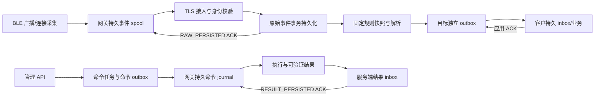

# ESP32-S3 与服务器协议

本文定义 ESP32-S3 与服务器之间的管理、上报与结果确认。现有 1.0 契约由服务端与模拟器使用；1.1 补充 GW32I33V2 的网络、双射频采集、广播和自动连接。板内 ESP32-S3 与 nRF54L15 的 UART 帧和命令见独立协议。客户接收端继续使用本文的客户投递契约。[板内 UART 协议](gateway-uart-protocol.md)

本文以仓库中的 [OpenAPI](../internal/platform/assets/openapi.json)、[消息 Schema](../internal/platform/assets/message-contracts.schema.json) 和服务器业务校验为准。服务器能创建任务，不等于网关已执行；以下职责与交付状态须分别验收。

| 层级 | 当前提供的内容 | 尚需完成的执行与验证 |
| --- | --- | --- |
| 服务器 | 配置/能力/权限校验，持久任务与 ACK，广播字段，UUID 解析和自动连接规则，NRF54 组件 OTA 制品与结果校验 | 与真实 ESP 执行器联调及部署验证 |
| nRF54L15 | 独立固件源码、UART 扫描/过滤/Central/广播/Peripheral，以及可选 MCUboot UART DFU | 目标 SDK 构建、镜像签名及实板验证，见 [验证记录](../../firmware/nrf54l15/VALIDATION.md) |
| ESP32-S3 | 本文规定的执行、持久化和恢复契约 | **本仓库尚未提供生产 ESP 执行器**：网络切换、原生 BLE、双路去重、UART 转换、OTA 下载/传输/确认均需接入 |

示例中的网关、对端、任务、制品和摘要必须替换为实际已登记值。JSON 中的时间仅说明格式；创建任务时 `expiresAt` 必须晚于服务器当前时间，且不超过未来 7 天，不能直接重用文档日期。下文将内层 `configuration` 示例与完整 API 请求明确区分。

## 分层与交付边界



接入事务、解析事务、客户投递事务解耦。网关只需等待原始数据成功持久化，客户暂时离线不占用网关请求。队列达到容量上限时返回可重试拒绝，网关保留 spool，不能以吞包维持表面在线。

## 身份、连接与证书

- 安装实例分配不可变 `namespaceId`；设备使用清单中唯一 `gatewayId`。持久身份不随 IP、TCP/MQTT 会话或重启变化。
- HTTP 使用每设备独立的高熵 Bearer token，服务端保存 SHA256 verifier；也可使用服务器信任 CA 签发并已登记指纹的客户端证书。配置 `GW_CLIENT_CA` 只建立证书链信任，不会自动把未知证书登记为设备。
- MQTT 用户名必须为 `gatewayId`，Broker ACL 限制到该身份的 topic。平台服务凭据独立，不能放入网关。服务端仍校验 topic/envelope 中 namespace、gateway 一致以及设备处于 active 状态。
- TLS 至少 1.2，客户端验证 CA 和主机名。生产证书吊销、更新和时钟校准纳入运维；不使用 `InsecureSkipVerify`。

## MQTT topic 与 HTTP 等价接口

所有网关业务 MQTT 消息使用 QoS 1、`retain=false`。重复是预期行为；PUBACK 不是应用 ACK。

| 方向 | MQTT topic | HTTP |
| --- | --- | --- |
| 上行原始事件 | `gw/v1/{namespaceId}/{gatewayId}/telemetry` | `POST /api/v1/gateway-ingress/batches` |
| 原始持久 ACK | `.../telemetry-ack` | batches 响应 |
| 下行任务 | `.../commands` | `GET /api/v1/gateway-ingress/commands`，响应 `{commands:[...]}` |
| 执行结果 | `.../command-results` | `POST /api/v1/gateway-ingress/results` |
| 结果持久 ACK | `.../result-ack` | results 响应 |
| 状态心跳 | `.../status` | `POST /api/v1/gateway-ingress/status` |

结果 ACK 的 topic 名为单数 `result-ack`。不使用 MQTT retained 命令，避免重连后执行已过期动作。参考部署将 MQTT 接入和命令调度放在 manager，解析与客户投递放在 pipeline；这两个进程共享本机数据目录。HTTP 模拟器面向 `all` 单进程运行；分进程时 HTTP 数据上行发往 pipeline，命令/状态/结果发往 manager。

## 事件标识与应用 ACK

网关持久化 `bootId`（随机 128 bit）、单调 `sequence` 和原始 payload。建议 `eventId=bootId-sequence`。先将 eventId 和 payload 一起写入 Flash journal，再排入发送队列；重发不得生成新 eventId、改变采集时间或重新序列化出不同语义字段。同一 `(namespaceId,gatewayId,eventId)` 的内容变化属于永久冲突。

```json
{
  "schemaVersion":"1.0",
  "namespaceId":"ns_local",
  "gatewayId":"gw_demo",
  "batchId":"batch_001",
  "events":[{
    "eventId":"boot_01-1",
    "timeQuality":"SYNCED",
    "capturedAt":"2026-11-07T10:00:00Z",
    "sourceDeviceId":"sensor_01",
    "sequence":1,
    "protocolHint":"ble-ad-v1",
    "payloadBase64":"AgEGAwMPGA=="
  }]
}
```

上例 payload 解码为 `02 01 06 03 03 0F 18`，即 Flags 和 16 位服务 UUID `180f`，是合法原始 AD。每批 1–200 条，单条解码后最多 64 KiB，总原始字节最多 256 KiB，HTTP JSON 总体最多 1 MiB。建议固件批量 32–100 条，正常刷新间隔 100–1000 ms；需根据实际采集速率、延迟和 Flash 写入寿命验证后确定。重复 BLE 广播是否合并属于采集策略；已经持久化为独立事件后不得为减少流量随意合并。

无可信采集时钟时，`timeQuality=UNSYNCED` 且省略 `capturedAt`；服务器保留 `receivedAt`。不能用服务器时间伪装设备原始采集时间。重试保持时间质量与采集时间不变。

ACK 必须匹配 namespace、gateway、batchId，且 `durability=RAW_PERSISTED`。逐条处理：

| status | 网关动作 |
| --- | --- |
| ACCEPTED / DUPLICATE | 该 eventId 已被服务器接管，可回收本地 payload |
| REJECTED_RETRYABLE | 保留事件，遵守 retryAfterMs，指数退避加随机抖动 |
| REJECTED_PERMANENT | 保留诊断摘要和原始数据至本地隔离区，不进行无限紧密重发 |
| 缺失 item / 请求失败 / 错误 ACK 身份 | 不释放相应事件，继续重试 |

服务器 ACK 仅表示原始数据已经提交，不表示已解析或客户业务完成。批次可改变，但事件身份不可改变。超过去重保留期的离线设备须通过运维处理旧 spool；不能无限承诺历史 ID 的去重记录。

## 命令、执行日志与结果

命令包含 `schemaVersion,namespaceId,gatewayId,taskId,type,parameters,createdAt,expiresAt,requestDigest`。requestDigest 是服务端接收到的原始 TaskRequest 的规范 JSON SHA256；CONFIGURE 的 `desiredRevision` 由服务器随后加入 parameters，不能用最终命令重新计算原始请求 digest。

管理客户端创建任务使用 `POST /api/v1/tasks`，需要管理身份、目标范围内的 `task:create` 和对应操作权限；HTTP 头携带 `Idempotency-Key`。任务请求是 `gatewayId/type/parameters/expiresAt` 四个字段，不自行填写服务器命令信封里的 taskId 或 requestDigest。同一次请求重试必须保持幂等键和请求体；实际的新操作使用新键。当前服务器对每个网关串行放行任务；有在途任务时返回 `TASK_IN_PROGRESS`，存在待对账的 UNKNOWN 时仅允许诊断继续。HTTP 任务创建成功只代表已受理，实际结果通过任务查询及结果通道确认。

网关先原子写入 `(taskId,requestDigest,command,state=ACCEPTED)`，再报告受理。相同 taskId/digest 只重发已有结果，不重新执行；同 taskId 不同 digest 拒绝并告警。真正物理动作前持久化 EXECUTING 意图。设备重启后，若不能证明动作已执行或未执行，报告 UNKNOWN，由管理员查询/对账，不自动重跑 REBOOT、GATT_WRITE、OTA 等动作。

每条结果包含稳定 `resultId`、该任务单调 `resultSequence`、`state`、`observedAt`、`verification` 和 `details`。先持久化结果再发送；因 ACK 丢失重发时 resultId/resultSequence/内容保持不变。服务端按序接纳，过期/迟到结果不会把任务状态回退。收到 namespace/gateway 匹配且 `durability=RESULT_PERSISTED` 的逐项 ACCEPTED/DUPLICATE 才标记该结果已交付。已交付终态 journal 仍要保留以防任务重发触发第二次物理动作。

| 命令 | 参考固件行为与成功证据 |
| --- | --- |
| CONFIGURE | 校验能力与字段，按 `desiredRevision` 应用；成功详情含完全一致的 `configuration`、`reportedConfigurationRevision`，verification=VERIFIED |
| REBOOT | 动作前落盘；真实重启后以新 bootId 完成结果。模拟器只更换持久 bootId 并标记 simulated |
| DIAGNOSTICS | 返回设备实际可采集的诊断 profile；不能虚报未测得指标 |
| GATT_READ / GATT_WRITE | 仅声明支持的型号执行，约束目标设备、service/characteristic、超时和返回值；参考模拟器返回 UNSUPPORTED |
| FIRMWARE_UPGRADE | 仅声明支持的型号执行；需要设备端独立验签、hash/兼容性检查、断电恢复、启动后版本确认和回滚；参考模拟器不执行 |

CONFIGURE 允许字段：`scan.enabled/active/intervalMs/windowMs`（10–10240 ms，window≤interval）；`upload.batchMaxRecords`（1–1000）和 `flushIntervalMs`（100–60000）；`filters.minRssi`（-127..20）、`serviceUuids`、`manufacturerIds`（每组最多 128，厂商 ID 0..65535）。上行契约每批最多 200，固件须将更大的内部采集缓冲拆为多批。网关若未同步可信时钟，不得擅自执行时间敏感命令；需要先校时或按协议明确拒绝 TTL 无法判断。

## 固件与设备清单制品

制品文件 SHA256 写入 manifest；对原始 UTF-8 manifest 字节做 Ed25519 签名，签名以 Base64 表示。manifest 含 `keyId,name,version,sha256,kind`，可含兼容型号、硬件版本、源固件版本列表。服务器加载独立信任公钥；签名私钥保留在发行环境。

设备清单包含身份、序列号、型号、硬件/固件版本、capabilities 和 `credentialHash=SHA256(token)`；明文 token 通过安全出厂渠道进入设备，不能写进导入清单。没有已验证硬件资料时只登记参考型号。

OTA 设备凭据仅能读取与有效任务匹配的 `/api/v1/artifacts/{artifactId}/verification` 和 `/content`。verification 返回原始 manifest 与 signature；设备必须用固件内置发行公钥再次验证，服务端验签不代替设备验签。

### nRF54L15 组件升级

`FIRMWARE_UPGRADE.parameters` 增加可选 `component`，取值为 `GATEWAY` 或 `NRF54`；省略时保留原有整机/主机固件行为。`component=NRF54` 同时要求签名设备能力 `FIRMWARE_UPGRADE` 和 `NRF54_UART_DFU_1`，ESP 还须核实当前 nRF HELLO 的 UART 能力位 12。本机没有实现/启用对应 DFU 构建时不得登记该能力。

```json
{
  "gatewayId": "gw_example",
  "type": "FIRMWARE_UPGRADE",
  "parameters": {
    "component": "NRF54",
    "artifactId": "artifact_nrf54_release",
    "expectedFirmwareVersion": "gw-nrf54l15/0.2.0"
  },
  "expiresAt": "2026-11-18T12:10:00Z"
}
```

这是 `POST /api/v1/tasks` 的完整请求体；需要 `task:create`、`firmware:deploy` 及对应网关范围权限。创建请求可将 expiresAt 设为当前 UTC 加 10 分钟，再根据镜像大小和链路速率选择足够的有效期。`expectedFirmwareVersion` 必须等于已验签制品 version。可选 `maintenanceWindowId` 只有字符串引用字段，当前服务器不会据此校验维护窗口时段；调度方仍须保证实际执行时间符合运维安排。

制品必须是本项目 DFU 构建生成、带 MCUboot 头部和镜像签名的 `zephyr.signed.bin`，不能传裸应用 bin 或 `merged.hex`。先用 `POST /api/v1/artifacts` 上传 `multipart/form-data`，需实例级 `artifact:write` 和 `Idempotency-Key`，字段如下；上传返回的 artifactId 才可填入任务。

| 上传字段 | 内容和校验 |
| --- | --- |
| `file` | MCUboot 签名应用文件的原始二进制；不可用整机烧录 HEX 替代 |
| `kind` | `FIRMWARE`，与 manifest 完全一致 |
| `sha256` | 原始 file 全部字节的 64 位小写 SHA-256，与 manifest 完全一致 |
| `manifest` | 原始 UTF-8 JSON 文本，包括 `keyId/name/version/sha256/kind`、`component=NRF54`、`imageFormat=MCUBOOT_SIGNED_BIN` 和非空 `compatibleModels` |
| `signature` | 对上述原始 manifest 字节签名的 Ed25519 签名，标准 Base64；签名后不得重新排版 manifest |

相同 kind/name/version 的制品不能覆盖。compatibleModels 仍匹配实际网关型号，例如 `GW32I33V2`，不能用芯片型号替代型号兼容检查；hardwareVersions 继续限制实际网关硬件版本。任务 component 必须与签名 manifest 匹配，NRF54 镜像不能投递为 GATEWAY 升级，未声明组件的旧制品也不能投递为 NRF54。设备下载 verification 返回 `{manifest,signature}`，manifest 是保留原始字节顺序的字符串；content 响应提供 `X-Content-SHA256` 和摘要 ETag，但 ESP 必须自行计算下载文件摘要并验证签名，不能只信任 HTTP 头。下载授权还要求任务属于该网关、尚未过期且处于允许的在途状态。

当前设备注册表中的 firmwareVersion 表示网关主机版本，没有独立、已验证的 nRF 源版本清单。因此 NRF54 manifest 若提供非空 fromFirmwareVersions，服务器返回 `FIRMWARE_COMPONENT_VERSION_UNKNOWN`，不会误拿 ESP 版本代替。需要源版本约束的发布须先建设独立组件版本证据及 ESP 实际版本回读，不能仅删掉约束绕过发布要求。

ESP 接到授权任务后先验证 manifest 签名、组件、型号/硬件版本、镜像大小和 SHA-256，再通过 [UART DFU](gateway-uart-protocol.md#esp-经-uart-升级-nrf) 传送：BEGIN → 顺序 CHUNK → FINISH → REBOOT → 新 HELLO 与健康检查 → VERIFY_RUNNING → CONFIRM。VERIFY_RUNNING 使用期望制品的准确文件大小和签名 manifest 的 sha256，从运行中的主镜像槽读回校验；即使版本字符串匹配，也不能跳过这一步。CONFIRM 要求本次启动已经校验成功，即使镜像当前已确认亦如此。MCUboot 使用固件内置的板级镜像公钥进行独立验签；服务器制品签名不能替代这一检查。传输 session 和偏移保存在 ESP journal，UART 重连先查询状态，nRF 复位后重传从 0 开始。升级不能通过未经认证的 Peripheral RX 字节自动触发。

只有新镜像版本等于 expectedFirmwareVersion、运行镜像字节与期望制品一致且明确确认了 MCUboot 测试镜像，ESP 才报告 `SUCCEEDED/VERIFIED`。结果 details 必须包含 `component=NRF54`、`firmwareVersion`、32 位小写十六进制的 `nrfBootId`、`bootConfirmed=true` 和 64 位小写十六进制的 `imageSha256`。服务器把 imageSha256 与该任务绑定制品记录的 sha256 比较，缺失或不同返回 `NRF54_FIRMWARE_IMAGE_MISMATCH`，不能仅凭相同版本号接受另一镜像。仅收到 FINISH 或重启命令的 OK 不足以成功。该结果是经过网关认证通道提交的执行报告，不是对芯片状态的独立硬件证明。nRF 升级结果不会覆盖网关主机 firmwareVersion；未确认测试镜像默认在 120 s 确认窗口后复位回滚，挂死时由 ESP 复位线恢复。

结果通过既有 `POST /api/v1/gateway-ingress/results` 或 MQTT `command-results` 发送，控制信封仍为 1.0。下例为完整 `TaskResultBatch`；imageSha256 只是格式样例，发送时必须换成任务制品的实际摘要，nrfBootId 必须来自新 HELLO。

```json
{
  "schemaVersion": "1.0",
  "namespaceId": "ns_local",
  "gatewayId": "gw_example",
  "results": [{
    "resultId": "result_nrf_upgrade_3",
    "taskId": "task_nrf_upgrade",
    "resultSequence": 3,
    "state": "SUCCEEDED",
    "observedAt": "2026-11-18T12:05:00Z",
    "verification": "VERIFIED",
    "details": {
      "component": "NRF54",
      "firmwareVersion": "gw-nrf54l15/0.2.0",
      "nrfBootId": "00112233445566778899aabbccddeeff",
      "bootConfirmed": true,
      "imageSha256": "0123456789abcdef0123456789abcdef0123456789abcdef0123456789abcdef"
    }
  }]
}
```

ESP 的 OTA journal 至少绑定 taskId、requestDigest、artifactId、组件、期望版本、文件长度/摘要、UART session、nRF 启动 ID、已接纳偏移和升级阶段。UART ACK 只接管传输步骤，最终 `RESULT_PERSISTED` 才接管平台执行结果。链路中断后先查询状态；若新启动 ID 无法与试启动及主镜像校验证据对应，保留待对账状态。禁止因为 FINISH 返回 OK 就覆盖本地“已确认版本”。DFU 期间停止新增无线业务，现有连接须先按授权任务关闭；当前固件不会强制踢掉连接开始升级。中止或回滚后由 ESP 对账并恢复原业务目标。

当前仓库提供服务器的组件任务校验和 nRF UART DFU 接口；ESP 下载、持久 journal、板内传输、健康检查与确认执行器仍须在 ESP 固件中接入。接口和主机测试不表示已完成整机 OTA、目标 SDK 链接或实板掉电验证。

## 客户平台接收与修正

转发事件身份链为 `sourceEventId → processingRevision → outputId → deliveryId`；同一次 delivery 重试保持 deliveryId 和内容不变。DECODE 输出 data，PASSTHROUGH 输出 rawBase64；目标版本、mappingVersion 固定，规则更新不篡改在途数据。

客户在一个数据库事务中保存 deliveryId 去重记录和 inbox/业务状态，**提交后**返回带 `batchId,targetId,targetVersion,durability,items` 的 ACK。durability 只能声明真实已完成的 `CUSTOMER_INBOX_PERSISTED` 或 `CUSTOMER_BUSINESS_PERSISTED`。逐项状态为 ACCEPTED、DUPLICATE、RETRYABLE、REJECTED。仅成功 HTTP 状态码、空响应或 Broker PUBACK 不能释放平台 outbox。

客户业务幂等键使用 `(targetId,namespaceId,gatewayId,sourceEventId,recordKey)`；新 processingRevision 覆盖旧版本，旧版本迟到不能回滚。修正消息带 `correction=true` 和 `replacesOutputIds`，按输出 ID 幂等移除被替换记录。当前内置解析器每个输入只生成一个业务输出；客户模拟器保存源事件最大 revision，阻止旧版本复活。多输出跨批组替换的完整集合提交协议尚需扩展，本版不宣称支持任意多记录拆分。

恢复旧服务器备份后，客户可能已保存更高 revision。恢复命令会锁住重新解析；必须由所有客户接收端导出最高 revision、合并后离线导入。禁止凭空设定较小 revision 或删除恢复对账标记。

## GW32I33V2 控制扩展 1.1

**状态：协议及实现约束。** 1.1 复用现有 TLS、MQTT topic、HTTP 路径、任务 journal 和应用 ACK。发布前，服务器按签名设备清单和型号启用 `GW32_CONTROL_PROFILE_1`，固件按实际板级能力执行。任务仍通过 `PUT /api/v1/gateways/{gatewayId}/configuration` 或 `POST /api/v1/tasks` 创建。当前服务器已实现网络、无线扫描、过滤及广播扩展的字段和能力校验；ESP 驱动执行、nRF UART 能力和服务器结果必须一起对账，服务器接受配置不表示目标芯片已经执行。[配置校验](../internal/platform/gw32_config.go) · [任务校验](../internal/platform/control.go) · [消息 Schema](../internal/platform/assets/message-contracts.schema.json)

| 配置对象 | 执行方 | 能力范围 |
| --- | --- | --- |
| `network` | ESP32-S3 | CH390H 以太网、Wi-Fi STA、上行优先级和网络恢复 |
| `radios.nrf54` | ESP 经 UART 调度 nRF54L15 | 扫描、Beacon 过滤、对外广播、Central 与 GATT、本机 Peripheral |
| `radios.esp32` | ESP32-S3 原生 BLE | 独立扫描、Beacon 过滤、对外广播和经能力验证的 Central/GATT |
| `upload` | ESP32-S3 | 事件队列、MQTT/HTTP 批量与刷新 |

主流程为 **服务器下发扫描规则 → ESP 应用至 nRF → nRF 过滤并上送原始观测 → ESP 合并双路观测 → 服务器解析 UUID 并匹配连接规则 → ESP 调用 nRF 连接并回报结果**。启用 ESP 原生扫描时，两路分别应用扫描规则。对同一采集任务，服务器给两个目标下发同一套逻辑过滤条件，按各自能力检查和读回。ESP 负责合并，连接规则和任务创建由服务器执行。

板级定义沿用 2026 年 10 月 29 日优化版网表，网络接口为 CH390H SPI 以太网和 ESP32-S3 Wi-Fi。LTE 仅属于另有蜂窝模块的硬件变体，本版网络配置不包含 LTE。nRF 作为主要 BLE 采集器，启动时扫描和广播仍默认关闭，等待 ESP 恢复已提交目标；ESP 原生 BLE 也按任务启用。ESP 的 Wi-Fi 和 BLE 共享 RF 时隙，nRF 多角色受控制器调度和实板 FEM 约束。每个目标只启用经过验证的角色组合，诊断同时报告配置值与实际状态。仓库内对应的 [nRF 板定义](../../firmware/nrf54l15/boards/gw32/gw32_nrf54l15/gw32_nrf54l15_nrf54l15_cpuapp.dts) 和 [验证记录](../../firmware/nrf54l15/VALIDATION.md) 可用于核对固件基线；原理图及网表属于独立硬件资料。[ESP32-S3 Wi-Fi/BLE 共存](https://docs.espressif.com/projects/esp-idf/en/stable/esp32s3/api-guides/coexist.html)

### 配置与能力

1.0 的 `scan/filters` 对 GW32 映射到 nRF 扫描，`upload` 仍在 ESP。扩展请求一次只提交 `network`、一个 `radios.<target>`、或既有 1.0 配置其中之一。每个无线目标的扩展配置又只改扫描组（`scan/filters/beaconRules`）或广播组（`advertising`），由相应修订号独立生效，便于恢复和对账。ESP 将部分对象合并至该组上次生效快照后再应用。网络数组、过滤数组和广告原始字节按字段整体替换。

服务器授权取签名设备清单能力和调用者权限的交集。ESP 再检查本机驱动、运行时角色组合和 UART HELLO 能力。能力字符串包括 `GW32_CONTROL_PROFILE_1`、`NETWORK_ETHERNET`、`NETWORK_WIFI_STA`，以及以 `NRF54_` 或 `ESP32_` 加 `BLE_SCAN`、`BLE_BEACON_FILTER`、`BLE_ADV`、`BLE_PERIPHERAL`、`BLE_GATT_CENTRAL`、`BLE_GATT_NOTIFY`。可连接广播同时要求目标的 `BLE_ADV` 和 `BLE_PERIPHERAL`；对 nRF，ESP 还要检查 UART 能力位 4 和 11。服务器按合并后的完整广播模式检查能力，不能通过省略 mode 的部分更新绕过。ESP 原生 Peripheral 只有实际实现时才可登记对应能力，本次 nRF 实现不自动赋予 ESP 该能力。连接类任务还需对应任务类型已在清单授权。运行时不支持的参数返回 `UNSUPPORTED`，资源冲突返回 `BUSY`。1.0 的状态心跳沿用原字段，`DIAGNOSTICS` 的 `details` 可返回各接口实际状态、能力交集、射频修订号和丢弃计数。

平台将 `desiredRevision` 分配给当前配置任务。ESP 持久化配置目标、该组生效修订号和任务状态，成功结果的 `details.configuration` 仍回显原请求对象，`reportedConfigurationRevision` 等于任务的 `desiredRevision`。独立的 `details.effective` 可给出量化后的时间、接口或射频实际状态，凭据仅以引用或掩码形式出现。

### 配置 API 提交流程

1. 用管理身份 `GET /api/v1/gateways/{gatewayId}/configuration`，保存响应 ETag、desiredRevision 和 reportedRevision。此接口的 desired/reported 是最近对应记录的配置补丁，不能当成已经合并的完整网络或双射频快照；ESP 必须持久保留各组已提交快照。
2. `PUT` 同一路径，携带 `If-Match: <刚读到的 ETag>`、`Idempotency-Key` 和 JSON `ConfigurationUpdate`：`expectedReportedRevision` 取已读 reportedRevision，`configuration` 放下文内层对象，`expiresAt` 使用本次任务的实际截止时间。权限为目标范围内的 `gateway:configure` 与 `task:create`，设备还必须声明 `CONFIGURE`。
3. 用返回 taskId 查询 `GET /api/v1/tasks/{taskId}`。只有设备结果已通过校验且为 `SUCCEEDED/VERIFIED` 才显示配置成功；配置 revision 前移、HTTP 2xx 或 MQTT PUBACK 均不能替代执行证据。冲突时重新读取状态并决定新的操作，不能自动覆盖其他操作者的改动。

以下 PowerShell 7 示例按当前版本和动态有效期生成完整请求，操作是关闭 nRF 广播。环境变量由操作者配置为实际服务 URL、管理 token 和网关 ID；不要把 token 写入文档或制品。此处只演示提交，ESP 执行器接入后才会完成物理动作。

```powershell
$gatewayApi = $env:GW_API.TrimEnd('/')
$gatewayId = $env:GW_GATEWAY_ID
$readHeaders = @{ Authorization = "Bearer $env:GW_OPERATOR_TOKEN" }
$configurationUrl = "$gatewayApi/api/v1/gateways/$gatewayId/configuration"
$response = Invoke-WebRequest -Uri $configurationUrl -Headers $readHeaders
$current = $response.Content | ConvertFrom-Json
$body = @{
    expectedReportedRevision = $current.reportedRevision
    configuration = @{ radios = @{ nrf54 = @{ advertising = @{ enabled = $false } } } }
    expiresAt = [DateTime]::UtcNow.AddMinutes(10).ToString('o')
} | ConvertTo-Json -Depth 12
$writeHeaders = $readHeaders.Clone()
$writeHeaders['If-Match'] = [string]($response.Headers.ETag | Select-Object -First 1)
$writeHeaders['Idempotency-Key'] = [guid]::NewGuid().ToString()
Invoke-RestMethod -Method Put -Uri $configurationUrl -Headers $writeHeaders -ContentType 'application/json' -Body $body
```

请求失败且执行状态不明时，保留 `$body` 和 `$writeHeaders`，只重发最后一条请求；重新运行整段会生成新幂等键。下列网络、扫描和广播 JSON 均是这里 `configuration` 的值，不能作为 PUT 的裸请求体。改变扫描组与广播组须分成两个任务，前一个终结后再提交后一个；两个无线目标也须分开提交。

### 网络配置与切换

| 字段 | 类型与约束 |
| --- | --- |
| `network.uplinkOrder` | 1–2 个不同项，值为 `ETHERNET` 或 `WIFI_STA`，按优先顺序选择 |
| `network.ethernet` | `enabled:boolean`、`ipv4`。硬件基线为 CH390H |
| `network.wifiSta` | `enabled:boolean`、`ssid:string`（启用时 1–32 UTF-8 字节）、`security`（`WPA2_PSK` 或 `WPA3_SAE`）、`credentialRef:string`、`ipv4` |
| `ipv4` | `mode=DHCP` 时自动获得参数。 `mode=STATIC` 时包含 `address`、`prefixLength`（1–30）、同子网 `gateway` 和 1–2 个 `dns` IPv4 地址 |

合并后，`uplinkOrder` 必须引用已启用接口。`ipv4` 按整个对象替换。默认优先以太网 DHCP。Wi-Fi 密钥由设备安全配置流程写入本地凭据存储，任务仅引用 `credentialRef`，ESP 在试用前验证引用有效。上行端点、网关身份和信任根仍按现有部署配置管理。正常运行时按优先顺序选择已通过应用连通性验证的接口，失效后切到下一项，并继续原 spool 的重试序列。

下列 `configuration` 对象设置以太网主用和 Wi-Fi 备用。

```json
{
  "network": {
    "uplinkOrder": ["ETHERNET", "WIFI_STA"],
    "ethernet": {"enabled": true, "ipv4": {"mode": "DHCP"}},
    "wifiSta": {
      "enabled": true,
      "ssid": "site-gateway",
      "security": "WPA2_PSK",
      "credentialRef": "site-wifi-01",
      "ipv4": {"mode": "DHCP"}
    }
  }
}
```

1. ESP 在同一个 `CONFIGURE` 任务中持久化最后可用配置、候选配置和试用意图，先报告受理，再启动最长 120 秒的试用窗口。窗口还受任务有效期约束。
2. ESP 逐个试用配置发生变化且列入上行优先级的接口，并验证候选首选路由。每个受测接口完成链路、IP、必要的 DNS 和 TLS 校验后，ESP 将管理连接明确绑定到该接口和其路由，并发送各自带稳定 `resultId` 的 `EXECUTING`、`verification=NONE` 结果。探测结果的 `details` 记录试用接口、候选修订号和实际网络状态。MQTT 使用绑定候选接口的会话订阅结果 ACK，HTTP 使用绑定候选接口的 HTTPS 请求和响应。
3. 每个受测接口都须在绑定连接上收到匹配任务、结果 ID、命名空间和网关的 `RESULT_PERSISTED`，且逐项为 `ACCEPTED` 或 `DUPLICATE`。ESP 随后原子提交候选为新的最后可用配置，再报告 `SUCCEEDED/VERIFIED`。MQTT PUBACK 仅作为传输层信号。
4. 超时、拒绝、候选失联或在提交前重启时，恢复最后可用配置并持久记录回滚结果，连接恢复后报告失败原因和实际生效修订号。提交后重启时恢复新配置和已写入的任务状态。两种恢复都保留网关身份、待发事件和命令结果。

上述接口绑定、试用及回滚是 ESP 执行器的实现要求。服务器目前校验配置、能力、修订号与结果回显，并不能独立证明探测流量实际经过哪个网口。LTE、Wi-Fi SoftAP 配网窗口开关、Wi-Fi 原始帧收发及凭据明文下发都没有在本配置 Schema 中开放；`NETWORK` 诊断的 Wi-Fi 扫描也不能代替 BLE 扫描。

### 本地网页配网与远程凭据扩展

ESP32-S3须提供手机/笔记本连接热点后使用的本地网页，配置Wi-Fi STA、Ethernet、DHCP/静态IPv4和主备顺序。该入口与平台共享参数校验、候选试用和回退管理；本地事务使用独立localRevision/transactionId，不能伪造CONFIGURE任务或自行推进desiredRevision。明确LOCAL_ONLY保存不等于平台已确认。

当前Schema继续只接受credentialRef，不接受明文password。远程新密码安装、本地在线挑战、设备网络状态上报与采用/覆盖本地改动的裁决属于待实现扩展，完整端点草案与版本前置条件见[配网设计](../../docs/esp32s3-network-provisioning.md)。本节不宣称这些草案已进入当前Schema/OpenAPI；实现时须同步服务端、设备、权限、页面和验收。现有远程networkProbe及RESULT_PERSISTED先持久后成功的门槛保持不变。

### ESP Wi-Fi 与原生 BLE

Wi-Fi 的业务收发通过 STA 和现有 MQTT/HTTP。`DIAGNOSTICS` 的 `NETWORK` profile 支持扩展参数 `wifiScan=OFF/PASSIVE/ACTIVE`，省略为 OFF。扫描受该任务时限约束，最多返回 32 个 AP，字段为 SSID、BSSID、信道、RSSI 和认证类型。启用主动扫描须满足本机配置和地区信道限制。Wi-Fi SoftAP 仅在现场打开的配网窗口内由固件发标准 Wi-Fi Beacon，窗口结束即停，配置界面要求本地认证。BLE 广播和扫描属于 `radios.esp32`，使用下面的独立配置和上报格式。[ESP-IDF Wi-Fi 扫描](https://docs.espressif.com/projects/esp-idf/en/latest/esp32s3/api-guides/wifi-driver/station-scenarios.html#esp32-s3-wi-fi-scan)

两个 BLE 目标使用同一套 JSON 配置语义，ESP 将 nRF 目标转成 UART 命令，将 ESP 目标交给本机 BLE 栈。

| 配置字段 | 约束和行为 |
| --- | --- |
| `scan` | `enabled`、`active`、`intervalMs`、`windowMs`，沿用 1.0 范围 |
| `filters` | `minRssi`、`serviceUuids`、`manufacturerIds`，沿用 1.0 范围。扩展对象允许用 `minRssi:null` 清除 RSSI 阈值，用空数组清除列表 |
| `beaconRules[]` | 最多 8 条。每条含 `action=ALLOW/DENY`、`reportKinds[]`（`LEGACY_ADV/LEGACY_SCAN_RSP/EXT_ADV/EXT_SCAN_RSP`）、`adType`（1–255）、`offset`、`valueBase64`、`maskBase64`。首个命中生效，长度与默认动作按 UART Beacon 规则定义 |
| `advertising` | `enabled`、`mode=NONCONNECTABLE/SCANNABLE_NONCONNECTABLE/CONNECTABLE_SCANNABLE`、`intervalMs`（100–10240）、`advDataBase64`、`scanResponseBase64`。每段解码后最多 31 字节，数据由完整 AD 结构组成。不可扫描模式的扫描响应为空；可连接模式要求额外 Peripheral 能力 |

下列配置由服务器发给 ESP 自己的 BLE 控制器，开启 AD 数据为 `02 01 06` 的广播。

```json
{
  "radios": {
    "esp32": {
      "advertising": {
        "enabled": true,
        "mode": "NONCONNECTABLE",
        "intervalMs": 250,
        "advDataBase64": "AgEG",
        "scanResponseBase64": ""
      }
    }
  }
}
```

对 nRF 的扫描或广播配置，ESP 分别用 UART 的 `SET_SCAN_PROFILE` 或 `SET_ADV_CONFIG`，再读回配置和实际状态。仅改变广播 enabled 且 nRF 有能力位 10 时，可使用 `SET_ADV_ENABLED`；完整快照和配置 revision 的语义相同。仅支持基础扫描的 nRF 使用 `SET_SCAN_CONFIG`。`DIAGNOSTICS BLE` 报告实际扫描状态、采集延迟、扫描空档和共存降级，也可读回 `GET_ADV_STATUS` 的目标值、实际状态、最后驱动错误、应用时间和更新计数。ESP 原生 BLE 通过本地驱动回调确认启停，双路采集进入同一个 ESP 合并队列。

下列配置让 nRF 接收带 iBeacon 前缀 `4C 00 02 15` 的 legacy 广播。规则命中后仍保留完整 AD。

```json
{
  "radios": {
    "nrf54": {
      "scan": {"enabled": true, "active": false, "intervalMs": 100, "windowMs": 50},
      "beaconRules": [{
        "action": "ALLOW",
        "reportKinds": ["LEGACY_ADV"],
        "adType": 255,
        "offset": 0,
        "valueBase64": "TAACFQ==",
        "maskBase64": "/////w=="
      }]
    }
  }
}
```

基础 RSSI/服务 UUID/厂商过滤先执行，各类已启用条件之间取 AND、同一列表内部取 OR；再依序匹配 Beacon 掩码规则，首个命中决定放行或拒绝。有 ALLOW 规则但无命中时丢弃，只有 DENY 规则或空规则时默认放行。ADV 与 SCAN_RSP 独立过滤，不跨报告拼接内容。上例沿用已有基础 filters；要清除已有条件，显式附加 `filters={"minRssi":null,"serviceUuids":[],"manufacturerIds":[]}`。当前 nRF 固件以 legacy 接收为基线；Schema 允许 EXT 报告规则，不代表固件已声明完整扩展广播接收能力。

### 服务器控制 nRF 对外广播

广播的开启、关闭、类型、内容及间隔由 `radios.nrf54.advertising` 配置，不另造一套无 revision 的启停任务。服务器分配 desiredRevision，ESP 持久化并将部分更新合并成完整广播配置后下发 nRF。nRF 同一启动周期的 UART 重握手保留广播配置；nRF 重启后默认关闭，ESP 按已提交目标恢复。修改内容不会改变接收扫描规则；更改扫描也不能隐式抹去广播目标。

| 控制意图 | 配置字段 | 执行及成功条件 |
| --- | --- | --- |
| 启停 | `enabled` | 保留既有类型/内容/间隔；读回目标配置与真实状态 |
| 类型 | `mode` | 三种 legacy 模式；改为 NONCONNECTABLE 时同时把 scanResponseBase64 清空，否则完整配置校验失败 |
| 内容 | `advDataBase64`、`scanResponseBase64` | 各自整段替换；标准 Base64，解码后各 0–31 字节且 AD 结构完整，空字符串表示清空 |
| 间隔 | `intervalMs` | 整数 100–10240 ms；ESP 按 UART 的 0.625 ms tick 规则量化，effective 可报告量化值 |
| 查询 | 既有 `DIAGNOSTICS` 的 `BLE` profile | ESP 读取 `GET_ADV_CONFIG` 和 `GET_ADV_STATUS`；配置查询 API 本身不实时读取控制器 |

启用只恢复当前保存的内容；首次配置应完整给出五个字段，避免发出空载荷。原始 AD 中的设备名称、Flags 和服务 UUID 都由下发内容决定，不自动注入。当前 API 没有发射功率、广播 MAC、PHY、扩展广播集或轮播列表字段，不能用未知 JSON 字段请求这些功能。

下面是 nRF 的纯 iBeacon 广播配置：UUID `00112233-4455-6677-8899-aabbccddeeff`、Major 1、Minor 2、measured power -59，含 Flags 共 30 字节；标识和校准值在部署时替换。

```json
{
  "radios": {
    "nrf54": {
      "advertising": {
        "enabled": true,
        "mode": "NONCONNECTABLE",
        "intervalMs": 500,
        "advDataBase64": "AgEGGv9MAAIVABEiM0RVZneImaq7zN3u/wABAALF",
        "scanResponseBase64": ""
      }
    }
  }
}
```

下例启用可连接广播，广播数据包含 Flags 和本机 Peripheral 服务 UUID，扫描响应包含名称 `GW32`：

```json
{
  "radios": {
    "nrf54": {
      "advertising": {
        "enabled": true,
        "mode": "CONNECTABLE_SCANNABLE",
        "intervalMs": 250,
        "advDataBase64": "AgEGEQcAVAuaL2yRnTFMWksBAOB7",
        "scanResponseBase64": "BQlHVzMy"
      }
    }
  }
}
```

关闭只需将 `{"radios":{"nrf54":{"advertising":{"enabled":false}}}}` 放入 configuration，内容和间隔保留供以后启用；只改间隔可提交 `{"radios":{"nrf54":{"advertising":{"intervalMs":1000}}}}`。纯 Beacon 使用 `NONCONNECTABLE`；需要设备名称等扫描响应时可用 `SCANNABLE_NONCONNECTABLE`。iBeacon、厂商数据和自定义 Service Data 都编码为标准 AD 原始字节，服务器配置不依赖固定厂商模板。iBeacon measured power 是校准 RSSI，不等同于芯片或天线口发射功率。

运行中仅载荷变化时，支持能力位 10 的 nRF 尝试在线更新；模式和间隔变化需要短暂停播重启。AdvData 和 ScanRsp 的空口变更不保证同时发生，接收方应使用业务载荷版本识别，不能从两包到达顺序推断配置事务。配置回读与实际状态确认后，ESP 才报告结果。可连接模式被远端接入后，`enabled=true/state=PAUSED` 配合有效的 Peripheral 连接是正常状态；断开后恢复目标广播。扫描、Central、Peripheral 的并发仍受实际能力限制，冲突返回 `BUSY`，ESP 不擅自停止其他服务器任务。

当前 nRF 基线不声明扫描/广播/连接并行能力。切换到广播前须先结束或关闭冲突扫描任务；由服务器分开提交的停扫、启播是两个可观察步骤，不是跨任务原子事务。Central 和 Peripheral 合计最多一个活动连接。`enabled=false` 取消新的广播及断连后的自动恢复，**不会断开已经连接的手机**；断连须由获授权的 ESP 会话使用 UART Peripheral 断连命令完成。广播暂停也不代表连接故障，应用应同时读取 Peripheral 状态。

本机服务为 `7be00001-4b5a-4c31-9d91-6c2f9a0b5400`，具有公开 INFO 读取、RX Write 和 TX Notify。UUID 和 UART 命令详见 [Peripheral 协议](gateway-uart-protocol.md#可连接广播与本机-peripheral-服务)。远端写入通过 `PERIPHERAL_BATCH`（UART 类型 0x22）到 ESP，只是不透明应用输入；它不直接执行服务器配置或固件升级。ESP 须完成应用认证、授权和防重放后再解释或转发数据，不能把 BLE 连接成功当作管理授权，也不能把该写入伪装成已有 `GATT_NOTIFY` 上行事件。当前 RawEvent capture.kind 没有 Peripheral RX 类型，也没有服务器公开的 Peripheral 回复/断连任务；云端字段映射、应用认证和手机端到端闭环尚未实现。现有数据传输命令只定义 ESP ↔ nRF 接口。

### ESP 双路采集去重

ESP 在分配平台事件 ID 之前做跨射频的一对一匹配。仅一颗芯片扫描时，观测直接定稿。双路扫描时使用以下规则。

1. 匹配键为观测地址类型和地址、`kind`（ADV 或 SCAN_RSP）、legacy/extended、扩展广播 SID、ADV 的可连接属性及完整原始 AD 字节。可用 SHA-256 查找候选，再比较原始字节。仅两颗不同芯片的观测可配对。匿名地址、缺少 SID 的扩展报告和不可比较的元数据分别保留。RSSI 用于诊断和规则，服务 UUID 用于解析。
2. ESP 以各自采集时刻做比较。用 UART `TIME_PROBE` 将 nRF 单调采集时间映射到 ESP 单调时钟。初始时间窗为 50 ms，要求两条观测时间差的绝对值加上时钟误差估计不超过窗口。误差按探测往返时延的一半、采样量化和锚龄内的时钟漂移上界估算。缺少有效时间映射时分别上报。
3. 每条观测从进入 ESP 暂存队列起最多等待 150 ms。到期时选当前尚未配对且时间差最小的另一射频候选，同差取先入队者。每条记录最多配对一次。命中时以 nRF 观测作为主记录，保留其时间、地址、可连接属性和 RSSI，并写入 `capture.observedBy=["NRF54","ESP32"]`。同一路收到的重复广播、不同 AD 内容和不同报告种类保持独立。迟到记录按未配对观测处理。
4. ESP 将 nRF 待合并观测或最终事件与 UART 批次去重水位一起写入 Flash，提交后回 `CUSTODY`。配对或单条定稿时，原子写入一条不可变平台事件并移除已消费观测。ESP 重启后先将失去旧单调时间映射的暂存观测分别定稿，再继续合并。暂存区初始上限为 256 条或 128 KiB，满时有 spool 空间则直接定稿，否则 nRF 批次返回 `BUSY`。GATT 通知和链路状态走各自事件类型。

`DIAGNOSTICS BLE` 报告两路接纳数、匹配数、时钟失效和迟到导致的单独定稿数。板内合并控制观测数量，串口重传与平台重传仍分别用批次身份和 `eventId` 去重。

这些跨射频合并参数属于待实现的 ESP 算法约束，当前服务器没有开放可调 `dedupWindowMs` 配置字段。不要用 MAC 或 UUID 单独作为去重键，也不要把同一射频持续收到的周期广播永久抑制。当前 nRF 对匹配已保存 bond identity 的扫描报告保守地上报未知地址；ESP 省略该事件的 address/addressType，分别保留观测，并禁止用它触发按空口地址的自动连接。参见 [nRF 固件的地址边界说明](../../firmware/nrf54l15/README.md)。

### 连接和 GATT 任务

1.0 的 `GATT_READ/WRITE` 在 GW32 上默认选 nRF。1.1 给这些任务增加可选 `radio=NRF54/ESP32` 和 `connectionRef`。无 `connectionRef` 时，ESP 在一次任务内完成连接、发现、读写和断开，所有步骤共用任务的 `timeoutMs` 预算，并受任务有效期约束。带引用时，目标地址、地址类型和无线控制器须匹配已建立的连接。先验证设备、服务、特征和操作权限，1.1 基线写入使用 `WITH_RESPONSE`，按特征权限和协商 MTU 校验长度。READBACK 由同一连接内的读取验证。APPLICATION_REPLY 需设备协议适配器明确支持。

以下扩展动作使用现有任务信封及 `gatt:execute` 权限。每项均有任务有效期和 `timeoutMs`（100–30000）。

| 任务 | 参数 | 成功证据 |
| --- | --- | --- |
| `GATT_CONNECT` | `radio`、`deviceAddress`、`addressType=PUBLIC/RANDOM`、`security=UNENCRYPTED/BONDED_ENCRYPTED` | `connectionRef`、实际连接状态、`attMtu` |
| `GATT_DISCONNECT` | `radio`、`connectionRef` | 连接关闭，引用及订阅失效 |
| `GATT_SUBSCRIBE` | `radio`、`connectionRef`、`serviceUuid`、`characteristicUuid`、`mode=NOTIFY/INDICATE` | CCC 生效证据和该连接内的 `characteristicHandle` |
| `GATT_UNSUBSCRIBE` | `radio`、`connectionRef`、`serviceUuid`、`characteristicUuid` | 目标订阅已关闭 |

`connectionRef` 在当前网关内标识一次连接。ESP 将 ASCII `gw32-conn-v1`、射频单字节编号（0 nRF、1 ESP）、对应控制器的 16 字节启动 ID、4 字节小端连接号按顺序连接并计算 SHA-256，取前 16 字节编码为小写十六进制。ESP 原生 BLE 也分配同一启动周期内不复用的连接号。这样可在 ESP 重启后为 nRF 未交付通知生成原引用，控制命令则只接受当前已登记的活连接。

断开或任一相关芯片重启后，旧引用返回 `STALE_CONNECTION`。临时连接按任务关闭。ESP 重启时先用 journal 对账旧操作，再关闭 nRF 尚存的旧连接。持久 journal 保存 taskId、请求摘要到板内操作的映射。同 taskId 和摘要只重发已有结果，摘要冲突则拒绝。已发出的 GATT 写入在复位或断链后无法证实时报告 `UNKNOWN`，服务器和 ESP 均保留该状态供对账。nRF 板内复位用于恢复，平台 REBOOT 以新的 ESP 网关启动 ID 验证。

当前 nRF 在 Central 建连时暂停扫描，并在连接失败或连接断开、资源释放后恢复保存的扫描目标；维持连接期间继续暂停，不宣称边扫描边连接。若广播或 Peripheral 正占用资源，连接命令返回 BUSY，由上层明确协调。`BONDED_ENCRYPTED` 仅使用已有绑定，不能作为自动首次配对请求。BLE 服务 UUID 的位宽判定发生在服务器解析阶段，连接过程仍以已授权的真实地址和规范 128 位 UUID 执行。

### 服务器解析与自动连接

自动连接按已启用的服务器规则执行，目标控制器固定为 nRF。参与自动连接的扫描资料使用 `ble-ad-v1` 上传完整原始 AD。服务器先按 Length/Type/Data 验证结构，再根据 AD Type 判定位宽，输出规范 UUID、原始位宽 `wireBits`、`adType` 及来源事件 ID。列表字段长度须为对应 UUID 长度的整数倍，Service Data 只解析开头的 UUID，其余为业务字节。结构或 UUID 字段长度非法时保存原始数据并记录解析错误，该事件停止自动连接评估。[Bluetooth SIG AD 类型](https://www.bluetooth.com/wp-content/uploads/Files/Specification/HTML/Assigned_Numbers/out/en/index-en.html) · [Bluetooth Core Supplement](https://www.bluetooth.com/wp-content/uploads/Files/Specification/HTML/CSS_v14/out/en/core-supplementary-features/data-types-specification.html)

| 广播中服务 UUID 位宽 | UUID List AD Type | Service Data AD Type | 规范化 |
| --- | --- | --- | --- |
| 16 位 | `0x02/0x03` | `0x16` | 2 字节小端，展开为 `0000xxxx-0000-1000-8000-00805f9b34fb` |
| 32 位 | `0x04/0x05` | `0x20` | 4 字节小端，展开为 `xxxxxxxx-0000-1000-8000-00805f9b34fb` |
| 128 位 | `0x06/0x07` | `0x21` | 16 字节蓝牙小端，转为小写标准 UUID 字符串 |

例如，`03 03 0F 18` 解为 16 位 `180f`，`05 05 78 56 34 12` 解为 32 位 `12345678`，后者的规范值为 `12345678-0000-1000-8000-00805f9b34fb`。128 位示例 `11 07 78 56 34 12 F0 DE BC 9A 78 56 34 12 78 56 34 12` 解为 `12345678-1234-5678-9abc-def012345678`。32 位示例用于测试解码。设备自定义服务采用 128 位 UUID，16/32 位广播 UUID 使用 Bluetooth SIG 分配值。规则按规范 UUID 匹配，可额外限定 `wireBits`。厂商 AD 内的 iBeacon UUID 属于 Beacon 标识，服务发现依据上表中的服务字段。[UUID 展开规则](https://www.bluetooth.com/wp-content/uploads/Files/Specification/HTML/Core-61/out/en/host/service-discovery-protocol--sdp--specification.html) · [GATT UUID 编码](https://www.bluetooth.com/wp-content/uploads/Files/Specification/HTML/Core-60/out/en/host/generic-attribute-profile--gatt-.html)

管理 API 先用 `POST /api/v1/ble-peers` 登记稳定地址，再用 `POST /api/v1/auto-connect-rules` 引用返回的 peerId。两种创建请求都携带 Idempotency-Key；需要对端范围内的 `gatt:manage`，规则还要求其 gatewayIds 范围内的 `gatt:execute`。ruleId 和 revision 由服务器生成，不放进创建请求。修改现有对端或规则用相应 `PATCH /{id}` 和当前 If-Match；活动连接可从 `GET /api/v1/gatt-connections` 查询。

以下是两个分别提交的完整 JSON 请求体。例子使用已分配的 16 位 Battery Service 展开值，说明服务器既支持 16/32 位展开，也支持完整 128 位 UUID；实际规则应与目标设备服务一致。

`POST /api/v1/ble-peers`：

```json
{
  "scopeId": "scope_site_01",
  "displayName": "battery-sensor-01",
  "deviceAddress": "A1B2C3D4E5F6",
  "addressType": "PUBLIC"
}
```

`POST /api/v1/auto-connect-rules`，peerId 换成上一请求的返回值：

```json
{
  "name": "connect-known-battery-sensor",
  "peerId": "peer_battery_01",
  "gatewayIds": ["gw_example"],
  "enabled": true,
  "priority": 100,
  "serviceUuid": "0000180f-0000-1000-8000-00805f9b34fb",
  "security": "UNENCRYPTED",
  "wireBits": 16,
  "minRssi": -85,
  "maxAgeMs": 5000,
  "cooldownMs": 30000
}
```

public 和 random static 地址才可登记自动连接，轮换的 RPA、未知或匿名地址不在本版规则范围。接收 UUID 不会直接连接任何陌生设备；只有授权、启用规则命中才创建任务。`autoTrigger` 由服务器内部生成，公开任务 API 拒绝客户端自行注入。启用规则要求目标具有 `GW32_CONTROL_PROFILE_1`、`GW32_CAPTURE_CONTEXT_1`、`GATT_CONNECT`、`NRF54_BLE_GATT_CENTRAL` 和 `NRF54_BLE_GATT_SERVICE_DISCOVERY`。

1. **匹配规则。** 每条规则包含 `ruleId`、`revision`、启停、优先级、授权网关范围、已登记的对端地址与类型、目标规范 `serviceUuid`、连接安全级别，以及可选 `characteristicUuid`、`wireBits` 和最低 RSSI。多条命中按优先级从高到低取首条，同优先级按规则 ID 排序。默认观测有效期为 5 s，同一对端尝试冷却为 30 s。首版自动连接目标限已登记的 public 或 random static 地址。启用自动连接须同时支持 1.1 采集上下文和 nRF 的 GATT 服务查找能力。
2. **确认可连接。** 要求同一网关有 `capture.radio=NRF54`、`kind=ADV`、`connectable=true` 的新鲜观测，可信 `capturedAt` 必须仍在有效期内。UUID 优先取自该 ADV，也可来自同一网关在采集时间 500 ms 内观测到的同地址类型、同地址、同 legacy/extended 类型的 SCAN_RSP，扩展报告还须同 SID。两类报告到达时都可触发评估，时间按采集时刻比较。ESP 单路观测可提供关联的 SCAN_RSP 资料。目标只在扫描响应中提供 UUID 时，启用主动扫描并让前置过滤保留两类报告，再由服务器做 UUID 匹配。
3. **创建任务。** 原始事件持久化后，服务器通过持久规则任务评估，接管 ACK 独立返回。管理侧在同一事务中写入自动触发去重记录、对端占用记录和 `GATT_CONNECT` 任务，任务唯一键为 `(namespaceId,gatewayId,ruleId,revision,advEventId,serviceUuid)`。同一命名空间内，一个已登记对端同时仅有一个连接尝试或活动连接。网关已存在未完成任务、对端处于冷却或待对账时跳过本次候选，后续以新鲜观测重新评估。
4. **执行与发现。** 任务使用既有信封和 `radio=NRF54`。参数增加 `autoTrigger`，包含 `advEventId`、`uuidEventId`、`ruleId`、`ruleRevision`、规范 `serviceUuid`、`wireBits`、可选 `characteristicUuid` 和 `maxAgeMs`。初始 `maxAgeMs` 为 5000，允许 1000–30000。任务的 `expiresAt` 不晚于所用观测的有效期。ESP 定稿时保存最近可连接 nRF 广播的 `eventId`、原始观测地址、可连接属性、nRF 启动 ID 和单调采集时间，至少保留至 30 s 有效期上限，独立于上报事件回收。ESP 执行前再次核对这些证据，失效或缺失返回 `STALE_OBSERVATION`。按真实地址连接后，在同一任务内执行服务查找、可选特征发现和实际连接状态回读。若服务或特征未发现，或实际对端及安全状态不匹配，则关闭该连接并报告失败。
5. **回报与释放。** 成功结果包含 `ruleId`、`advEventId`、实际对端地址与类型、`connectionRef`、`attMtu`、实际安全状态和已发现的规范服务 UUID，特征发现成功时附特征 UUID 与句柄。ESP 将连接登记和成功结果一同持久化。ESP 每 2 s 或在连接操作结束后读取 nRF 连接状态，断开、nRF 启动 ID 改变或 ESP 重启使已登记的旧连接失效时，将 `GATT_LINK_DOWN` 写入持久队列。服务器按 `connectionRef` 关闭连接和释放占用，并保留关闭标记以处理乱序结果。执行结果为 `UNKNOWN`、状态失联或关闭事件迟到时，先用诊断对账，再允许后续自动连接。

### 双射频数据上报 1.1

1.0 数据仍用原 `IngressBatch`。ESP 保留射频来源供本地诊断，使用 `ble-ad-v1` 或 `reference-sensor-v1` 上报广播。双射频元数据和 GATT 通知需要网关与服务器部署同时启用 `GW32_CAPTURE_CONTEXT_1`。该能力同时是平台接受 GATT 订阅任务的前置条件。ESP 在写入 Flash 时固定每条事件的上行版本。扩展使用相同 MQTT/HTTP 接入和接管 ACK，`IngressBatch` 与 `IngressAck` 的 `schemaVersion` 为 `1.1`。每条事件在原 `RawEvent` 字段之外增加下述 `capture` 对象，其他未知字段继续拒绝。

| `capture` 字段 | 约束 |
| --- | --- |
| `radio` | 必填，`NRF54` 或 `ESP32` |
| `kind` | 必填，`ADV`、`SCAN_RSP`、`GATT_NOTIFY`、`GATT_INDICATE`、`GATT_LINK_DOWN` |
| `addressType`、`address` | 地址已知时成对提供。类型为 `PUBLIC/RANDOM`，地址为 12 位大写十六进制 |
| `legacy` | ADV、SCAN_RSP 必填的布尔值 |
| `connectable` | 仅 ADV，布尔值。nRF 记录从 UART `props` bit0 取得，ESP 本机记录在控制器属性未知时省略 |
| `observedBy` | 双路观测成功合并的 ADV 或 SCAN_RSP 固定为 `["NRF54","ESP32"]`，`radio` 为 `NRF54` |
| `rssiDbm`、`txPowerDbm`、`primaryPhy`、`secondaryPhy`、`sid` | ADV、SCAN_RSP 的已知元数据。dBm 为有符号整数，PHY 为 `LE_1M/LE_2M/LE_CODED`，SID 为 0–15 |
| `connectionRef`、`characteristicHandle` | GATT 通知或指示必填。句柄为 1–65535，引用为捕获时的连接快照。链路断开只带 `connectionRef` |
| `linkReason` | `GATT_LINK_DOWN` 必填，`DISCONNECTED`、`NRF_RESTART` 或 `ESP_RESTART` |

ADV、SCAN_RSP 保持现有 `protocolHint` 和原始 AD 载荷映射。GATT 通知和指示使用 `protocolHint=ble-gatt-value-v1`，`payloadBase64` 只编码特征值字节。链路断开使用 `ble-gatt-link-v1` 和空 `payloadBase64`，由连接状态处理器消费。GATT 任务的同步读结果走命令结果通道。ESP 在事件定稿时固定上行版本、`eventId`、时间、`capture` 和载荷。服务器把 `capture` 与事件同事务提交并纳入去重摘要。重试按原版本分批，版本切换只影响新事件，旧版本接入保留至对应 spool 排空。

以下是两颗控制器对同一广播完成合并后的完整 `IngressBatch` 示例。保留 nRF 的地址、RSSI 和时间，payload 仍为原始 AD；observedBy 仅在真实完成双路配对时添加。发送到既有 telemetry 或 batches 接口，不增加另一套上报入口。

```json
{
  "schemaVersion": "1.1",
  "namespaceId": "ns_local",
  "gatewayId": "gw_example",
  "batchId": "batch_ble_001",
  "events": [{
    "eventId": "espboot01-1",
    "sequence": 1,
    "capturedAt": "2026-11-18T12:00:00Z",
    "timeQuality": "SYNCED",
    "protocolHint": "ble-ad-v1",
    "payloadBase64": "AgEGAwMPGA==",
    "capture": {
      "radio": "NRF54",
      "kind": "ADV",
      "addressType": "PUBLIC",
      "address": "A1B2C3D4E5F6",
      "legacy": true,
      "connectable": true,
      "observedBy": ["NRF54", "ESP32"],
      "rssiDbm": -60,
      "primaryPhy": "LE_1M"
    }
  }]
}
```

1.1 的联调须覆盖旧网关继续接入、错误能力拒绝、双路一对一去重及重启恢复、16/32/128 位 UUID 解析、仅扫描响应带 UUID、不可连接及过期观测拦截、自动任务重复触发、服务发现失败、连接结果与断开事件乱序、GATT 写入结果丢失、候选路由验证与断电回滚，以及跨版本 spool 重放。

完整需求和交付核对见 [网关需求清单](../../docs/gateway-requirements.md)；分层数据流、集成次序与验收步骤见 [网关联调说明](../../docs/gateway-integration.md)。两份协议共同定义契约，固件与服务器的测试结果不替代 ESP 执行器及实板联调。
