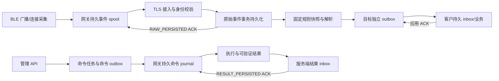

# 网关与客户接收端协议 1.0

本文定义自有网关尚未设计部分的参考契约。服务端与模拟器据此实现；固件团队需实现真实采集、Flash 持久化、配置生效、重启与升级验证。不得把模拟器的 VERIFIED 等同于物理硬件已经验证。

## 分层与交付边界



接入事务、解析事务、客户投递事务解耦。网关只需等待原始数据成功持久化，客户暂时离线不占用网关请求。队列达到容量上限时返回可重试拒绝，网关保留 spool，不能以吞包维持表面在线。

## 身份、连接与证书

- 安装实例分配不可变 `namespaceId`；设备使用清单中唯一 `gatewayId`。持久身份不随 IP、TCP/MQTT 会话或重启变化。
- HTTP 使用每设备独立的高熵 Bearer token，服务端保存 SHA256 verifier；也可使用服务器信任 CA 签发并已登记指纹的客户端证书。配置 `GW_CLIENT_CA` 只建立证书链信任，不会自动把未知证书登记为设备。
- MQTT 用户名必须为 `gatewayId`，Broker ACL 限制到该身份的 topic。平台服务凭据独立，不能放入网关。服务端仍校验 topic/envelope 中 namespace、gateway 一致以及设备处于 active 状态。
- TLS 至少 1.2，客户端验证 CA 和主机名。生产证书吊销、更新和时钟校准纳入运维；不使用 `InsecureSkipVerify`。

## MQTT topic 与 HTTP 等价接口

所有网关业务 MQTT 消息使用 QoS 1、`retain=false`。重复是预期行为；PUBACK 不是应用 ACK。

| 方向 | MQTT topic | HTTP |
| --- | --- | --- |
| 上行原始事件 | `gw/v1/{namespaceId}/{gatewayId}/telemetry` | `POST /api/v1/gateway-ingress/batches` |
| 原始持久 ACK | `.../telemetry-ack` | batches 响应 |
| 下行任务 | `.../commands` | `GET /api/v1/gateway-ingress/commands`，响应 `{commands:[...]}` |
| 执行结果 | `.../command-results` | `POST /api/v1/gateway-ingress/results` |
| 结果持久 ACK | `.../result-ack` | results 响应 |
| 状态心跳 | `.../status` | `POST /api/v1/gateway-ingress/status` |

结果 ACK 的 topic 名为单数 `result-ack`。不使用 MQTT retained 命令，避免重连后执行已过期动作。参考部署将 MQTT 接入和命令调度放在 manager，解析与客户投递放在 pipeline；这两个进程共享本机数据目录。HTTP 模拟器面向 `all` 单进程运行；分进程时 HTTP 数据上行发往 pipeline，命令/状态/结果发往 manager。

## 事件标识与应用 ACK

网关持久化 `bootId`（随机 128 bit）、单调 `sequence` 和原始 payload。建议 `eventId=bootId-sequence`。先将 eventId 和 payload 一起写入 Flash journal，再排入发送队列；重发不得生成新 eventId、改变采集时间或重新序列化出不同语义字段。同一 `(namespaceId,gatewayId,eventId)` 的内容变化属于永久冲突。

```json
{
  "schemaVersion":"1.0",
  "namespaceId":"ns_local",
  "gatewayId":"gw_demo",
  "batchId":"batch_001",
  "events":[{
    "eventId":"boot_01-1",
    "timeQuality":"SYNCED",
    "capturedAt":"2026-11-07T10:00:00Z",
    "sourceDeviceId":"sensor_01",
    "sequence":1,
    "protocolHint":"reference-sensor-v1",
    "payloadBase64":"由18字节参考帧编码产生"
  }]
}
```

上例 payload 为字段示意，实际值必须为合法 Base64。每批 1–200 条，单条解码后最多 64 KiB，总原始字节最多 256 KiB，HTTP JSON 总体最多 1 MiB。建议固件批量 32–100 条，正常刷新间隔 100–1000 ms；需根据实际采集速率、延迟和 Flash 写入寿命验证后确定。重复 BLE 广播是否合并属于采集策略；已经持久化为独立事件后不得为减少流量随意合并。

无可信采集时钟时，`timeQuality=UNSYNCED` 且省略 `capturedAt`；服务器保留 `receivedAt`。不能用服务器时间伪装设备原始采集时间。重试保持时间质量与采集时间不变。

ACK 必须匹配 namespace、gateway、batchId，且 `durability=RAW_PERSISTED`。逐条处理：

| status | 网关动作 |
| --- | --- |
| ACCEPTED / DUPLICATE | 该 eventId 已被服务器接管，可回收本地 payload |
| REJECTED_RETRYABLE | 保留事件，遵守 retryAfterMs，指数退避加随机抖动 |
| REJECTED_PERMANENT | 保留诊断摘要和原始数据至本地隔离区，不进行无限紧密重发 |
| 缺失 item / 请求失败 / 错误 ACK 身份 | 不释放相应事件，继续重试 |

服务器 ACK 仅表示原始数据已经提交，不表示已解析或客户业务完成。批次可改变，但事件身份不可改变。超过去重保留期的离线设备须通过运维处理旧 spool；不能无限承诺历史 ID 的去重记录。

## 命令、执行日志与结果

命令包含 `schemaVersion,namespaceId,gatewayId,taskId,type,parameters,createdAt,expiresAt,requestDigest`。requestDigest 是服务端接收到的原始 TaskRequest 的规范 JSON SHA256；CONFIGURE 的 `desiredRevision` 由服务器随后加入 parameters，不能用最终命令重新计算原始请求 digest。

网关先原子写入 `(taskId,requestDigest,command,state=ACCEPTED)`，再报告受理。相同 taskId/digest 只重发已有结果，不重新执行；同 taskId 不同 digest 拒绝并告警。真正物理动作前持久化 EXECUTING 意图。设备重启后，若不能证明动作已执行或未执行，报告 UNKNOWN，由管理员查询/对账，不自动重跑 REBOOT、GATT_WRITE、OTA 等动作。

每条结果包含稳定 `resultId`、该任务单调 `resultSequence`、`state`、`observedAt`、`verification` 和 `details`。先持久化结果再发送；因 ACK 丢失重发时 resultId/resultSequence/内容保持不变。服务端按序接纳，过期/迟到结果不会把任务状态回退。收到 namespace/gateway 匹配且 `durability=RESULT_PERSISTED` 的逐项 ACCEPTED/DUPLICATE 才标记该结果已交付。已交付终态 journal 仍要保留以防任务重发触发第二次物理动作。

| 命令 | 参考固件行为与成功证据 |
| --- | --- |
| CONFIGURE | 校验能力与字段，按 `desiredRevision` 应用；成功详情含完全一致的 `configuration`、`reportedConfigurationRevision`，verification=VERIFIED |
| REBOOT | 动作前落盘；真实重启后以新 bootId 完成结果。模拟器只更换持久 bootId 并标记 simulated |
| DIAGNOSTICS | 返回设备实际可采集的诊断 profile；不能虚报未测得指标 |
| GATT_READ / GATT_WRITE | 仅声明支持的型号执行，约束目标设备、service/characteristic、超时和返回值；参考模拟器返回 UNSUPPORTED |
| FIRMWARE_UPGRADE | 仅声明支持的型号执行；需要设备端独立验签、hash/兼容性检查、断电恢复、启动后版本确认和回滚；参考模拟器不执行 |

CONFIGURE 允许字段：`scan.enabled/active/intervalMs/windowMs`（10–10240 ms，window≤interval）；`upload.batchMaxRecords`（1–1000）和 `flushIntervalMs`（100–60000）；`filters.minRssi`（-127..20）、`serviceUuids`、`manufacturerIds`（每组最多 128，厂商 ID 0..65535）。上行契约每批最多 200，固件须将更大的内部采集缓冲拆为多批。网关若未同步可信时钟，不得擅自执行时间敏感命令；需要先校时或按协议明确拒绝 TTL 无法判断。

## 固件与设备清单制品

制品文件 SHA256 写入 manifest；对原始 UTF-8 manifest 字节做 Ed25519 签名，签名以 Base64 表示。manifest 含 `keyId,name,version,sha256,kind`，可含兼容型号、硬件版本、源固件版本列表。服务器加载独立信任公钥；签名私钥保留在发行环境。

设备清单包含身份、序列号、型号、硬件/固件版本、capabilities 和 `credentialHash=SHA256(token)`；明文 token 通过安全出厂渠道进入设备，不能写进导入清单。没有已验证硬件资料时只登记参考型号。

OTA 设备凭据仅能读取与有效任务匹配的 `/api/v1/artifacts/{artifactId}/verification` 和 `/content`。verification 返回原始 manifest 与 signature；设备必须用固件内置发行公钥再次验证，服务端验签不代替设备验签。

## 客户平台接收与修正

转发事件身份链为 `sourceEventId → processingRevision → outputId → deliveryId`；同一次 delivery 重试保持 deliveryId 和内容不变。DECODE 输出 data，PASSTHROUGH 输出 rawBase64；目标版本、mappingVersion 固定，规则更新不篡改在途数据。

客户在一个数据库事务中保存 deliveryId 去重记录和 inbox/业务状态，**提交后**返回带 `batchId,targetId,targetVersion,durability,items` 的 ACK。durability 只能声明真实已完成的 `CUSTOMER_INBOX_PERSISTED` 或 `CUSTOMER_BUSINESS_PERSISTED`。逐项状态为 ACCEPTED、DUPLICATE、RETRYABLE、REJECTED。仅成功 HTTP 状态码、空响应或 Broker PUBACK 不能释放平台 outbox。

客户业务幂等键使用 `(targetId,namespaceId,gatewayId,sourceEventId,recordKey)`；新 processingRevision 覆盖旧版本，旧版本迟到不能回滚。修正消息带 `correction=true` 和 `replacesOutputIds`，按输出 ID 幂等移除被替换记录。当前内置解析器每个输入只生成一个业务输出；客户模拟器保存源事件最大 revision，阻止旧版本复活。多输出跨批组替换的完整集合提交协议尚需扩展，本版不宣称支持任意多记录拆分。

恢复旧服务器备份后，客户可能已保存更高 revision。恢复命令会锁住重新解析；必须由所有客户接收端导出最高 revision、合并后离线导入。禁止凭空设定较小 revision 或删除恢复对账标记。
